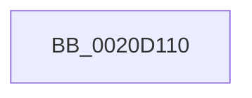

# KeWaitForMultipleObjects

- RVA: `0x0020D110`–`0x0020D168` (길이 `88` bytes)
- VA: `0x000000014020D110`
- 실행 섹션: `.text`
- PDB 이름 있음: `예`; PDB Function 태그: `예`
- unwind 정보 RVA: `0x0005D910`
- 디코드: `20`개 명령, `88/88` bytes 표시
- 미해석 바이트: `0` (있으면 어셈블리에 `.byte`로 보존)

> 이 문서는 커널 이미지의 기계어와 PDB 기호를 분석해 생성했습니다. 4번과 5번은 함수 원형과 자료형을 바이너리 사용 방식에서 추정한 C 해석이며 원본 소스 복구 결과는 아닙니다.

## 1. Dependencies

- 직접 호출 지점: **0**; 고유 호출 대상: **0**
- 직접 호출자로 확인된 함수: **43**
- RIP 상대 이미지 참조: **1**

### Outgoing calls
- 직접 디코드된 call 명령이 없습니다.

### Direct callers
- [SMKM_STORE&lt;SM_TRAITS&gt;::SmStReadThread](SMKM_STORE_SM_TRAITS_SmStReadThread_function_00203230.md) at `0x002032FF`
- [sub_00206865](Unknown_function_00206865.md) at `0x002068D2`
- [SMKM_STORE_MGR&lt;SM_TRAITS&gt;::SmCompressCtxWorkerThread](../26/SMKM_STORE_MGR_SM_TRAITS_SmCompressCtxWorkerThread_function_00267D20.md) at `0x00267E65`
- [MiWaitForFreePage](../2A/MiWaitForFreePage_function_002A3324.md) at `0x002A34AD`
- [MiBackgroundZeroLocalPages](../31/MiBackgroundZeroLocalPages_function_0031EF30.md) at `0x0031F7B5`
- [MmWaitMultipleForCacheManagerPrefetch](../36/MmWaitMultipleForCacheManagerPrefetch_function_0036D470.md) at `0x0036D5BB`
- [MiRebuildLargePagesThread](../37/MiRebuildLargePagesThread_function_00379AC0.md) at `0x00379BA3`
- [MiRebuildLargePagesThread](../37/MiRebuildLargePagesThread_function_00379AC0.md) at `0x00379C68`
- [MiStoreEvictThread](../3A/MiStoreEvictThread_function_003A42D0.md) at `0x003A43D0`
- [MiStoreEvictThread](../3A/MiStoreEvictThread_function_003A42D0.md) at `0x003A4490`
- [SMKM_STORE_MGR&lt;SM_TRAITS&gt;::SmCompressCtxBalancerThread](../3B/SMKM_STORE_MGR_SM_TRAITS_SmCompressCtxBalancerThread_function_003B22C0.md) at `0x003B2391`
- [CcQueueLazyWriteScanThreadForVolume](../3C/CcQueueLazyWriteScanThreadForVolume_function_003C9AF0.md) at `0x003C9BBD`
- [MiMappedPageWriter](../40/MiMappedPageWriter_function_00404AC0.md) at `0x00404D4A`
- [MiMappedPageWriter](../40/MiMappedPageWriter_function_00404AC0.md) at `0x00404D99`
- [PopSleepDeviceList](../43/PopSleepDeviceList_function_00430460.md) at `0x004305C3`
- [CcAsyncReadWorker](../45/CcAsyncReadWorker_function_0045DB10.md) at `0x0045DC81`
- [MiDereferenceSegmentThread](../46/MiDereferenceSegmentThread_function_00464890.md) at `0x00464983`
- [MiIssueSegmentDereferenceWork](../46/MiIssueSegmentDereferenceWork_function_00464AB0.md) at `0x00464C98`
- [MiModifiedPageWriter](../47/MiModifiedPageWriter_function_0047E5F0.md) at `0x0047E795`
- [MiModifiedPageWriter](../47/MiModifiedPageWriter_function_0047E5F0.md) at `0x0047E94C`
- [PopFxProcessWorkPool](../49/PopFxProcessWorkPool_function_0049E8A0.md) at `0x0049E974`
- [MiWaitForAvailablePages](../4A/MiWaitForAvailablePages_function_004A1DCC.md) at `0x004A1E86`
- [CcAsyncLazywriteWorkerMulti](../4D/CcAsyncLazywriteWorkerMulti_function_004D1574.md) at `0x004D1717`
- [CcAsyncLazywriteWorkerMulti](../4D/CcAsyncLazywriteWorkerMulti_function_004D1574.md) at `0x004D181A`
- [MiWaitForAsynchronousFlushes](../4D/MiWaitForAsynchronousFlushes_function_004D8FC0.md) at `0x004D9058`
- [CcQueueLazyWriteScanThread](../57/CcQueueLazyWriteScanThread_function_0057BBD0.md) at `0x0057BC98`
- [KeBalanceSetManager](../5C/KeBalanceSetManager_function_005C5B30.md) at `0x005C5BD1`
- [DifKeWaitForMultipleObjectsWrapper](../63/DifKeWaitForMultipleObjectsWrapper_function_00633500.md) at `0x00633632`
- [CmSiWaitForMultipleEvents](../66/CmSiWaitForMultipleEvents_function_0066DE98.md) at `0x0066DF12`
- [MiPartitionWorkingSetManager](../67/MiPartitionWorkingSetManager_function_006791E0.md) at `0x00679265`
- [MiZeroNodeConductorWait](../69/MiZeroNodeConductorWait_function_006968E8.md) at `0x0069699C`
- [MiZeroPageThread](../69/MiZeroPageThread_function_00696D80.md) at `0x00696EE0`
- [sub_006DA7D6](../6D/Unknown_function_006DA7D6.md) at `0x006DA83E`
- [PfGenerateTrace](../../page/75/PfGenerateTrace_function_0075101C.md) at `0x007510CE`
- [PsShutdownSystem](../../page/78/PsShutdownSystem_function_00785E94.md) at `0x00785FF1`
- [EtwpCovSampCaptureWorkerThread](../../page/7C/EtwpCovSampCaptureWorkerThread_function_007C19B0.md) at `0x007C1A16`
- [CmpFinishSystemHivesLoad](../../page/7D/CmpFinishSystemHivesLoad_function_007DA210.md) at `0x007DA436`
- [ObWaitForMultipleObjects](../../page/86/ObWaitForMultipleObjects_function_00868DF0.md) at `0x00869130`
- [PiUEventNotifyUserMode](../../page/95/PiUEventNotifyUserMode_function_00954CB4.md) at `0x00955064`
- [PfTLoggingWorker](../../page/97/PfTLoggingWorker_function_0097B140.md) at `0x0097B233`
- [EtwpLogger](../../page/9B/EtwpLogger_function_009BE310.md) at `0x009BE435`
- [FsRtlCancellableWaitForMultipleObjects](../../page/9F/FsRtlCancellableWaitForMultipleObjects_function_009F1EE0.md) at `0x009F1F6A`
- [PopThermalReadCounters](../../page/A0/PopThermalReadCounters_function_00A0E5B8.md) at `0x00A0E6AF`
- [CmpDoFileWrite](../../page/A6/CmpDoFileWrite_function_00A65880.md) at `0x00A65A8E`
- [CmpDoFileWrite](../../page/A6/CmpDoFileWrite_function_00A65880.md) at `0x00A65B0F`
- [CmpDoFileWrite](../../page/A6/CmpDoFileWrite_function_00A65880.md) at `0x00A65B67`
- [CmpDoFileWrite](../../page/A6/CmpDoFileWrite_function_00A65880.md) at `0x00A65BC4`
- [ExpWorkQueueManagerThread](../../page/AF/ExpWorkQueueManagerThread_function_00AF6D60.md) at `0x00AF6EAF`
- [PnprQuiesceWorker](../../pagelk/B6/PnprQuiesceWorker_function_00B654E0.md) at `0x00B65557`
- [MiZeroAllPageFiles](../../pagelk/B7/MiZeroAllPageFiles_function_00B73B2C.md) at `0x00B73D33`
- [KiComputeDispatchInterruptCost](../../init/C3/KiComputeDispatchInterruptCost_function_00C377C0.md) at `0x00C37A00`

### Static image references
- `0x0020D11E` → RVA `0x00E0A740` (`.data`; read)

## 2. Other-region calls and transfers

- 다른 실행 섹션으로 향하는 call: **0**
- call이 아닌 외부 분기/꼬리 이동: **1**
  - `0x0020D166` → [sub_0020D18E](Unknown_function_0020D18E.md) (`tail-transfer`)

## 3. Assembly (complete function range)

```asm
0020D110  40 55                           push rbp
0020D112  56                              push rsi
0020D113  41 54                           push r12
0020D115  41 55                           push r13
0020D117  48 81 EC D8 00 00 00            sub rsp, 0xd8
0020D11E  48 8B 05 1B D6 BF 00            mov rax, qword ptr [rip + 0xbfd61b]
0020D125  48 33 C4                        xor rax, rsp
0020D128  48 89 84 24 B0 00 00 00         mov qword ptr [rsp + 0xb0], rax
0020D130  48 8B 84 24 38 01 00 00         mov rax, qword ptr [rsp + 0x138]
0020D138  33 ED                           xor ebp, ebp
0020D13A  48 8B B4 24 30 01 00 00         mov rsi, qword ptr [rsp + 0x130]
0020D142  45 8B D1                        mov r10d, r9d
0020D145  44 89 8C 24 80 00 00 00         mov dword ptr [rsp + 0x80], r9d
0020D14D  4C 8B E2                        mov r12, rdx
0020D150  48 89 54 24 58                  mov qword ptr [rsp + 0x58], rdx
0020D155  89 4C 24 40                     mov dword ptr [rsp + 0x40], ecx
0020D159  48 89 44 24 70                  mov qword ptr [rsp + 0x70], rax
0020D15E  48 89 6C 24 78                  mov qword ptr [rsp + 0x78], rbp
0020D163  83 F9 01                        cmp ecx, 1
0020D166  74 26                           je 0x14020d18e
```

## 4. C-style interpretation (structured pseudocode)

```c
__int64 __fastcall KeWaitForMultipleObjects(int a1, __int64 a2, __int64 a3, int a4, __int64 a5, __int64 a6, __int64 a7, __int64 a8)
{
    __int64 result;
    __int64 v_rbp;
    __int64 v_rsp;
    unsigned __int64 v_stack_m48;
    unsigned int v_stack_m78;
    unsigned __int64 v_stack_m80;
    unsigned __int64 v_stack_m88;
    unsigned __int64 v_stack_mA0;
    unsigned int v_stack_mB8;

    v_rsp = (v_rsp) - (216);
    result = (*(unsigned __int64 *)(v_rip + 12572187)) ^ (v_rsp);
    v_stack_m48 = result;
    v_rbp = 0;
    v_stack_m78 = a4;
    v_stack_mA0 = a2;
    v_stack_mB8 = a1;
    v_stack_m88 = a8;
    v_stack_m80 = 0;
}
```

## 5. (Beta) C Style

```c
int64_t KeWaitForMultipleObjects(int32_t Arg1, int64_t Arg2, int64_t Arg3, int32_t Arg4, uint64_t Arg5, uint64_t Arg6, int64_t Arg7, int64_t Arg8)
{
    int64_t result;
    int64_t local_rbp;
    int64_t local_rsp;
    uint64_t v_stack_m48;
    uint32_t v_stack_m78;
    uint64_t v_stack_m80;
    uint64_t v_stack_m88;
    uint64_t v_stack_mA0;
    uint32_t v_stack_mB8;

    local_rsp = (local_rsp) - (216);
    result = (*(uint64_t *)(v_rip + 0xBFD61B)) ^ (local_rsp);
    v_stack_m48 = result;
    local_rbp = 0;
    v_stack_m78 = Arg4;
    v_stack_mA0 = Arg2;
    v_stack_mB8 = Arg1;
    v_stack_m88 = Arg8;
    v_stack_m80 = 0;
}
```

## 6. Execution-region graph

[열기: 2D/3D 그래프와 함수 탐색 컨트롤 패널](../../../control-panel.html?section=text&rva=0x0020D110&view=graph)

- 2D 그래프는 위에서 아래로 흐르고, 3D 그래프는 빈 공간을 드래그해 회전합니다. Shift+드래그는 이동, 휠은 확대·축소, 함수 노드 선택은 대상 보고서 이동입니다.

### Static fallback


