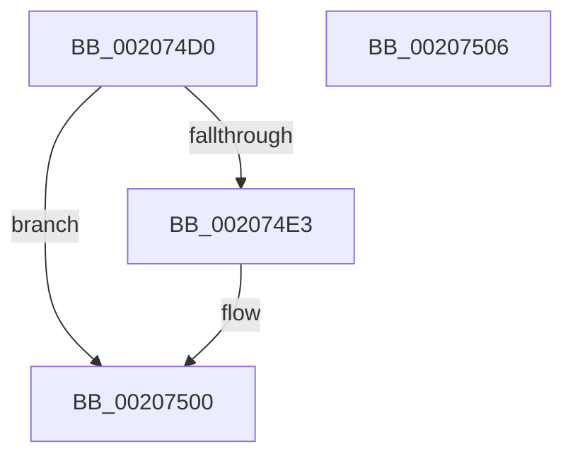

# KiAbQueueAutoBoostDpc

- RVA: `0x002074D0`–`0x00207507` (길이 `55` bytes)
- VA: `0x00000001402074D0`
- 실행 섹션: `.text`
- PDB 이름 있음: `예`; PDB Function 태그: `아니요`
- unwind 정보 RVA: `0x0005CF00`
- 디코드: `14`개 명령, `55/55` bytes 표시
- 미해석 바이트: `0` (있으면 어셈블리에 `.byte`로 보존)

> 이 문서는 커널 이미지의 기계어와 PDB 기호를 분석해 생성했습니다. 4번과 5번은 함수 원형과 자료형을 바이너리 사용 방식에서 추정한 C 해석이며 원본 소스 복구 결과는 아닙니다.

## 1. Dependencies

- 직접 호출 지점: **1**; 고유 호출 대상: **1**
- 직접 호출자로 확인된 함수: **20**
- RIP 상대 이미지 참조: **0**

### Outgoing calls
- `0x002074F0` → [KeInsertQueueDpc](KeInsertQueueDpc_function_00207C50.md) (function, `0x00207C50`)

### Direct callers
- [ExpAcquireResourceSharedLite](../21/ExpAcquireResourceSharedLite_function_00212040.md) at `0x0021321B`
- [ExEnterPriorityRegionAndAcquireResourceShared](../21/ExEnterPriorityRegionAndAcquireResourceShared_function_00213870.md) at `0x00213A7D`
- [sub_002142F9](../21/Unknown_function_002142F9.md) at `0x00214A84`
- [sub_002142F9](../21/Unknown_function_002142F9.md) at `0x00214B2F`
- [sub_00215166](../21/Unknown_function_00215166.md) at `0x002157BF`
- [sub_00215F5C](../21/Unknown_function_00215F5C.md) at `0x00216090`
- [KiAbConvertWaiterToOwnerEntry](../21/KiAbConvertWaiterToOwnerEntry_function_00219430.md) at `0x00219AE6`
- [sub_0021D7F8](../21/Unknown_function_0021D7F8.md) at `0x0021EA70`
- [sub_0021D7F8](../21/Unknown_function_0021D7F8.md) at `0x0021EAB3`
- [sub_0021EFFA](../21/Unknown_function_0021EFFA.md) at `0x0021F040`
- [sub_0021F36F](../21/Unknown_function_0021F36F.md) at `0x0021F5B6`
- [sub_0021F36F](../21/Unknown_function_0021F36F.md) at `0x0021F5E8`
- [KiWakePriQueueWaiter](../21/KiWakePriQueueWaiter_function_0021F720.md) at `0x0021F82A`
- [sub_00220023](../22/Unknown_function_00220023.md) at `0x00220127`
- [sub_00220023](../22/Unknown_function_00220023.md) at `0x00220159`
- [sub_002209D5](../22/Unknown_function_002209D5.md) at `0x00220AD9`
- [sub_002209D5](../22/Unknown_function_002209D5.md) at `0x00220B0B`
- [sub_002546EC](../25/Unknown_function_002546EC.md) at `0x00255171`
- [PsBoostThreadIo](../39/PsBoostThreadIo_function_003927C0.md) at `0x00392892`
- [PsBoostThreadIoEx](../39/PsBoostThreadIoEx_function_00392C00.md) at `0x00392CDF`
- [KeAbProcessBaseIoPriorityChangeInternal](../3C/KeAbProcessBaseIoPriorityChangeInternal_function_003C406C.md) at `0x003C4116`
- [KeSetActualBasePriorityThread](../3C/KeSetActualBasePriorityThread_function_003C4370.md) at `0x003C444C`
- [KiSetBasePriorityAndClearDecrement](../3C/KiSetBasePriorityAndClearDecrement_function_003C6B9C.md) at `0x003C6BFE`
- [PsEnterPriorityRegion](../3F/PsEnterPriorityRegion_function_003F8CD0.md) at `0x003F8E52`
- [sub_0041FC7E](../41/Unknown_function_0041FC7E.md) at `0x0041FCC4`

### Static image references
- 디코드된 RIP-relative 메모리 참조가 없습니다.

## 2. Other-region calls and transfers

- 다른 실행 섹션으로 향하는 call: **0**
- 별도 외부 분기/꼬리 이동을 확인하지 못했습니다.

## 3. Assembly (complete function range)

```asm
002074D0  40 53                           push rbx
002074D2  48 83 EC 20                     sub rsp, 0x20
002074D6  48 83 B9 A0 91 00 00 00         cmp qword ptr [rcx + 0x91a0], 0
002074DE  48 8B D9                        mov rbx, rcx
002074E1  75 1D                           jne 0x140207500
002074E3  48 81 C1 80 91 00 00            add rcx, 0x9180
002074EA  45 33 C0                        xor r8d, r8d
002074ED  48 8B D3                        mov rdx, rbx
002074F0  E8 5B 07 00 00                  call 0x140207c50
002074F5  48 C7 83 A0 91 00 00 01 00 00 00  mov qword ptr [rbx + 0x91a0], 1
00207500  48 83 C4 20                     add rsp, 0x20
00207504  5B                              pop rbx
00207505  C3                              ret
00207506  CC                              int3
```

## 4. C-style interpretation (structured pseudocode)

```c
__int64 __fastcall KiAbQueueAutoBoostDpc(__int64 a1, __int64 a2, int a3)
{
    __int64 result;
    __int64 v_rsp;

    v_rsp = (v_rsp) - (32);
    if ((*(unsigned __int64 *)(a1 + 37280)) == 0) {
        a1 = (a1) + (0x9180ULL);
        a3 = 0;
        a2 = a1;
        result = KeInsertQueueDpc(a1, a2, a3, a4);
        *(unsigned __int64 *)(a1 + 37280) = 1;
    }
    v_rsp = (v_rsp) + (32);
    return result;
}
```

## 5. (Beta) C Style

```c
int64_t KiAbQueueAutoBoostDpc(void *Arg1, int64_t Arg2, int32_t Arg3)
{
    uint8_t *arg1 = (uint8_t *)Arg1;

    int64_t result;
    int64_t local_rsp;

    local_rsp = (local_rsp) - (32);
    if ((*(uint64_t *)(arg1 + 0x91A0)) == 0) {
        Arg1 = (Arg1) + (0x9180ULL);
        Arg3 = 0;
        Arg2 = Arg1;
        result = KeInsertQueueDpc(Arg1, Arg2, Arg3, a4);
        *(uint64_t *)(arg1 + 0x91A0) = 1;
    }
    local_rsp = (local_rsp) + (32);
    return result;
}
```

### 관측된 메모리 오프셋

구조체 형식이 확인되지 않은 접근은 인자 기준의 오프셋으로만 기록했습니다.

| 기준 인자 | 오프셋 표현 | 폭 (bit) | 접근 |
|---|---:|---:|---|
| `Arg1` | `+ 0x91A0` | `64` | `R` |
| `Arg1` | `+ 0x91A0` | `64` | `W` |

## 6. Execution-region graph

[열기: 2D/3D 그래프와 함수 탐색 컨트롤 패널](../../../control-panel.html?section=text&rva=0x002074D0&view=graph)

- 2D 그래프는 위에서 아래로 흐르고, 3D 그래프는 빈 공간을 드래그해 회전합니다. Shift+드래그는 이동, 휠은 확대·축소, 함수 노드 선택은 대상 보고서 이동입니다.

### Static fallback


