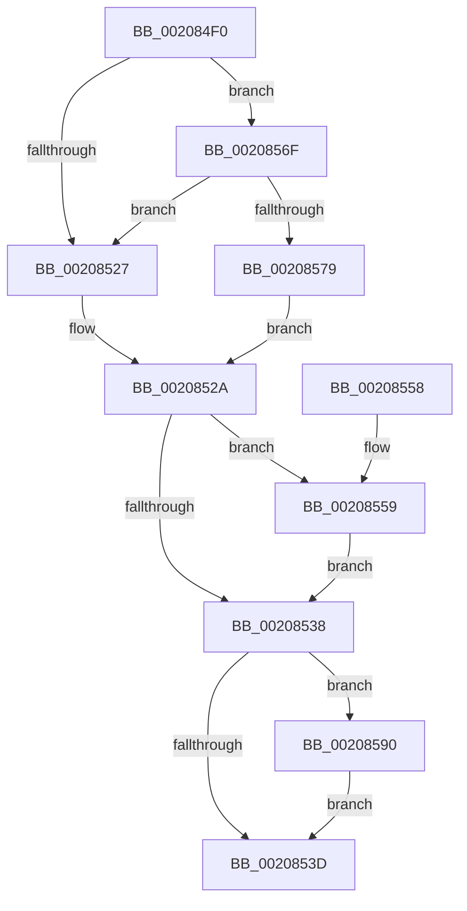

# KiAcquireSpinLockInstrumented

- RVA: `0x002084F0`–`0x002085B5` (길이 `197` bytes)
- VA: `0x00000001402084F0`
- 실행 섹션: `.text`
- PDB 이름 있음: `예`; PDB Function 태그: `아니요`
- unwind 정보 RVA: `0x0005D378`
- 디코드: `53`개 명령, `197/197` bytes 표시
- 미해석 바이트: `0` (있으면 어셈블리에 `.byte`로 보존)

> 이 문서는 커널 이미지의 기계어와 PDB 기호를 분석해 생성했습니다. 4번과 5번은 함수 원형과 자료형을 바이너리 사용 방식에서 추정한 C 해석이며 원본 소스 복구 결과는 아닙니다.

## 1. Dependencies

- 직접 호출 지점: **2**; 고유 호출 대상: **2**
- 직접 호출자로 확인된 함수: **30**
- RIP 상대 이미지 참조: **2**

### Outgoing calls
- `0x00208559` → [KxWaitForSpinLockAndAcquire](KxWaitForSpinLockAndAcquire_function_002085C0.md) (function, `0x002085C0`)
- `0x002085AE` → [PerfLogSpinLockAcquire](../41/PerfLogSpinLockAcquire_function_00414FC4.md) (function, `0x00414FC4`)

### Direct callers
- [sub_00206E35](Unknown_function_00206E35.md) at `0x00206E89`
- [sub_00206E35](Unknown_function_00206E35.md) at `0x00206F81`
- [sub_00207169](Unknown_function_00207169.md) at `0x002071AD`
- [sub_002073F4](Unknown_function_002073F4.md) at `0x00207425`
- [IopQueueThreadIrp](IopQueueThreadIrp_function_002075C0.md) at `0x00207619`
- [sub_00207B41](Unknown_function_00207B41.md) at `0x00207B7A`
- [sub_00207D3E](Unknown_function_00207D3E.md) at `0x00207DA3`
- [KeAcquireSpinLockAtDpcLevel](KeAcquireSpinLockAtDpcLevel_function_00208430.md) at `0x00208447`
- [KeAcquireSpinLockRaiseToDpc](KeAcquireSpinLockRaiseToDpc_function_00208470.md) at `0x002084A9`
- [sub_00208A9F](Unknown_function_00208A9F.md) at `0x00208AAD`
- [IoRemoveIoCompletion](IoRemoveIoCompletion_function_0020B580.md) at `0x0020B8BD`
- [ExpSetTimerObject](../23/ExpSetTimerObject_function_00231730.md) at `0x00231815`
- [ExpSetTimerObject](../23/ExpSetTimerObject_function_00231730.md) at `0x00231841`
- [ExpSetTimerObject](../23/ExpSetTimerObject_function_00231730.md) at `0x00231925`
- [sub_00235B5D](../23/Unknown_function_00235B5D.md) at `0x00235BAD`
- [KiExecuteAllDpcs](../25/KiExecuteAllDpcs_function_0025B740.md) at `0x0025B8CC`
- [PopFxActivateComponentDependents](../2B/PopFxActivateComponentDependents_function_002BE9F0.md) at `0x002BEA53`
- [PpmUpdatePerformanceFeedback](../2D/PpmUpdatePerformanceFeedback_function_002DE580.md) at `0x002DE690`
- [EtwpApcPoolThunk](../2F/EtwpApcPoolThunk_function_002FA090.md) at `0x002FA135`
- [sub_0034DA7E](../34/Unknown_function_0034DA7E.md) at `0x0034DAC4`
- [IopFreeWaitCompletionPacket](../35/IopFreeWaitCompletionPacket_function_00351A50.md) at `0x00351AB2`
- [ExpUpdateTimerResolution](../39/ExpUpdateTimerResolution_function_003914A0.md) at `0x003914F9`
- [KeSetTimer2](../3A/KeSetTimer2_function_003A08E0.md) at `0x003A0A79`
- [KiAcquireTimer2CollectionLockIfInserted](../3A/KiAcquireTimer2CollectionLockIfInserted_function_003A1150.md) at `0x003A118D`
- [sub_003A1A0C](../3A/Unknown_function_003A1A0C.md) at `0x003A1A21`
- [EtwpLockBufferList](../3E/EtwpLockBufferList_function_003EB49C.md) at `0x003EB4EC`
- [EtwpTraceStackKey](../3F/EtwpTraceStackKey_function_003FC290.md) at `0x003FC38E`
- [ExGenRandom](../41/ExGenRandom_function_0041B010.md) at `0x0041B066`
- [sub_004313E9](../43/Unknown_function_004313E9.md) at `0x00431443`
- [sub_00433766](../43/Unknown_function_00433766.md) at `0x0043382D`
- [HalpPCIAcquireConfigSpaceLock](../43/HalpPCIAcquireConfigSpaceLock_function_004394CC.md) at `0x00439515`
- [KeAcquireInterruptSpinLock](../44/KeAcquireInterruptSpinLock_function_0044B9F0.md) at `0x0044BA2D`
- [BgpFwAcquireLock](../4B/BgpFwAcquireLock_function_004B3AA4.md) at `0x004B3AFC`

### Static image references
- `0x00208515` → RVA `0x00FC6B06` (`ALMOSTRO`; read)
- `0x0020856F` → RVA `0x00F0DE58` (`.data`; read)

## 2. Other-region calls and transfers

- 다른 실행 섹션으로 향하는 call: **0**
- 별도 외부 분기/꼬리 이동을 확인하지 못했습니다.

## 3. Assembly (complete function range)

```asm
002084F0  48 89 5C 24 08                  mov qword ptr [rsp + 8], rbx
002084F5  48 89 6C 24 10                  mov qword ptr [rsp + 0x10], rbp
002084FA  48 89 74 24 18                  mov qword ptr [rsp + 0x18], rsi
002084FF  48 89 7C 24 20                  mov qword ptr [rsp + 0x20], rdi
00208504  41 56                           push r14
00208506  48 83 EC 30                     sub rsp, 0x30
0020850A  65 48 8B 1C 25 20 00 00 00      mov rbx, qword ptr gs:[0x20]
00208513  33 F6                           xor esi, esi
00208515  F6 05 EA E5 DB 00 01            test byte ptr [rip + 0xdbe5ea], 1
0020851C  48 8B F9                        mov rdi, rcx
0020851F  44 8B F6                        mov r14d, esi
00208522  44 8B CE                        mov r9d, esi
00208525  75 48                           jne 0x14020856f
00208527  40 32 ED                        xor bpl, bpl
0020852A  FF 83 C0 8E 00 00               inc dword ptr [rbx + 0x8ec0]
00208530  F0 48 0F BA 29 00               lock bts qword ptr [rcx], 0
00208536  72 21                           jb 0x140208559
00208538  40 84 ED                        test bpl, bpl
0020853B  75 53                           jne 0x140208590
0020853D  48 8B 5C 24 40                  mov rbx, qword ptr [rsp + 0x40]
00208542  48 8B 6C 24 48                  mov rbp, qword ptr [rsp + 0x48]
00208547  48 8B 74 24 50                  mov rsi, qword ptr [rsp + 0x50]
0020854C  48 8B 7C 24 58                  mov rdi, qword ptr [rsp + 0x58]
00208551  48 83 C4 30                     add rsp, 0x30
00208555  41 5E                           pop r14
00208557  C3                              ret
00208558  CC                              int3
00208559  E8 62 00 00 00                  call 0x1402085c0
0020855E  FF 83 C4 8E 00 00               inc dword ptr [rbx + 0x8ec4]
00208564  44 8B C8                        mov r9d, eax
00208567  01 83 C8 8E 00 00               add dword ptr [rbx + 0x8ec8], eax
0020856D  EB C9                           jmp 0x140208538
0020856F  8B 05 E3 58 D0 00               mov eax, dword ptr [rip + 0xd058e3]
00208575  85 C0                           test eax, eax
00208577  75 AE                           jne 0x140208527
00208579  40 B5 01                        mov bpl, 1
0020857C  0F 31                           rdtsc
0020857E  8B B3 40 86 00 00               mov esi, dword ptr [rbx + 0x8640]
00208584  48 C1 E2 20                     shl rdx, 0x20
00208588  48 0B C2                        or rax, rdx
0020858B  4C 8B F0                        mov r14, rax
0020858E  EB 9A                           jmp 0x14020852a
00208590  0F 31                           rdtsc
00208592  48 C1 E2 20                     shl rdx, 0x20
00208596  48 8B CF                        mov rcx, rdi
00208599  48 0B C2                        or rax, rdx
0020859C  C6 44 24 28 00                  mov byte ptr [rsp + 0x28], 0
002085A1  44 8B C0                        mov r8d, eax
002085A4  89 74 24 20                     mov dword ptr [rsp + 0x20], esi
002085A8  45 2B C6                        sub r8d, r14d
002085AB  48 8B D0                        mov rdx, rax
002085AE  E8 11 CA 20 00                  call 0x140414fc4
002085B3  EB 88                           jmp 0x14020853d
```

## 4. C-style interpretation (structured pseudocode)

```c
__int64 __fastcall KiAcquireSpinLockInstrumented(__int64 a1, __int64 a2)
{
    __int64 result;
    __int64 v_rbp;
    __int64 v_rsi;
    __int64 v_rsp;
    unsigned __int64 v_stack_p10;
    unsigned __int64 v_stack_p18;
    unsigned __int64 v_stack_p20;
    unsigned __int8 v_stack_p28;
    unsigned __int64 v_stack_p8;

    v_stack_p8 = v_rbx;
    v_stack_p10 = v_rbp;
    v_stack_p18 = v_rsi;
    v_stack_p20 = v_rdi;
    v_rsp = (v_rsp) - (48);
    v_rsi = 0;
    if (((*(unsigned __int8 *)(v_rip + 14411242)) & (1)) != 0) goto loc_0020856F;
loc_00208527:
    v_rbp = 0;
loc_0020852A:
    if (condition_is_below) goto loc_00208559;
loc_00208538:
    if (0 != 0) goto loc_00208590;
loc_0020853D:
    v_rsp = (v_rsp) + (48);
    return result;
loc_00208559:
    result = KxWaitForSpinLockAndAcquire(a1, a2, a3, 0);
    goto loc_00208538;
loc_0020856F:
    if ((unsigned int)((unsigned int)(*(unsigned int *)(v_rip + 13654243))) != 0) goto loc_00208527;
    a2 = (a2) << (32);
    result = ((unsigned int)(*(unsigned int *)(v_rip + 13654243))) | (a2);
    goto loc_0020852A;
loc_00208590:
    a2 = (a2) << (32);
    result = (result) | (a2);
    v_stack_p28 = 0;
    v_stack_p20 = (unsigned int)((unsigned int)(*(unsigned int *)(v_stack_p8 + 34368)));
    a3 = (unsigned int)(((unsigned int)((unsigned int)(result))) - ((unsigned int)(result)));
    result = PerfLogSpinLockAcquire(v_stack_p20, result, a3, (unsigned int)((unsigned int)(result)));
    goto loc_0020853D;
}
```

## 5. (Beta) C Style

```c
int64_t KiAcquireSpinLockInstrumented(void *Arg1, int64_t Arg2)
{
    uint8_t *arg1 = (uint8_t *)Arg1;

    int64_t result;
    int64_t local_rbp;
    int64_t local_rsi;
    int64_t local_rsp;
    uint64_t v_stack_p10;
    uint64_t v_stack_p18;
    uint64_t v_stack_p20;
    uint8_t v_stack_p28;
    uint64_t v_stack_p8;

    v_stack_p8 = local_rbx;
    v_stack_p10 = local_rbp;
    v_stack_p18 = local_rsi;
    v_stack_p20 = local_rdi;
    local_rsp = (local_rsp) - (48);
    local_rsi = 0;
    if (((*(uint8_t *)(v_rip + 0xDBE5EA)) & (1)) != 0) goto loc_0020856F;
loc_00208527:
    local_rbp = 0;
loc_0020852A:
    if (condition_is_below) goto loc_00208559;
loc_00208538:
    if (0 != 0) goto loc_00208590;
loc_0020853D:
    local_rsp = (local_rsp) + (48);
    return result;
loc_00208559:
    result = KxWaitForSpinLockAndAcquire(Arg1, Arg2, a3, 0);
    goto loc_00208538;
loc_0020856F:
    if ((uint32_t)((uint32_t)(*(uint32_t *)(v_rip + 0xD058E3))) != 0) goto loc_00208527;
    Arg2 = (Arg2) << (32);
    result = ((uint32_t)(*(uint32_t *)(v_rip + 0xD058E3))) | (Arg2);
    goto loc_0020852A;
loc_00208590:
    Arg2 = (Arg2) << (32);
    result = (result) | (Arg2);
    v_stack_p28 = 0;
    v_stack_p20 = (uint32_t)((uint32_t)(*(uint32_t *)(v_stack_p8 + 0x8640)));
    a3 = (uint32_t)(((uint32_t)((uint32_t)(result))) - ((uint32_t)(result)));
    result = PerfLogSpinLockAcquire(v_stack_p20, result, a3, (uint32_t)((uint32_t)(result)));
    goto loc_0020853D;
}
```

### 관측된 메모리 오프셋

구조체 형식이 확인되지 않은 접근은 인자 기준의 오프셋으로만 기록했습니다.

| 기준 인자 | 오프셋 표현 | 폭 (bit) | 접근 |
|---|---:|---:|---|
| `Arg1` | `+ 0x0` | `64` | `R/W` |

## 6. Execution-region graph

[열기: 2D/3D 그래프와 함수 탐색 컨트롤 패널](../../../control-panel.html?section=text&rva=0x002084F0&view=graph)

- 2D 그래프는 위에서 아래로 흐르고, 3D 그래프는 빈 공간을 드래그해 회전합니다. Shift+드래그는 이동, 휠은 확대·축소, 함수 노드 선택은 대상 보고서 이동입니다.

### Static fallback


