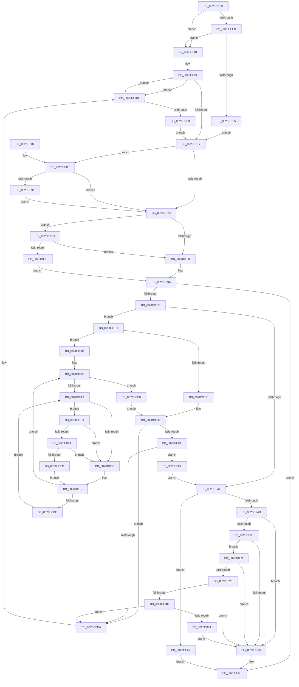

# KiActivateWaiterQueueWithNoLocks

- RVA: `0x0020CEB0`–`0x0020D106` (길이 `598` bytes)
- VA: `0x000000014020CEB0`
- 실행 섹션: `.text`
- PDB 이름 있음: `예`; PDB Function 태그: `아니요`
- unwind 정보 RVA: `0x0005D8F8`
- 디코드: `155`개 명령, `598/598` bytes 표시
- 미해석 바이트: `0` (있으면 어셈블리에 `.byte`로 보존)

> 이 문서는 커널 이미지의 기계어와 PDB 기호를 분석해 생성했습니다. 4번과 5번은 함수 원형과 자료형을 바이너리 사용 방식에서 추정한 C 해석이며 원본 소스 복구 결과는 아닙니다.

## 1. Dependencies

- 직접 호출 지점: **9**; 고유 호출 대상: **9**
- 직접 호출자로 확인된 함수: **4**
- RIP 상대 이미지 참조: **5**

### Outgoing calls
- `0x0020CEFA` → [ExpAcquireSpinLockSharedAtDpcLevelInstrumented](../27/ExpAcquireSpinLockSharedAtDpcLevelInstrumented_function_0027CD20.md) (function, `0x0027CD20`)
- `0x0020CF88` → [KiAcquireKobjectLockSafe](../25/KiAcquireKobjectLockSafe_function_00251C90.md) (function, `0x00251C90`)
- `0x0020CFAA` → [KiActivateWaiterKQueue](../3C/KiActivateWaiterKQueue_function_003C6950.md) (function, `0x003C6950`)
- `0x0020CFE8` → [ExpWaitForSpinLockSharedAndAcquire](../36/ExpWaitForSpinLockSharedAndAcquire_function_00362380.md) (function, `0x00362380`)
- `0x0020D017` → [KiAttemptFastRemovePriQueue](../3C/KiAttemptFastRemovePriQueue_function_003C6AA0.md) (function, `0x003C6AA0`)
- `0x0020D03F` → [KiWakePriQueueWaiter](../21/KiWakePriQueueWaiter_function_0021F720.md) (function, `0x0021F720`)
- `0x0020D093` → [ExpReleaseSpinLockSharedFromDpcLevelInstrumented](../2F/ExpReleaseSpinLockSharedFromDpcLevelInstrumented_function_002F0F48.md) (function, `0x002F0F48`)
- `0x0020D0F4` → [KiCheckVpBackingLongSpinWaitHypercall](../30/KiCheckVpBackingLongSpinWaitHypercall_function_0030F490.md) (function, `0x0030F490`)
- `0x0020D0FF` → [HvlNotifyLongSpinWait](../30/HvlNotifyLongSpinWait_function_0030F460.md) (function, `0x0030F460`)

### Direct callers
- [sub_0020BDAA](Unknown_function_0020BDAA.md) at `0x0020BFAB`
- [KeTerminateThread](../35/KeTerminateThread_function_00355138.md) at `0x0035528A`
- [KiPriQueueThreadPriorityChanged](../3C/KiPriQueueThreadPriorityChanged_function_003C4640.md) at `0x003C4709`
- [KiSwitchPriQueue](../3C/KiSwitchPriQueue_function_003C6DC0.md) at `0x003C6EA0`

### Static image references
- `0x0020CEC7` → RVA `0x00FD2D80` (`CACHEALI`; read)
- `0x0020CEE2` → RVA `0x00FC6B06` (`ALMOSTRO`; read)
- `0x0020CEEB` → RVA `0x00F0DE58` (`.data`; read)
- `0x0020D0AB` → RVA `0x00FC52AC` (`ALMOSTRO`; reference)
- `0x0020D0EA` → RVA `0x00FC6AB8` (`ALMOSTRO`; read)

## 2. Other-region calls and transfers

- 다른 실행 섹션으로 향하는 call: **0**
- 별도 외부 분기/꼬리 이동을 확인하지 못했습니다.

## 3. Assembly (complete function range)

```asm
0020CEB0  48 89 5C 24 10                  mov qword ptr [rsp + 0x10], rbx
0020CEB5  48 89 6C 24 18                  mov qword ptr [rsp + 0x18], rbp
0020CEBA  48 89 74 24 20                  mov qword ptr [rsp + 0x20], rsi
0020CEBF  57                              push rdi
0020CEC0  48 83 EC 20                     sub rsp, 0x20
0020CEC4  48 8B DA                        mov rbx, rdx
0020CEC7  48 8D 05 B2 5E DC 00            lea rax, [rip + 0xdc5eb2]
0020CECE  48 C1 EB 04                     shr rbx, 4
0020CED2  49 8B F0                        mov rsi, r8
0020CED5  83 E3 3F                        and ebx, 0x3f
0020CED8  48 8B E9                        mov rbp, rcx
0020CEDB  48 C1 E3 06                     shl rbx, 6
0020CEDF  48 03 D8                        add rbx, rax
0020CEE2  F6 05 1D 9C DB 00 21            test byte ptr [rip + 0xdb9c1d], 0x21
0020CEE9  74 16                           je 0x14020cf01
0020CEEB  8B 05 67 0F D0 00               mov eax, dword ptr [rip + 0xd00f67]
0020CEF1  85 C0                           test eax, eax
0020CEF3  75 0C                           jne 0x14020cf01
0020CEF5  B2 FF                           mov dl, 0xff
0020CEF7  48 8B CB                        mov rcx, rbx
0020CEFA  E8 21 FE 06 00                  call 0x14027cd20
0020CEFF  EB 16                           jmp 0x14020cf17
0020CF01  0F 0D 0B                        prefetchw byte ptr [rbx]
0020CF04  8B 03                           mov eax, dword ptr [rbx]
0020CF06  0F BA F0 1F                     btr eax, 0x1f
0020CF0A  8D 48 01                        lea ecx, [rax + 1]
0020CF0D  F0 0F B1 0B                     lock cmpxchg dword ptr [rbx], ecx
0020CF11  0F 85 C4 00 00 00               jne 0x14020cfdb
0020CF17  48 8B BD E8 00 00 00            mov rdi, qword ptr [rbp + 0xe8]
0020CF1E  48 85 FF                        test rdi, rdi
0020CF21  75 62                           jne 0x14020cf85
0020CF23  F6 05 DC 9B DB 00 01            test byte ptr [rip + 0xdb9bdc], 1
0020CF2A  0F 85 4D 01 00 00               jne 0x14020d07d
0020CF30  F0 81 23 FF FF FF BF            lock and dword ptr [rbx], 0xbfffffff
0020CF37  F0 FF 0B                        lock dec dword ptr [rbx]
0020CF3A  48 85 FF                        test rdi, rdi
0020CF3D  74 30                           je 0x14020cf6f
0020CF3F  48 85 F6                        test rsi, rsi
0020CF42  75 6D                           jne 0x14020cfb1
0020CF44  0F B6 07                        movzx eax, byte ptr [rdi]
0020CF47  24 7F                           and al, 0x7f
0020CF49  3C 15                           cmp al, 0x15
0020CF4B  75 5A                           jne 0x14020cfa7
0020CF4D  48 8D 47 08                     lea rax, [rdi + 8]
0020CF51  C7 44 24 30 00 00 00 00         mov dword ptr [rsp + 0x30], 0
0020CF59  48 39 00                        cmp qword ptr [rax], rax
0020CF5C  74 0A                           je 0x14020cf68
0020CF5E  83 7F 04 00                     cmp dword ptr [rdi + 4], 0
0020CF62  0F 85 A1 00 00 00               jne 0x14020d009
0020CF68  F0 81 27 7F FF FF FF            lock and dword ptr [rdi], 0xffffff7f
0020CF6F  48 8B 5C 24 38                  mov rbx, qword ptr [rsp + 0x38]
0020CF74  48 8B 6C 24 40                  mov rbp, qword ptr [rsp + 0x40]
0020CF79  48 8B 74 24 48                  mov rsi, qword ptr [rsp + 0x48]
0020CF7E  48 83 C4 20                     add rsp, 0x20
0020CF82  5F                              pop rdi
0020CF83  C3                              ret
0020CF84  CC                              int3
0020CF85  48 8B CF                        mov rcx, rdi
0020CF88  E8 03 4D 04 00                  call 0x140251c90
0020CF8D  48 8B 85 E8 00 00 00            mov rax, qword ptr [rbp + 0xe8]
0020CF94  48 85 C0                        test rax, rax
0020CF97  75 8A                           jne 0x14020cf23
0020CF99  F0 81 27 7F FF FF FF            lock and dword ptr [rdi], 0xffffff7f
0020CFA0  33 FF                           xor edi, edi
0020CFA2  E9 7C FF FF FF                  jmp 0x14020cf23
0020CFA7  48 8B CF                        mov rcx, rdi
0020CFAA  E8 A1 99 1B 00                  call 0x1403c6950
0020CFAF  EB BE                           jmp 0x14020cf6f
0020CFB1  0F B6 07                        movzx eax, byte ptr [rdi]
0020CFB4  24 7F                           and al, 0x7f
0020CFB6  3C 15                           cmp al, 0x15
0020CFB8  0F 84 DF 00 00 00               je 0x14020d09d
0020CFBE  F0 FF 4F 28                     lock dec dword ptr [rdi + 0x28]
0020CFC2  48 8B 0E                        mov rcx, qword ptr [rsi]
0020CFC5  48 8B 46 08                     mov rax, qword ptr [rsi + 8]
0020CFC9  48 39 71 08                     cmp qword ptr [rcx + 8], rsi
0020CFCD  75 05                           jne 0x14020cfd4
0020CFCF  48 39 30                        cmp qword ptr [rax], rsi
0020CFD2  74 1E                           je 0x14020cff2
0020CFD4  B9 03 00 00 00                  mov ecx, 3
0020CFD9  CD 29                           int 0x29
0020CFDB  85 C0                           test eax, eax
0020CFDD  0F 89 27 FF FF FF               jns 0x14020cf0a
0020CFE3  B2 FF                           mov dl, 0xff
0020CFE5  48 8B CB                        mov rcx, rbx
0020CFE8  E8 93 53 15 00                  call 0x140362380
0020CFED  E9 25 FF FF FF                  jmp 0x14020cf17
0020CFF2  48 89 08                        mov qword ptr [rax], rcx
0020CFF5  48 89 41 08                     mov qword ptr [rcx + 8], rax
0020CFF9  48 C7 85 E8 00 00 00 00 00 00 00  mov qword ptr [rbp + 0xe8], 0
0020D004  E9 3B FF FF FF                  jmp 0x14020cf44
0020D009  41 B8 FF FF FF FF               mov r8d, 0xffffffff
0020D00F  48 8D 54 24 30                  lea rdx, [rsp + 0x30]
0020D014  48 8B CF                        mov rcx, rdi
0020D017  E8 84 9A 1B 00                  call 0x1403c6aa0
0020D01C  48 8B D8                        mov rbx, rax
0020D01F  48 85 C0                        test rax, rax
0020D022  0F 84 40 FF FF FF               je 0x14020cf68
0020D028  65 48 8B 0C 25 20 00 00 00      mov rcx, qword ptr gs:[0x20]
0020D031  4C 8B C0                        mov r8, rax
0020D034  48 63 74 24 30                  movsxd rsi, dword ptr [rsp + 0x30]
0020D039  48 8B D7                        mov rdx, rdi
0020D03C  44 8B CE                        mov r9d, esi
0020D03F  E8 DC 26 01 00                  call 0x14021f720
0020D044  84 C0                           test al, al
0020D046  0F 85 1C FF FF FF               jne 0x14020cf68
0020D04C  FF 47 04                        inc dword ptr [rdi + 4]
0020D04F  48 8B CE                        mov rcx, rsi
0020D052  48 C1 E1 04                     shl rcx, 4
0020D056  48 83 C1 18                     add rcx, 0x18
0020D05A  48 03 CF                        add rcx, rdi
0020D05D  48 8B 01                        mov rax, qword ptr [rcx]
0020D060  48 39 48 08                     cmp qword ptr [rax + 8], rcx
0020D064  0F 85 6A FF FF FF               jne 0x14020cfd4
0020D06A  48 89 03                        mov qword ptr [rbx], rax
0020D06D  48 89 4B 08                     mov qword ptr [rbx + 8], rcx
0020D071  48 89 58 08                     mov qword ptr [rax + 8], rbx
0020D075  48 89 19                        mov qword ptr [rcx], rbx
0020D078  E9 EB FE FF FF                  jmp 0x14020cf68
0020D07D  8B 05 D5 0D D0 00               mov eax, dword ptr [rip + 0xd00dd5]
0020D083  85 C0                           test eax, eax
0020D085  0F 85 A5 FE FF FF               jne 0x14020cf30
0020D08B  48 8B 54 24 28                  mov rdx, qword ptr [rsp + 0x28]
0020D090  48 8B CB                        mov rcx, rbx
0020D093  E8 B0 3E 0E 00                  call 0x1402f0f48
0020D098  E9 9D FE FF FF                  jmp 0x14020cf3a
0020D09D  33 DB                           xor ebx, ebx
0020D09F  90                              nop
0020D0A0  F0 48 0F BA 6D 40 00            lock bts qword ptr [rbp + 0x40], 0
0020D0A7  73 17                           jae 0x14020d0c0
0020D0A9  FF C3                           inc ebx
0020D0AB  85 1D FB 81 DB 00               test dword ptr [rip + 0xdb81fb], ebx
0020D0B1  74 37                           je 0x14020d0ea
0020D0B3  F3 90                           pause
0020D0B5  48 8B 45 40                     mov rax, qword ptr [rbp + 0x40]
0020D0B9  48 85 C0                        test rax, rax
0020D0BC  74 E2                           je 0x14020d0a0
0020D0BE  EB E9                           jmp 0x14020d0a9
0020D0C0  8B 85 1C 02 00 00               mov eax, dword ptr [rbp + 0x21c]
0020D0C6  0F B6 C0                        movzx eax, al
0020D0C9  8B C8                           mov ecx, eax
0020D0CB  0F BA E8 08                     bts eax, 8
0020D0CF  89 85 1C 02 00 00               mov dword ptr [rbp + 0x21c], eax
0020D0D5  F0 FF 8C 8F 18 02 00 00         lock dec dword ptr [rdi + rcx*4 + 0x218]
0020D0DD  48 C7 45 40 00 00 00 00         mov qword ptr [rbp + 0x40], 0
0020D0E5  E9 D8 FE FF FF                  jmp 0x14020cfc2
0020D0EA  8B 05 C8 99 DB 00               mov eax, dword ptr [rip + 0xdb99c8]
0020D0F0  A8 40                           test al, 0x40
0020D0F2  74 BF                           je 0x14020d0b3
0020D0F4  E8 97 23 10 00                  call 0x14030f490
0020D0F9  84 C0                           test al, al
0020D0FB  74 B6                           je 0x14020d0b3
0020D0FD  8B CB                           mov ecx, ebx
0020D0FF  E8 5C 23 10 00                  call 0x14030f460
0020D104  EB AF                           jmp 0x14020d0b5
```

## 4. C-style interpretation (structured pseudocode)

```c
__int64 __fastcall KiActivateWaiterQueueWithNoLocks(__int64 a1, __int64 a2, __int64 a3)
{
    __int64 result;
    __int64 v_rbx;
    __int64 v_rdi;
    __int64 v_rsp;
    unsigned __int64 v_stack_p10;
    unsigned __int64 v_stack_p18;
    unsigned __int64 v_stack_p20;
    unsigned __int64 v_stack_p28;
    unsigned __int64 v_stack_p30;
    unsigned int v_stack_p8;

    v_stack_p10 = v_rbx;
    v_stack_p18 = v_rbp;
    v_stack_p20 = v_rsi;
    v_rsp = (v_rsp) - (32);
    v_rbx = (a2) >> (4);
    v_rbx = (unsigned int)((v_rbx) & (63));
    v_rbx = (v_rbx) << (6);
    v_rbx = (v_rbx) + (v_rip + 14442162);
    if (((*(unsigned __int8 *)(v_rip + 14392349)) & (33)) == 0) goto loc_0020CF01;
    if ((unsigned int)((unsigned int)(*(unsigned int *)(v_rip + 13635431))) != 0) goto loc_0020CF01;
    result = ExpAcquireSpinLockSharedAtDpcLevelInstrumented(v_rbx, 255, a3, a4);
    goto loc_0020CF17;
loc_0020CF01:
loc_0020CF0A:
    if ((unsigned int)((unsigned int)(*(unsigned int *)(v_rip + 13635431))) != 0) goto loc_0020CFDB;
loc_0020CF17:
    if (*(unsigned __int64 *)(a1 + 232) != 0) goto loc_0020CF85;
loc_0020CF23:
    if (((*(unsigned __int8 *)(v_rip + 14392284)) & (1)) != 0) goto loc_0020D07D;
loc_0020CF30:
loc_0020CF3A:
    if (*(unsigned __int64 *)(a1 + 232) == 0) goto loc_0020CF6F;
    if (a3 != 0) goto loc_0020CFB1;
loc_0020CF44:
    result = (unsigned __int8)((*(unsigned __int8 *)(*(unsigned __int64 *)(a1 + 232))) & (127));
    if (((unsigned __int8)(result)) != 21) goto loc_0020CFA7;
    v_stack_p8 = 0;
    if ((*(unsigned __int64 *)(*(unsigned __int64 *)(a1 + 232) + 8)) == (*(unsigned __int64 *)(a1 + 232) + 8)) goto loc_0020CF68;
    if ((*(unsigned int *)(*(unsigned __int64 *)(a1 + 232) + 4)) != 0) goto loc_0020D009;
loc_0020CF68:
loc_0020CF6F:
    v_rsp = (v_rsp) + (32);
    return *(unsigned __int64 *)(a1 + 232) + 8;
loc_0020CF85:
    result = KiAcquireKobjectLockSafe(*(unsigned __int64 *)(a1 + 232), 255, a3, a4);
    if (*(unsigned __int64 *)(v_stack_p18 + 232) != 0) goto loc_0020CF23;
    v_rdi = 0;
    goto loc_0020CF23;
loc_0020CFA7:
    result = KiActivateWaiterKQueue(0, 255, a3, a4);
    goto loc_0020CF6F;
loc_0020CFB1:
    result = (unsigned __int8)((*(unsigned __int8 *)(v_rdi)) & (127));
    if (((unsigned __int8)(result)) == 21) goto loc_0020D09D;
loc_0020CFC2:
    if ((*(unsigned __int64 *)(*(unsigned __int64 *)(v_stack_p20) + 8)) != v_stack_p20) goto loc_0020CFD4;
    if ((*(unsigned __int64 *)(*(unsigned __int64 *)(v_stack_p20 + 8))) == v_stack_p20) goto loc_0020CFF2;
loc_0020CFD4:
loc_0020CFDB:
    if (!sign_flag) goto loc_0020CF0A;
    result = ExpWaitForSpinLockSharedAndAcquire(v_stack_p10, 255, a3, a4);
    goto loc_0020CF17;
loc_0020CFF2:
    *(unsigned __int64 *)(result) = v_stack_p10;
    *(unsigned __int64 *)(v_stack_p10 + 8) = result;
    *(unsigned __int64 *)(v_stack_p18 + 232) = 0;
    goto loc_0020CF44;
loc_0020D009:
    result = KiAttemptFastRemovePriQueue(0, v_stack_p30, (unsigned int)(0xFFFFFFFFULL), a4);
    if (result == 0) goto loc_0020CF68;
    result = KiWakePriQueueWaiter(*(unsigned __int64 *)(gs_base + (0 + 32)), 0, result, (unsigned int)((unsigned int)((int)(v_stack_p30))));
    if ((unsigned __int8)(result) != 0) goto loc_0020CF68;
    a1 = ((int)(v_stack_p30)) << (4);
    a1 = (a1) + (24);
    a1 = (a1) + (0);
    if ((*(unsigned __int64 *)(*(unsigned __int64 *)(a1) + 8)) != a1) goto loc_0020CFD4;
    *(unsigned __int64 *)(result) = *(unsigned __int64 *)(a1);
    *(unsigned __int64 *)(result + 8) = a1;
    *(unsigned __int64 *)(*(unsigned __int64 *)(a1) + 8) = result;
    *(unsigned __int64 *)(a1) = result;
    goto loc_0020CF68;
loc_0020D07D:
    if ((unsigned int)((unsigned int)(*(unsigned int *)(v_rip + 13635029))) != 0) goto loc_0020CF30;
    result = ExpReleaseSpinLockSharedFromDpcLevelInstrumented(result, v_stack_p28, result, (unsigned int)((unsigned int)((int)(v_stack_p30))));
    goto loc_0020CF3A;
loc_0020D09D:
    v_rbx = 0;
loc_0020D0A0:
    if (condition_is_above_or_equal) goto loc_0020D0C0;
loc_0020D0A9:
    v_rbx = (unsigned int)((v_rbx) + 1);
    if (((*(unsigned int *)(v_rip + 14385659)) & ((unsigned int)(v_rbx))) == 0) goto loc_0020D0EA;
loc_0020D0B3:
loc_0020D0B5:
    if (*(unsigned __int64 *)(v_stack_p18 + 64) == 0) goto loc_0020D0A0;
    goto loc_0020D0A9;
loc_0020D0C0:
    *(unsigned int *)(v_stack_p18 + 540) = (unsigned int)((unsigned __int8)((unsigned int)(*(unsigned int *)(v_stack_p18 + 540))));
    *(unsigned __int64 *)(v_stack_p18 + 64) = 0;
    goto loc_0020CFC2;
loc_0020D0EA:
    if ((((unsigned __int8)((unsigned int)(*(unsigned int *)(v_rip + 14391752)))) & (64)) == 0) goto loc_0020D0B3;
    result = KiCheckVpBackingLongSpinWaitHypercall((unsigned int)((unsigned int)((unsigned __int8)((unsigned int)(*(unsigned int *)(v_stack_p18 + 540))))), v_stack_p28, result, (unsigned int)((unsigned int)((int)(v_stack_p30))));
    if ((unsigned __int8)(result) == 0) goto loc_0020D0B3;
    result = HvlNotifyLongSpinWait((unsigned int)((unsigned int)(v_rbx)), v_stack_p28, result, (unsigned int)((unsigned int)((int)(v_stack_p30))));
    goto loc_0020D0B5;
}
```

## 5. (Beta) C Style

```c
int64_t KiActivateWaiterQueueWithNoLocks(void *Arg1, int64_t Arg2, int64_t Arg3)
{
    uint8_t *arg1 = (uint8_t *)Arg1;

    int64_t result;
    int64_t local_rbx;
    int64_t local_rdi;
    int64_t local_rsp;
    uint64_t v_stack_p10;
    uint64_t v_stack_p18;
    uint64_t v_stack_p20;
    uint64_t v_stack_p28;
    uint64_t v_stack_p30;
    uint32_t v_stack_p8;

    v_stack_p10 = local_rbx;
    v_stack_p18 = local_rbp;
    v_stack_p20 = local_rsi;
    local_rsp = (local_rsp) - (32);
    local_rbx = (Arg2) >> (4);
    local_rbx = (uint32_t)((local_rbx) & (63));
    local_rbx = (local_rbx) << (6);
    local_rbx = (local_rbx) + (v_rip + 14442162);
    if (((*(uint8_t *)(v_rip + 0xDB9C1D)) & (33)) == 0) goto loc_0020CF01;
    if ((uint32_t)((uint32_t)(*(uint32_t *)(v_rip + 0xD00F67))) != 0) goto loc_0020CF01;
    result = ExpAcquireSpinLockSharedAtDpcLevelInstrumented(local_rbx, 255, Arg3, a4);
    goto loc_0020CF17;
loc_0020CF01:
loc_0020CF0A:
    if ((uint32_t)((uint32_t)(*(uint32_t *)(v_rip + 0xD00F67))) != 0) goto loc_0020CFDB;
loc_0020CF17:
    if (*(uint64_t *)(arg1 + 0xE8) != 0) goto loc_0020CF85;
loc_0020CF23:
    if (((*(uint8_t *)(v_rip + 0xDB9BDC)) & (1)) != 0) goto loc_0020D07D;
loc_0020CF30:
loc_0020CF3A:
    if (*(uint64_t *)(arg1 + 0xE8) == 0) goto loc_0020CF6F;
    if (Arg3 != 0) goto loc_0020CFB1;
loc_0020CF44:
    result = (uint8_t)((*(uint8_t *)(*(uint64_t *)(arg1 + 0xE8))) & (127));
    if (((uint8_t)(result)) != 21) goto loc_0020CFA7;
    v_stack_p8 = 0;
    if ((*(uint64_t *)(*(uint64_t *)(arg1 + 0xE8) + 0x8)) == (*(uint64_t *)(arg1 + 0xE8) + 8)) goto loc_0020CF68;
    if ((*(uint32_t *)(*(uint64_t *)(arg1 + 0xE8) + 0x4)) != 0) goto loc_0020D009;
loc_0020CF68:
loc_0020CF6F:
    local_rsp = (local_rsp) + (32);
    return *(uint64_t *)(arg1 + 0xE8) + 8;
loc_0020CF85:
    result = KiAcquireKobjectLockSafe(*(uint64_t *)(arg1 + 0xE8), 255, Arg3, a4);
    if (*(uint64_t *)(v_stack_p18 + 0xE8) != 0) goto loc_0020CF23;
    local_rdi = 0;
    goto loc_0020CF23;
loc_0020CFA7:
    result = KiActivateWaiterKQueue(0, 255, Arg3, a4);
    goto loc_0020CF6F;
loc_0020CFB1:
    result = (uint8_t)((*(uint8_t *)(local_rdi)) & (127));
    if (((uint8_t)(result)) == 21) goto loc_0020D09D;
loc_0020CFC2:
    if ((*(uint64_t *)(*(uint64_t *)(v_stack_p20) + 0x8)) != v_stack_p20) goto loc_0020CFD4;
    if ((*(uint64_t *)(*(uint64_t *)(v_stack_p20 + 0x8))) == v_stack_p20) goto loc_0020CFF2;
loc_0020CFD4:
loc_0020CFDB:
    if (!sign_flag) goto loc_0020CF0A;
    result = ExpWaitForSpinLockSharedAndAcquire(v_stack_p10, 255, Arg3, a4);
    goto loc_0020CF17;
loc_0020CFF2:
    *(uint64_t *)(result) = v_stack_p10;
    *(uint64_t *)(v_stack_p10 + 0x8) = result;
    *(uint64_t *)(v_stack_p18 + 0xE8) = 0;
    goto loc_0020CF44;
loc_0020D009:
    result = KiAttemptFastRemovePriQueue(0, v_stack_p30, (uint32_t)(0xFFFFFFFFULL), a4);
    if (result == 0) goto loc_0020CF68;
    result = KiWakePriQueueWaiter(*(uint64_t *)(gs_base + (0 + 0x20)), 0, result, (uint32_t)((uint32_t)((int32_t)(v_stack_p30))));
    if ((uint8_t)(result) != 0) goto loc_0020CF68;
    Arg1 = ((int32_t)(v_stack_p30)) << (4);
    Arg1 = (Arg1) + (24);
    Arg1 = (Arg1) + (0);
    if ((*(uint64_t *)(*(uint64_t *)(arg1) + 0x8)) != Arg1) goto loc_0020CFD4;
    *(uint64_t *)(result) = *(uint64_t *)(arg1);
    *(void **)(result + 0x8) = Arg1;
    *(uint64_t *)(*(uint64_t *)(arg1) + 0x8) = result;
    *(uint64_t *)(arg1) = result;
    goto loc_0020CF68;
loc_0020D07D:
    if ((uint32_t)((uint32_t)(*(uint32_t *)(v_rip + 0xD00DD5))) != 0) goto loc_0020CF30;
    result = ExpReleaseSpinLockSharedFromDpcLevelInstrumented(result, v_stack_p28, result, (uint32_t)((uint32_t)((int32_t)(v_stack_p30))));
    goto loc_0020CF3A;
loc_0020D09D:
    local_rbx = 0;
loc_0020D0A0:
    if (condition_is_above_or_equal) goto loc_0020D0C0;
loc_0020D0A9:
    local_rbx = (uint32_t)((local_rbx) + 1);
    if (((*(uint32_t *)(v_rip + 0xDB81FB)) & ((uint32_t)(local_rbx))) == 0) goto loc_0020D0EA;
loc_0020D0B3:
loc_0020D0B5:
    if (*(uint64_t *)(v_stack_p18 + 0x40) == 0) goto loc_0020D0A0;
    goto loc_0020D0A9;
loc_0020D0C0:
    *(uint32_t *)(v_stack_p18 + 0x21C) = (uint32_t)((uint8_t)((uint32_t)(*(uint32_t *)(v_stack_p18 + 0x21C))));
    *(uint64_t *)(v_stack_p18 + 0x40) = 0;
    goto loc_0020CFC2;
loc_0020D0EA:
    if ((((uint8_t)((uint32_t)(*(uint32_t *)(v_rip + 0xDB99C8)))) & (64)) == 0) goto loc_0020D0B3;
    result = KiCheckVpBackingLongSpinWaitHypercall((uint32_t)((uint32_t)((uint8_t)((uint32_t)(*(uint32_t *)(v_stack_p18 + 0x21C))))), v_stack_p28, result, (uint32_t)((uint32_t)((int32_t)(v_stack_p30))));
    if ((uint8_t)(result) == 0) goto loc_0020D0B3;
    result = HvlNotifyLongSpinWait((uint32_t)((uint32_t)(local_rbx)), v_stack_p28, result, (uint32_t)((uint32_t)((int32_t)(v_stack_p30))));
    goto loc_0020D0B5;
}
```

### 관측된 메모리 오프셋

구조체 형식이 확인되지 않은 접근은 인자 기준의 오프셋으로만 기록했습니다.

| 기준 인자 | 오프셋 표현 | 폭 (bit) | 접근 |
|---|---:|---:|---|
| `Arg1` | `+ 0x40` | `64` | `R` |
| `Arg1` | `+ 0x40` | `64` | `R/W` |
| `Arg1` | `+ 0x40` | `64` | `W` |
| `Arg1` | `+ 0xE8` | `64` | `R` |
| `Arg1` | `+ 0xE8` | `64` | `W` |
| `Arg1` | `+ 0x21C` | `32` | `R` |
| `Arg1` | `+ 0x21C` | `32` | `W` |

## 6. Execution-region graph

[열기: 2D/3D 그래프와 함수 탐색 컨트롤 패널](../../../control-panel.html?section=text&rva=0x0020CEB0&view=graph)

- 2D 그래프는 위에서 아래로 흐르고, 3D 그래프는 빈 공간을 드래그해 회전합니다. Shift+드래그는 이동, 휠은 확대·축소, 함수 노드 선택은 대상 보고서 이동입니다.

### Static fallback


