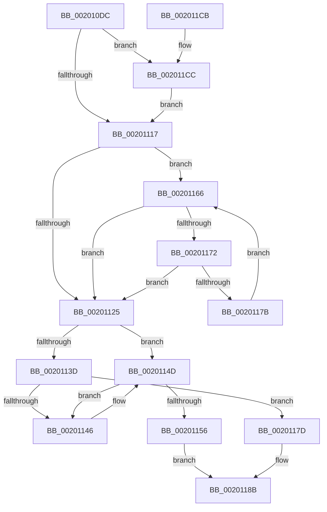

# KiAddThreadToScbQueue

- RVA: `0x002010DC`–`0x002011DF` (길이 `259` bytes)
- VA: `0x00000001402010DC`
- 실행 섹션: `.text`
- PDB 이름 있음: `예`; PDB Function 태그: `아니요`
- unwind 정보 RVA: `0x0005C70C`
- 디코드: `69`개 명령, `259/259` bytes 표시
- 미해석 바이트: `0` (있으면 어셈블리에 `.byte`로 보존)

> 이 문서는 커널 이미지의 기계어와 PDB 기호를 분석해 생성했습니다. 4번과 5번은 함수 원형과 자료형을 바이너리 사용 방식에서 추정한 C 해석이며 원본 소스 복구 결과는 아닙니다.

## 1. Dependencies

- 직접 호출 지점: **2**; 고유 호출 대상: **2**
- 직접 호출자로 확인된 함수: **5**
- RIP 상대 이미지 참조: **0**

### Outgoing calls
- `0x0020111A` → [KiUpdateVpBackingThreadPriorityOnReadyQueueInsertion](../21/KiUpdateVpBackingThreadPriorityOnReadyQueueInsertion_function_0021D360.md) (function, `0x0021D360`)
- `0x002011AB` → [KiInsertNonMaxOverQuotaScb](KiInsertNonMaxOverQuotaScb_function_00201374.md) (function, `0x00201374`)

### Direct callers
- [KiDeferGroupSchedulingPreemption](KiDeferGroupSchedulingPreemption_function_0020076C.md) at `0x00200E6C`
- [KiQueueReadyThread](../21/KiQueueReadyThread_function_0021C7B0.md) at `0x0021CC95`
- [sub_00254461](../25/Unknown_function_00254461.md) at `0x0025469A`
- [KiSearchForNewThreadsForRescheduleContext](../25/KiSearchForNewThreadsForRescheduleContext_function_00258620.md) at `0x002597CA`
- [KiAttemptToScheduleThreadToBusyIsolationUnit](../25/KiAttemptToScheduleThreadToBusyIsolationUnit_function_00259B00.md) at `0x0025A7DE`

### Static image references
- 디코드된 RIP-relative 메모리 참조가 없습니다.

## 2. Other-region calls and transfers

- 다른 실행 섹션으로 향하는 call: **0**
- 별도 외부 분기/꼬리 이동을 확인하지 못했습니다.

## 3. Assembly (complete function range)

```asm
002010DC  48 8B C4                        mov rax, rsp
002010DF  48 89 58 08                     mov qword ptr [rax + 8], rbx
002010E3  48 89 68 10                     mov qword ptr [rax + 0x10], rbp
002010E7  48 89 70 18                     mov qword ptr [rax + 0x18], rsi
002010EB  48 89 78 20                     mov qword ptr [rax + 0x20], rdi
002010EF  41 56                           push r14
002010F1  48 83 EC 20                     sub rsp, 0x20
002010F5  41 F7 40 78 00 00 40 00         test dword ptr [r8 + 0x78], 0x400000
002010FD  41 8B F1                        mov esi, r9d
00201100  41 0F BE A8 C3 00 00 00         movsx ebp, byte ptr [r8 + 0xc3]
00201108  49 8B F8                        mov rdi, r8
0020110B  48 8B DA                        mov rbx, rdx
0020110E  4C 8B F1                        mov r14, rcx
00201111  0F 85 B5 00 00 00               jne 0x1402011cc
00201117  48 8B CF                        mov rcx, rdi
0020111A  E8 41 C2 01 00                  call 0x14021d360
0020111F  83 7B 7C 00                     cmp dword ptr [rbx + 0x7c], 0
00201123  74 41                           je 0x140201166
00201125  8B D5                           mov edx, ebp
00201127  48 8D 8F D8 00 00 00            lea rcx, [rdi + 0xd8]
0020112E  48 83 C2 09                     add rdx, 9
00201132  48 C1 E2 04                     shl rdx, 4
00201136  48 03 D3                        add rdx, rbx
00201139  85 F6                           test esi, esi
0020113B  74 10                           je 0x14020114d
0020113D  48 8B 02                        mov rax, qword ptr [rdx]
00201140  48 39 50 08                     cmp qword ptr [rax + 8], rdx
00201144  74 37                           je 0x14020117d
00201146  B9 03 00 00 00                  mov ecx, 3
0020114B  CD 29                           int 0x29
0020114D  48 8B 42 08                     mov rax, qword ptr [rdx + 8]
00201151  48 39 10                        cmp qword ptr [rax], rdx
00201154  75 F0                           jne 0x140201146
00201156  48 89 11                        mov qword ptr [rcx], rdx
00201159  48 89 41 08                     mov qword ptr [rcx + 8], rax
0020115D  48 89 08                        mov qword ptr [rax], rcx
00201160  48 89 4A 08                     mov qword ptr [rdx + 8], rcx
00201164  EB 25                           jmp 0x14020118b
00201166  48 8B 83 A0 01 00 00            mov rax, qword ptr [rbx + 0x1a0]
0020116D  48 85 C0                        test rax, rax
00201170  74 B3                           je 0x140201125
00201172  83 78 7C 00                     cmp dword ptr [rax + 0x7c], 0
00201176  48 8B D8                        mov rbx, rax
00201179  75 AA                           jne 0x140201125
0020117B  EB E9                           jmp 0x140201166
0020117D  48 89 01                        mov qword ptr [rcx], rax
00201180  48 89 51 08                     mov qword ptr [rcx + 8], rdx
00201184  48 89 48 08                     mov qword ptr [rax + 8], rcx
00201188  48 89 0A                        mov qword ptr [rdx], rcx
0020118B  0F BA 6F 74 0D                  bts dword ptr [rdi + 0x74], 0xd
00201190  41 B0 01                        mov r8b, 1
00201193  48 89 9F B0 03 00 00            mov qword ptr [rdi + 0x3b0], rbx
0020119A  49 8B D6                        mov rdx, r14
0020119D  0F B7 43 78                     movzx eax, word ptr [rbx + 0x78]
002011A1  48 8B CB                        mov rcx, rbx
002011A4  0F AB E8                        bts eax, ebp
002011A7  66 89 43 78                     mov word ptr [rbx + 0x78], ax
002011AB  E8 C4 01 00 00                  call 0x140201374
002011B0  48 8B 5C 24 30                  mov rbx, qword ptr [rsp + 0x30]
002011B5  48 8B 6C 24 38                  mov rbp, qword ptr [rsp + 0x38]
002011BA  48 8B 74 24 40                  mov rsi, qword ptr [rsp + 0x40]
002011BF  48 8B 7C 24 48                  mov rdi, qword ptr [rsp + 0x48]
002011C4  48 83 C4 20                     add rsp, 0x20
002011C8  41 5E                           pop r14
002011CA  C3                              ret
002011CB  CC                              int3
002011CC  49 8B 80 C8 03 00 00            mov rax, qword ptr [r8 + 0x3c8]
002011D3  F0 81 08 00 00 04 00            lock or dword ptr [rax], 0x40000
002011DA  E9 38 FF FF FF                  jmp 0x140201117
```

## 4. C-style interpretation (structured pseudocode)

```c
__int64 __fastcall KiAddThreadToScbQueue(__int64 a1, __int64 a2, __int64 a3, int a4)
{
    __int64 result;
    __int64 v_rsp;
    unsigned __int64 v_stack_p10;
    unsigned __int64 v_stack_p18;
    unsigned __int64 v_stack_p20;
    unsigned __int64 v_stack_p8;

    *(unsigned __int64 *)(v_rsp + 8) = v_rbx;
    *(unsigned __int64 *)(v_rsp + 16) = v_rbp;
    *(unsigned __int64 *)(v_rsp + 24) = v_rsi;
    *(unsigned __int64 *)(v_rsp + 32) = v_rdi;
    v_rsp = (v_rsp) - (32);
    if (((*(unsigned int *)(a3 + 120)) & (0x400000ULL)) != 0) goto loc_002011CC;
loc_00201117:
    result = KiUpdateVpBackingThreadPriorityOnReadyQueueInsertion(a3, a2, a3, a4);
    if ((*(unsigned int *)(a2 + 124)) == 0) goto loc_00201166;
loc_00201125:
    a2 = ((unsigned int)((unsigned int)((__int8)(*(unsigned __int8 *)(a3 + 195))))) + (9);
    a2 = (a2) << (4);
    a2 = (a2) + (a2);
    if ((unsigned int)((unsigned int)(a4)) == 0) goto loc_0020114D;
    if ((*(unsigned __int64 *)(*(unsigned __int64 *)(a2) + 8)) == a2) goto loc_0020117D;
loc_00201146:
loc_0020114D:
    if ((*(unsigned __int64 *)(*(unsigned __int64 *)(a2 + 8))) != a2) goto loc_00201146;
    *(unsigned __int64 *)(3) = a2;
    *(unsigned __int64 *)(3 + 8) = *(unsigned __int64 *)(a2 + 8);
    *(unsigned __int64 *)(*(unsigned __int64 *)(a2 + 8)) = 3;
    *(unsigned __int64 *)(a2 + 8) = 3;
    goto loc_0020118B;
loc_00201166:
    if (*(unsigned __int64 *)(a2 + 416) == 0) goto loc_00201125;
    if ((*(unsigned int *)(*(unsigned __int64 *)(a2 + 416) + 124)) != 0) goto loc_00201125;
    goto loc_00201166;
loc_0020117D:
    *(unsigned __int64 *)(3) = *(unsigned __int64 *)(a2 + 416);
    *(unsigned __int64 *)(3 + 8) = a2;
    *(unsigned __int64 *)(*(unsigned __int64 *)(a2 + 416) + 8) = 3;
    *(unsigned __int64 *)(a2) = 3;
loc_0020118B:
    *(unsigned __int64 *)(a3 + 944) = *(unsigned __int64 *)(a2 + 416);
    *(unsigned __int16 *)(*(unsigned __int64 *)(a2 + 416) + 120) = (unsigned __int16)(*(unsigned __int16 *)(*(unsigned __int64 *)(a2 + 416) + 120));
    result = KiInsertNonMaxOverQuotaScb(*(unsigned __int64 *)(a2 + 416), a1, 1, a4);
    v_rsp = (v_rsp) + (32);
    return result;
loc_002011CC:
    goto loc_00201117;
}
```

## 5. (Beta) C Style

```c
int64_t KiAddThreadToScbQueue(int64_t Arg1, void *Arg2, void *Arg3, int32_t Arg4)
{
    uint8_t *arg2 = (uint8_t *)Arg2;
    uint8_t *arg3 = (uint8_t *)Arg3;

    int64_t result;
    int64_t local_rsp;
    uint64_t v_stack_p10;
    uint64_t v_stack_p18;
    uint64_t v_stack_p20;
    uint64_t v_stack_p8;

    *(uint64_t *)(local_rsp + 0x8) = local_rbx;
    *(uint64_t *)(local_rsp + 0x10) = local_rbp;
    *(uint64_t *)(local_rsp + 0x18) = local_rsi;
    *(uint64_t *)(local_rsp + 0x20) = local_rdi;
    local_rsp = (local_rsp) - (32);
    if (((*(uint32_t *)(arg3 + 0x78)) & (0x400000ULL)) != 0) goto loc_002011CC;
loc_00201117:
    result = KiUpdateVpBackingThreadPriorityOnReadyQueueInsertion(Arg3, Arg2, Arg3, Arg4);
    if ((*(uint32_t *)(arg2 + 0x7C)) == 0) goto loc_00201166;
loc_00201125:
    Arg2 = ((uint32_t)((uint32_t)((int8_t)(*(uint8_t *)(arg3 + 0xC3))))) + (9);
    Arg2 = (Arg2) << (4);
    Arg2 = (Arg2) + (Arg2);
    if ((uint32_t)((uint32_t)(Arg4)) == 0) goto loc_0020114D;
    if ((*(uint64_t *)(*(uint64_t *)(arg2) + 0x8)) == Arg2) goto loc_0020117D;
loc_00201146:
loc_0020114D:
    if ((*(uint64_t *)(*(uint64_t *)(arg2 + 0x8))) != Arg2) goto loc_00201146;
    *(void **)(3) = Arg2;
    *(uint64_t *)(3 + 0x8) = *(uint64_t *)(arg2 + 0x8);
    *(uint64_t *)(*(uint64_t *)(arg2 + 0x8)) = 3;
    *(uint64_t *)(arg2 + 0x8) = 3;
    goto loc_0020118B;
loc_00201166:
    if (*(uint64_t *)(arg2 + 0x1A0) == 0) goto loc_00201125;
    if ((*(uint32_t *)(*(uint64_t *)(arg2 + 0x1A0) + 0x7C)) != 0) goto loc_00201125;
    goto loc_00201166;
loc_0020117D:
    *(uint64_t *)(3) = *(uint64_t *)(arg2 + 0x1A0);
    *(void **)(3 + 0x8) = Arg2;
    *(uint64_t *)(*(uint64_t *)(arg2 + 0x1A0) + 0x8) = 3;
    *(uint64_t *)(arg2) = 3;
loc_0020118B:
    *(uint64_t *)(arg3 + 0x3B0) = *(uint64_t *)(arg2 + 0x1A0);
    *(uint16_t *)(*(uint64_t *)(arg2 + 0x1A0) + 0x78) = (uint16_t)(*(uint16_t *)(*(uint64_t *)(arg2 + 0x1A0) + 0x78));
    result = KiInsertNonMaxOverQuotaScb(*(uint64_t *)(arg2 + 0x1A0), Arg1, 1, Arg4);
    local_rsp = (local_rsp) + (32);
    return result;
loc_002011CC:
    goto loc_00201117;
}
```

### 관측된 메모리 오프셋

구조체 형식이 확인되지 않은 접근은 인자 기준의 오프셋으로만 기록했습니다.

| 기준 인자 | 오프셋 표현 | 폭 (bit) | 접근 |
|---|---:|---:|---|
| `Arg2` | `+ 0x7C` | `32` | `R` |
| `Arg3` | `+ 0x0` | `64` | `W` |
| `Arg3` | `+ 0x8` | `64` | `W` |
| `Arg3` | `+ 0x74` | `32` | `R/W` |
| `Arg3` | `+ 0x78` | `32` | `R` |
| `Arg3` | `+ 0xC3` | `8` | `R` |
| `Arg3` | `+ 0xD8` | `64` | `R` |
| `Arg3` | `+ 0x3B0` | `64` | `W` |
| `Arg3` | `+ 0x3C8` | `64` | `R` |

## 6. Execution-region graph

[열기: 2D/3D 그래프와 함수 탐색 컨트롤 패널](../../../control-panel.html?section=text&rva=0x002010DC&view=graph)

- 2D 그래프는 위에서 아래로 흐르고, 3D 그래프는 빈 공간을 드래그해 회전합니다. Shift+드래그는 이동, 휠은 확대·축소, 함수 노드 선택은 대상 보고서 이동입니다.

### Static fallback


