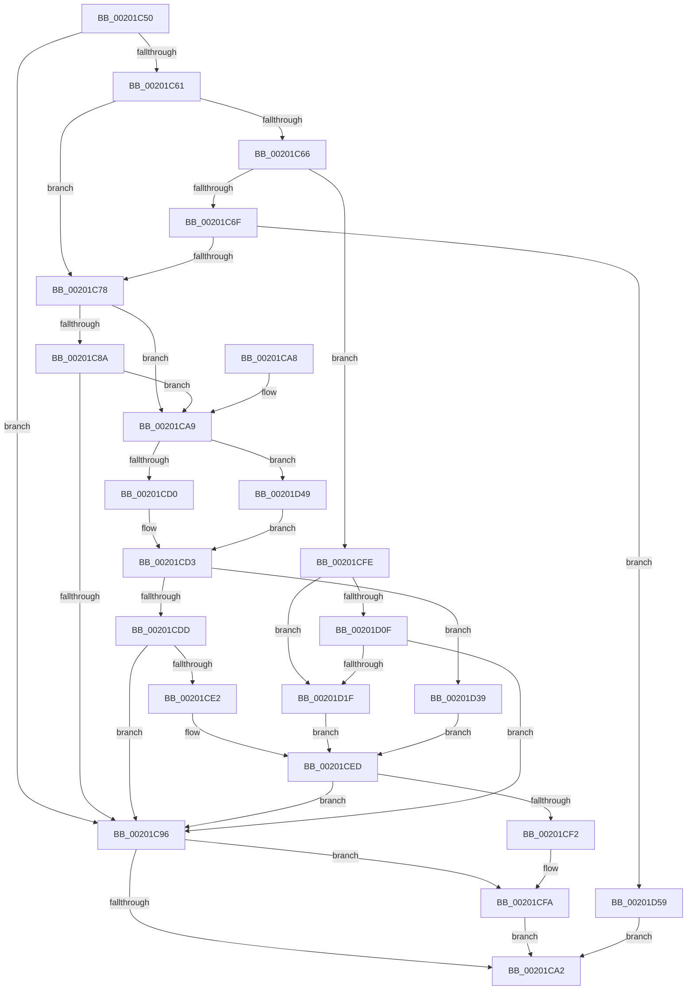

# KiAdvanceReadyQueueEnumeratorToNextList

- RVA: `0x00201C50`–`0x00201D63` (길이 `275` bytes)
- VA: `0x0000000140201C50`
- 실행 섹션: `.text`
- PDB 이름 있음: `예`; PDB Function 태그: `아니요`
- unwind 정보 RVA: `0x0005C88C`
- 디코드: `84`개 명령, `275/275` bytes 표시
- 미해석 바이트: `0` (있으면 어셈블리에 `.byte`로 보존)

> 이 문서는 커널 이미지의 기계어와 PDB 기호를 분석해 생성했습니다. 4번과 5번은 함수 원형과 자료형을 바이너리 사용 방식에서 추정한 C 해석이며 원본 소스 복구 결과는 아닙니다.

## 1. Dependencies

- 직접 호출 지점: **3**; 고유 호출 대상: **3**
- 직접 호출자로 확인된 함수: **3**
- RIP 상대 이미지 참조: **0**

### Outgoing calls
- `0x00201C8D` → [KiAdvanceReadyQueueEnumeratorToNextProcessor](KiAdvanceReadyQueueEnumeratorToNextProcessor_function_002021BC.md) (function, `0x002021BC`)
- `0x00201C99` → [KiAdvanceReadyQueueEnumeratorToNextPhase](KiAdvanceReadyQueueEnumeratorToNextPhase_function_00201D70.md) (function, `0x00201D70`)
- `0x00201D12` → [KiAdvanceReadyQueueEnumeratorToNextScb](KiAdvanceReadyQueueEnumeratorToNextScb_function_0020227C.md) (function, `0x0020227C`)

### Direct callers
- [sub_00201929](Unknown_function_00201929.md) at `0x0020193D`
- [KiSearchForNewThreadsForRescheduleContext](../25/KiSearchForNewThreadsForRescheduleContext_function_00258620.md) at `0x00258CBC`
- [KiSearchForNewThreadsForRescheduleContext](../25/KiSearchForNewThreadsForRescheduleContext_function_00258620.md) at `0x002592B0`
- [KiSearchForNewThreadsForRescheduleContext](../25/KiSearchForNewThreadsForRescheduleContext_function_00258620.md) at `0x0025940F`
- [KiAttemptToScheduleThreadToBusyIsolationUnit](../25/KiAttemptToScheduleThreadToBusyIsolationUnit_function_00259B00.md) at `0x0025A840`
- [KiAttemptToScheduleThreadToBusyIsolationUnit](../25/KiAttemptToScheduleThreadToBusyIsolationUnit_function_00259B00.md) at `0x0025AE04`

### Static image references
- 디코드된 RIP-relative 메모리 참조가 없습니다.

## 2. Other-region calls and transfers

- 다른 실행 섹션으로 향하는 call: **0**
- 별도 외부 분기/꼬리 이동을 확인하지 못했습니다.

## 3. Assembly (complete function range)

```asm
00201C50  40 53                           push rbx
00201C52  48 83 EC 20                     sub rsp, 0x20
00201C56  48 8B D9                        mov rbx, rcx
00201C59  0F B6 49 0D                     movzx ecx, byte ptr [rcx + 0xd]
00201C5D  85 C9                           test ecx, ecx
00201C5F  74 35                           je 0x140201c96
00201C61  83 E9 01                        sub ecx, 1
00201C64  74 12                           je 0x140201c78
00201C66  83 E9 01                        sub ecx, 1
00201C69  0F 84 8F 00 00 00               je 0x140201cfe
00201C6F  83 E9 01                        sub ecx, 1
00201C72  0F 85 E1 00 00 00               jne 0x140201d59
00201C78  0F B6 4B 0B                     movzx ecx, byte ptr [rbx + 0xb]
00201C7C  0F B6 43 0C                     movzx eax, byte ptr [rbx + 0xc]
00201C80  0F B3 C1                        btr ecx, eax
00201C83  88 4B 0B                        mov byte ptr [rbx + 0xb], cl
00201C86  84 C9                           test cl, cl
00201C88  75 1F                           jne 0x140201ca9
00201C8A  48 8B CB                        mov rcx, rbx
00201C8D  E8 2A 05 00 00                  call 0x1402021bc
00201C92  85 C0                           test eax, eax
00201C94  79 13                           jns 0x140201ca9
00201C96  48 8B CB                        mov rcx, rbx
00201C99  E8 D2 00 00 00                  call 0x140201d70
00201C9E  85 C0                           test eax, eax
00201CA0  79 58                           jns 0x140201cfa
00201CA2  48 83 C4 20                     add rsp, 0x20
00201CA6  5B                              pop rbx
00201CA7  C3                              ret
00201CA8  CC                              int3
00201CA9  0F B6 43 0A                     movzx eax, byte ptr [rbx + 0xa]
00201CAD  44 0F B6 43 08                  movzx r8d, byte ptr [rbx + 8]
00201CB2  48 FF C0                        inc rax
00201CB5  48 8D 0C 40                     lea rcx, [rax + rax*2]
00201CB9  48 03 C9                        add rcx, rcx
00201CBC  48 8B 14 CB                     mov rdx, qword ptr [rbx + rcx*8]
00201CC0  4C 8B 4C CB 08                  mov r9, qword ptr [rbx + rcx*8 + 8]
00201CC5  0F B6 4B 0B                     movzx ecx, byte ptr [rbx + 0xb]
00201CC9  8D 41 FF                        lea eax, [rcx - 1]
00201CCC  85 C1                           test ecx, eax
00201CCE  75 79                           jne 0x140201d49
00201CD0  0F BC C1                        bsf eax, ecx
00201CD3  88 43 0C                        mov byte ptr [rbx + 0xc], al
00201CD6  0F B6 C8                        movzx ecx, al
00201CD9  84 C0                           test al, al
00201CDB  74 5C                           je 0x140201d39
00201CDD  83 F9 01                        cmp ecx, 1
00201CE0  75 B4                           jne 0x140201c96
00201CE2  49 8D 40 04                     lea rax, [r8 + 4]
00201CE6  48 C1 E0 04                     shl rax, 4
00201CEA  49 03 C1                        add rax, r9
00201CED  48 85 C0                        test rax, rax
00201CF0  74 A4                           je 0x140201c96
00201CF2  48 89 43 20                     mov qword ptr [rbx + 0x20], rax
00201CF6  48 89 43 28                     mov qword ptr [rbx + 0x28], rax
00201CFA  33 C0                           xor eax, eax
00201CFC  EB A4                           jmp 0x140201ca2
00201CFE  8A 4B 08                        mov cl, byte ptr [rbx + 8]
00201D01  BA 01 00 00 00                  mov edx, 1
00201D06  D3 E2                           shl edx, cl
00201D08  F7 D2                           not edx
00201D0A  21 53 04                        and dword ptr [rbx + 4], edx
00201D0D  75 10                           jne 0x140201d1f
00201D0F  48 8B CB                        mov rcx, rbx
00201D12  E8 65 05 00 00                  call 0x14020227c
00201D17  85 C0                           test eax, eax
00201D19  0F 88 77 FF FF FF               js 0x140201c96
00201D1F  8B 43 04                        mov eax, dword ptr [rbx + 4]
00201D22  0F BD C8                        bsr ecx, eax
00201D25  0F B6 C1                        movzx eax, cl
00201D28  48 83 C0 09                     add rax, 9
00201D2C  88 4B 08                        mov byte ptr [rbx + 8], cl
00201D2F  48 C1 E0 04                     shl rax, 4
00201D33  48 03 43 10                     add rax, qword ptr [rbx + 0x10]
00201D37  EB B4                           jmp 0x140201ced
00201D39  49 8D 80 44 08 00 00            lea rax, [r8 + 0x844]
00201D40  48 C1 E0 04                     shl rax, 4
00201D44  48 03 C2                        add rax, rdx
00201D47  EB A4                           jmp 0x140201ced
00201D49  44 0F A3 82 DC 83 00 00         bt dword ptr [rdx + 0x83dc], r8d
00201D51  0F 93 C0                        setae al
00201D54  E9 7A FF FF FF                  jmp 0x140201cd3
00201D59  B8 1A 00 00 80                  mov eax, 0x8000001a
00201D5E  E9 3F FF FF FF                  jmp 0x140201ca2
```

## 4. C-style interpretation (structured pseudocode)

```c
__int64 __fastcall KiAdvanceReadyQueueEnumeratorToNextList(__int64 a1)
{
    __int64 result;
    __int64 v_rsp;

    v_rsp = (v_rsp) - (32);
    if ((unsigned int)(*(unsigned __int8 *)(a1 + 13)) == 0) goto loc_00201C96;
    a1 = (unsigned int)((*(unsigned __int8 *)(a1 + 13)) - (1));
    if (condition_is_equal) goto loc_00201C78;
    a1 = (unsigned int)((a1) - (1));
    if (condition_is_equal) goto loc_00201CFE;
    a1 = (unsigned int)((a1) - (1));
    if (condition_is_not_equal) goto loc_00201D59;
loc_00201C78:
    *(unsigned __int8 *)(a1 + 11) = (unsigned __int8)(*(unsigned __int8 *)(a1 + 11));
    if ((unsigned __int8)(*(unsigned __int8 *)(a1 + 11)) != 0) goto loc_00201CA9;
    result = KiAdvanceReadyQueueEnumeratorToNextProcessor(a1, a2, a3, a4);
    if (!sign_flag) goto loc_00201CA9;
loc_00201C96:
    result = KiAdvanceReadyQueueEnumeratorToNextPhase(a1, a2, a3, a4);
    if (!sign_flag) goto loc_00201CFA;
loc_00201CA2:
    v_rsp = (v_rsp) + (32);
    return result;
loc_00201CA9:
    result = (*(unsigned __int8 *)(a1 + 10)) + 1;
    a1 = (result + result * 2) + (result + result * 2);
    if ((((unsigned int)(*(unsigned __int8 *)(a1 + 11))) & ((unsigned int)(*(unsigned __int8 *)(a1 + 11) - 1))) != 0) goto loc_00201D49;
loc_00201CD3:
    *(unsigned __int8 *)(a1 + 12) = (unsigned __int8)(*(unsigned __int8 *)(a1 + 11) - 1);
    if ((unsigned __int8)(*(unsigned __int8 *)(a1 + 11) - 1) == 0) goto loc_00201D39;
    if (((unsigned int)((unsigned __int8)(*(unsigned __int8 *)(a1 + 11) - 1))) != 1) goto loc_00201C96;
    result = (*(unsigned __int8 *)(a1 + 8) + 4) << (4);
    result = (result) + (*(unsigned __int64 *)(a1 + a1 * 8 + 8));
loc_00201CED:
    if (result == 0) goto loc_00201C96;
    *(unsigned __int64 *)(a1 + 32) = result;
    *(unsigned __int64 *)(a1 + 40) = result;
loc_00201CFA:
    result = 0;
    goto loc_00201CA2;
loc_00201CFE:
    a2 = (unsigned int)((1) << ((unsigned __int8)(*(unsigned __int8 *)(a1 + 8))));
    a2 = (unsigned int)(~(a2));
    if (condition_is_not_equal) goto loc_00201D1F;
    result = KiAdvanceReadyQueueEnumeratorToNextScb(a1, a2, *(unsigned __int8 *)(a1 + 8), *(unsigned __int64 *)(a1 + a1 * 8 + 8));
    if (sign_flag) goto loc_00201C96;
loc_00201D1F:
    result = ((unsigned __int8)(a1)) + (9);
    *(unsigned __int8 *)(a1 + 8) = (unsigned __int8)(a1);
    result = (result) << (4);
    result = (result) + (*(unsigned __int64 *)(a1 + 16));
    goto loc_00201CED;
loc_00201D39:
    result = (*(unsigned __int8 *)(a1 + 8) + 2116) << (4);
    result = (result) + (a2);
    goto loc_00201CED;
loc_00201D49:
    result = (condition_is_above_or_equal) ? 1 : 0;
    goto loc_00201CD3;
loc_00201D59:
    goto loc_00201CA2;
}
```

## 5. (Beta) C Style

```c
int64_t KiAdvanceReadyQueueEnumeratorToNextList(void *Arg1)
{
    uint8_t *arg1 = (uint8_t *)Arg1;

    int64_t result;
    int64_t local_rsp;

    local_rsp = (local_rsp) - (32);
    if ((uint32_t)(*(uint8_t *)(arg1 + 0xD)) == 0) goto loc_00201C96;
    Arg1 = (uint32_t)((*(uint8_t *)(arg1 + 0xD)) - (1));
    if (condition_is_equal) goto loc_00201C78;
    Arg1 = (uint32_t)((Arg1) - (1));
    if (condition_is_equal) goto loc_00201CFE;
    Arg1 = (uint32_t)((Arg1) - (1));
    if (condition_is_not_equal) goto loc_00201D59;
loc_00201C78:
    *(uint8_t *)(arg1 + 0xB) = (uint8_t)(*(uint8_t *)(arg1 + 0xB));
    if ((uint8_t)(*(uint8_t *)(arg1 + 0xB)) != 0) goto loc_00201CA9;
    result = KiAdvanceReadyQueueEnumeratorToNextProcessor(Arg1, a2, a3, a4);
    if (!sign_flag) goto loc_00201CA9;
loc_00201C96:
    result = KiAdvanceReadyQueueEnumeratorToNextPhase(Arg1, a2, a3, a4);
    if (!sign_flag) goto loc_00201CFA;
loc_00201CA2:
    local_rsp = (local_rsp) + (32);
    return result;
loc_00201CA9:
    result = (*(uint8_t *)(arg1 + 0xA)) + 1;
    Arg1 = (result + result * 2) + (result + result * 2);
    if ((((uint32_t)(*(uint8_t *)(arg1 + 0xB))) & ((uint32_t)(*(uint8_t *)(arg1 + 0xB) - 1))) != 0) goto loc_00201D49;
loc_00201CD3:
    *(uint8_t *)(arg1 + 0xC) = (uint8_t)(*(uint8_t *)(arg1 + 0xB) - 1);
    if ((uint8_t)(*(uint8_t *)(arg1 + 0xB) - 1) == 0) goto loc_00201D39;
    if (((uint32_t)((uint8_t)(*(uint8_t *)(arg1 + 0xB) - 1))) != 1) goto loc_00201C96;
    result = (*(uint8_t *)(arg1 + 0x8) + 4) << (4);
    result = (result) + (*(uint64_t *)(arg1 + arg1 * 8 + 0x8));
loc_00201CED:
    if (result == 0) goto loc_00201C96;
    *(uint64_t *)(arg1 + 0x20) = result;
    *(uint64_t *)(arg1 + 0x28) = result;
loc_00201CFA:
    result = 0;
    goto loc_00201CA2;
loc_00201CFE:
    a2 = (uint32_t)((1) << ((uint8_t)(*(uint8_t *)(arg1 + 0x8))));
    a2 = (uint32_t)(~(a2));
    if (condition_is_not_equal) goto loc_00201D1F;
    result = KiAdvanceReadyQueueEnumeratorToNextScb(Arg1, a2, *(uint8_t *)(arg1 + 0x8), *(uint64_t *)(arg1 + arg1 * 8 + 0x8));
    if (sign_flag) goto loc_00201C96;
loc_00201D1F:
    result = ((uint8_t)(Arg1)) + (9);
    *(uint8_t *)(arg1 + 0x8) = (uint8_t)(Arg1);
    result = (result) << (4);
    result = (result) + (*(uint64_t *)(arg1 + 0x10));
    goto loc_00201CED;
loc_00201D39:
    result = (*(uint8_t *)(arg1 + 0x8) + 2116) << (4);
    result = (result) + (a2);
    goto loc_00201CED;
loc_00201D49:
    result = (condition_is_above_or_equal) ? 1 : 0;
    goto loc_00201CD3;
loc_00201D59:
    goto loc_00201CA2;
}
```

### 관측된 메모리 오프셋

구조체 형식이 확인되지 않은 접근은 인자 기준의 오프셋으로만 기록했습니다.

| 기준 인자 | 오프셋 표현 | 폭 (bit) | 접근 |
|---|---:|---:|---|
| `Arg1` | `+ 0x0 + rcx*8` | `64` | `R` |
| `Arg1` | `+ 0x4` | `32` | `R` |
| `Arg1` | `+ 0x4` | `32` | `R/W` |
| `Arg1` | `+ 0x8` | `8` | `R` |
| `Arg1` | `+ 0x8` | `8` | `W` |
| `Arg1` | `+ 0x8 + rcx*8` | `64` | `R` |
| `Arg1` | `+ 0xA` | `8` | `R` |
| `Arg1` | `+ 0xB` | `8` | `R` |
| `Arg1` | `+ 0xB` | `8` | `W` |
| `Arg1` | `+ 0xC` | `8` | `R` |
| `Arg1` | `+ 0xC` | `8` | `W` |
| `Arg1` | `+ 0xD` | `8` | `R` |
| `Arg1` | `+ 0x10` | `64` | `R` |
| `Arg1` | `+ 0x20` | `64` | `W` |
| `Arg1` | `+ 0x28` | `64` | `W` |

## 6. Execution-region graph

[열기: 2D/3D 그래프와 함수 탐색 컨트롤 패널](../../../control-panel.html?section=text&rva=0x00201C50&view=graph)

- 2D 그래프는 위에서 아래로 흐르고, 3D 그래프는 빈 공간을 드래그해 회전합니다. Shift+드래그는 이동, 휠은 확대·축소, 함수 노드 선택은 대상 보고서 이동입니다.

### Static fallback


