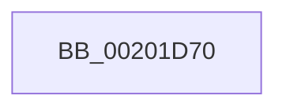

# KiAdvanceReadyQueueEnumeratorToNextPhase

- RVA: `0x00201D70`–`0x00201D95` (길이 `37` bytes)
- VA: `0x0000000140201D70`
- 실행 섹션: `.text`
- PDB 이름 있음: `예`; PDB Function 태그: `아니요`
- unwind 정보 RVA: `0x0005C898`
- 디코드: `10`개 명령, `37/37` bytes 표시
- 미해석 바이트: `0` (있으면 어셈블리에 `.byte`로 보존)

> 이 문서는 커널 이미지의 기계어와 PDB 기호를 분석해 생성했습니다. 4번과 5번은 함수 원형과 자료형을 바이너리 사용 방식에서 추정한 C 해석이며 원본 소스 복구 결과는 아닙니다.

## 1. Dependencies

- 직접 호출 지점: **0**; 고유 호출 대상: **0**
- 직접 호출자로 확인된 함수: **1**
- RIP 상대 이미지 참조: **0**

### Outgoing calls
- 직접 디코드된 call 명령이 없습니다.

### Direct callers
- [KiAdvanceReadyQueueEnumeratorToNextList](KiAdvanceReadyQueueEnumeratorToNextList_function_00201C50.md) at `0x00201C99`

### Static image references
- 디코드된 RIP-relative 메모리 참조가 없습니다.

## 2. Other-region calls and transfers

- 다른 실행 섹션으로 향하는 call: **0**
- call이 아닌 외부 분기/꼬리 이동: **1**
  - `0x00201D8F` → [sub_00201F78](Unknown_function_00201F78.md) (`tail-transfer`)

## 3. Assembly (complete function range)

```asm
00201D70  48 89 5C 24 18                  mov qword ptr [rsp + 0x18], rbx
00201D75  48 89 6C 24 20                  mov qword ptr [rsp + 0x20], rbp
00201D7A  56                              push rsi
00201D7B  48 83 EC 20                     sub rsp, 0x20
00201D7F  0F B6 71 0D                     movzx esi, byte ptr [rcx + 0xd]
00201D83  33 ED                           xor ebp, ebp
00201D85  40 FE C6                        inc sil
00201D88  48 8B D9                        mov rbx, rcx
00201D8B  40 80 FE 04                     cmp sil, 4
00201D8F  0F 83 E3 01 00 00               jae 0x140201f78
```

## 4. C-style interpretation (structured pseudocode)

```c
void __fastcall KiAdvanceReadyQueueEnumeratorToNextPhase(__int64 a1)
{
    __int64 v_rbp;
    __int64 v_rsi;
    __int64 v_rsp;
    unsigned __int64 v_stack_p18;
    unsigned __int64 v_stack_p20;

    v_stack_p18 = v_rbx;
    v_stack_p20 = v_rbp;
    v_rsp = (v_rsp) - (32);
    v_rbp = 0;
    v_rsi = (unsigned __int8)((*(unsigned __int8 *)(a1 + 13)) + 1);
}
```

## 5. (Beta) C Style

```c
void KiAdvanceReadyQueueEnumeratorToNextPhase(void *Arg1)
{
    uint8_t *arg1 = (uint8_t *)Arg1;

    int64_t local_rbp;
    int64_t local_rsi;
    int64_t local_rsp;
    uint64_t v_stack_p18;
    uint64_t v_stack_p20;

    v_stack_p18 = local_rbx;
    v_stack_p20 = local_rbp;
    local_rsp = (local_rsp) - (32);
    local_rbp = 0;
    local_rsi = (uint8_t)((*(uint8_t *)(arg1 + 0xD)) + 1);
}
```

### 관측된 메모리 오프셋

구조체 형식이 확인되지 않은 접근은 인자 기준의 오프셋으로만 기록했습니다.

| 기준 인자 | 오프셋 표현 | 폭 (bit) | 접근 |
|---|---:|---:|---|
| `Arg1` | `+ 0xD` | `8` | `R` |

## 6. Execution-region graph

[열기: 2D/3D 그래프와 함수 탐색 컨트롤 패널](../../../control-panel.html?section=text&rva=0x00201D70&view=graph)

- 2D 그래프는 위에서 아래로 흐르고, 3D 그래프는 빈 공간을 드래그해 회전합니다. Shift+드래그는 이동, 휠은 확대·축소, 함수 노드 선택은 대상 보고서 이동입니다.

### Static fallback


