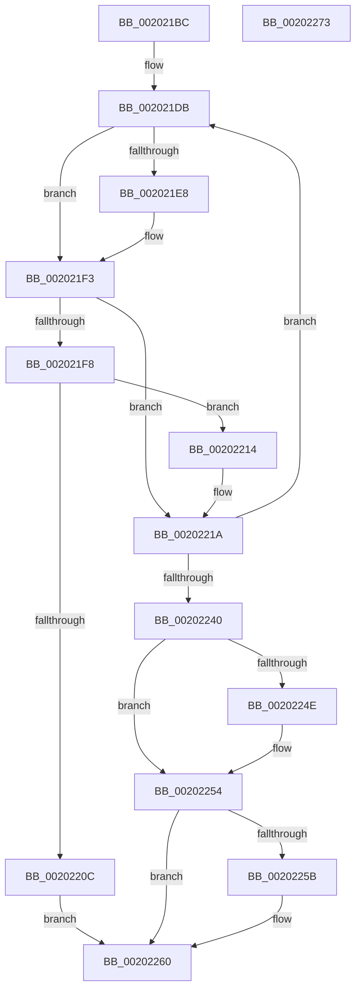

# KiAdvanceReadyQueueEnumeratorToNextProcessor

- RVA: `0x002021BC`–`0x00202274` (길이 `184` bytes)
- VA: `0x00000001402021BC`
- 실행 섹션: `.text`
- PDB 이름 있음: `예`; PDB Function 태그: `아니요`
- unwind 정보 RVA: `0x0005C8E4`
- 디코드: `54`개 명령, `184/184` bytes 표시
- 미해석 바이트: `0` (있으면 어셈블리에 `.byte`로 보존)

> 이 문서는 커널 이미지의 기계어와 PDB 기호를 분석해 생성했습니다. 4번과 5번은 함수 원형과 자료형을 바이너리 사용 방식에서 추정한 C 해석이며 원본 소스 복구 결과는 아닙니다.

## 1. Dependencies

- 직접 호출 지점: **0**; 고유 호출 대상: **0**
- 직접 호출자로 확인된 함수: **1**
- RIP 상대 이미지 참조: **0**

### Outgoing calls
- 직접 디코드된 call 명령이 없습니다.

### Direct callers
- [KiAdvanceReadyQueueEnumeratorToNextList](KiAdvanceReadyQueueEnumeratorToNextList_function_00201C50.md) at `0x00201C8D`

### Static image references
- 디코드된 RIP-relative 메모리 참조가 없습니다.

## 2. Other-region calls and transfers

- 다른 실행 섹션으로 향하는 call: **0**
- 별도 외부 분기/꼬리 이동을 확인하지 못했습니다.

## 3. Assembly (complete function range)

```asm
002021BC  48 89 5C 24 10                  mov qword ptr [rsp + 0x10], rbx
002021C1  48 89 74 24 18                  mov qword ptr [rsp + 0x18], rsi
002021C6  48 89 7C 24 20                  mov qword ptr [rsp + 0x20], rdi
002021CB  8B 31                           mov esi, dword ptr [rcx]
002021CD  4C 8D 49 08                     lea r9, [rcx + 8]
002021D1  40 8A 79 09                     mov dil, byte ptr [rcx + 9]
002021D5  48 8B D1                        mov rdx, rcx
002021D8  45 33 C0                        xor r8d, r8d
002021DB  FE 42 0A                        inc byte ptr [rdx + 0xa]
002021DE  44 0F B6 52 0A                  movzx r10d, byte ptr [rdx + 0xa]
002021E3  44 3B D6                        cmp r10d, esi
002021E6  72 0B                           jb 0x1402021f3
002021E8  44 88 42 0A                     mov byte ptr [rdx + 0xa], r8b
002021EC  4C 8D 4A 08                     lea r9, [rdx + 8]
002021F0  45 8A D0                        mov r10b, r8b
002021F3  44 3A D7                        cmp r10b, dil
002021F6  75 22                           jne 0x14020221a
002021F8  41 8A 09                        mov cl, byte ptr [r9]
002021FB  B8 01 00 00 00                  mov eax, 1
00202200  D3 E0                           shl eax, cl
00202202  F7 D0                           not eax
00202204  23 42 04                        and eax, dword ptr [rdx + 4]
00202207  89 42 04                        mov dword ptr [rdx + 4], eax
0020220A  75 08                           jne 0x140202214
0020220C  41 B8 1A 00 00 80               mov r8d, 0x8000001a
00202212  EB 4C                           jmp 0x140202260
00202214  0F BD C0                        bsr eax, eax
00202217  41 88 01                        mov byte ptr [r9], al
0020221A  41 8A 09                        mov cl, byte ptr [r9]
0020221D  41 BB 01 00 00 00               mov r11d, 1
00202223  41 D3 E3                        shl r11d, cl
00202226  41 0F B6 C2                     movzx eax, r10b
0020222A  4C 8D 14 40                     lea r10, [rax + rax*2]
0020222E  4D 03 D2                        add r10, r10
00202231  42 8B 4C D2 5C                  mov ecx, dword ptr [rdx + r10*8 + 0x5c]
00202236  42 0B 4C D2 58                  or ecx, dword ptr [rdx + r10*8 + 0x58]
0020223B  41 85 CB                        test r11d, ecx
0020223E  74 9B                           je 0x1402021db
00202240  44 88 42 0B                     mov byte ptr [rdx + 0xb], r8b
00202244  41 8A C0                        mov al, r8b
00202247  46 85 5C D2 58                  test dword ptr [rdx + r10*8 + 0x58], r11d
0020224C  74 06                           je 0x140202254
0020224E  C6 42 0B 01                     mov byte ptr [rdx + 0xb], 1
00202252  B0 01                           mov al, 1
00202254  46 85 5C D2 5C                  test dword ptr [rdx + r10*8 + 0x5c], r11d
00202259  74 05                           je 0x140202260
0020225B  0C 02                           or al, 2
0020225D  88 42 0B                        mov byte ptr [rdx + 0xb], al
00202260  48 8B 5C 24 10                  mov rbx, qword ptr [rsp + 0x10]
00202265  41 8B C0                        mov eax, r8d
00202268  48 8B 74 24 18                  mov rsi, qword ptr [rsp + 0x18]
0020226D  48 8B 7C 24 20                  mov rdi, qword ptr [rsp + 0x20]
00202272  C3                              ret
00202273  CC                              int3
```

## 4. C-style interpretation (structured pseudocode)

```c
__int64 __fastcall KiAdvanceReadyQueueEnumeratorToNextProcessor(__int64 a1, __int64 a2, int a3)
{
    __int64 result;
    __int64 v_r10;
    __int64 v_r11;
    unsigned __int64 v_stack_p10;
    unsigned __int64 v_stack_p18;
    unsigned __int64 v_stack_p20;

    v_stack_p10 = v_rbx;
    v_stack_p18 = v_rsi;
    v_stack_p20 = v_rdi;
    a3 = 0;
loc_002021DB:
    v_r10 = *(unsigned __int8 *)(a1 + 10);
    if (((unsigned int)(*(unsigned __int8 *)(a1 + 10))) >= ((unsigned int)((unsigned int)(*(unsigned int *)(a1))))) {
        *(unsigned __int8 *)(a1 + 10) = 0;
        a4 = a1 + 8;
        v_r10 = 0;
    }
    if (((unsigned __int8)(v_r10)) != ((unsigned __int8)(*(unsigned __int8 *)(a1 + 9)))) goto loc_0020221A;
    result = (unsigned int)((1) << ((unsigned __int8)(*(unsigned __int8 *)(a4))));
    result = (unsigned int)(~(result));
    result = (unsigned int)((result) & (*(unsigned int *)(a1 + 4)));
    *(unsigned int *)(a1 + 4) = (unsigned int)(result);
    if (condition_is_not_equal) goto loc_00202214;
    goto loc_00202260;
loc_00202214:
    *(unsigned __int8 *)(a4) = (unsigned __int8)(result);
loc_0020221A:
    v_r11 = (unsigned int)((1) << ((unsigned __int8)(*(unsigned __int8 *)(a4))));
    v_r10 = ((unsigned __int8)(v_r10) + (unsigned __int8)(v_r10) * 2) + ((unsigned __int8)(v_r10) + (unsigned __int8)(v_r10) * 2);
    a1 = (unsigned int)(((unsigned int)(*(unsigned int *)(a1 + v_r10 * 8 + 92))) | (*(unsigned int *)(a1 + v_r10 * 8 + 88)));
    if ((((unsigned int)(v_r11)) & ((unsigned int)(a1))) == 0) goto loc_002021DB;
    *(unsigned __int8 *)(a1 + 11) = (unsigned __int8)((unsigned int)(0x8000001AULL));
    result = (unsigned __int8)((unsigned int)(0x8000001AULL));
    if (((*(unsigned int *)(a1 + v_r10 * 8 + 88)) & ((unsigned int)(v_r11))) != 0) {
        *(unsigned __int8 *)(a1 + 11) = 1;
        result = 1;
    }
    if (((*(unsigned int *)(a1 + v_r10 * 8 + 92)) & ((unsigned int)(v_r11))) != 0) {
        result = (unsigned __int8)((result) | (2));
        *(unsigned __int8 *)(a1 + 11) = (unsigned __int8)(result);
    }
    return (unsigned int)((unsigned int)((unsigned int)(0x8000001AULL)));
}
```

## 5. (Beta) C Style

```c
int64_t KiAdvanceReadyQueueEnumeratorToNextProcessor(void *Arg1, int64_t Arg2, int32_t Arg3)
{
    uint8_t *arg1 = (uint8_t *)Arg1;

    int64_t result;
    int64_t local_r10;
    int64_t local_r11;
    uint64_t v_stack_p10;
    uint64_t v_stack_p18;
    uint64_t v_stack_p20;

    v_stack_p10 = local_rbx;
    v_stack_p18 = local_rsi;
    v_stack_p20 = local_rdi;
    Arg3 = 0;
loc_002021DB:
    local_r10 = *(uint8_t *)(arg1 + 0xA);
    if (((uint32_t)(*(uint8_t *)(arg1 + 0xA))) >= ((uint32_t)((uint32_t)(*(uint32_t *)(arg1))))) {
        *(uint8_t *)(arg1 + 0xA) = 0;
        a4 = Arg1 + 8;
        local_r10 = 0;
    }
    if (((uint8_t)(local_r10)) != ((uint8_t)(*(uint8_t *)(arg1 + 0x9)))) goto loc_0020221A;
    result = (uint32_t)((1) << ((uint8_t)(*(uint8_t *)(a4))));
    result = (uint32_t)(~(result));
    result = (uint32_t)((result) & (*(uint32_t *)(arg1 + 0x4)));
    *(uint32_t *)(arg1 + 0x4) = (uint32_t)(result);
    if (condition_is_not_equal) goto loc_00202214;
    goto loc_00202260;
loc_00202214:
    *(uint8_t *)(a4) = (uint8_t)(result);
loc_0020221A:
    local_r11 = (uint32_t)((1) << ((uint8_t)(*(uint8_t *)(a4))));
    local_r10 = ((uint8_t)(local_r10) + (uint8_t)(local_r10) * 2) + ((uint8_t)(local_r10) + (uint8_t)(local_r10) * 2);
    Arg1 = (uint32_t)(((uint32_t)(*(uint32_t *)(arg1 + local_r10 * 8 + 0x5C))) | (*(uint32_t *)(arg1 + local_r10 * 8 + 0x58)));
    if ((((uint32_t)(local_r11)) & ((uint32_t)(Arg1))) == 0) goto loc_002021DB;
    *(uint8_t *)(arg1 + 0xB) = (uint8_t)((uint32_t)(0x8000001AULL));
    result = (uint8_t)((uint32_t)(0x8000001AULL));
    if (((*(uint32_t *)(arg1 + local_r10 * 8 + 0x58)) & ((uint32_t)(local_r11))) != 0) {
        *(uint8_t *)(arg1 + 0xB) = 1;
        result = 1;
    }
    if (((*(uint32_t *)(arg1 + local_r10 * 8 + 0x5C)) & ((uint32_t)(local_r11))) != 0) {
        result = (uint8_t)((result) | (2));
        *(uint8_t *)(arg1 + 0xB) = (uint8_t)(result);
    }
    return (uint32_t)((uint32_t)((uint32_t)(0x8000001AULL)));
}
```

### 관측된 메모리 오프셋

구조체 형식이 확인되지 않은 접근은 인자 기준의 오프셋으로만 기록했습니다.

| 기준 인자 | 오프셋 표현 | 폭 (bit) | 접근 |
|---|---:|---:|---|
| `Arg1` | `+ 0x0` | `8` | `R` |
| `Arg1` | `+ 0x0` | `8` | `W` |
| `Arg1` | `+ 0x0` | `32` | `R` |
| `Arg1` | `+ 0x4` | `32` | `R` |
| `Arg1` | `+ 0x4` | `32` | `W` |
| `Arg1` | `+ 0x8` | `64` | `R` |
| `Arg1` | `+ 0x9` | `8` | `R` |
| `Arg1` | `+ 0xA` | `8` | `R` |
| `Arg1` | `+ 0xA` | `8` | `R/W` |
| `Arg1` | `+ 0xA` | `8` | `W` |
| `Arg1` | `+ 0xB` | `8` | `W` |
| `Arg1` | `+ 0x58 + r10*8` | `32` | `R` |
| `Arg1` | `+ 0x5C + r10*8` | `32` | `R` |

## 6. Execution-region graph

[열기: 2D/3D 그래프와 함수 탐색 컨트롤 패널](../../../control-panel.html?section=text&rva=0x002021BC&view=graph)

- 2D 그래프는 위에서 아래로 흐르고, 3D 그래프는 빈 공간을 드래그해 회전합니다. Shift+드래그는 이동, 휠은 확대·축소, 함수 노드 선택은 대상 보고서 이동입니다.

### Static fallback


