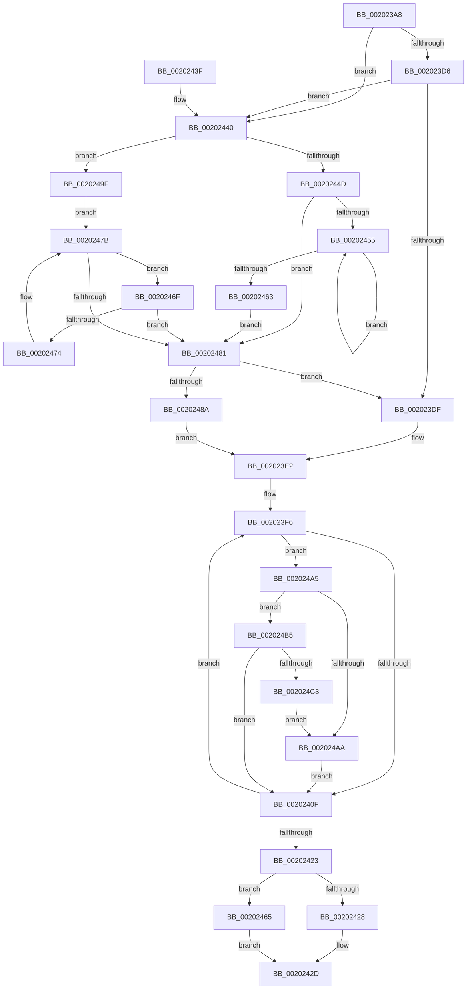

# KiAdvanceReadyQueueEnumeratorToNextRootScb

- RVA: `0x002023A8`–`0x002024C5` (길이 `285` bytes)
- VA: `0x00000001402023A8`
- 실행 섹션: `.text`
- PDB 이름 있음: `예`; PDB Function 태그: `아니요`
- unwind 정보 RVA: `0x0005C908`
- 디코드: `83`개 명령, `285/285` bytes 표시
- 미해석 바이트: `0` (있으면 어셈블리에 `.byte`로 보존)

> 이 문서는 커널 이미지의 기계어와 PDB 기호를 분석해 생성했습니다. 4번과 5번은 함수 원형과 자료형을 바이너리 사용 방식에서 추정한 C 해석이며 원본 소스 복구 결과는 아닙니다.

## 1. Dependencies

- 직접 호출 지점: **0**; 고유 호출 대상: **0**
- 직접 호출자로 확인된 함수: **1**
- RIP 상대 이미지 참조: **0**

### Outgoing calls
- 직접 디코드된 call 명령이 없습니다.

### Direct callers
- [KiAdvanceReadyQueueEnumeratorToNextScb](KiAdvanceReadyQueueEnumeratorToNextScb_function_0020227C.md) at `0x002022FD`

### Static image references
- 디코드된 RIP-relative 메모리 참조가 없습니다.

## 2. Other-region calls and transfers

- 다른 실행 섹션으로 향하는 call: **0**
- 별도 외부 분기/꼬리 이동을 확인하지 못했습니다.

## 3. Assembly (complete function range)

```asm
002023A8  48 89 5C 24 08                  mov qword ptr [rsp + 8], rbx
002023AD  48 89 74 24 10                  mov qword ptr [rsp + 0x10], rsi
002023B2  48 89 7C 24 18                  mov qword ptr [rsp + 0x18], rdi
002023B7  0F B6 41 0A                     movzx eax, byte ptr [rcx + 0xa]
002023BB  33 D2                           xor edx, edx
002023BD  4C 8B C1                        mov r8, rcx
002023C0  4C 8D 14 40                     lea r10, [rax + rax*2]
002023C4  4D 03 D2                        add r10, r10
002023C7  4A 8B 44 D1 48                  mov rax, qword ptr [rcx + r10*8 + 0x48]
002023CC  4E 8B 4C D1 40                  mov r9, qword ptr [rcx + r10*8 + 0x40]
002023D1  48 85 C0                        test rax, rax
002023D4  74 6A                           je 0x140202440
002023D6  4C 39 88 A8 01 00 00            cmp qword ptr [rax + 0x1a8], r9
002023DD  75 61                           jne 0x140202440
002023DF  48 8B CA                        mov rcx, rdx
002023E2  4B 89 4C D0 40                  mov qword ptr [r8 + r10*8 + 0x40], rcx
002023E7  8A DA                           mov bl, dl
002023E9  41 8A 78 09                     mov dil, byte ptr [r8 + 9]
002023ED  4C 8B CA                        mov r9, rdx
002023F0  41 8B 30                        mov esi, dword ptr [r8]
002023F3  44 8A D7                        mov r10b, dil
002023F6  41 0F B6 C2                     movzx eax, r10b
002023FA  48 8D 0C 40                     lea rcx, [rax + rax*2]
002023FE  48 03 C9                        add rcx, rcx
00202401  4D 8B 5C C8 40                  mov r11, qword ptr [r8 + rcx*8 + 0x40]
00202406  4D 85 DB                        test r11, r11
00202409  0F 85 96 00 00 00               jne 0x1402024a5
0020240F  41 FE C2                        inc r10b
00202412  41 0F B6 C2                     movzx eax, r10b
00202416  3B C6                           cmp eax, esi
00202418  45 1A D2                        sbb r10b, r10b
0020241B  44 22 D0                        and r10b, al
0020241E  44 3A D7                        cmp r10b, dil
00202421  75 D3                           jne 0x1402023f6
00202423  4D 85 C9                        test r9, r9
00202426  75 3D                           jne 0x140202465
00202428  BA 1A 00 00 80                  mov edx, 0x8000001a
0020242D  48 8B 5C 24 08                  mov rbx, qword ptr [rsp + 8]
00202432  8B C2                           mov eax, edx
00202434  48 8B 74 24 10                  mov rsi, qword ptr [rsp + 0x10]
00202439  48 8B 7C 24 18                  mov rdi, qword ptr [rsp + 0x18]
0020243E  C3                              ret
0020243F  CC                              int3
00202440  49 8B 49 60                     mov rcx, qword ptr [r9 + 0x60]
00202444  49 83 C1 58                     add r9, 0x58
00202448  48 85 C9                        test rcx, rcx
0020244B  74 52                           je 0x14020249f
0020244D  4C 8B 09                        mov r9, qword ptr [rcx]
00202450  4D 85 C9                        test r9, r9
00202453  74 2C                           je 0x140202481
00202455  49 8B 01                        mov rax, qword ptr [r9]
00202458  49 8B C9                        mov rcx, r9
0020245B  4C 8B C8                        mov r9, rax
0020245E  48 85 C0                        test rax, rax
00202461  75 F2                           jne 0x140202455
00202463  EB 1C                           jmp 0x140202481
00202465  41 88 58 0A                     mov byte ptr [r8 + 0xa], bl
00202469  4D 89 48 18                     mov qword ptr [r8 + 0x18], r9
0020246D  EB BE                           jmp 0x14020242d
0020246F  4C 39 09                        cmp qword ptr [rcx], r9
00202472  74 0D                           je 0x140202481
00202474  4C 8B C9                        mov r9, rcx
00202477  48 8B 49 10                     mov rcx, qword ptr [rcx + 0x10]
0020247B  48 83 E1 FC                     and rcx, 0xfffffffffffffffc
0020247F  75 EE                           jne 0x14020246f
00202481  48 85 C9                        test rcx, rcx
00202484  0F 84 55 FF FF FF               je 0x1402023df
0020248A  43 8B 44 D0 50                  mov eax, dword ptr [r8 + r10*8 + 0x50]
0020248F  48 83 C1 A8                     add rcx, -0x58
00202493  39 41 7C                        cmp dword ptr [rcx + 0x7c], eax
00202496  48 0F 47 CA                     cmova rcx, rdx
0020249A  E9 43 FF FF FF                  jmp 0x1402023e2
0020249F  49 8B 49 10                     mov rcx, qword ptr [r9 + 0x10]
002024A3  EB D6                           jmp 0x14020247b
002024A5  4D 85 C9                        test r9, r9
002024A8  75 0B                           jne 0x1402024b5
002024AA  41 8A DA                        mov bl, r10b
002024AD  4D 8B CB                        mov r9, r11
002024B0  E9 5A FF FF FF                  jmp 0x14020240f
002024B5  41 8B 43 7C                     mov eax, dword ptr [r11 + 0x7c]
002024B9  41 39 41 7C                     cmp dword ptr [r9 + 0x7c], eax
002024BD  0F 83 4C FF FF FF               jae 0x14020240f
002024C3  EB E5                           jmp 0x1402024aa
```

## 4. C-style interpretation (structured pseudocode)

```c
__int64 __fastcall KiAdvanceReadyQueueEnumeratorToNextRootScb(__int64 a1, int a2)
{
    __int64 v_r10;
    unsigned __int64 v_stack_p10;
    unsigned __int64 v_stack_p18;
    unsigned __int64 v_stack_p8;

    v_stack_p8 = v_rbx;
    v_stack_p10 = v_rsi;
    v_stack_p18 = v_rdi;
    a2 = 0;
    v_r10 = (*(unsigned __int8 *)(a1 + 10) + *(unsigned __int8 *)(a1 + 10) * 2) + (*(unsigned __int8 *)(a1 + 10) + *(unsigned __int8 *)(a1 + 10) * 2);
    if (*(unsigned __int64 *)(a1 + v_r10 * 8 + 72) == 0) goto loc_00202440;
    if ((*(unsigned __int64 *)(*(unsigned __int64 *)(a1 + v_r10 * 8 + 72) + 424)) != (*(unsigned __int64 *)(a1 + v_r10 * 8 + 64))) goto loc_00202440;
loc_002023DF:
loc_002023E2:
    *(unsigned __int64 *)(a1 + v_r10 * 8 + 64) = 0;
loc_002023F6:
    a1 = ((unsigned __int8)((unsigned __int8)(*(unsigned __int8 *)(a1 + 9))) + (unsigned __int8)((unsigned __int8)(*(unsigned __int8 *)(a1 + 9))) * 2) + ((unsigned __int8)((unsigned __int8)(*(unsigned __int8 *)(a1 + 9))) + (unsigned __int8)((unsigned __int8)(*(unsigned __int8 *)(a1 + 9))) * 2);
    if (*(unsigned __int64 *)(a1 + a1 * 8 + 64) != 0) goto loc_002024A5;
loc_0020240F:
    v_r10 = (unsigned __int8)(((unsigned __int8)(*(unsigned __int8 *)(a1 + 9))) + 1);
    v_r10 = (unsigned __int8)((v_r10) & ((unsigned __int8)((unsigned __int8)(v_r10))));
    if (((unsigned __int8)(v_r10)) != ((unsigned __int8)(*(unsigned __int8 *)(a1 + 9)))) goto loc_002023F6;
    if (0 != 0) goto loc_00202465;
loc_0020242D:
    return (unsigned int)((unsigned int)((unsigned int)(0x8000001AULL)));
loc_00202440:
    a4 = (0) + (88);
    if (*(unsigned __int64 *)(0 + 96) == 0) goto loc_0020249F;
    if (*(unsigned __int64 *)(*(unsigned __int64 *)(0 + 96)) == 0) goto loc_00202481;
loc_00202455:
    if (*(unsigned __int64 *)(*(unsigned __int64 *)(*(unsigned __int64 *)(0 + 96))) != 0) goto loc_00202455;
    goto loc_00202481;
loc_00202465:
    *(unsigned __int8 *)(a1 + 10) = (unsigned __int8)(v_stack_p8);
    *(unsigned __int64 *)(a1 + 24) = *(unsigned __int64 *)(*(unsigned __int64 *)(*(unsigned __int64 *)(0 + 96)));
    goto loc_0020242D;
loc_0020246F:
    if ((*(unsigned __int64 *)(*(unsigned __int64 *)(*(unsigned __int64 *)(0 + 96)))) == (*(unsigned __int64 *)(*(unsigned __int64 *)(*(unsigned __int64 *)(0 + 96))))) goto loc_00202481;
loc_0020247B:
    a1 = (*(unsigned __int64 *)(*(unsigned __int64 *)(*(unsigned __int64 *)(0 + 96)) + 16)) & (-4);
    if (condition_is_not_equal) goto loc_0020246F;
loc_00202481:
    if (a1 == 0) goto loc_002023DF;
    a1 = (a1) + (-88);
    if ((*(unsigned int *)(a1 + 124)) > ((unsigned int)((unsigned int)(*(unsigned int *)(a1 + v_r10 * 8 + 80))))) { a1 = (unsigned int)(0x8000001AULL); }
    goto loc_002023E2;
loc_0020249F:
    goto loc_0020247B;
loc_002024A5:
    if (*(unsigned __int64 *)(*(unsigned __int64 *)(0 + 96)) != 0) goto loc_002024B5;
loc_002024AA:
    goto loc_0020240F;
loc_002024B5:
    if ((*(unsigned int *)(*(unsigned __int64 *)(a1 + a1 * 8 + 64) + 124)) >= ((unsigned int)((unsigned int)(*(unsigned int *)(*(unsigned __int64 *)(a1 + a1 * 8 + 64) + 124))))) goto loc_0020240F;
    goto loc_002024AA;
}
```

## 5. (Beta) C Style

```c
int64_t KiAdvanceReadyQueueEnumeratorToNextRootScb(void *Arg1, int32_t Arg2)
{
    uint8_t *arg1 = (uint8_t *)Arg1;

    int64_t local_r10;
    uint64_t v_stack_p10;
    uint64_t v_stack_p18;
    uint64_t v_stack_p8;

    v_stack_p8 = local_rbx;
    v_stack_p10 = local_rsi;
    v_stack_p18 = local_rdi;
    Arg2 = 0;
    local_r10 = (*(uint8_t *)(arg1 + 0xA) + *(uint8_t *)(arg1 + 0xA) * 2) + (*(uint8_t *)(arg1 + 0xA) + *(uint8_t *)(arg1 + 0xA) * 2);
    if (*(uint64_t *)(arg1 + local_r10 * 8 + 0x48) == 0) goto loc_00202440;
    if ((*(uint64_t *)(*(uint64_t *)(arg1 + local_r10 * 8 + 0x48) + 0x1A8)) != (*(uint64_t *)(arg1 + local_r10 * 8 + 0x40))) goto loc_00202440;
loc_002023DF:
loc_002023E2:
    *(uint64_t *)(arg1 + local_r10 * 8 + 0x40) = 0;
loc_002023F6:
    Arg1 = ((uint8_t)((uint8_t)(*(uint8_t *)(arg1 + 0x9))) + (uint8_t)((uint8_t)(*(uint8_t *)(arg1 + 0x9))) * 2) + ((uint8_t)((uint8_t)(*(uint8_t *)(arg1 + 0x9))) + (uint8_t)((uint8_t)(*(uint8_t *)(arg1 + 0x9))) * 2);
    if (*(uint64_t *)(arg1 + arg1 * 8 + 0x40) != 0) goto loc_002024A5;
loc_0020240F:
    local_r10 = (uint8_t)(((uint8_t)(*(uint8_t *)(arg1 + 0x9))) + 1);
    local_r10 = (uint8_t)((local_r10) & ((uint8_t)((uint8_t)(local_r10))));
    if (((uint8_t)(local_r10)) != ((uint8_t)(*(uint8_t *)(arg1 + 0x9)))) goto loc_002023F6;
    if (0 != 0) goto loc_00202465;
loc_0020242D:
    return (uint32_t)((uint32_t)((uint32_t)(0x8000001AULL)));
loc_00202440:
    a4 = (0) + (88);
    if (*(uint64_t *)(0 + 0x60) == 0) goto loc_0020249F;
    if (*(uint64_t *)(*(uint64_t *)(0 + 0x60)) == 0) goto loc_00202481;
loc_00202455:
    if (*(uint64_t *)(*(uint64_t *)(*(uint64_t *)(0 + 0x60))) != 0) goto loc_00202455;
    goto loc_00202481;
loc_00202465:
    *(uint8_t *)(arg1 + 0xA) = (uint8_t)(v_stack_p8);
    *(uint64_t *)(arg1 + 0x18) = *(uint64_t *)(*(uint64_t *)(*(uint64_t *)(0 + 0x60)));
    goto loc_0020242D;
loc_0020246F:
    if ((*(uint64_t *)(*(uint64_t *)(*(uint64_t *)(0 + 0x60)))) == (*(uint64_t *)(*(uint64_t *)(*(uint64_t *)(0 + 0x60))))) goto loc_00202481;
loc_0020247B:
    Arg1 = (*(uint64_t *)(*(uint64_t *)(*(uint64_t *)(0 + 0x60)) + 0x10)) & (-4);
    if (condition_is_not_equal) goto loc_0020246F;
loc_00202481:
    if (Arg1 == NULL) goto loc_002023DF;
    Arg1 = (Arg1) + (-88);
    if ((*(uint32_t *)(arg1 + 0x7C)) > ((uint32_t)((uint32_t)(*(uint32_t *)(arg1 + local_r10 * 8 + 0x50))))) { Arg1 = (uint32_t)(0x8000001AULL); }
    goto loc_002023E2;
loc_0020249F:
    goto loc_0020247B;
loc_002024A5:
    if (*(uint64_t *)(*(uint64_t *)(0 + 0x60)) != 0) goto loc_002024B5;
loc_002024AA:
    goto loc_0020240F;
loc_002024B5:
    if ((*(uint32_t *)(*(uint64_t *)(arg1 + arg1 * 8 + 0x40) + 0x7C)) >= ((uint32_t)((uint32_t)(*(uint32_t *)(*(uint64_t *)(arg1 + arg1 * 8 + 0x40) + 0x7C))))) goto loc_0020240F;
    goto loc_002024AA;
}
```

### 관측된 메모리 오프셋

구조체 형식이 확인되지 않은 접근은 인자 기준의 오프셋으로만 기록했습니다.

| 기준 인자 | 오프셋 표현 | 폭 (bit) | 접근 |
|---|---:|---:|---|
| `Arg1` | `+ 0x0` | `32` | `R` |
| `Arg1` | `+ 0x9` | `8` | `R` |
| `Arg1` | `+ 0xA` | `8` | `R` |
| `Arg1` | `+ 0xA` | `8` | `W` |
| `Arg1` | `+ 0x18` | `64` | `W` |
| `Arg1` | `+ 0x40 + r10*8` | `64` | `R` |
| `Arg1` | `+ 0x40 + r10*8` | `64` | `W` |
| `Arg1` | `+ 0x40 + rcx*8` | `64` | `R` |
| `Arg1` | `+ 0x48 + r10*8` | `64` | `R` |
| `Arg1` | `+ 0x50 + r10*8` | `32` | `R` |

## 6. Execution-region graph

[열기: 2D/3D 그래프와 함수 탐색 컨트롤 패널](../../../control-panel.html?section=text&rva=0x002023A8&view=graph)

- 2D 그래프는 위에서 아래로 흐르고, 3D 그래프는 빈 공간을 드래그해 회전합니다. Shift+드래그는 이동, 휠은 확대·축소, 함수 노드 선택은 대상 보고서 이동입니다.

### Static fallback


