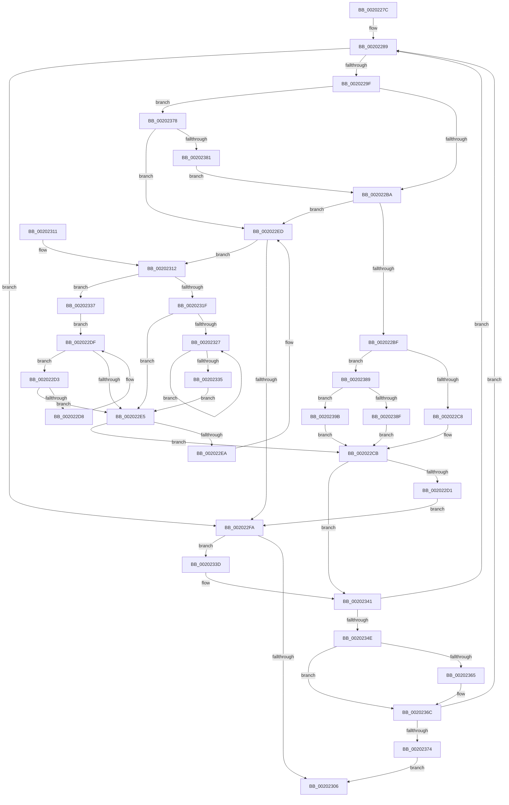

# KiAdvanceReadyQueueEnumeratorToNextScb

- RVA: `0x0020227C`–`0x002023A2` (길이 `294` bytes)
- VA: `0x000000014020227C`
- 실행 섹션: `.text`
- PDB 이름 있음: `예`; PDB Function 태그: `아니요`
- unwind 정보 RVA: `0x0005C8F8`
- 디코드: `87`개 명령, `294/294` bytes 표시
- 미해석 바이트: `0` (있으면 어셈블리에 `.byte`로 보존)

> 이 문서는 커널 이미지의 기계어와 PDB 기호를 분석해 생성했습니다. 4번과 5번은 함수 원형과 자료형을 바이너리 사용 방식에서 추정한 C 해석이며 원본 소스 복구 결과는 아닙니다.

## 1. Dependencies

- 직접 호출 지점: **1**; 고유 호출 대상: **1**
- 직접 호출자로 확인된 함수: **4**
- RIP 상대 이미지 참조: **0**

### Outgoing calls
- `0x002022FD` → [KiAdvanceReadyQueueEnumeratorToNextRootScb](KiAdvanceReadyQueueEnumeratorToNextRootScb_function_002023A8.md) (function, `0x002023A8`)

### Direct callers
- [KiAdvanceReadyQueueEnumeratorToNextList](KiAdvanceReadyQueueEnumeratorToNextList_function_00201C50.md) at `0x00201D12`
- [sub_00201F99](Unknown_function_00201F99.md) at `0x00202180`
- [KiSearchForNewThreadsForRescheduleContext](../25/KiSearchForNewThreadsForRescheduleContext_function_00258620.md) at `0x0025924D`
- [KiAttemptToScheduleThreadToBusyIsolationUnit](../25/KiAttemptToScheduleThreadToBusyIsolationUnit_function_00259B00.md) at `0x0025AD94`

### Static image references
- 디코드된 RIP-relative 메모리 참조가 없습니다.

## 2. Other-region calls and transfers

- 다른 실행 섹션으로 향하는 call: **0**
- 별도 외부 분기/꼬리 이동을 확인하지 못했습니다.

## 3. Assembly (complete function range)

```asm
0020227C  48 89 5C 24 08                  mov qword ptr [rsp + 8], rbx
00202281  57                              push rdi
00202282  48 83 EC 20                     sub rsp, 0x20
00202286  48 8B D9                        mov rbx, rcx
00202289  0F B6 43 0A                     movzx eax, byte ptr [rbx + 0xa]
0020228D  48 8B 53 10                     mov rdx, qword ptr [rbx + 0x10]
00202291  48 8D 3C 40                     lea rdi, [rax + rax*2]
00202295  48 03 FF                        add rdi, rdi
00202298  48 3B 54 FB 48                  cmp rdx, qword ptr [rbx + rdi*8 + 0x48]
0020229D  74 5B                           je 0x1402022fa
0020229F  48 8D 8A 90 01 00 00            lea rcx, [rdx + 0x190]
002022A6  4C 8B 41 08                     mov r8, qword ptr [rcx + 8]
002022AA  48 8B 01                        mov rax, qword ptr [rcx]
002022AD  4D 8B C8                        mov r9, r8
002022B0  41 83 E1 01                     and r9d, 1
002022B4  0F 85 BE 00 00 00               jne 0x140202378
002022BA  48 85 C0                        test rax, rax
002022BD  74 2E                           je 0x1402022ed
002022BF  4D 85 C9                        test r9, r9
002022C2  0F 85 C1 00 00 00               jne 0x140202389
002022C8  49 8B C8                        mov rcx, r8
002022CB  48 83 C1 A8                     add rcx, -0x58
002022CF  75 70                           jne 0x140202341
002022D1  EB 27                           jmp 0x1402022fa
002022D3  48 39 11                        cmp qword ptr [rcx], rdx
002022D6  74 0D                           je 0x1402022e5
002022D8  48 8B D1                        mov rdx, rcx
002022DB  48 8B 49 10                     mov rcx, qword ptr [rcx + 0x10]
002022DF  48 83 E1 FC                     and rcx, 0xfffffffffffffffc
002022E3  75 EE                           jne 0x1402022d3
002022E5  48 85 C9                        test rcx, rcx
002022E8  75 E1                           jne 0x1402022cb
002022EA  49 8B 10                        mov rdx, qword ptr [r8]
002022ED  4C 8D 82 A0 01 00 00            lea r8, [rdx + 0x1a0]
002022F4  49 83 38 00                     cmp qword ptr [r8], 0
002022F8  75 18                           jne 0x140202312
002022FA  48 8B CB                        mov rcx, rbx
002022FD  E8 A6 00 00 00                  call 0x1402023a8
00202302  85 C0                           test eax, eax
00202304  79 37                           jns 0x14020233d
00202306  48 8B 5C 24 30                  mov rbx, qword ptr [rsp + 0x30]
0020230B  48 83 C4 20                     add rsp, 0x20
0020230F  5F                              pop rdi
00202310  C3                              ret
00202311  CC                              int3
00202312  48 8B 4A 60                     mov rcx, qword ptr [rdx + 0x60]
00202316  48 83 C2 58                     add rdx, 0x58
0020231A  48 85 C9                        test rcx, rcx
0020231D  74 18                           je 0x140202337
0020231F  48 8B 11                        mov rdx, qword ptr [rcx]
00202322  48 85 D2                        test rdx, rdx
00202325  74 BE                           je 0x1402022e5
00202327  48 8B 02                        mov rax, qword ptr [rdx]
0020232A  48 8B CA                        mov rcx, rdx
0020232D  48 8B D0                        mov rdx, rax
00202330  48 85 C0                        test rax, rax
00202333  75 F2                           jne 0x140202327
00202335  EB AE                           jmp 0x1402022e5
00202337  48 8B 4A 10                     mov rcx, qword ptr [rdx + 0x10]
0020233B  EB A2                           jmp 0x1402022df
0020233D  48 8B 4B 18                     mov rcx, qword ptr [rbx + 0x18]
00202341  48 89 4B 10                     mov qword ptr [rbx + 0x10], rcx
00202345  48 85 C9                        test rcx, rcx
00202348  0F 84 3B FF FF FF               je 0x140202289
0020234E  0F B7 51 78                     movzx edx, word ptr [rcx + 0x78]
00202352  89 53 04                        mov dword ptr [rbx + 4], edx
00202355  48 8B 89 A8 01 00 00            mov rcx, qword ptr [rcx + 0x1a8]
0020235C  8B 44 FB 50                     mov eax, dword ptr [rbx + rdi*8 + 0x50]
00202360  39 41 7C                        cmp dword ptr [rcx + 0x7c], eax
00202363  75 07                           jne 0x14020236c
00202365  23 54 FB 54                     and edx, dword ptr [rbx + rdi*8 + 0x54]
00202369  89 53 04                        mov dword ptr [rbx + 4], edx
0020236C  85 D2                           test edx, edx
0020236E  0F 84 15 FF FF FF               je 0x140202289
00202374  33 C0                           xor eax, eax
00202376  EB 8E                           jmp 0x140202306
00202378  48 85 C0                        test rax, rax
0020237B  0F 84 6C FF FF FF               je 0x1402022ed
00202381  48 33 C1                        xor rax, rcx
00202384  E9 31 FF FF FF                  jmp 0x1402022ba
00202389  49 83 F8 01                     cmp r8, 1
0020238D  74 0C                           je 0x14020239b
0020238F  48 83 C9 01                     or rcx, 1
00202393  49 33 C8                        xor rcx, r8
00202396  E9 30 FF FF FF                  jmp 0x1402022cb
0020239B  33 C9                           xor ecx, ecx
0020239D  E9 29 FF FF FF                  jmp 0x1402022cb
```

## 4. C-style interpretation (structured pseudocode)

```c
__int64 __fastcall KiAdvanceReadyQueueEnumeratorToNextScb(__int64 a1)
{
    __int64 result;
    __int64 v_rdi;
    __int64 v_rsp;
    unsigned __int64 v_stack_p8;

    v_stack_p8 = v_rbx;
    v_rsp = (v_rsp) - (32);
loc_00202289:
    v_rdi = (*(unsigned __int8 *)(a1 + 10) + *(unsigned __int8 *)(a1 + 10) * 2) + (*(unsigned __int8 *)(a1 + 10) + *(unsigned __int8 *)(a1 + 10) * 2);
    if ((*(unsigned __int64 *)(a1 + 16)) == (*(unsigned __int64 *)(a1 + v_rdi * 8 + 72))) goto loc_002022FA;
    a4 = (unsigned int)((*(unsigned __int64 *)(*(unsigned __int64 *)(a1 + 16) + 400 + 8)) & (1));
    if (condition_is_not_equal) goto loc_00202378;
loc_002022BA:
    if (*(unsigned __int64 *)(*(unsigned __int64 *)(a1 + 16) + 400) == 0) goto loc_002022ED;
    if (a4 != 0) goto loc_00202389;
loc_002022CB:
    a1 = (*(unsigned __int64 *)(*(unsigned __int64 *)(a1 + 16) + 400 + 8)) + (-88);
    if (condition_is_not_equal) goto loc_00202341;
    goto loc_002022FA;
loc_002022D3:
    if ((*(unsigned __int64 *)(a1)) == (*(unsigned __int64 *)(a1 + 16))) goto loc_002022E5;
loc_002022DF:
    a1 = (*(unsigned __int64 *)(a1 + 16)) & (-4);
    if (condition_is_not_equal) goto loc_002022D3;
loc_002022E5:
    if (a1 != 0) goto loc_002022CB;
loc_002022ED:
    if ((*(unsigned __int64 *)(*(unsigned __int64 *)(*(unsigned __int64 *)(*(unsigned __int64 *)(a1 + 16) + 400 + 8)) + 416)) != 0) goto loc_00202312;
loc_002022FA:
    result = KiAdvanceReadyQueueEnumeratorToNextRootScb(a1, *(unsigned __int64 *)(*(unsigned __int64 *)(*(unsigned __int64 *)(a1 + 16) + 400 + 8)), *(unsigned __int64 *)(*(unsigned __int64 *)(*(unsigned __int64 *)(a1 + 16) + 400 + 8)) + 416, a4);
    if (!sign_flag) goto loc_0020233D;
loc_00202306:
    v_rsp = (v_rsp) + (32);
    return result;
loc_00202312:
    a2 = (*(unsigned __int64 *)(*(unsigned __int64 *)(*(unsigned __int64 *)(a1 + 16) + 400 + 8))) + (88);
    if (*(unsigned __int64 *)(*(unsigned __int64 *)(*(unsigned __int64 *)(*(unsigned __int64 *)(a1 + 16) + 400 + 8)) + 96) == 0) goto loc_00202337;
    if (*(unsigned __int64 *)(*(unsigned __int64 *)(*(unsigned __int64 *)(*(unsigned __int64 *)(*(unsigned __int64 *)(a1 + 16) + 400 + 8)) + 96)) == 0) goto loc_002022E5;
loc_00202327:
    if (*(unsigned __int64 *)(*(unsigned __int64 *)(*(unsigned __int64 *)(*(unsigned __int64 *)(*(unsigned __int64 *)(*(unsigned __int64 *)(a1 + 16) + 400 + 8)) + 96))) != 0) goto loc_00202327;
    goto loc_002022E5;
loc_00202337:
    goto loc_002022DF;
loc_0020233D:
loc_00202341:
    *(unsigned __int64 *)(v_stack_p8 + 16) = *(unsigned __int64 *)(v_stack_p8 + 24);
    if (*(unsigned __int64 *)(v_stack_p8 + 24) == 0) goto loc_00202289;
    *(unsigned int *)(v_stack_p8 + 4) = (unsigned int)(*(unsigned __int16 *)(*(unsigned __int64 *)(v_stack_p8 + 24) + 120));
    if ((*(unsigned int *)(*(unsigned __int64 *)(*(unsigned __int64 *)(v_stack_p8 + 24) + 424) + 124)) == ((unsigned int)((unsigned int)(*(unsigned int *)(v_stack_p8 + v_rdi * 8 + 80))))) {
        a2 = (unsigned int)((*(unsigned __int16 *)(*(unsigned __int64 *)(v_stack_p8 + 24) + 120)) & (*(unsigned int *)(v_stack_p8 + v_rdi * 8 + 84)));
        *(unsigned int *)(v_stack_p8 + 4) = (unsigned int)(a2);
    }
    if ((unsigned int)(a2) == 0) goto loc_00202289;
    result = 0;
    goto loc_00202306;
loc_00202378:
    if (0 == 0) goto loc_002022ED;
    result = (result) ^ (*(unsigned __int64 *)(*(unsigned __int64 *)(v_stack_p8 + 24) + 424));
    goto loc_002022BA;
loc_00202389:
    if ((*(unsigned __int64 *)(*(unsigned __int64 *)(*(unsigned __int64 *)(a1 + 16) + 400 + 8)) + 416) == 1) goto loc_0020239B;
    a1 = (*(unsigned __int64 *)(*(unsigned __int64 *)(v_stack_p8 + 24) + 424)) | (1);
    a1 = (a1) ^ (*(unsigned __int64 *)(*(unsigned __int64 *)(*(unsigned __int64 *)(a1 + 16) + 400 + 8)) + 416);
    goto loc_002022CB;
loc_0020239B:
    a1 = 0;
    goto loc_002022CB;
}
```

## 5. (Beta) C Style

```c
int64_t KiAdvanceReadyQueueEnumeratorToNextScb(void *Arg1)
{
    uint8_t *arg1 = (uint8_t *)Arg1;

    int64_t result;
    int64_t local_rdi;
    int64_t local_rsp;
    uint64_t v_stack_p8;

    v_stack_p8 = local_rbx;
    local_rsp = (local_rsp) - (32);
loc_00202289:
    local_rdi = (*(uint8_t *)(arg1 + 0xA) + *(uint8_t *)(arg1 + 0xA) * 2) + (*(uint8_t *)(arg1 + 0xA) + *(uint8_t *)(arg1 + 0xA) * 2);
    if ((*(uint64_t *)(arg1 + 0x10)) == (*(uint64_t *)(arg1 + local_rdi * 8 + 0x48))) goto loc_002022FA;
    a4 = (uint32_t)((*(uint64_t *)(*(uint64_t *)(arg1 + 0x10) + 0x190 + 0x8)) & (1));
    if (condition_is_not_equal) goto loc_00202378;
loc_002022BA:
    if (*(uint64_t *)(*(uint64_t *)(arg1 + 0x10) + 0x190) == 0) goto loc_002022ED;
    if (a4 != 0) goto loc_00202389;
loc_002022CB:
    Arg1 = (*(uint64_t *)(*(uint64_t *)(arg1 + 0x10) + 0x190 + 0x8)) + (-88);
    if (condition_is_not_equal) goto loc_00202341;
    goto loc_002022FA;
loc_002022D3:
    if ((*(uint64_t *)(arg1)) == (*(uint64_t *)(arg1 + 0x10))) goto loc_002022E5;
loc_002022DF:
    Arg1 = (*(uint64_t *)(arg1 + 0x10)) & (-4);
    if (condition_is_not_equal) goto loc_002022D3;
loc_002022E5:
    if (Arg1 != NULL) goto loc_002022CB;
loc_002022ED:
    if ((*(uint64_t *)(*(uint64_t *)(*(uint64_t *)(*(uint64_t *)(arg1 + 0x10) + 0x190 + 0x8)) + 0x1A0)) != 0) goto loc_00202312;
loc_002022FA:
    result = KiAdvanceReadyQueueEnumeratorToNextRootScb(Arg1, *(uint64_t *)(*(uint64_t *)(*(uint64_t *)(arg1 + 0x10) + 0x190 + 0x8)), *(uint64_t *)(*(uint64_t *)(*(uint64_t *)(arg1 + 0x10) + 0x190 + 0x8)) + 416, a4);
    if (!sign_flag) goto loc_0020233D;
loc_00202306:
    local_rsp = (local_rsp) + (32);
    return result;
loc_00202312:
    a2 = (*(uint64_t *)(*(uint64_t *)(*(uint64_t *)(arg1 + 0x10) + 0x190 + 0x8))) + (88);
    if (*(uint64_t *)(*(uint64_t *)(*(uint64_t *)(*(uint64_t *)(arg1 + 0x10) + 0x190 + 0x8)) + 0x60) == 0) goto loc_00202337;
    if (*(uint64_t *)(*(uint64_t *)(*(uint64_t *)(*(uint64_t *)(*(uint64_t *)(arg1 + 0x10) + 0x190 + 0x8)) + 0x60)) == 0) goto loc_002022E5;
loc_00202327:
    if (*(uint64_t *)(*(uint64_t *)(*(uint64_t *)(*(uint64_t *)(*(uint64_t *)(*(uint64_t *)(arg1 + 0x10) + 0x190 + 0x8)) + 0x60))) != 0) goto loc_00202327;
    goto loc_002022E5;
loc_00202337:
    goto loc_002022DF;
loc_0020233D:
loc_00202341:
    *(uint64_t *)(v_stack_p8 + 0x10) = *(uint64_t *)(v_stack_p8 + 0x18);
    if (*(uint64_t *)(v_stack_p8 + 0x18) == 0) goto loc_00202289;
    *(uint32_t *)(v_stack_p8 + 0x4) = (uint32_t)(*(uint16_t *)(*(uint64_t *)(v_stack_p8 + 0x18) + 0x78));
    if ((*(uint32_t *)(*(uint64_t *)(*(uint64_t *)(v_stack_p8 + 0x18) + 0x1A8) + 0x7C)) == ((uint32_t)((uint32_t)(*(uint32_t *)(v_stack_p8 + local_rdi * 8 + 0x50))))) {
        a2 = (uint32_t)((*(uint16_t *)(*(uint64_t *)(v_stack_p8 + 0x18) + 0x78)) & (*(uint32_t *)(v_stack_p8 + local_rdi * 8 + 0x54)));
        *(uint32_t *)(v_stack_p8 + 0x4) = (uint32_t)(a2);
    }
    if ((uint32_t)(a2) == 0) goto loc_00202289;
    result = 0;
    goto loc_00202306;
loc_00202378:
    if (0 == 0) goto loc_002022ED;
    result = (result) ^ (*(uint64_t *)(*(uint64_t *)(v_stack_p8 + 0x18) + 0x1A8));
    goto loc_002022BA;
loc_00202389:
    if ((*(uint64_t *)(*(uint64_t *)(*(uint64_t *)(arg1 + 0x10) + 0x190 + 0x8)) + 416) == 1) goto loc_0020239B;
    Arg1 = (*(uint64_t *)(*(uint64_t *)(v_stack_p8 + 0x18) + 0x1A8)) | (1);
    Arg1 = (Arg1) ^ (*(uint64_t *)(*(uint64_t *)(*(uint64_t *)(arg1 + 0x10) + 0x190 + 0x8)) + 416);
    goto loc_002022CB;
loc_0020239B:
    Arg1 = 0;
    goto loc_002022CB;
}
```

### 관측된 메모리 오프셋

구조체 형식이 확인되지 않은 접근은 인자 기준의 오프셋으로만 기록했습니다.

| 기준 인자 | 오프셋 표현 | 폭 (bit) | 접근 |
|---|---:|---:|---|
| `Arg1` | `+ 0x4` | `32` | `W` |
| `Arg1` | `+ 0xA` | `8` | `R` |
| `Arg1` | `+ 0x10` | `64` | `R` |
| `Arg1` | `+ 0x10` | `64` | `W` |
| `Arg1` | `+ 0x18` | `64` | `R` |
| `Arg1` | `+ 0x48 + rdi*8` | `64` | `R` |
| `Arg1` | `+ 0x50 + rdi*8` | `32` | `R` |
| `Arg1` | `+ 0x54 + rdi*8` | `32` | `R` |

## 6. Execution-region graph

[열기: 2D/3D 그래프와 함수 탐색 컨트롤 패널](../../../control-panel.html?section=text&rva=0x0020227C&view=graph)

- 2D 그래프는 위에서 아래로 흐르고, 3D 그래프는 빈 공간을 드래그해 회전합니다. Shift+드래그는 이동, 휠은 확대·축소, 함수 노드 선택은 대상 보고서 이동입니다.

### Static fallback


