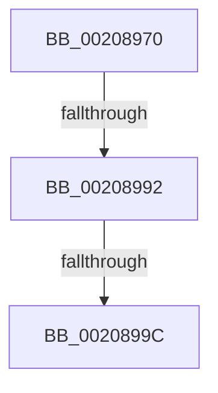

# KiCallInterruptServiceRoutine

- RVA: `0x00208970`–`0x002089AC` (길이 `60` bytes)
- VA: `0x0000000140208970`
- 실행 섹션: `.text`
- PDB 이름 있음: `예`; PDB Function 태그: `예`
- unwind 정보 RVA: `0x0005D3B8`
- 디코드: `16`개 명령, `60/60` bytes 표시
- 미해석 바이트: `0` (있으면 어셈블리에 `.byte`로 보존)

> 이 문서는 커널 이미지의 기계어와 PDB 기호를 분석해 생성했습니다. 4번과 5번은 함수 원형과 자료형을 바이너리 사용 방식에서 추정한 C 해석이며 원본 소스 복구 결과는 아닙니다.

## 1. Dependencies

- 직접 호출 지점: **0**; 고유 호출 대상: **0**
- 직접 호출자로 확인된 함수: **5**
- RIP 상대 이미지 참조: **0**

### Outgoing calls
- 직접 디코드된 call 명령이 없습니다.

### Direct callers
- [KiInvokeInterruptServiceRoutine](../39/KiInvokeInterruptServiceRoutine_function_0039F8E0.md) at `0x0039F9D9`
- [KiScanInterruptObjectList](../6B/KiScanInterruptObjectList_function_006B3860.md) at `0x006B38FB`
- [KiInterruptSubDispatch](../6B/KiInterruptSubDispatch_function_006B3990.md) at `0x006B39FE`
- [KiInterruptSubDispatchNoLock](../6B/KiInterruptSubDispatchNoLock_function_006B3A30.md) at `0x006B3A9B`
- [KiInterruptSubDispatchNoLockNoEtw](../6B/KiInterruptSubDispatchNoLockNoEtw_function_006B3AD0.md) at `0x006B3B19`

### Static image references
- 디코드된 RIP-relative 메모리 참조가 없습니다.

## 2. Other-region calls and transfers

- 다른 실행 섹션으로 향하는 call: **0**
- call이 아닌 외부 분기/꼬리 이동: **3**
  - `0x0020898C` → [sub_00208A2D](Unknown_function_00208A2D.md) (`tail-transfer`)
  - `0x00208996` → [sub_00208A2D + 0x3C](Unknown_function_00208A2D.md) (`tail-transfer`)
  - `0x002089A6` → [sub_00208DED](Unknown_function_00208DED.md) (`tail-transfer`)

## 3. Assembly (complete function range)

```asm
00208970  40 53                           push rbx
00208972  55                              push rbp
00208973  57                              push rdi
00208974  41 57                           push r15
00208976  48 83 EC 48                     sub rsp, 0x48
0020897A  8B 41 58                        mov eax, dword ptr [rcx + 0x58]
0020897D  0F B6 EA                        movzx ebp, dl
00208980  48 8B D9                        mov rbx, rcx
00208983  41 BF 01 00 00 00               mov r15d, 1
00208989  83 F8 30                        cmp eax, 0x30
0020898C  0F 83 9B 00 00 00               jae 0x140208a2d
00208992  80 7B 5D 00                     cmp byte ptr [rbx + 0x5d], 0
00208996  0F 84 CD 00 00 00               je 0x140208a69
0020899C  4C 8B 8B 10 01 00 00            mov r9, qword ptr [rbx + 0x110]
002089A3  4D 85 C9                        test r9, r9
002089A6  0F 85 41 04 00 00               jne 0x140208ded
```

## 4. C-style interpretation (structured pseudocode)

```c
__int64 __fastcall KiCallInterruptServiceRoutine(__int64 a1, unsigned __int8 a2)
{
    __int64 v_rsp;

    v_rsp = (v_rsp) - (72);
}
```

## 5. (Beta) C Style

```c
int64_t KiCallInterruptServiceRoutine(void *Arg1, uint8_t Arg2)
{
    uint8_t *arg1 = (uint8_t *)Arg1;

    int64_t local_rsp;

    local_rsp = (local_rsp) - (72);
}
```

### 관측된 메모리 오프셋

구조체 형식이 확인되지 않은 접근은 인자 기준의 오프셋으로만 기록했습니다.

| 기준 인자 | 오프셋 표현 | 폭 (bit) | 접근 |
|---|---:|---:|---|
| `Arg1` | `+ 0x58` | `32` | `R` |
| `Arg1` | `+ 0x5D` | `8` | `R` |
| `Arg1` | `+ 0x110` | `64` | `R` |

## 6. Execution-region graph

[열기: 2D/3D 그래프와 함수 탐색 컨트롤 패널](../../../control-panel.html?section=text&rva=0x00208970&view=graph)

- 2D 그래프는 위에서 아래로 흐르고, 3D 그래프는 빈 공간을 드래그해 회전합니다. Shift+드래그는 이동, 휠은 확대·축소, 함수 노드 선택은 대상 보고서 이동입니다.

### Static fallback


