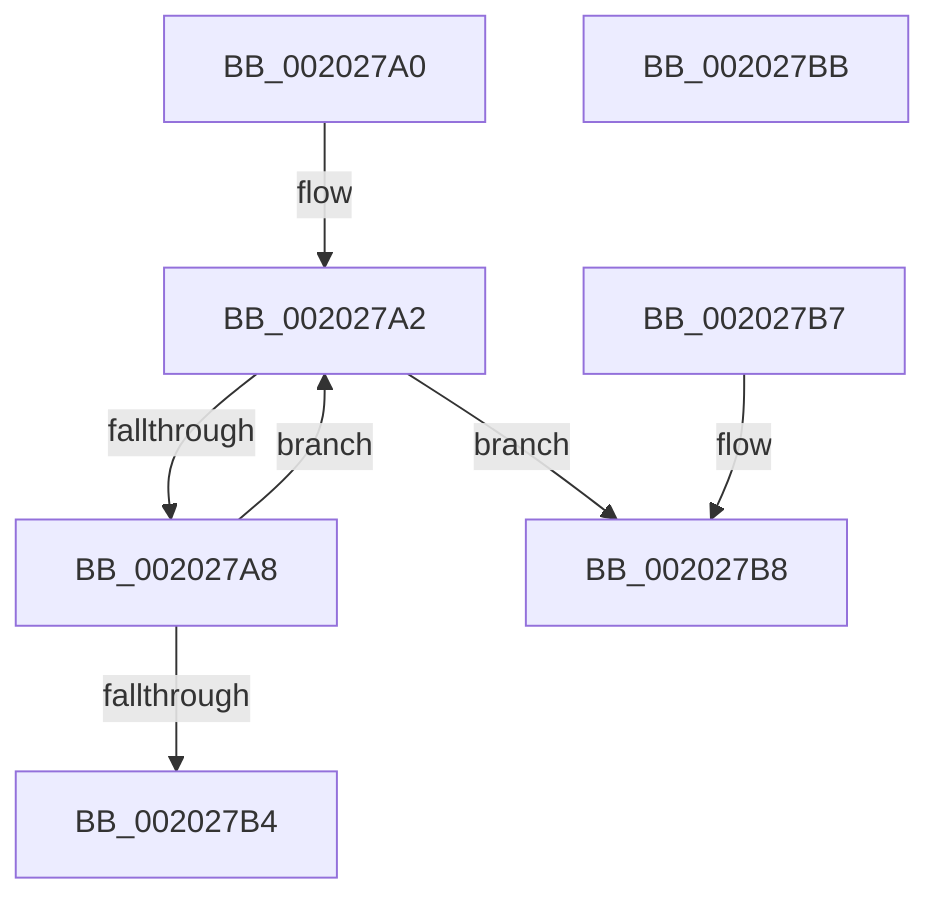

# KiCheckForMaxOverQuotaScb

- RVA: `0x002027A0`–`0x002027BC` (길이 `28` bytes)
- VA: `0x00000001402027A0`
- 실행 섹션: `.text`
- PDB 이름 있음: `예`; PDB Function 태그: `아니요`
- unwind 정보 RVA: `0x000DB714`
- 디코드: `12`개 명령, `28/28` bytes 표시
- 미해석 바이트: `0` (있으면 어셈블리에 `.byte`로 보존)

> 이 문서는 커널 이미지의 기계어와 PDB 기호를 분석해 생성했습니다. 4번과 5번은 함수 원형과 자료형을 바이너리 사용 방식에서 추정한 C 해석이며 원본 소스 복구 결과는 아닙니다.

## 1. Dependencies

- 직접 호출 지점: **0**; 고유 호출 대상: **0**
- 직접 호출자로 확인된 함수: **12**
- RIP 상대 이미지 참조: **0**

### Outgoing calls
- 직접 디코드된 call 명령이 없습니다.

### Direct callers
- [KiDeferGroupSchedulingPreemption](KiDeferGroupSchedulingPreemption_function_0020076C.md) at `0x0020096C`
- [KiDeferGroupSchedulingPreemption](KiDeferGroupSchedulingPreemption_function_0020076C.md) at `0x00200DFD`
- [KiReduceToUnderMaxQuotaSet](KiReduceToUnderMaxQuotaSet_function_00202730.md) at `0x0020277C`
- [KiHandleDeferredPreemption](KiHandleDeferredPreemption_function_00202ECC.md) at `0x00203079`
- [KiQueueReadyThread](../21/KiQueueReadyThread_function_0021C7B0.md) at `0x0021C8CC`
- [KiQueueReadyThread](../21/KiQueueReadyThread_function_0021C7B0.md) at `0x0021CC57`
- [sub_0021D7F8](../21/Unknown_function_0021D7F8.md) at `0x0021E238`
- [sub_0021D7F8](../21/Unknown_function_0021D7F8.md) at `0x0021E505`
- [sub_00254461](../25/Unknown_function_00254461.md) at `0x00254659`
- [sub_00257DDC](../25/Unknown_function_00257DDC.md) at `0x00257E1B`
- [KiSearchForNewThreadsForRescheduleContext](../25/KiSearchForNewThreadsForRescheduleContext_function_00258620.md) at `0x00258F85`
- [KiAttemptToScheduleThreadToBusyIsolationUnit](../25/KiAttemptToScheduleThreadToBusyIsolationUnit_function_00259B00.md) at `0x0025AB91`
- [KiMoveScbThreadsToNewReadylist](../30/KiMoveScbThreadsToNewReadylist_function_003099AC.md) at `0x00309AEF`
- [KiGroupSchedulingQuantumEnd](../30/KiGroupSchedulingQuantumEnd_function_0030B220.md) at `0x0030B545`
- [KiSearchForNewThreadsOnTarget](../30/KiSearchForNewThreadsOnTarget_function_0030F500.md) at `0x0031000A`
- [KiSearchForNewThreadsOnTarget](../30/KiSearchForNewThreadsOnTarget_function_0030F500.md) at `0x003103F5`
- [KiSearchForNewThreadsOnTarget](../30/KiSearchForNewThreadsOnTarget_function_0030F500.md) at `0x00310B84`

### Static image references
- 디코드된 RIP-relative 메모리 참조가 없습니다.

## 2. Other-region calls and transfers

- 다른 실행 섹션으로 향하는 call: **0**
- 별도 외부 분기/꼬리 이동을 확인하지 못했습니다.

## 3. Assembly (complete function range)

```asm
002027A0  66 90                           nop
002027A2  F6 41 70 02                     test byte ptr [rcx + 0x70], 2
002027A6  75 10                           jne 0x1402027b8
002027A8  48 8B 89 A0 01 00 00            mov rcx, qword ptr [rcx + 0x1a0]
002027AF  48 85 C9                        test rcx, rcx
002027B2  75 EE                           jne 0x1402027a2
002027B4  32 C0                           xor al, al
002027B6  C3                              ret
002027B7  CC                              int3
002027B8  B0 01                           mov al, 1
002027BA  C3                              ret
002027BB  CC                              int3
```

## 4. C-style interpretation (structured pseudocode)

```c
__int64 __fastcall KiCheckForMaxOverQuotaScb(__int64 a1)
{
    __int64 result;

loc_002027A2:
    if (((*(unsigned __int8 *)(a1 + 112)) & (2)) != 0) goto loc_002027B8;
    if (*(unsigned __int64 *)(a1 + 416) != 0) goto loc_002027A2;
    result = 0;
    return result;
loc_002027B8:
    return 1;
}
```

## 5. (Beta) C Style

```c
int64_t KiCheckForMaxOverQuotaScb(int64_t Arg1)
{
    int64_t result;

loc_002027A2:
    if (((*(uint8_t *)(Arg1 + 0x70)) & (2)) != 0) goto loc_002027B8;
    if (*(uint64_t *)(Arg1 + 0x1A0) != 0) goto loc_002027A2;
    result = 0;
    return result;
loc_002027B8:
    return 1;
}
```

## 6. Execution-region graph

[열기: 2D/3D 그래프와 함수 탐색 컨트롤 패널](../../../control-panel.html?section=text&rva=0x002027A0&view=graph)

- 2D 그래프는 위에서 아래로 흐르고, 3D 그래프는 빈 공간을 드래그해 회전합니다. Shift+드래그는 이동, 휠은 확대·축소, 함수 노드 선택은 대상 보고서 이동입니다.

### Static fallback


