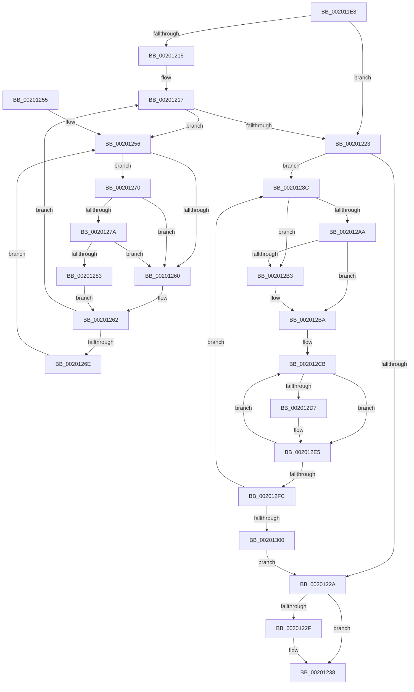

# KiFlushReadyLists

- RVA: `0x002011E8`–`0x00201308` (길이 `288` bytes)
- VA: `0x00000001402011E8`
- 실행 섹션: `.text`
- PDB 이름 있음: `예`; PDB Function 태그: `아니요`
- unwind 정보 RVA: `0x0005C728`
- 디코드: `90`개 명령, `288/288` bytes 표시
- 미해석 바이트: `0` (있으면 어셈블리에 `.byte`로 보존)

> 이 문서는 커널 이미지의 기계어와 PDB 기호를 분석해 생성했습니다. 4번과 5번은 함수 원형과 자료형을 바이너리 사용 방식에서 추정한 C 해석이며 원본 소스 복구 결과는 아닙니다.

## 1. Dependencies

- 직접 호출 지점: **4**; 고유 호출 대상: **4**
- 직접 호출자로 확인된 함수: **2**
- RIP 상대 이미지 참조: **2**

### Outgoing calls
- `0x0020127A` → [KiCheckVpBackingLongSpinWaitHypercall](../30/KiCheckVpBackingLongSpinWaitHypercall_function_0030F490.md) (function, `0x0030F490`)
- `0x00201285` → [HvlNotifyLongSpinWait](../30/HvlNotifyLongSpinWait_function_0030F460.md) (function, `0x0030F460`)
- `0x002012E0` → [KiUpdateSoftParkElectionStatisticsOnRemoval](KiUpdateSoftParkElectionStatisticsOnRemoval_function_00201A50.md) (function, `0x00201A50`)
- `0x002012F2` → [KiInsertDeferredReadyList](KiInsertDeferredReadyList_function_00201310.md) (function, `0x00201310`)

### Direct callers
- [KiFlushPrcbReadyLists](../35/KiFlushPrcbReadyLists_function_00353098.md) at `0x003530B9`
- [KiParkCurrentProcessor](../35/KiParkCurrentProcessor_function_003533A4.md) at `0x00353614`

### Static image references
- `0x00201258` → RVA `0x00FC52AC` (`ALMOSTRO`; reference)
- `0x00201270` → RVA `0x00FC6AB8` (`ALMOSTRO`; read)

## 2. Other-region calls and transfers

- 다른 실행 섹션으로 향하는 call: **0**
- 별도 외부 분기/꼬리 이동을 확인하지 못했습니다.

## 3. Assembly (complete function range)

```asm
002011E8  48 89 5C 24 08                  mov qword ptr [rsp + 8], rbx
002011ED  48 89 6C 24 18                  mov qword ptr [rsp + 0x18], rbp
002011F2  48 89 74 24 20                  mov qword ptr [rsp + 0x20], rsi
002011F7  57                              push rdi
002011F8  41 54                           push r12
002011FA  41 55                           push r13
002011FC  41 56                           push r14
002011FE  41 57                           push r15
00201200  48 83 EC 20                     sub rsp, 0x20
00201204  49 8B D9                        mov rbx, r9
00201207  4D 8B E0                        mov r12, r8
0020120A  4C 8B F2                        mov r14, rdx
0020120D  4C 8B E9                        mov r13, rcx
00201210  4D 85 C9                        test r9, r9
00201213  74 0E                           je 0x140201223
00201215  33 FF                           xor edi, edi
00201217  F0 48 0F BA AB 00 03 00 00 00   lock bts qword ptr [rbx + 0x300], 0
00201221  72 33                           jb 0x140201256
00201223  41 8B 36                        mov esi, dword ptr [r14]
00201226  85 F6                           test esi, esi
00201228  75 62                           jne 0x14020128c
0020122A  48 85 DB                        test rbx, rbx
0020122D  74 09                           je 0x140201238
0020122F  F0 48 83 A3 00 03 00 00 00      lock and qword ptr [rbx + 0x300], 0
00201238  48 8B 5C 24 50                  mov rbx, qword ptr [rsp + 0x50]
0020123D  48 8B 6C 24 60                  mov rbp, qword ptr [rsp + 0x60]
00201242  48 8B 74 24 68                  mov rsi, qword ptr [rsp + 0x68]
00201247  48 83 C4 20                     add rsp, 0x20
0020124B  41 5F                           pop r15
0020124D  41 5E                           pop r14
0020124F  41 5D                           pop r13
00201251  41 5C                           pop r12
00201253  5F                              pop rdi
00201254  C3                              ret
00201255  CC                              int3
00201256  FF C7                           inc edi
00201258  85 3D 4E 40 DC 00               test dword ptr [rip + 0xdc404e], edi
0020125E  74 10                           je 0x140201270
00201260  F3 90                           pause
00201262  48 8B 83 00 03 00 00            mov rax, qword ptr [rbx + 0x300]
00201269  48 85 C0                        test rax, rax
0020126C  74 A9                           je 0x140201217
0020126E  EB E6                           jmp 0x140201256
00201270  8B 05 42 58 DC 00               mov eax, dword ptr [rip + 0xdc5842]
00201276  A8 40                           test al, 0x40
00201278  74 E6                           je 0x140201260
0020127A  E8 11 E2 10 00                  call 0x14030f490
0020127F  84 C0                           test al, al
00201281  74 DD                           je 0x140201260
00201283  8B CF                           mov ecx, edi
00201285  E8 D6 E1 10 00                  call 0x14030f460
0020128A  EB D6                           jmp 0x140201262
0020128C  0F BC C6                        bsf eax, esi
0020128F  8B C8                           mov ecx, eax
00201291  48 C1 E1 04                     shl rcx, 4
00201295  49 03 CD                        add rcx, r13
00201298  89 44 24 58                     mov dword ptr [rsp + 0x58], eax
0020129C  8D 46 FF                        lea eax, [rsi - 1]
0020129F  23 F0                           and esi, eax
002012A1  48 8B 39                        mov rdi, qword ptr [rcx]
002012A4  48 39 4F 08                     cmp qword ptr [rdi + 8], rcx
002012A8  75 09                           jne 0x1402012b3
002012AA  48 8B 41 08                     mov rax, qword ptr [rcx + 8]
002012AE  48 39 08                        cmp qword ptr [rax], rcx
002012B1  74 07                           je 0x1402012ba
002012B3  B9 03 00 00 00                  mov ecx, 3
002012B8  CD 29                           int 0x29
002012BA  48 89 38                        mov qword ptr [rax], rdi
002012BD  4C 8B FF                        mov r15, rdi
002012C0  48 89 47 08                     mov qword ptr [rdi + 8], rax
002012C4  48 89 49 08                     mov qword ptr [rcx + 8], rcx
002012C8  48 89 09                        mov qword ptr [rcx], rcx
002012CB  48 8D AF 28 FF FF FF            lea rbp, [rdi - 0xd8]
002012D2  48 85 DB                        test rbx, rbx
002012D5  74 0E                           je 0x1402012e5
002012D7  41 B0 01                        mov r8b, 1
002012DA  48 8B D5                        mov rdx, rbp
002012DD  48 8B CB                        mov rcx, rbx
002012E0  E8 6B 07 00 00                  call 0x140201a50
002012E5  83 4D 74 02                     or dword ptr [rbp + 0x74], 2
002012E9  48 8B D5                        mov rdx, rbp
002012EC  48 8B 3F                        mov rdi, qword ptr [rdi]
002012EF  49 8B CC                        mov rcx, r12
002012F2  E8 19 00 00 00                  call 0x140201310
002012F7  49 3B FF                        cmp rdi, r15
002012FA  75 CF                           jne 0x1402012cb
002012FC  85 F6                           test esi, esi
002012FE  75 8C                           jne 0x14020128c
00201300  41 21 36                        and dword ptr [r14], esi
00201303  E9 22 FF FF FF                  jmp 0x14020122a
```

## 4. C-style interpretation (structured pseudocode)

```c
__int64 __fastcall KiFlushReadyLists(__int64 a1, __int64 a2, __int64 a3, __int64 a4)
{
    __int64 result;
    __int64 v_rdi;
    __int64 v_rsi;
    __int64 v_rsp;
    unsigned __int64 v_stack_p18;
    unsigned __int64 v_stack_p20;
    unsigned int v_stack_p58;
    unsigned __int64 v_stack_p8;

    v_stack_p8 = v_rbx;
    v_stack_p18 = v_rbp;
    v_stack_p20 = v_rsi;
    v_rsp = (v_rsp) - (32);
    if (a4 == 0) goto loc_00201223;
    v_rdi = 0;
loc_00201217:
    if (condition_is_below) goto loc_00201256;
loc_00201223:
    if ((unsigned int)((unsigned int)(*(unsigned int *)(a2))) != 0) goto loc_0020128C;
loc_0020122A:
    if (a4 != 0) {
    }
    v_rsp = (v_rsp) + (32);
    return result;
loc_00201256:
    v_rdi = (unsigned int)((v_rdi) + 1);
    if (((*(unsigned int *)(v_rip + 14434382)) & ((unsigned int)(v_rdi))) == 0) goto loc_00201270;
loc_00201260:
loc_00201262:
    if (*(unsigned __int64 *)(v_stack_p8 + 768) == 0) goto loc_00201217;
    goto loc_00201256;
loc_00201270:
    if ((((unsigned __int8)((unsigned int)(*(unsigned int *)(v_rip + 14440514)))) & (64)) == 0) goto loc_00201260;
    result = KiCheckVpBackingLongSpinWaitHypercall(a1, a2, a3, a4);
    if ((unsigned __int8)(result) == 0) goto loc_00201260;
    result = HvlNotifyLongSpinWait((unsigned int)((unsigned int)(v_rdi)), a2, a3, a4);
    goto loc_00201262;
loc_0020128C:
    a1 = ((unsigned int)((unsigned int)(result))) << (4);
    a1 = (a1) + (a1);
    v_stack_p58 = (unsigned int)(result);
    v_rsi = (unsigned int)((v_stack_p20) & ((unsigned int)(v_stack_p20 - 1)));
    if ((*(unsigned __int64 *)(*(unsigned __int64 *)(a1) + 8)) != a1) goto loc_002012B3;
    if ((*(unsigned __int64 *)(*(unsigned __int64 *)(a1 + 8))) != a1) {
        a1 = 3;
    }
    *(unsigned __int64 *)(*(unsigned __int64 *)(a1 + 8)) = *(unsigned __int64 *)(a1);
    *(unsigned __int64 *)(*(unsigned __int64 *)(a1) + 8) = *(unsigned __int64 *)(a1 + 8);
    *(unsigned __int64 *)(a1 + 8) = a1;
    *(unsigned __int64 *)(a1) = a1;
loc_002012CB:
    result = *(unsigned __int64 *)(a1 + 8);
    if (v_stack_p8 != 0) {
        a3 = 1;
        a2 = *(unsigned __int64 *)(a1) - 216;
        a1 = v_stack_p8;
        result = KiUpdateSoftParkElectionStatisticsOnRemoval(a1, a2, a3, a4);
    }
    result = KiInsertDeferredReadyList(a3, *(unsigned __int64 *)(a1) - 216, a3, a4);
    if ((*(unsigned __int64 *)(*(unsigned __int64 *)(a1))) != (*(unsigned __int64 *)(a1))) goto loc_002012CB;
    if ((unsigned int)(v_rsi) != 0) goto loc_0020128C;
    goto loc_0020122A;
}
```

## 5. (Beta) C Style

```c
int64_t KiFlushReadyLists(int64_t Arg1, void *Arg2, int64_t Arg3, void *Arg4)
{
    uint8_t *arg2 = (uint8_t *)Arg2;
    uint8_t *arg4 = (uint8_t *)Arg4;

    int64_t result;
    int64_t local_rdi;
    int64_t local_rsi;
    int64_t local_rsp;
    uint64_t v_stack_p18;
    uint64_t v_stack_p20;
    uint32_t v_stack_p58;
    uint64_t v_stack_p8;

    v_stack_p8 = local_rbx;
    v_stack_p18 = local_rbp;
    v_stack_p20 = local_rsi;
    local_rsp = (local_rsp) - (32);
    if (Arg4 == NULL) goto loc_00201223;
    local_rdi = 0;
loc_00201217:
    if (condition_is_below) goto loc_00201256;
loc_00201223:
    if ((uint32_t)((uint32_t)(*(uint32_t *)(arg2))) != 0) goto loc_0020128C;
loc_0020122A:
    if (Arg4 != NULL) {
    }
    local_rsp = (local_rsp) + (32);
    return result;
loc_00201256:
    local_rdi = (uint32_t)((local_rdi) + 1);
    if (((*(uint32_t *)(v_rip + 0xDC404E)) & ((uint32_t)(local_rdi))) == 0) goto loc_00201270;
loc_00201260:
loc_00201262:
    if (*(uint64_t *)(v_stack_p8 + 0x300) == 0) goto loc_00201217;
    goto loc_00201256;
loc_00201270:
    if ((((uint8_t)((uint32_t)(*(uint32_t *)(v_rip + 0xDC5842)))) & (64)) == 0) goto loc_00201260;
    result = KiCheckVpBackingLongSpinWaitHypercall(Arg1, Arg2, Arg3, Arg4);
    if ((uint8_t)(result) == 0) goto loc_00201260;
    result = HvlNotifyLongSpinWait((uint32_t)((uint32_t)(local_rdi)), Arg2, Arg3, Arg4);
    goto loc_00201262;
loc_0020128C:
    Arg1 = ((uint32_t)((uint32_t)(result))) << (4);
    Arg1 = (Arg1) + (Arg1);
    v_stack_p58 = (uint32_t)(result);
    local_rsi = (uint32_t)((v_stack_p20) & ((uint32_t)(v_stack_p20 - 1)));
    if ((*(uint64_t *)(*(uint64_t *)(Arg1) + 0x8)) != Arg1) goto loc_002012B3;
    if ((*(uint64_t *)(*(uint64_t *)(Arg1 + 0x8))) != Arg1) {
        Arg1 = 3;
    }
    *(uint64_t *)(*(uint64_t *)(Arg1 + 0x8)) = *(uint64_t *)(Arg1);
    *(uint64_t *)(*(uint64_t *)(Arg1) + 0x8) = *(uint64_t *)(Arg1 + 0x8);
    *(uint64_t *)(Arg1 + 0x8) = Arg1;
    *(uint64_t *)(Arg1) = Arg1;
loc_002012CB:
    result = *(uint64_t *)(Arg1 + 0x8);
    if (v_stack_p8 != 0) {
        Arg3 = 1;
        Arg2 = *(uint64_t *)(Arg1) - 216;
        Arg1 = v_stack_p8;
        result = KiUpdateSoftParkElectionStatisticsOnRemoval(Arg1, Arg2, Arg3, Arg4);
    }
    result = KiInsertDeferredReadyList(Arg3, *(uint64_t *)(Arg1) - 216, Arg3, Arg4);
    if ((*(uint64_t *)(*(uint64_t *)(Arg1))) != (*(uint64_t *)(Arg1))) goto loc_002012CB;
    if ((uint32_t)(local_rsi) != 0) goto loc_0020128C;
    goto loc_0020122A;
}
```

### 관측된 메모리 오프셋

구조체 형식이 확인되지 않은 접근은 인자 기준의 오프셋으로만 기록했습니다.

| 기준 인자 | 오프셋 표현 | 폭 (bit) | 접근 |
|---|---:|---:|---|
| `Arg2` | `+ 0x0` | `32` | `R` |
| `Arg2` | `+ 0x0` | `32` | `R/W` |
| `Arg4` | `+ 0x300` | `64` | `R` |
| `Arg4` | `+ 0x300` | `64` | `R/W` |

## 6. Execution-region graph

[열기: 2D/3D 그래프와 함수 탐색 컨트롤 패널](../../../control-panel.html?section=text&rva=0x002011E8&view=graph)

- 2D 그래프는 위에서 아래로 흐르고, 3D 그래프는 빈 공간을 드래그해 회전합니다. Shift+드래그는 이동, 휠은 확대·축소, 함수 노드 선택은 대상 보고서 이동입니다.

### Static fallback


