# KiHandleDeferredPreemption

- RVA: `0x00202ECC`–`0x00203222` (길이 `854` bytes)
- VA: `0x0000000140202ECC`
- 실행 섹션: `.text`
- PDB 이름 있음: `예`; PDB Function 태그: `아니요`
- unwind 정보 RVA: `0x0005C9FC`
- 디코드: `228`개 명령, `854/854` bytes 표시
- 미해석 바이트: `0` (있으면 어셈블리에 `.byte`로 보존)

> 이 문서는 커널 이미지의 기계어와 PDB 기호를 분석해 생성했습니다. 4번과 5번은 함수 원형과 자료형을 바이너리 사용 방식에서 추정한 C 해석이며 원본 소스 복구 결과는 아닙니다.

## 1. Dependencies

- 직접 호출 지점: **27**; 고유 호출 대상: **23**
- 직접 호출자로 확인된 함수: **1**
- RIP 상대 이미지 참조: **1**

### Outgoing calls
- `0x00202F1B` → [KiAbProcessPreContextSwitch](../21/KiAbProcessPreContextSwitch_function_0021D420.md) (function, `0x0021D420`)
- `0x00202F30` → [KiAcquirePrcbLocksForIsolationUnit](../30/KiAcquirePrcbLocksForIsolationUnit_function_0030ED60.md) (function, `0x0030ED60`)
- `0x00202F85` → [KzReleaseAdditionalPrcbLocks](KzReleaseAdditionalPrcbLocks_function_00202B70.md) (function, `0x00202B70`)
- `0x00202F9F` → [KiReleasePrcbLocksForIsolationUnit](../39/KiReleasePrcbLocksForIsolationUnit_function_00399C50.md) (function, `0x00399C50`)
- `0x00202FA7` → [KiAbProcessPostContextSwitch](../24/KiAbProcessPostContextSwitch_function_00248790.md) (function, `0x00248790`)
- `0x00202FBC` → [KiLowerIrqlProcessIrqlFlags](../4F/KiLowerIrqlProcessIrqlFlags_function_004F5698.md) (function, `0x004F5698`)
- `0x00202FF8` → [memset](../6C/memset_function_006C6C40.md) (function, `0x006C6C40`)
- `0x00203007` → [KiStartRescheduleContext](../30/KiStartRescheduleContext_function_0030C6B0.md) (function, `0x0030C6B0`)
- `0x0020300F` → [KiIsThreadConstrainedBySchedulingGroup](../30/KiIsThreadConstrainedBySchedulingGroup_function_0030B200.md) (function, `0x0030B200`)
- `0x00203033` → [KiSearchForNewThreadsForRescheduleContext](../25/KiSearchForNewThreadsForRescheduleContext_function_00258620.md) (function, `0x00258620`)
- `0x00203045` → [KiCommitRescheduleContext](../30/KiCommitRescheduleContext_function_0030CF20.md) (function, `0x0030CF20`)
- `0x00203079` → [KiCheckForMaxOverQuotaScb](KiCheckForMaxOverQuotaScb_function_002027A0.md) (function, `0x002027A0`)
- `0x00203088` → [KiFindRescheduleContextEntryForPrcb](../35/KiFindRescheduleContextEntryForPrcb_function_00353060.md) (function, `0x00353060`)
- `0x002030E8` → [KiAdjustRescheduleContextEntryForThreadRemoval](../35/KiAdjustRescheduleContextEntryForThreadRemoval_function_00352340.md) (function, `0x00352340`)
- `0x00203108` → [KiRaiseIrqlProcessIrqlFlags](../4F/KiRaiseIrqlProcessIrqlFlags_function_004F56FC.md) (function, `0x004F56FC`)
- `0x0020311D` → [KiCaptureTotalCyclesCurrentThread](../37/KiCaptureTotalCyclesCurrentThread_function_0037CB90.md) (function, `0x0037CB90`)
- `0x00203128` → [KiUpdatePriorityMatrixForRunningTransition](../37/KiUpdatePriorityMatrixForRunningTransition_function_0037B3A0.md) (function, `0x0037B3A0`)
- `0x00203155` → [KiQueueReadyThread](../21/KiQueueReadyThread_function_0021C7B0.md) (function, `0x0021C7B0`)
- `0x00203163` → [KiSwapContext](../6B/KiSwapContext_function_006B9740.md) (function, `0x006B9740`)
- `0x0020316D` → [KiAbProcessPostContextSwitch](../24/KiAbProcessPostContextSwitch_function_00248790.md) (function, `0x00248790`)
- `0x0020318A` → [KiLowerIrqlProcessIrqlFlags](../4F/KiLowerIrqlProcessIrqlFlags_function_004F5698.md) (function, `0x004F5698`)
- `0x0020319E` → [KiDeliverApc](../25/KiDeliverApc_function_00250F20.md) (function, `0x00250F20`)
- `0x002031AC` → [KiReleasePrcbLocksForIsolationUnit](../39/KiReleasePrcbLocksForIsolationUnit_function_00399C50.md) (function, `0x00399C50`)
- `0x002031C4` → [KiAcquirePrcbLocksForIsolationUnit](../30/KiAcquirePrcbLocksForIsolationUnit_function_0030ED60.md) (function, `0x0030ED60`)
- `0x002031EE` → [KiCompleteRescheduleContextEntry](../35/KiCompleteRescheduleContextEntry_function_00356330.md) (function, `0x00356330`)
- `0x00203206` → [KiFlushSoftwareInterruptBatch](../25/KiFlushSoftwareInterruptBatch_function_00252200.md) (function, `0x00252200`)
- `0x00203214` → [KiReadyDeferredReadyList](../30/KiReadyDeferredReadyList_function_0030DD80.md) (function, `0x0030DD80`)

### Direct callers
- [KiSchedulerApc](KiSchedulerApc_function_00202BC0.md) at `0x00202C70`

### Static image references
- `0x00202EFA` → RVA `0x00FC6D20` (`ALMOSTRO`; read)

## 2. Other-region calls and transfers

- 다른 실행 섹션으로 향하는 call: **0**
- 별도 외부 분기/꼬리 이동을 확인하지 못했습니다.

## 3. Assembly (complete function range)

```asm
00202ECC  48 89 5C 24 18                  mov qword ptr [rsp + 0x18], rbx
00202ED1  48 89 74 24 20                  mov qword ptr [rsp + 0x20], rsi
00202ED6  55                              push rbp
00202ED7  57                              push rdi
00202ED8  41 54                           push r12
00202EDA  41 56                           push r14
00202EDC  41 57                           push r15
00202EDE  48 8B EC                        mov rbp, rsp
00202EE1  48 83 EC 30                     sub rsp, 0x30
00202EE5  48 83 65 30 00                  and qword ptr [rbp + 0x30], 0
00202EEA  48 8B F1                        mov rsi, rcx
00202EED  45 0F 20 C4                     mov r12, cr8
00202EF1  BB 02 00 00 00                  mov ebx, 2
00202EF6  44 0F 22 C3                     mov cr8, rbx
00202EFA  83 3D 1F 3E DC 00 00            cmp dword ptr [rip + 0xdc3e1f], 0
00202F01  0F 85 FC 01 00 00               jne 0x140203103
00202F07  65 48 8B 3C 25 20 00 00 00      mov rdi, qword ptr gs:[0x20]
00202F10  33 D2                           xor edx, edx
00202F12  F0 0F BA 76 78 0A               lock btr dword ptr [rsi + 0x78], 0xa
00202F18  48 8B CE                        mov rcx, rsi
00202F1B  E8 00 A5 01 00                  call 0x14021d420
00202F20  41 BF 01 00 00 00               mov r15d, 1
00202F26  4C 8D 45 30                     lea r8, [rbp + 0x30]
00202F2A  41 8B D7                        mov edx, r15d
00202F2D  48 8B CF                        mov rcx, rdi
00202F30  E8 2B BE 10 00                  call 0x14030ed60
00202F35  48 83 7F 10 00                  cmp qword ptr [rdi + 0x10], 0
00202F3A  0F 84 A1 00 00 00               je 0x140202fe1
00202F40  48 8B 45 30                     mov rax, qword ptr [rbp + 0x30]
00202F44  45 33 D2                        xor r10d, r10d
00202F47  48 8B D8                        mov rbx, rax
00202F4A  33 D2                           xor edx, edx
00202F4C  48 83 E3 FE                     and rbx, 0xfffffffffffffffe
00202F50  48 89 5D 38                     mov qword ptr [rbp + 0x38], rbx
00202F54  41 23 C7                        and eax, r15d
00202F57  74 35                           je 0x140202f8e
00202F59  85 C0                           test eax, eax
00202F5B  0F 84 0C 01 00 00               je 0x14020306d
00202F61  83 F8 01                        cmp eax, 1
00202F64  75 15                           jne 0x140202f7b
00202F66  48 8B 83 58 8E 00 00            mov rax, qword ptr [rbx + 0x8e58]
00202F6D  4C 8B 93 58 8E 00 00            mov r10, qword ptr [rbx + 0x8e58]
00202F74  49 83 C2 08                     add r10, 8
00202F78  0F B6 10                        movzx edx, byte ptr [rax]
00202F7B  45 8B CF                        mov r9d, r15d
00202F7E  4C 8D 45 38                     lea r8, [rbp + 0x38]
00202F82  49 8B CA                        mov rcx, r10
00202F85  E8 E6 FB FF FF                  call 0x140202b70
00202F8A  48 89 5D 30                     mov qword ptr [rbp + 0x30], rbx
00202F8E  48 8B 5F 10                     mov rbx, qword ptr [rdi + 0x10]
00202F92  48 85 DB                        test rbx, rbx
00202F95  0F 85 77 01 00 00               jne 0x140203112
00202F9B  48 8D 4D 30                     lea rcx, [rbp + 0x30]
00202F9F  E8 AC 6C 19 00                  call 0x140399c50
00202FA4  48 8B CE                        mov rcx, rsi
00202FA7  E8 E4 57 04 00                  call 0x140248790
00202FAC  83 3D 6D 3D DC 00 00            cmp dword ptr [rip + 0xdc3d6d], 0
00202FB3  74 0C                           je 0x140202fc1
00202FB5  44 0F 20 C1                     mov rcx, cr8
00202FB9  41 8A D4                        mov dl, r12b
00202FBC  E8 D7 26 2F 00                  call 0x1404f5698
00202FC1  41 0F B6 C4                     movzx eax, r12b
00202FC5  44 0F 22 C0                     mov cr8, rax
00202FC9  48 8B 5C 24 70                  mov rbx, qword ptr [rsp + 0x70]
00202FCE  48 8B 74 24 78                  mov rsi, qword ptr [rsp + 0x78]
00202FD3  48 83 C4 30                     add rsp, 0x30
00202FD7  41 5F                           pop r15
00202FD9  41 5E                           pop r14
00202FDB  41 5C                           pop r12
00202FDD  5F                              pop rdi
00202FDE  5D                              pop rbp
00202FDF  C3                              ret
00202FE0  CC                              int3
00202FE1  4C 8B B7 E8 37 00 00            mov r14, qword ptr [rdi + 0x37e8]
00202FE8  33 D2                           xor edx, edx
00202FEA  48 83 65 38 00                  and qword ptr [rbp + 0x38], 0
00202FEF  49 8B CE                        mov rcx, r14
00202FF2  41 B8 F0 00 00 00               mov r8d, 0xf0
00202FF8  E8 43 3C 4C 00                  call 0x1406c6c40
00202FFD  45 33 C0                        xor r8d, r8d
00203000  48 8D 55 30                     lea rdx, [rbp + 0x30]
00203004  49 8B CE                        mov rcx, r14
00203007  E8 A4 96 10 00                  call 0x14030c6b0
0020300C  48 8B CE                        mov rcx, rsi
0020300F  E8 EC 81 10 00                  call 0x14030b200
00203014  84 C0                           test al, al
00203016  74 14                           je 0x14020302c
00203018  48 8B 46 68                     mov rax, qword ptr [rsi + 0x68]
0020301C  48 85 C0                        test rax, rax
0020301F  74 0B                           je 0x14020302c
00203021  8B 8F D8 00 00 00               mov ecx, dword ptr [rdi + 0xd8]
00203027  48 03 C8                        add rcx, rax
0020302A  75 4D                           jne 0x140203079
0020302C  48 8D 55 38                     lea rdx, [rbp + 0x38]
00203030  49 8B CE                        mov rcx, r14
00203033  E8 E8 55 05 00                  call 0x140258620
00203038  4C 8D 4D 38                     lea r9, [rbp + 0x38]
0020303C  45 33 C0                        xor r8d, r8d
0020303F  48 8B D7                        mov rdx, rdi
00203042  49 8B CE                        mov rcx, r14
00203045  E8 D6 9E 10 00                  call 0x14030cf20
0020304A  48 8B 5D 38                     mov rbx, qword ptr [rbp + 0x38]
0020304E  44 8A F8                        mov r15b, al
00203051  84 C0                           test al, al
00203053  0F 85 4F 01 00 00               jne 0x1402031a8
00203059  48 85 DB                        test rbx, rbx
0020305C  0F 85 46 01 00 00               jne 0x1402031a8
00203062  41 BF 01 00 00 00               mov r15d, 1
00203068  E9 D3 FE FF FF                  jmp 0x140202f40
0020306D  4C 8D 55 38                     lea r10, [rbp + 0x38]
00203071  41 8B D7                        mov edx, r15d
00203074  E9 02 FF FF FF                  jmp 0x140202f7b
00203079  E8 22 F7 FF FF                  call 0x1402027a0
0020307E  84 C0                           test al, al
00203080  74 AA                           je 0x14020302c
00203082  48 8B D7                        mov rdx, rdi
00203085  49 8B CE                        mov rcx, r14
00203088  E8 D3 FF 14 00                  call 0x140353060
0020308D  4C 8B D8                        mov r11, rax
00203090  08 58 22                        or byte ptr [rax + 0x22], bl
00203093  44 8A 40 20                     mov r8b, byte ptr [rax + 0x20]
00203097  48 8B 10                        mov rdx, qword ptr [rax]
0020309A  48 8B 4A 18                     mov rcx, qword ptr [rdx + 0x18]
0020309E  48 89 48 10                     mov qword ptr [rax + 0x10], rcx
002030A2  41 8A C8                        mov cl, r8b
002030A5  80 E1 C5                        and cl, 0xc5
002030A8  80 C9 05                        or cl, 5
002030AB  88 48 20                        mov byte ptr [rax + 0x20], cl
002030AE  48 8B 4A 18                     mov rcx, qword ptr [rdx + 0x18]
002030B2  80 60 21 FE                     and byte ptr [rax + 0x21], 0xfe
002030B6  48 89 48 18                     mov qword ptr [rax + 0x18], rcx
002030BA  44 84 C3                        test bl, r8b
002030BD  0F 84 69 FF FF FF               je 0x14020302c
002030C3  45 33 D2                        xor r10d, r10d
002030C6  45 38 16                        cmp byte ptr [r14], r10b
002030C9  76 2E                           jbe 0x1402030f9
002030CB  41 8B C2                        mov eax, r10d
002030CE  4A 8D 0C 95 02 00 00 00         lea rcx, [r10*4 + 2]
002030D6  48 03 C8                        add rcx, rax
002030D9  49 8D 0C CE                     lea rcx, [r14 + rcx*8]
002030DD  49 3B CB                        cmp rcx, r11
002030E0  74 0B                           je 0x1402030ed
002030E2  45 8A CF                        mov r9b, r15b
002030E5  45 33 C0                        xor r8d, r8d
002030E8  E8 53 F2 14 00                  call 0x140352340
002030ED  41 0F B6 06                     movzx eax, byte ptr [r14]
002030F1  45 03 D7                        add r10d, r15d
002030F4  44 3B D0                        cmp r10d, eax
002030F7  72 D2                           jb 0x1402030cb
002030F9  41 83 66 04 00                  and dword ptr [r14 + 4], 0
002030FE  E9 29 FF FF FF                  jmp 0x14020302c
00203103  8A D3                           mov dl, bl
00203105  41 8A CC                        mov cl, r12b
00203108  E8 EF 25 2F 00                  call 0x1404f56fc
0020310D  E9 F5 FD FF FF                  jmp 0x140202f07
00203112  48 83 67 10 00                  and qword ptr [rdi + 0x10], 0
00203117  48 8B D6                        mov rdx, rsi
0020311A  48 8B CF                        mov rcx, rdi
0020311D  E8 6E 9A 17 00                  call 0x14037cb90
00203122  48 8B D3                        mov rdx, rbx
00203125  48 8B CF                        mov rcx, rdi
00203128  E8 73 82 17 00                  call 0x14037b3a0
0020312D  48 3B 5F 18                     cmp rbx, qword ptr [rdi + 0x18]
00203131  74 0A                           je 0x14020313d
00203133  44 84 7F 23                     test byte ptr [rdi + 0x23], r15b
00203137  0F 84 DE 00 00 00               je 0x14020321b
0020313D  4C 8B C6                        mov r8, rsi
00203140  C6 86 83 02 00 00 26            mov byte ptr [rsi + 0x283], 0x26
00203147  48 8D 55 30                     lea rdx, [rbp + 0x30]
0020314B  C6 86 86 01 00 00 00            mov byte ptr [rsi + 0x186], 0
00203152  48 8B CF                        mov rcx, rdi
00203155  E8 56 96 01 00                  call 0x14021c7b0
0020315A  45 33 C0                        xor r8d, r8d
0020315D  48 8B D3                        mov rdx, rbx
00203160  48 8B CE                        mov rcx, rsi
00203163  E8 D8 65 4B 00                  call 0x1406b9740
00203168  48 8B CE                        mov rcx, rsi
0020316B  8A D8                           mov bl, al
0020316D  E8 1E 56 04 00                  call 0x140248790
00203172  84 DB                           test bl, bl
00203174  0F 84 32 FE FF FF               je 0x140202fac
0020317A  83 3D 9F 3B DC 00 00            cmp dword ptr [rip + 0xdc3b9f], 0
00203181  74 0C                           je 0x14020318f
00203183  44 0F 20 C1                     mov rcx, cr8
00203187  41 8A D7                        mov dl, r15b
0020318A  E8 09 25 2F 00                  call 0x1404f5698
0020318F  45 0F 22 C7                     mov cr8, r15
00203193  83 66 74 BF                     and dword ptr [rsi + 0x74], 0xffffffbf
00203197  45 33 C0                        xor r8d, r8d
0020319A  33 D2                           xor edx, edx
0020319C  33 C9                           xor ecx, ecx
0020319E  E8 7D DD 04 00                  call 0x140250f20
002031A3  E9 04 FE FF FF                  jmp 0x140202fac
002031A8  48 8D 4D 30                     lea rcx, [rbp + 0x30]
002031AC  E8 9F 6A 19 00                  call 0x140399c50
002031B1  45 84 FF                        test r15b, r15b
002031B4  75 18                           jne 0x1402031ce
002031B6  48 85 DB                        test rbx, rbx
002031B9  75 52                           jne 0x14020320d
002031BB  4C 8D 45 30                     lea r8, [rbp + 0x30]
002031BF  33 D2                           xor edx, edx
002031C1  48 8B CF                        mov rcx, rdi
002031C4  E8 97 BB 10 00                  call 0x14030ed60
002031C9  E9 94 FE FF FF                  jmp 0x140203062
002031CE  45 33 FF                        xor r15d, r15d
002031D1  45 38 3E                        cmp byte ptr [r14], r15b
002031D4  76 29                           jbe 0x1402031ff
002031D6  41 8B CF                        mov ecx, r15d
002031D9  45 33 C9                        xor r9d, r9d
002031DC  48 83 C1 02                     add rcx, 2
002031E0  45 33 C0                        xor r8d, r8d
002031E3  48 8B D7                        mov rdx, rdi
002031E6  4A 8D 0C B9                     lea rcx, [rcx + r15*4]
002031EA  49 8D 0C CE                     lea rcx, [r14 + rcx*8]
002031EE  E8 3D 31 15 00                  call 0x140356330
002031F3  41 0F B6 06                     movzx eax, byte ptr [r14]
002031F7  41 FF C7                        inc r15d
002031FA  44 3B F8                        cmp r15d, eax
002031FD  72 D7                           jb 0x1402031d6
002031FF  48 8D 8F D8 35 00 00            lea rcx, [rdi + 0x35d8]
00203206  E8 F5 EF 04 00                  call 0x140252200
0020320B  EB A9                           jmp 0x1402031b6
0020320D  48 8D 55 38                     lea rdx, [rbp + 0x38]
00203211  48 8B CF                        mov rcx, rdi
00203214  E8 67 AB 10 00                  call 0x14030dd80
00203219  EB A0                           jmp 0x1402031bb
0020321B  B9 21 00 00 00                  mov ecx, 0x21
00203220  CD 29                           int 0x29
```

## 4. C-style interpretation (structured pseudocode)

```c
__int64 __fastcall KiHandleDeferredPreemption(__int64 a1, int a2)
{
    __int64 result;
    __int64 v_r10;
    __int64 v_r15;
    __int64 v_rbx;
    __int64 v_rsp;
    unsigned __int64 v_stack_p10;
    unsigned __int64 v_stack_p18;
    unsigned __int64 v_stack_p20;
    unsigned __int64 v_stack_p8;

    v_stack_p18 = v_rbx;
    v_stack_p20 = v_rsi;
    v_rsp = (v_rsp) - (48);
    if ((*(unsigned int *)(v_rip + 14433823)) != 0) goto loc_00203103;
loc_00202F07:
    a2 = 0;
    result = KiAbProcessPreContextSwitch(a1, a2, a3, a4);
    result = KiAcquirePrcbLocksForIsolationUnit(*(unsigned __int64 *)(gs_base + (0 + 32)), 1, v_stack_p8, a4);
    if ((*(unsigned __int64 *)(*(unsigned __int64 *)(gs_base + (0 + 32)) + 16)) == 0) goto loc_00202FE1;
loc_00202F40:
    v_r10 = 0;
    a2 = 0;
    v_rbx = (v_stack_p8) & (-2);
    v_stack_p10 = v_rbx;
    result = (unsigned int)((v_stack_p8) & (1));
    if (condition_is_equal) goto loc_00202F8E;
    if ((unsigned int)(result) == 0) goto loc_0020306D;
    if (((unsigned int)(result)) == 1) {
        result = *(unsigned __int64 *)(v_rbx + 36440);
        v_r10 = *(unsigned __int64 *)(v_rbx + 36440);
        v_r10 = (v_r10) + (8);
        a2 = *(unsigned __int8 *)(result);
    }
    result = KzReleaseAdditionalPrcbLocks(v_r10, a2, v_stack_p10, 1);
    v_stack_p8 = v_rbx;
loc_00202F8E:
    if (*(unsigned __int64 *)(*(unsigned __int64 *)(gs_base + (0 + 32)) + 16) != 0) goto loc_00203112;
    result = KiReleasePrcbLocksForIsolationUnit(v_stack_p8, a2, v_stack_p10, 1);
    result = KiAbProcessPostContextSwitch(a1, a2, v_stack_p10, 1);
loc_00202FAC:
    if ((*(unsigned int *)(v_rip + 14433645)) != 0) {
        a1 = 2;
        a2 = (unsigned __int8)(v_cr8);
        result = KiLowerIrqlProcessIrqlFlags(a1, a2, v_stack_p10, 1);
    }
    v_rsp = (v_rsp) + (48);
    return (unsigned __int8)(v_cr8);
loc_00202FE1:
    a2 = 0;
    result = memset(*(unsigned __int64 *)(*(unsigned __int64 *)(gs_base + (0 + 32)) + 14312), a2, 240, 1);
    a3 = 0;
    result = KiStartRescheduleContext(*(unsigned __int64 *)(*(unsigned __int64 *)(gs_base + (0 + 32)) + 14312), v_stack_p8, a3, 1);
    result = KiIsThreadConstrainedBySchedulingGroup(v_stack_p20, v_stack_p8, a3, 1);
    if ((unsigned __int8)(result) == 0) goto loc_0020302C;
    if (*(unsigned __int64 *)(v_stack_p20 + 104) == 0) goto loc_0020302C;
    a1 = ((unsigned int)(*(unsigned int *)(*(unsigned __int64 *)(gs_base + (0 + 32)) + 216))) + (*(unsigned __int64 *)(v_stack_p20 + 104));
    if (condition_is_not_equal) goto loc_00203079;
loc_0020302C:
    result = KiSearchForNewThreadsForRescheduleContext(*(unsigned __int64 *)(*(unsigned __int64 *)(gs_base + (0 + 32)) + 14312), v_stack_p10, a3, 1);
    a3 = 0;
    result = KiCommitRescheduleContext(*(unsigned __int64 *)(*(unsigned __int64 *)(gs_base + (0 + 32)) + 14312), *(unsigned __int64 *)(gs_base + (0 + 32)), a3, v_stack_p10);
    if ((unsigned __int8)(result) != 0) goto loc_002031A8;
    if (v_stack_p10 != 0) goto loc_002031A8;
loc_00203062:
    goto loc_00202F40;
loc_0020306D:
    goto loc_00202F7B;
loc_00203079:
    result = KiCheckForMaxOverQuotaScb(*(unsigned __int64 *)(*(unsigned __int64 *)(gs_base + (0 + 32)) + 14312), 1, a3, v_stack_p10);
    if ((unsigned __int8)(result) == 0) goto loc_0020302C;
    result = KiFindRescheduleContextEntryForPrcb(*(unsigned __int64 *)(*(unsigned __int64 *)(gs_base + (0 + 32)) + 14312), *(unsigned __int64 *)(gs_base + (0 + 32)), a3, v_stack_p10);
    *(unsigned __int64 *)(result + 16) = *(unsigned __int64 *)(*(unsigned __int64 *)(result) + 24);
    a1 = (unsigned __int8)(((unsigned __int8)(*(unsigned __int8 *)(result + 32))) & (197));
    a1 = (unsigned __int8)((a1) | (5));
    *(unsigned __int8 *)(result + 32) = (unsigned __int8)(a1);
    *(unsigned __int64 *)(result + 24) = *(unsigned __int64 *)(*(unsigned __int64 *)(result) + 24);
    if ((((unsigned __int8)(v_stack_p10)) & ((unsigned __int8)(*(unsigned __int8 *)(result + 32)))) == 0) goto loc_0020302C;
    v_r10 = 0;
    if ((*(unsigned __int8 *)(*(unsigned __int64 *)(*(unsigned __int64 *)(gs_base + (0 + 32)) + 14312))) <= 0) goto loc_002030F9;
loc_002030CB:
    a1 = (v_r10 * 4 + 2) + (0);
    result = 0;
    if ((*(unsigned __int64 *)(*(unsigned __int64 *)(gs_base + (0 + 32)) + 14312) + a1 * 8) != result) {
        a4 = 1;
        a3 = 0;
        result = KiAdjustRescheduleContextEntryForThreadRemoval(*(unsigned __int64 *)(*(unsigned __int64 *)(gs_base + (0 + 32)) + 14312) + a1 * 8, *(unsigned __int64 *)(result), a3, a4);
    }
    v_r10 = (unsigned int)((v_r10) + (1));
    if (((unsigned int)(v_r10)) < ((unsigned int)(*(unsigned __int8 *)(*(unsigned __int64 *)(*(unsigned __int64 *)(gs_base + (0 + 32)) + 14312))))) goto loc_002030CB;
loc_002030F9:
    goto loc_0020302C;
loc_00203103:
    result = KiRaiseIrqlProcessIrqlFlags((unsigned __int8)(v_cr8), (unsigned __int8)(v_stack_p10), a3, a4);
    goto loc_00202F07;
loc_00203112:
    result = KiCaptureTotalCyclesCurrentThread(*(unsigned __int64 *)(gs_base + (0 + 32)), v_stack_p20, a3, a4);
    result = KiUpdatePriorityMatrixForRunningTransition(*(unsigned __int64 *)(gs_base + (0 + 32)), v_stack_p10, a3, a4);
    if (v_stack_p10 == (*(unsigned __int64 *)(*(unsigned __int64 *)(gs_base + (0 + 32)) + 24))) goto loc_0020313D;
    if (((*(unsigned __int8 *)(*(unsigned __int64 *)(gs_base + (0 + 32)) + 35)) & (1)) == 0) goto loc_0020321B;
loc_0020313D:
    *(unsigned __int8 *)(v_stack_p20 + 643) = 38;
    *(unsigned __int8 *)(v_stack_p20 + 390) = 0;
    result = KiQueueReadyThread(*(unsigned __int64 *)(gs_base + (0 + 32)), v_stack_p8, v_stack_p20, a4);
    a3 = 0;
    result = KiSwapContext(v_stack_p20, v_stack_p10, a3, a4);
    result = KiAbProcessPostContextSwitch(v_stack_p20, v_stack_p10, a3, a4);
    if ((unsigned __int8)((unsigned __int8)(result)) == 0) goto loc_00202FAC;
    if ((*(unsigned int *)(v_rip + 14433183)) != 0) {
        a1 = (unsigned __int8)(v_cr8);
        a2 = 1;
        result = KiLowerIrqlProcessIrqlFlags(a1, a2, a3, a4);
    }
    a3 = 0;
    a2 = 0;
    a1 = 0;
    result = KiDeliverApc(a1, a2, a3, a4);
    goto loc_00202FAC;
loc_002031A8:
    result = KiReleasePrcbLocksForIsolationUnit(v_stack_p8, a2, a3, a4);
    if (1 != 0) goto loc_002031CE;
loc_002031B6:
    if ((unsigned __int8)(result) != 0) goto loc_0020320D;
loc_002031BB:
    a2 = 0;
    result = KiAcquirePrcbLocksForIsolationUnit(*(unsigned __int64 *)(gs_base + (0 + 32)), a2, v_stack_p8, a4);
    goto loc_00203062;
loc_002031CE:
    v_r15 = 0;
    if ((*(unsigned __int8 *)(*(unsigned __int64 *)(*(unsigned __int64 *)(gs_base + (0 + 32)) + 14312))) <= 0) goto loc_002031FF;
loc_002031D6:
    a4 = 0;
    a1 = (0) + (2);
    a3 = 0;
    result = KiCompleteRescheduleContextEntry(*(unsigned __int64 *)(*(unsigned __int64 *)(gs_base + (0 + 32)) + 14312) + a1 + v_r15 * 4 * 8, *(unsigned __int64 *)(gs_base + (0 + 32)), a3, a4);
    v_r15 = (unsigned int)((v_r15) + 1);
    if (((unsigned int)(v_r15)) < ((unsigned int)(*(unsigned __int8 *)(*(unsigned __int64 *)(*(unsigned __int64 *)(gs_base + (0 + 32)) + 14312))))) goto loc_002031D6;
loc_002031FF:
    result = KiFlushSoftwareInterruptBatch(*(unsigned __int64 *)(gs_base + (0 + 32)) + 13784, *(unsigned __int64 *)(gs_base + (0 + 32)), a3, a4);
    goto loc_002031B6;
loc_0020320D:
    result = KiReadyDeferredReadyList(*(unsigned __int64 *)(gs_base + (0 + 32)), v_stack_p10, a3, a4);
    goto loc_002031BB;
loc_0020321B:
    return result;
}
```

## 5. (Beta) C Style

```c
int64_t KiHandleDeferredPreemption(void *Arg1, int32_t Arg2)
{
    uint8_t *arg1 = (uint8_t *)Arg1;

    int64_t result;
    int64_t local_r10;
    int64_t local_r15;
    int64_t local_rbx;
    int64_t local_rsp;
    uint64_t v_stack_p10;
    uint64_t v_stack_p18;
    uint64_t v_stack_p20;
    uint64_t v_stack_p8;

    v_stack_p18 = local_rbx;
    v_stack_p20 = local_rsi;
    local_rsp = (local_rsp) - (48);
    if ((*(uint32_t *)(v_rip + 0xDC3E1F)) != 0) goto loc_00203103;
loc_00202F07:
    Arg2 = 0;
    result = KiAbProcessPreContextSwitch(Arg1, Arg2, a3, a4);
    result = KiAcquirePrcbLocksForIsolationUnit(*(uint64_t *)(gs_base + (0 + 0x20)), 1, v_stack_p8, a4);
    if ((*(uint64_t *)(*(uint64_t *)(gs_base + (0 + 0x20)) + 0x10)) == 0) goto loc_00202FE1;
loc_00202F40:
    local_r10 = 0;
    Arg2 = 0;
    local_rbx = (v_stack_p8) & (-2);
    v_stack_p10 = local_rbx;
    result = (uint32_t)((v_stack_p8) & (1));
    if (condition_is_equal) goto loc_00202F8E;
    if ((uint32_t)(result) == 0) goto loc_0020306D;
    if (((uint32_t)(result)) == 1) {
        result = *(uint64_t *)(local_rbx + 0x8E58);
        local_r10 = *(uint64_t *)(local_rbx + 0x8E58);
        local_r10 = (local_r10) + (8);
        Arg2 = *(uint8_t *)(result);
    }
    result = KzReleaseAdditionalPrcbLocks(local_r10, Arg2, v_stack_p10, 1);
    v_stack_p8 = local_rbx;
loc_00202F8E:
    if (*(uint64_t *)(*(uint64_t *)(gs_base + (0 + 0x20)) + 0x10) != 0) goto loc_00203112;
    result = KiReleasePrcbLocksForIsolationUnit(v_stack_p8, Arg2, v_stack_p10, 1);
    result = KiAbProcessPostContextSwitch(Arg1, Arg2, v_stack_p10, 1);
loc_00202FAC:
    if ((*(uint32_t *)(v_rip + 0xDC3D6D)) != 0) {
        Arg1 = 2;
        Arg2 = (uint8_t)(v_cr8);
        result = KiLowerIrqlProcessIrqlFlags(Arg1, Arg2, v_stack_p10, 1);
    }
    local_rsp = (local_rsp) + (48);
    return (uint8_t)(v_cr8);
loc_00202FE1:
    Arg2 = 0;
    result = memset(*(uint64_t *)(*(uint64_t *)(gs_base + (0 + 0x20)) + 0x37E8), Arg2, 240, 1);
    a3 = 0;
    result = KiStartRescheduleContext(*(uint64_t *)(*(uint64_t *)(gs_base + (0 + 0x20)) + 0x37E8), v_stack_p8, a3, 1);
    result = KiIsThreadConstrainedBySchedulingGroup(v_stack_p20, v_stack_p8, a3, 1);
    if ((uint8_t)(result) == 0) goto loc_0020302C;
    if (*(uint64_t *)(v_stack_p20 + 0x68) == 0) goto loc_0020302C;
    Arg1 = ((uint32_t)(*(uint32_t *)(*(uint64_t *)(gs_base + (0 + 0x20)) + 0xD8))) + (*(uint64_t *)(v_stack_p20 + 0x68));
    if (condition_is_not_equal) goto loc_00203079;
loc_0020302C:
    result = KiSearchForNewThreadsForRescheduleContext(*(uint64_t *)(*(uint64_t *)(gs_base + (0 + 0x20)) + 0x37E8), v_stack_p10, a3, 1);
    a3 = 0;
    result = KiCommitRescheduleContext(*(uint64_t *)(*(uint64_t *)(gs_base + (0 + 0x20)) + 0x37E8), *(uint64_t *)(gs_base + (0 + 0x20)), a3, v_stack_p10);
    if ((uint8_t)(result) != 0) goto loc_002031A8;
    if (v_stack_p10 != 0) goto loc_002031A8;
loc_00203062:
    goto loc_00202F40;
loc_0020306D:
    goto loc_00202F7B;
loc_00203079:
    result = KiCheckForMaxOverQuotaScb(*(uint64_t *)(*(uint64_t *)(gs_base + (0 + 0x20)) + 0x37E8), 1, a3, v_stack_p10);
    if ((uint8_t)(result) == 0) goto loc_0020302C;
    result = KiFindRescheduleContextEntryForPrcb(*(uint64_t *)(*(uint64_t *)(gs_base + (0 + 0x20)) + 0x37E8), *(uint64_t *)(gs_base + (0 + 0x20)), a3, v_stack_p10);
    *(uint64_t *)(result + 0x10) = *(uint64_t *)(*(uint64_t *)(result) + 0x18);
    Arg1 = (uint8_t)(((uint8_t)(*(uint8_t *)(result + 0x20))) & (197));
    Arg1 = (uint8_t)((Arg1) | (5));
    *(uint8_t *)(result + 0x20) = (uint8_t)(Arg1);
    *(uint64_t *)(result + 0x18) = *(uint64_t *)(*(uint64_t *)(result) + 0x18);
    if ((((uint8_t)(v_stack_p10)) & ((uint8_t)(*(uint8_t *)(result + 0x20)))) == 0) goto loc_0020302C;
    local_r10 = 0;
    if ((*(uint8_t *)(*(uint64_t *)(*(uint64_t *)(gs_base + (0 + 0x20)) + 0x37E8))) <= 0) goto loc_002030F9;
loc_002030CB:
    Arg1 = (local_r10 * 4 + 2) + (0);
    result = 0;
    if ((*(uint64_t *)(*(uint64_t *)(gs_base + (0 + 0x20)) + 0x37E8) + Arg1 * 8) != result) {
        a4 = 1;
        a3 = 0;
        result = KiAdjustRescheduleContextEntryForThreadRemoval(*(uint64_t *)(*(uint64_t *)(gs_base + (0 + 0x20)) + 0x37E8) + Arg1 * 8, *(uint64_t *)(result), a3, a4);
    }
    local_r10 = (uint32_t)((local_r10) + (1));
    if (((uint32_t)(local_r10)) < ((uint32_t)(*(uint8_t *)(*(uint64_t *)(*(uint64_t *)(gs_base + (0 + 0x20)) + 0x37E8))))) goto loc_002030CB;
loc_002030F9:
    goto loc_0020302C;
loc_00203103:
    result = KiRaiseIrqlProcessIrqlFlags((uint8_t)(v_cr8), (uint8_t)(v_stack_p10), a3, a4);
    goto loc_00202F07;
loc_00203112:
    result = KiCaptureTotalCyclesCurrentThread(*(uint64_t *)(gs_base + (0 + 0x20)), v_stack_p20, a3, a4);
    result = KiUpdatePriorityMatrixForRunningTransition(*(uint64_t *)(gs_base + (0 + 0x20)), v_stack_p10, a3, a4);
    if (v_stack_p10 == (*(uint64_t *)(*(uint64_t *)(gs_base + (0 + 0x20)) + 0x18))) goto loc_0020313D;
    if (((*(uint8_t *)(*(uint64_t *)(gs_base + (0 + 0x20)) + 0x23)) & (1)) == 0) goto loc_0020321B;
loc_0020313D:
    *(uint8_t *)(v_stack_p20 + 0x283) = 38;
    *(uint8_t *)(v_stack_p20 + 0x186) = 0;
    result = KiQueueReadyThread(*(uint64_t *)(gs_base + (0 + 0x20)), v_stack_p8, v_stack_p20, a4);
    a3 = 0;
    result = KiSwapContext(v_stack_p20, v_stack_p10, a3, a4);
    result = KiAbProcessPostContextSwitch(v_stack_p20, v_stack_p10, a3, a4);
    if ((uint8_t)((uint8_t)(result)) == 0) goto loc_00202FAC;
    if ((*(uint32_t *)(v_rip + 0xDC3B9F)) != 0) {
        Arg1 = (uint8_t)(v_cr8);
        Arg2 = 1;
        result = KiLowerIrqlProcessIrqlFlags(Arg1, Arg2, a3, a4);
    }
    a3 = 0;
    Arg2 = 0;
    Arg1 = 0;
    result = KiDeliverApc(Arg1, Arg2, a3, a4);
    goto loc_00202FAC;
loc_002031A8:
    result = KiReleasePrcbLocksForIsolationUnit(v_stack_p8, Arg2, a3, a4);
    if (1 != 0) goto loc_002031CE;
loc_002031B6:
    if ((uint8_t)(result) != 0) goto loc_0020320D;
loc_002031BB:
    Arg2 = 0;
    result = KiAcquirePrcbLocksForIsolationUnit(*(uint64_t *)(gs_base + (0 + 0x20)), Arg2, v_stack_p8, a4);
    goto loc_00203062;
loc_002031CE:
    local_r15 = 0;
    if ((*(uint8_t *)(*(uint64_t *)(*(uint64_t *)(gs_base + (0 + 0x20)) + 0x37E8))) <= 0) goto loc_002031FF;
loc_002031D6:
    a4 = 0;
    Arg1 = (0) + (2);
    a3 = 0;
    result = KiCompleteRescheduleContextEntry(*(uint64_t *)(*(uint64_t *)(gs_base + (0 + 0x20)) + 0x37E8) + Arg1 + local_r15 * 4 * 8, *(uint64_t *)(gs_base + (0 + 0x20)), a3, a4);
    local_r15 = (uint32_t)((local_r15) + 1);
    if (((uint32_t)(local_r15)) < ((uint32_t)(*(uint8_t *)(*(uint64_t *)(*(uint64_t *)(gs_base + (0 + 0x20)) + 0x37E8))))) goto loc_002031D6;
loc_002031FF:
    result = KiFlushSoftwareInterruptBatch(*(uint64_t *)(gs_base + (0 + 0x20)) + 13784, *(uint64_t *)(gs_base + (0 + 0x20)), a3, a4);
    goto loc_002031B6;
loc_0020320D:
    result = KiReadyDeferredReadyList(*(uint64_t *)(gs_base + (0 + 0x20)), v_stack_p10, a3, a4);
    goto loc_002031BB;
loc_0020321B:
    return result;
}
```

### 관측된 메모리 오프셋

구조체 형식이 확인되지 않은 접근은 인자 기준의 오프셋으로만 기록했습니다.

| 기준 인자 | 오프셋 표현 | 폭 (bit) | 접근 |
|---|---:|---:|---|
| `Arg1` | `+ 0x68` | `64` | `R` |
| `Arg1` | `+ 0x74` | `32` | `R/W` |
| `Arg1` | `+ 0x78` | `32` | `R/W` |
| `Arg1` | `+ 0x186` | `8` | `W` |
| `Arg1` | `+ 0x283` | `8` | `W` |

## 6. Execution-region graph

[열기: 2D/3D 그래프와 함수 탐색 컨트롤 패널](../../../control-panel.html?section=text&rva=0x00202ECC&view=graph)

- 2D 그래프는 위에서 아래로 흐르고, 3D 그래프는 빈 공간을 드래그해 회전합니다. Shift+드래그는 이동, 휠은 확대·축소, 함수 노드 선택은 대상 보고서 이동입니다.

### Static fallback

```mermaid
flowchart TD
  bb_00202ECC[BB_00202ECC]
  bb_00202F07[BB_00202F07]
  bb_00202F40[BB_00202F40]
  bb_00202F59[BB_00202F59]
  bb_00202F61[BB_00202F61]
  bb_00202F66[BB_00202F66]
  bb_00202F7B[BB_00202F7B]
  bb_00202F8E[BB_00202F8E]
  bb_00202F9B[BB_00202F9B]
  bb_00202FAC[BB_00202FAC]
  bb_00202FB5[BB_00202FB5]
  bb_00202FC1[BB_00202FC1]
  bb_00202FE0[BB_00202FE0]
  bb_00202FE1[BB_00202FE1]
  bb_00203018[BB_00203018]
  bb_00203021[BB_00203021]
  bb_0020302C[BB_0020302C]
  bb_00203059[BB_00203059]
  bb_00203062[BB_00203062]
  bb_0020306D[BB_0020306D]
  bb_00203079[BB_00203079]
  bb_00203082[BB_00203082]
  bb_002030C3[BB_002030C3]
  bb_002030CB[BB_002030CB]
  bb_002030E2[BB_002030E2]
  bb_002030ED[BB_002030ED]
  bb_002030F9[BB_002030F9]
  bb_00203103[BB_00203103]
  bb_00203112[BB_00203112]
  bb_00203133[BB_00203133]
  bb_0020313D[BB_0020313D]
  bb_0020317A[BB_0020317A]
  bb_00203183[BB_00203183]
  bb_0020318F[BB_0020318F]
  bb_002031A8[BB_002031A8]
  bb_002031B6[BB_002031B6]
  bb_002031BB[BB_002031BB]
  bb_002031CE[BB_002031CE]
  bb_002031D6[BB_002031D6]
  bb_002031FF[BB_002031FF]
  bb_0020320D[BB_0020320D]
  bb_0020321B[BB_0020321B]
  bb_00202ECC -->|branch| bb_00203103
  bb_00202ECC -->|fallthrough| bb_00202F07
  bb_00202F07 -->|branch| bb_00202FE1
  bb_00202F07 -->|fallthrough| bb_00202F40
  bb_00202F40 -->|branch| bb_00202F8E
  bb_00202F40 -->|fallthrough| bb_00202F59
  bb_00202F59 -->|branch| bb_0020306D
  bb_00202F59 -->|fallthrough| bb_00202F61
  bb_00202F61 -->|branch| bb_00202F7B
  bb_00202F61 -->|fallthrough| bb_00202F66
  bb_00202F66 -->|flow| bb_00202F7B
  bb_00202F7B -->|flow| bb_00202F8E
  bb_00202F8E -->|branch| bb_00203112
  bb_00202F8E -->|fallthrough| bb_00202F9B
  bb_00202F9B -->|flow| bb_00202FAC
  bb_00202FAC -->|branch| bb_00202FC1
  bb_00202FAC -->|fallthrough| bb_00202FB5
  bb_00202FB5 -->|flow| bb_00202FC1
  bb_00202FE0 -->|flow| bb_00202FE1
  bb_00202FE1 -->|branch| bb_0020302C
  bb_00202FE1 -->|fallthrough| bb_00203018
  bb_00203018 -->|branch| bb_0020302C
  bb_00203018 -->|fallthrough| bb_00203021
  bb_00203021 -->|branch| bb_00203079
  bb_00203021 -->|fallthrough| bb_0020302C
  bb_0020302C -->|branch| bb_002031A8
  bb_0020302C -->|fallthrough| bb_00203059
  bb_00203059 -->|branch| bb_002031A8
  bb_00203059 -->|fallthrough| bb_00203062
  bb_00203062 -->|branch| bb_00202F40
  bb_0020306D -->|branch| bb_00202F7B
  bb_00203079 -->|branch| bb_0020302C
  bb_00203079 -->|fallthrough| bb_00203082
  bb_00203082 -->|branch| bb_0020302C
  bb_00203082 -->|fallthrough| bb_002030C3
  bb_002030C3 -->|branch| bb_002030F9
  bb_002030C3 -->|fallthrough| bb_002030CB
  bb_002030CB -->|branch| bb_002030ED
  bb_002030CB -->|fallthrough| bb_002030E2
  bb_002030E2 -->|flow| bb_002030ED
  bb_002030ED -->|branch| bb_002030CB
  bb_002030ED -->|fallthrough| bb_002030F9
  bb_002030F9 -->|branch| bb_0020302C
  bb_00203103 -->|branch| bb_00202F07
  bb_00203112 -->|branch| bb_0020313D
  bb_00203112 -->|fallthrough| bb_00203133
  bb_00203133 -->|branch| bb_0020321B
  bb_00203133 -->|fallthrough| bb_0020313D
  bb_0020313D -->|branch| bb_00202FAC
  bb_0020313D -->|fallthrough| bb_0020317A
  bb_0020317A -->|branch| bb_0020318F
  bb_0020317A -->|fallthrough| bb_00203183
  bb_00203183 -->|flow| bb_0020318F
  bb_0020318F -->|branch| bb_00202FAC
  bb_002031A8 -->|branch| bb_002031CE
  bb_002031A8 -->|fallthrough| bb_002031B6
  bb_002031B6 -->|branch| bb_0020320D
  bb_002031B6 -->|fallthrough| bb_002031BB
  bb_002031BB -->|branch| bb_00203062
  bb_002031CE -->|branch| bb_002031FF
  bb_002031CE -->|fallthrough| bb_002031D6
  bb_002031D6 -->|branch| bb_002031D6
  bb_002031D6 -->|fallthrough| bb_002031FF
  bb_002031FF -->|branch| bb_002031B6
  bb_0020320D -->|branch| bb_002031BB
```


