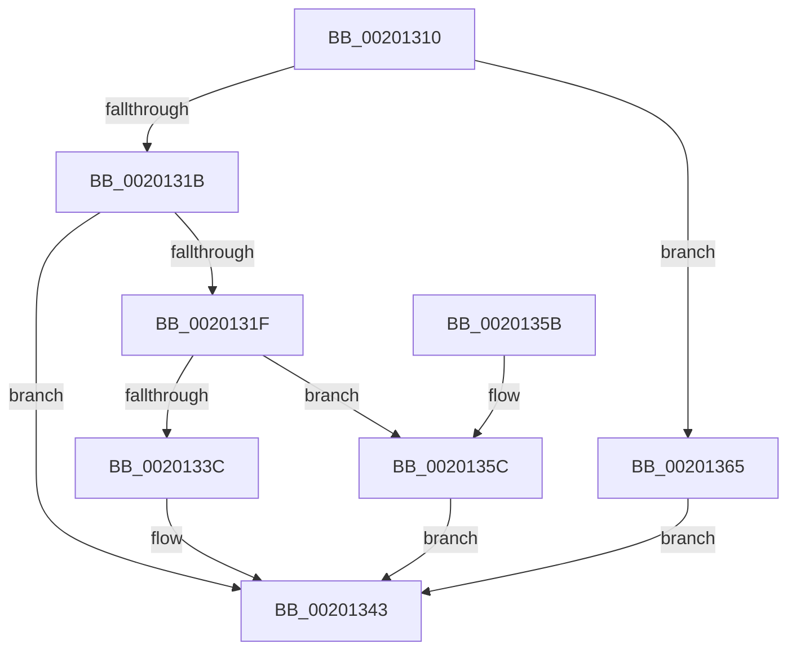

# KiInsertDeferredReadyList

- RVA: `0x00201310`–`0x0020136B` (길이 `91` bytes)
- VA: `0x0000000140201310`
- 실행 섹션: `.text`
- PDB 이름 있음: `예`; PDB Function 태그: `아니요`
- unwind 정보 RVA: `0x000DB714`
- 디코드: `22`개 명령, `91/91` bytes 표시
- 미해석 바이트: `0` (있으면 어셈블리에 `.byte`로 보존)

> 이 문서는 커널 이미지의 기계어와 PDB 기호를 분석해 생성했습니다. 4번과 5번은 함수 원형과 자료형을 바이너리 사용 방식에서 추정한 C 해석이며 원본 소스 복구 결과는 아닙니다.

## 1. Dependencies

- 직접 호출 지점: **0**; 고유 호출 대상: **0**
- 직접 호출자로 확인된 함수: **17**
- RIP 상대 이미지 참조: **0**

### Outgoing calls
- 직접 디코드된 call 명령이 없습니다.

### Direct callers
- [KiDeferGroupSchedulingPreemption](KiDeferGroupSchedulingPreemption_function_0020076C.md) at `0x00200F79`
- [KiDeferGroupSchedulingPreemption](KiDeferGroupSchedulingPreemption_function_0020076C.md) at `0x00200FA8`
- [KiFlushReadyLists](KiFlushReadyLists_function_002011E8.md) at `0x002012F2`
- [KiNormalPriorityReadyScan](../21/KiNormalPriorityReadyScan_function_0021B400.md) at `0x0021B6DA`
- [sub_0021C284](../21/Unknown_function_0021C284.md) at `0x0021C3B2`
- [sub_0021C57C](../21/Unknown_function_0021C57C.md) at `0x0021C59B`
- [sub_002546EC](../25/Unknown_function_002546EC.md) at `0x00254D86`
- [sub_002546EC](../25/Unknown_function_002546EC.md) at `0x00255043`
- [sub_002546EC](../25/Unknown_function_002546EC.md) at `0x0025508B`
- [sub_002546EC](../25/Unknown_function_002546EC.md) at `0x002550BA`
- [sub_002546EC](../25/Unknown_function_002546EC.md) at `0x002550E9`
- [KiSearchForNewThreadsForRescheduleContext](../25/KiSearchForNewThreadsForRescheduleContext_function_00258620.md) at `0x002594C4`
- [KiSearchForNewThreadsForRescheduleContext](../25/KiSearchForNewThreadsForRescheduleContext_function_00258620.md) at `0x00259708`
- [KiSearchForNewThreadsForRescheduleContext](../25/KiSearchForNewThreadsForRescheduleContext_function_00258620.md) at `0x00259741`
- [KiSearchForNewThreadsForRescheduleContext](../25/KiSearchForNewThreadsForRescheduleContext_function_00258620.md) at `0x00259770`
- [KiSearchForNewThreadsForRescheduleContext](../25/KiSearchForNewThreadsForRescheduleContext_function_00258620.md) at `0x0025979F`
- [KiAttemptToScheduleThreadToBusyIsolationUnit](../25/KiAttemptToScheduleThreadToBusyIsolationUnit_function_00259B00.md) at `0x0025B002`
- [KiAttemptToScheduleThreadToBusyIsolationUnit](../25/KiAttemptToScheduleThreadToBusyIsolationUnit_function_00259B00.md) at `0x0025B0FE`
- [KiAttemptToScheduleThreadToBusyIsolationUnit](../25/KiAttemptToScheduleThreadToBusyIsolationUnit_function_00259B00.md) at `0x0025B312`
- [KiAttemptToScheduleThreadToBusyIsolationUnit](../25/KiAttemptToScheduleThreadToBusyIsolationUnit_function_00259B00.md) at `0x0025B341`
- [KiAttemptToScheduleThreadToBusyIsolationUnit](../25/KiAttemptToScheduleThreadToBusyIsolationUnit_function_00259B00.md) at `0x0025B37A`
- [KiAttemptToScheduleThreadToBusyIsolationUnit](../25/KiAttemptToScheduleThreadToBusyIsolationUnit_function_00259B00.md) at `0x0025B3A9`
- [KiAttemptToScheduleThreadToBusyIsolationUnit](../25/KiAttemptToScheduleThreadToBusyIsolationUnit_function_00259B00.md) at `0x0025B3D8`
- [KiAttemptToScheduleThreadToBusyIsolationUnit](../25/KiAttemptToScheduleThreadToBusyIsolationUnit_function_00259B00.md) at `0x0025B47A`
- [KiAttemptToScheduleThreadToBusyIsolationUnit](../25/KiAttemptToScheduleThreadToBusyIsolationUnit_function_00259B00.md) at `0x0025B5C8`
- [KiAttemptToScheduleThreadToBusyIsolationUnit](../25/KiAttemptToScheduleThreadToBusyIsolationUnit_function_00259B00.md) at `0x0025B5F7`
- [KiExecuteAllDpcs](../25/KiExecuteAllDpcs_function_0025B740.md) at `0x0025CB41`
- [KiExecuteAllDpcs](../25/KiExecuteAllDpcs_function_0025B740.md) at `0x0025CB7A`
- [KiMoveScbThreadsToNewReadylist](../30/KiMoveScbThreadsToNewReadylist_function_003099AC.md) at `0x00309B9F`
- [KiGroupSchedulingGenerationEnd](../30/KiGroupSchedulingGenerationEnd_function_0030A9B4.md) at `0x0030AC53`
- [KiGroupSchedulingGenerationEnd](../30/KiGroupSchedulingGenerationEnd_function_0030A9B4.md) at `0x0030B009`
- [KiScheduleThreadToRescheduleContext](../30/KiScheduleThreadToRescheduleContext_function_0030C2A0.md) at `0x0030C452`
- [KiScheduleThreadToRescheduleContext](../30/KiScheduleThreadToRescheduleContext_function_0030C2A0.md) at `0x0030C5F1`
- [KiScheduleThreadToRescheduleContext](../30/KiScheduleThreadToRescheduleContext_function_0030C2A0.md) at `0x0030C622`
- [KiScheduleThreadToRescheduleContext](../30/KiScheduleThreadToRescheduleContext_function_0030C2A0.md) at `0x0030C653`
- [KiScheduleThreadToRescheduleContext](../30/KiScheduleThreadToRescheduleContext_function_0030C2A0.md) at `0x0030C684`
- [KiCommitRescheduleContextEntry](../30/KiCommitRescheduleContextEntry_function_0030CFD0.md) at `0x0030D35A`
- [KiSearchForNewThreadsOnTarget](../30/KiSearchForNewThreadsOnTarget_function_0030F500.md) at `0x0030FE24`
- [KiSearchForNewThreadsOnTarget](../30/KiSearchForNewThreadsOnTarget_function_0030F500.md) at `0x0030FEAC`
- [KiSearchForNewThreadsOnTarget](../30/KiSearchForNewThreadsOnTarget_function_0030F500.md) at `0x0031089D`
- [KiSearchForNewThreadsOnTarget](../30/KiSearchForNewThreadsOnTarget_function_0030F500.md) at `0x003108C7`
- [KiSearchForNewThreadsOnTarget](../30/KiSearchForNewThreadsOnTarget_function_0030F500.md) at `0x00310A0A`
- [KiSearchForNewThreadsOnTarget](../30/KiSearchForNewThreadsOnTarget_function_0030F500.md) at `0x00310FEF`
- [KiSearchForNewThreadsOnTarget](../30/KiSearchForNewThreadsOnTarget_function_0030F500.md) at `0x003110E8`
- [KiSearchForNewThreadsOnTarget](../30/KiSearchForNewThreadsOnTarget_function_0030F500.md) at `0x00311162`
- [KiScanSharedReadyThreads](../46/KiScanSharedReadyThreads_function_0046F120.md) at `0x0046F5D4`
- [KiAdjustRescheduleContextForIsolationWidthChange](../5C/KiAdjustRescheduleContextForIsolationWidthChange_function_005C9030.md) at `0x005C91EA`
- [KiAdjustRescheduleContextForProcessorAddition](../5C/KiAdjustRescheduleContextForProcessorAddition_function_005C9284.md) at `0x005C9303`
- [KiAdjustRescheduleContextForProcessorAddition](../5C/KiAdjustRescheduleContextForProcessorAddition_function_005C9284.md) at `0x005C9394`

### Static image references
- 디코드된 RIP-relative 메모리 참조가 없습니다.

## 2. Other-region calls and transfers

- 다른 실행 섹션으로 향하는 call: **0**
- 별도 외부 분기/꼬리 이동을 확인하지 못했습니다.

## 3. Assembly (complete function range)

```asm
00201310  0F B6 82 84 01 00 00            movzx eax, byte ptr [rdx + 0x184]
00201317  3C 01                           cmp al, 1
00201319  74 4A                           je 0x140201365
0020131B  3C 05                           cmp al, 5
0020131D  75 24                           jne 0x140201343
0020131F  48 B8 20 03 00 00 80 F7 FF FF   movabs rax, 0xfffff78000000320
00201329  44 8B 00                        mov r8d, dword ptr [rax]
0020132C  44 2B 82 B4 01 00 00            sub r8d, dword ptr [rdx + 0x1b4]
00201333  80 BA 87 01 00 00 00            cmp byte ptr [rdx + 0x187], 0
0020133A  74 20                           je 0x14020135c
0020133C  4C 01 82 E8 03 00 00            add qword ptr [rdx + 0x3e8], r8
00201343  C6 82 84 01 00 00 07            mov byte ptr [rdx + 0x184], 7
0020134A  48 81 C2 D8 00 00 00            add rdx, 0xd8
00201351  48 8B 01                        mov rax, qword ptr [rcx]
00201354  48 89 02                        mov qword ptr [rdx], rax
00201357  48 89 11                        mov qword ptr [rcx], rdx
0020135A  C3                              ret
0020135B  CC                              int3
0020135C  4C 01 82 E0 03 00 00            add qword ptr [rdx + 0x3e0], r8
00201363  EB DE                           jmp 0x140201343
00201365  83 4A 74 02                     or dword ptr [rdx + 0x74], 2
00201369  EB D8                           jmp 0x140201343
```

## 4. C-style interpretation (structured pseudocode)

```c
__int64 __fastcall KiInsertDeferredReadyList(__int64 a1, __int64 a2)
{
    if (((unsigned __int8)(*(unsigned __int8 *)(a2 + 388))) == 1) goto loc_00201365;
    if (((unsigned __int8)(*(unsigned __int8 *)(a2 + 388))) != 5) goto loc_00201343;
    a3 = (unsigned int)(((unsigned int)(*(unsigned int *)(*(unsigned __int8 *)(a2 + 388)))) - (*(unsigned int *)(a2 + 436)));
    if ((*(unsigned __int8 *)(a2 + 391)) == 0) goto loc_0020135C;
loc_00201343:
    *(unsigned __int8 *)(a2 + 388) = 7;
    a2 = (a2) + (216);
    *(unsigned __int64 *)(a2) = *(unsigned __int64 *)(a1);
    *(unsigned __int64 *)(a1) = a2;
    return *(unsigned __int64 *)(a1);
loc_0020135C:
    goto loc_00201343;
loc_00201365:
    goto loc_00201343;
}
```

## 5. (Beta) C Style

```c
int64_t KiInsertDeferredReadyList(void *Arg1, void *Arg2)
{
    uint8_t *arg1 = (uint8_t *)Arg1;
    uint8_t *arg2 = (uint8_t *)Arg2;

    if (((uint8_t)(*(uint8_t *)(arg2 + 0x184))) == 1) goto loc_00201365;
    if (((uint8_t)(*(uint8_t *)(arg2 + 0x184))) != 5) goto loc_00201343;
    a3 = (uint32_t)(((uint32_t)(*(uint32_t *)(*(uint8_t *)(arg2 + 0x184)))) - (*(uint32_t *)(arg2 + 0x1B4)));
    if ((*(uint8_t *)(arg2 + 0x187)) == 0) goto loc_0020135C;
loc_00201343:
    *(uint8_t *)(arg2 + 0x184) = 7;
    Arg2 = (Arg2) + (216);
    *(uint64_t *)(arg2) = *(uint64_t *)(arg1);
    *(void **)(arg1) = Arg2;
    return *(uint64_t *)(arg1);
loc_0020135C:
    goto loc_00201343;
loc_00201365:
    goto loc_00201343;
}
```

### 관측된 메모리 오프셋

구조체 형식이 확인되지 않은 접근은 인자 기준의 오프셋으로만 기록했습니다.

| 기준 인자 | 오프셋 표현 | 폭 (bit) | 접근 |
|---|---:|---:|---|
| `Arg1` | `+ 0x0` | `64` | `R` |
| `Arg1` | `+ 0x0` | `64` | `W` |
| `Arg2` | `+ 0x0` | `64` | `W` |
| `Arg2` | `+ 0x74` | `32` | `R/W` |
| `Arg2` | `+ 0x184` | `8` | `R` |
| `Arg2` | `+ 0x184` | `8` | `W` |
| `Arg2` | `+ 0x187` | `8` | `R` |
| `Arg2` | `+ 0x1B4` | `32` | `R` |
| `Arg2` | `+ 0x3E0` | `64` | `R/W` |
| `Arg2` | `+ 0x3E8` | `64` | `R/W` |

## 6. Execution-region graph

[열기: 2D/3D 그래프와 함수 탐색 컨트롤 패널](../../../control-panel.html?section=text&rva=0x00201310&view=graph)

- 2D 그래프는 위에서 아래로 흐르고, 3D 그래프는 빈 공간을 드래그해 회전합니다. Shift+드래그는 이동, 휠은 확대·축소, 함수 노드 선택은 대상 보고서 이동입니다.

### Static fallback


