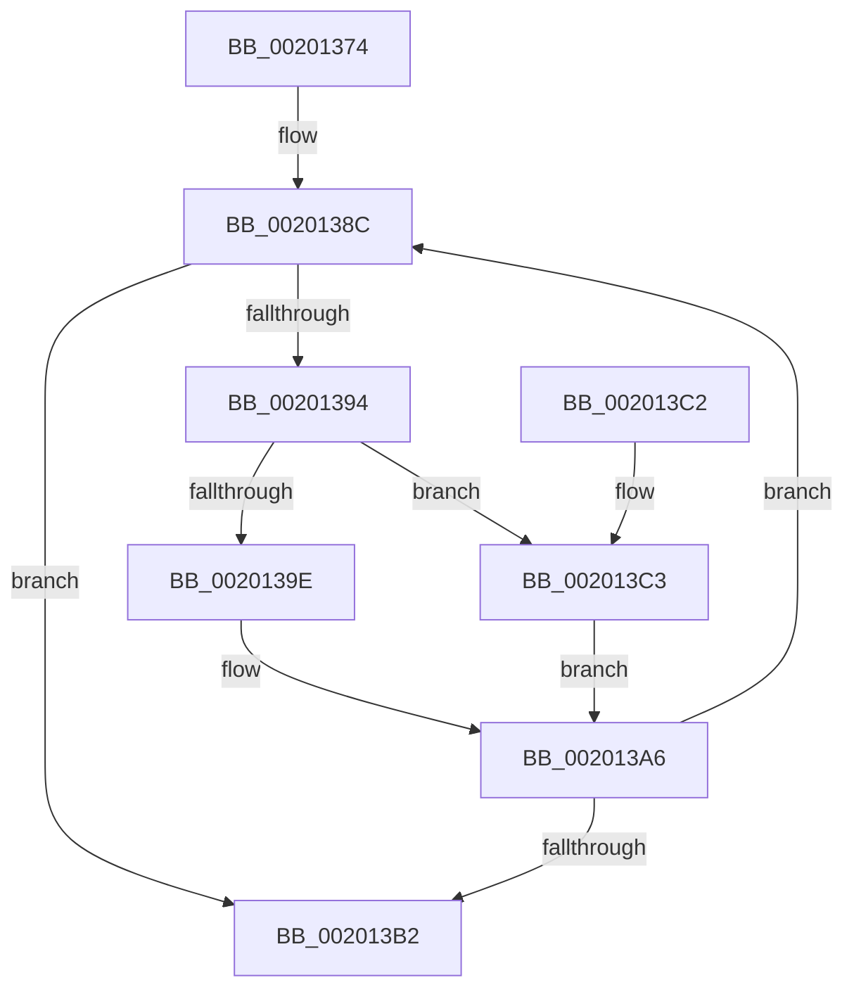

# KiInsertNonMaxOverQuotaScb

- RVA: `0x00201374`–`0x002013CD` (길이 `89` bytes)
- VA: `0x0000000140201374`
- 실행 섹션: `.text`
- PDB 이름 있음: `예`; PDB Function 태그: `아니요`
- unwind 정보 RVA: `0x0005C748`
- 디코드: `28`개 명령, `89/89` bytes 표시
- 미해석 바이트: `0` (있으면 어셈블리에 `.byte`로 보존)

> 이 문서는 커널 이미지의 기계어와 PDB 기호를 분석해 생성했습니다. 4번과 5번은 함수 원형과 자료형을 바이너리 사용 방식에서 추정한 C 해석이며 원본 소스 복구 결과는 아닙니다.

## 1. Dependencies

- 직접 호출 지점: **2**; 고유 호출 대상: **2**
- 직접 호출자로 확인된 함수: **2**
- RIP 상대 이미지 참조: **0**

### Outgoing calls
- `0x002013A1` → [KiInsertSchedulingGroupQueue](KiInsertSchedulingGroupQueue_function_002013D4.md) (function, `0x002013D4`)
- `0x002013C6` → [KiResortScbQueue](KiResortScbQueue_function_002024CC.md) (function, `0x002024CC`)

### Direct callers
- [KiAddThreadToScbQueue](KiAddThreadToScbQueue_function_002010DC.md) at `0x002011AB`
- [KiTransitionSchedulingGroupGeneration](../30/KiTransitionSchedulingGroupGeneration_function_003094C8.md) at `0x00309864`

### Static image references
- 디코드된 RIP-relative 메모리 참조가 없습니다.

## 2. Other-region calls and transfers

- 다른 실행 섹션으로 향하는 call: **0**
- 별도 외부 분기/꼬리 이동을 확인하지 못했습니다.

## 3. Assembly (complete function range)

```asm
00201374  48 89 5C 24 08                  mov qword ptr [rsp + 8], rbx
00201379  48 89 74 24 10                  mov qword ptr [rsp + 0x10], rsi
0020137E  57                              push rdi
0020137F  48 83 EC 20                     sub rsp, 0x20
00201383  41 8A F0                        mov sil, r8b
00201386  48 8B FA                        mov rdi, rdx
00201389  48 8B D9                        mov rbx, rcx
0020138C  0F B7 43 70                     movzx eax, word ptr [rbx + 0x70]
00201390  A8 02                           test al, 2
00201392  75 1E                           jne 0x1402013b2
00201394  48 8B D3                        mov rdx, rbx
00201397  48 8B CF                        mov rcx, rdi
0020139A  A8 01                           test al, 1
0020139C  75 25                           jne 0x1402013c3
0020139E  44 8A C6                        mov r8b, sil
002013A1  E8 2E 00 00 00                  call 0x1402013d4
002013A6  48 8B 9B A0 01 00 00            mov rbx, qword ptr [rbx + 0x1a0]
002013AD  48 85 DB                        test rbx, rbx
002013B0  75 DA                           jne 0x14020138c
002013B2  48 8B 5C 24 30                  mov rbx, qword ptr [rsp + 0x30]
002013B7  48 8B 74 24 38                  mov rsi, qword ptr [rsp + 0x38]
002013BC  48 83 C4 20                     add rsp, 0x20
002013C0  5F                              pop rdi
002013C1  C3                              ret
002013C2  CC                              int3
002013C3  45 33 C0                        xor r8d, r8d
002013C6  E8 01 11 00 00                  call 0x1402024cc
002013CB  EB D9                           jmp 0x1402013a6
```

## 4. C-style interpretation (structured pseudocode)

```c
__int64 __fastcall KiInsertNonMaxOverQuotaScb(__int64 a1, __int64 a2, unsigned __int8 a3)
{
    __int64 result;
    __int64 v_rsp;
    unsigned __int64 v_stack_p10;
    unsigned __int64 v_stack_p8;

    v_stack_p8 = v_rbx;
    v_stack_p10 = v_rsi;
    v_rsp = (v_rsp) - (32);
loc_0020138C:
    if ((((unsigned __int8)(*(unsigned __int16 *)(a1 + 112))) & (2)) != 0) goto loc_002013B2;
    if ((((unsigned __int8)(*(unsigned __int16 *)(a1 + 112))) & (1)) != 0) goto loc_002013C3;
    result = KiInsertSchedulingGroupQueue(a2, a1, a3, a4);
loc_002013A6:
    if (*(unsigned __int64 *)(a1 + 416) != 0) goto loc_0020138C;
loc_002013B2:
    v_rsp = (v_rsp) + (32);
    return result;
loc_002013C3:
    a3 = 0;
    result = KiResortScbQueue(a2, a1, a3, a4);
    goto loc_002013A6;
}
```

## 5. (Beta) C Style

```c
int64_t KiInsertNonMaxOverQuotaScb(int64_t Arg1, int64_t Arg2, uint8_t Arg3)
{
    int64_t result;
    int64_t local_rsp;
    uint64_t v_stack_p10;
    uint64_t v_stack_p8;

    v_stack_p8 = local_rbx;
    v_stack_p10 = local_rsi;
    local_rsp = (local_rsp) - (32);
loc_0020138C:
    if ((((uint8_t)(*(uint16_t *)(Arg1 + 0x70))) & (2)) != 0) goto loc_002013B2;
    if ((((uint8_t)(*(uint16_t *)(Arg1 + 0x70))) & (1)) != 0) goto loc_002013C3;
    result = KiInsertSchedulingGroupQueue(Arg2, Arg1, Arg3, a4);
loc_002013A6:
    if (*(uint64_t *)(Arg1 + 0x1A0) != 0) goto loc_0020138C;
loc_002013B2:
    local_rsp = (local_rsp) + (32);
    return result;
loc_002013C3:
    Arg3 = 0;
    result = KiResortScbQueue(Arg2, Arg1, Arg3, a4);
    goto loc_002013A6;
}
```

## 6. Execution-region graph

[열기: 2D/3D 그래프와 함수 탐색 컨트롤 패널](../../../control-panel.html?section=text&rva=0x00201374&view=graph)

- 2D 그래프는 위에서 아래로 흐르고, 3D 그래프는 빈 공간을 드래그해 회전합니다. Shift+드래그는 이동, 휠은 확대·축소, 함수 노드 선택은 대상 보고서 이동입니다.

### Static fallback


