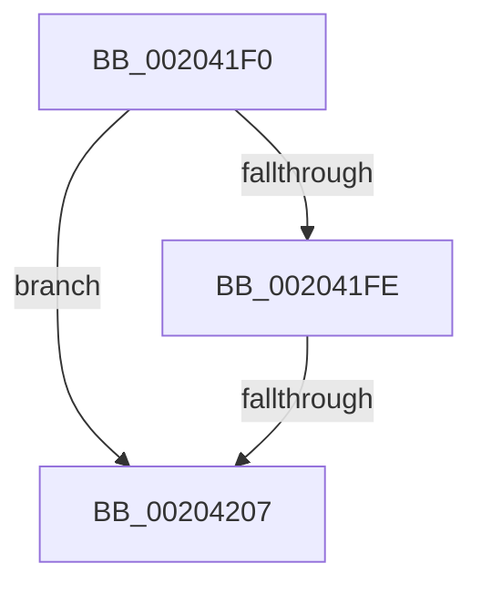

# KiInsertQueueApc

- RVA: `0x002041F0`–`0x00204222` (길이 `50` bytes)
- VA: `0x00000001402041F0`
- 실행 섹션: `.text`
- PDB 이름 있음: `예`; PDB Function 태그: `아니요`
- unwind 정보 RVA: `0x0005CB24`
- 디코드: `11`개 명령, `50/50` bytes 표시
- 미해석 바이트: `0` (있으면 어셈블리에 `.byte`로 보존)

> 이 문서는 커널 이미지의 기계어와 PDB 기호를 분석해 생성했습니다. 4번과 5번은 함수 원형과 자료형을 바이너리 사용 방식에서 추정한 C 해석이며 원본 소스 복구 결과는 아닙니다.

## 1. Dependencies

- 직접 호출 지점: **0**; 고유 호출 대상: **0**
- 직접 호출자로 확인된 함수: **8**
- RIP 상대 이미지 참조: **0**

### Outgoing calls
- 직접 디코드된 call 명령이 없습니다.

### Direct callers
- [KiSchedulerApc](KiSchedulerApc_function_00202BC0.md) at `0x00202DB0`
- [KeInsertQueueApc](KeInsertQueueApc_function_00203F10.md) at `0x0020406C`
- [KiQueueTebUpdateApc](../2C/KiQueueTebUpdateApc_function_002CE3F4.md) at `0x002CE447`
- [KiInsertDeferredPreemptionApc](../30/KiInsertDeferredPreemptionApc_function_0030A8E8.md) at `0x0030A946`
- [KiSuspendThread](../46/KiSuspendThread_function_0046B964.md) at `0x0046B9EA`
- [KeRequestTerminationThread](../48/KeRequestTerminationThread_function_00489A58.md) at `0x00489AD0`
- [KeTryToInsertQueueApc](../4D/KeTryToInsertQueueApc_function_004D72B8.md) at `0x004D7329`
- [KiRequestSchedulerApcThread](../5C/KiRequestSchedulerApcThread_function_005C44E4.md) at `0x005C4533`

### Static image references
- 디코드된 RIP-relative 메모리 참조가 없습니다.

## 2. Other-region calls and transfers

- 다른 실행 섹션으로 향하는 call: **0**
- call이 아닌 외부 분기/꼬리 이동: **1**
  - `0x00204205` → [sub_00204286](Unknown_function_00204286.md) (`tail-transfer`)

## 3. Assembly (complete function range)

```asm
002041F0  48 83 EC 08                     sub rsp, 8
002041F4  80 79 50 00                     cmp byte ptr [rcx + 0x50], 0
002041F8  48 8B 51 08                     mov rdx, qword ptr [rcx + 8]
002041FC  75 09                           jne 0x140204207
002041FE  80 BA 4A 02 00 00 00            cmp byte ptr [rdx + 0x24a], 0
00204205  75 7F                           jne 0x140204286
00204207  0F B6 82 4A 02 00 00            movzx eax, byte ptr [rdx + 0x24a]
0020420E  4C 8D 82 98 00 00 00            lea r8, [rdx + 0x98]
00204215  88 41 50                        mov byte ptr [rcx + 0x50], al
00204218  48 83 79 30 00                  cmp qword ptr [rcx + 0x30], 0
0020421D  48 0F BE 41 51                  movsx rax, byte ptr [rcx + 0x51]
```

## 4. C-style interpretation (structured pseudocode)

```c
__int64 __fastcall KiInsertQueueApc(__int64 a1)
{
    __int64 v_rsp;

    v_rsp = (v_rsp) - (8);
    if ((*(unsigned __int8 *)(a1 + 80)) != 0) goto loc_00204207;
loc_00204207:
    *(unsigned __int8 *)(a1 + 80) = (unsigned __int8)(*(unsigned __int8 *)(*(unsigned __int64 *)(a1 + 8) + 586));
    return (__int8)(*(unsigned __int8 *)(a1 + 81));
}
```

## 5. (Beta) C Style

```c
int64_t KiInsertQueueApc(void *Apc)
{
    uint8_t *apc = (uint8_t *)Apc;

    int64_t local_rsp;

    local_rsp = (local_rsp) - (8);
    if ((*(uint8_t *)(apc + 0x50)) != 0) goto loc_00204207; // ApcStateIndex @ 0x50
loc_00204207:
    *(uint8_t *)(apc + 0x50) = (uint8_t)(*(uint8_t *)(*(uint64_t *)(apc + 0x8) + 0x24A)); // Thread @ 0x08, ApcStateIndex @ 0x50
    return (int8_t)(*(uint8_t *)(apc + 0x51));
}
```

### KAPC 구조체와 오프셋 대응

| 오프셋 | KAPC 필드 |
|---:|---|
| `0x00` | `Type` |
| `0x01` | `SpareByte0` |
| `0x02` | `Size` |
| `0x08` | `Thread` |
| `0x20` | `KernelRoutine` |
| `0x28` | `RundownRoutine` |
| `0x30` | `NormalRoutine` |
| `0x38` | `NormalContext` |
| `0x40` | `SystemArgument1` |
| `0x48` | `SystemArgument2` |
| `0x50` | `ApcStateIndex` |
| `0x51` | `ApcMode` |
| `0x52` | `Inserted` |

필드 이름은 KAPC 배치에 맞춘 것이며, 해당 함수가 실행 중 접근한 오프셋은 위 C 코드와 어셈블리에서 확인할 수 있습니다.

## 6. Execution-region graph

[열기: 2D/3D 그래프와 함수 탐색 컨트롤 패널](../../../control-panel.html?section=text&rva=0x002041F0&view=graph)

- 2D 그래프는 위에서 아래로 흐르고, 3D 그래프는 빈 공간을 드래그해 회전합니다. Shift+드래그는 이동, 휠은 확대·축소, 함수 노드 선택은 대상 보고서 이동입니다.

### Static fallback


