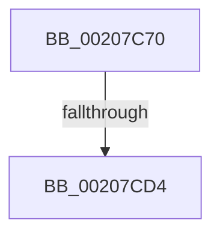

# KiInsertQueueDpc

- RVA: `0x00207C70`–`0x00207CE9` (길이 `121` bytes)
- VA: `0x0000000140207C70`
- 실행 섹션: `.text`
- PDB 이름 있음: `예`; PDB Function 태그: `아니요`
- unwind 정보 RVA: `0x0005D300`
- 디코드: `29`개 명령, `121/121` bytes 표시
- 미해석 바이트: `0` (있으면 어셈블리에 `.byte`로 보존)

> 이 문서는 커널 이미지의 기계어와 PDB 기호를 분석해 생성했습니다. 4번과 5번은 함수 원형과 자료형을 바이너리 사용 방식에서 추정한 C 해석이며 원본 소스 복구 결과는 아닙니다.

## 1. Dependencies

- 직접 호출 지점: **0**; 고유 호출 대상: **0**
- 직접 호출자로 확인된 함수: **2**
- RIP 상대 이미지 참조: **3**

### Outgoing calls
- 직접 디코드된 call 명령이 없습니다.

### Direct callers
- [KeInsertQueueDpc](KeInsertQueueDpc_function_00207C50.md) at `0x00207C5C`
- [KiTimerWaitTest](../23/KiTimerWaitTest_function_002337D0.md) at `0x00233A76`
- [KiTimerWaitTest](../23/KiTimerWaitTest_function_002337D0.md) at `0x00233ADF`
- [KiTimerWaitTest](../23/KiTimerWaitTest_function_002337D0.md) at `0x00233BC9`

### Static image references
- `0x00207CA6` → RVA `0x00FC6B04` (`ALMOSTRO`; read)
- `0x00207CCB` → RVA `0x00FC6D20` (`ALMOSTRO`; read)
- `0x00207CDD` → RVA `0x00000000` (`image boundary/outside`; read)

## 2. Other-region calls and transfers

- 다른 실행 섹션으로 향하는 call: **0**
- call이 아닌 외부 분기/꼬리 이동: **1**
  - `0x00207CD2` → [sub_00207D2E](Unknown_function_00207D2E.md) (`tail-transfer`)

## 3. Assembly (complete function range)

```asm
00207C70  4C 89 44 24 18                  mov qword ptr [rsp + 0x18], r8
00207C75  48 89 54 24 10                  mov qword ptr [rsp + 0x10], rdx
00207C7A  53                              push rbx
00207C7B  56                              push rsi
00207C7C  41 54                           push r12
00207C7E  41 55                           push r13
00207C80  41 57                           push r15
00207C82  48 81 EC C0 00 00 00            sub rsp, 0xc0
00207C89  0F B7 71 02                     movzx esi, word ptr [rcx + 2]
00207C8D  33 C0                           xor eax, eax
00207C8F  89 44 24 4C                     mov dword ptr [rsp + 0x4c], eax
00207C93  4D 8B F9                        mov r15, r9
00207C96  89 44 24 44                     mov dword ptr [rsp + 0x44], eax
00207C9A  48 8B D9                        mov rbx, rcx
00207C9D  48 89 44 24 58                  mov qword ptr [rsp + 0x58], rax
00207CA2  88 44 24 40                     mov byte ptr [rsp + 0x40], al
00207CA6  8B 05 58 EE DB 00               mov eax, dword ptr [rip + 0xdbee58]
00207CAC  25 00 00 04 00                  and eax, 0x40000
00207CB1  32 D2                           xor dl, dl
00207CB3  89 44 24 48                     mov dword ptr [rsp + 0x48], eax
00207CB7  88 94 24 F0 00 00 00            mov byte ptr [rsp + 0xf0], dl
00207CBE  45 0F 20 C4                     mov r12, cr8
00207CC2  B8 0F 00 00 00                  mov eax, 0xf
00207CC7  44 0F 22 C0                     mov cr8, rax
00207CCB  83 3D 4E F0 DB 00 00            cmp dword ptr [rip + 0xdbf04e], 0
00207CD2  75 5A                           jne 0x140207d2e
00207CD4  65 4C 8B 2C 25 20 00 00 00      mov r13, qword ptr gs:[0x20]
00207CDD  48 8D 0D 1C 83 DF FF            lea rcx, [rip - 0x207ce4]
00207CE4  B8 00 08 00 00                  mov eax, 0x800
```

## 4. C-style interpretation (structured pseudocode)

```c
__int64 __fastcall KiInsertQueueDpc(__int64 a1, __int64 a2, __int64 a3, __int64 a4)
{
    __int64 result;
    __int64 v_rsp;
    unsigned __int64 v_stack_m90;
    unsigned int v_stack_m9C;
    unsigned int v_stack_mA0;
    unsigned int v_stack_mA4;
    unsigned __int8 v_stack_mA8;
    unsigned __int64 v_stack_p10;
    unsigned __int64 v_stack_p18;
    unsigned __int8 v_stack_p8;

    v_stack_p18 = a3;
    v_stack_p10 = a2;
    v_rsp = (v_rsp) - (192);
    result = 0;
    v_stack_m9C = 0;
    v_stack_mA4 = 0;
    v_stack_m90 = 0;
    v_stack_mA8 = 0;
    result = (unsigned int)(((unsigned int)(*(unsigned int *)(v_rip + 14413400))) & (0x40000ULL));
    a2 = 0;
    v_stack_mA0 = (unsigned int)(result);
    v_stack_p8 = 0;
    return (unsigned int)(0x800ULL);
}
```

## 5. (Beta) C Style

```c
int64_t KiInsertQueueDpc(void *Arg1, int64_t Arg2, int64_t Arg3, int64_t Arg4)
{
    uint8_t *arg1 = (uint8_t *)Arg1;

    int64_t result;
    int64_t local_rsp;
    uint64_t v_stack_m90;
    uint32_t v_stack_m9C;
    uint32_t v_stack_mA0;
    uint32_t v_stack_mA4;
    uint8_t v_stack_mA8;
    uint64_t v_stack_p10;
    uint64_t v_stack_p18;
    uint8_t v_stack_p8;

    v_stack_p18 = Arg3;
    v_stack_p10 = Arg2;
    local_rsp = (local_rsp) - (192);
    result = 0;
    v_stack_m9C = 0;
    v_stack_mA4 = 0;
    v_stack_m90 = 0;
    v_stack_mA8 = 0;
    result = (uint32_t)(((uint32_t)(*(uint32_t *)(v_rip + 0xDBEE58))) & (0x40000ULL));
    Arg2 = 0;
    v_stack_mA0 = (uint32_t)(result);
    v_stack_p8 = 0;
    return (uint32_t)(0x800ULL);
}
```

### 관측된 메모리 오프셋

구조체 형식이 확인되지 않은 접근은 인자 기준의 오프셋으로만 기록했습니다.

| 기준 인자 | 오프셋 표현 | 폭 (bit) | 접근 |
|---|---:|---:|---|
| `Arg1` | `+ 0x2` | `16` | `R` |

## 6. Execution-region graph

[열기: 2D/3D 그래프와 함수 탐색 컨트롤 패널](../../../control-panel.html?section=text&rva=0x00207C70&view=graph)

- 2D 그래프는 위에서 아래로 흐르고, 3D 그래프는 빈 공간을 드래그해 회전합니다. Shift+드래그는 이동, 휠은 확대·축소, 함수 노드 선택은 대상 보고서 이동입니다.

### Static fallback


