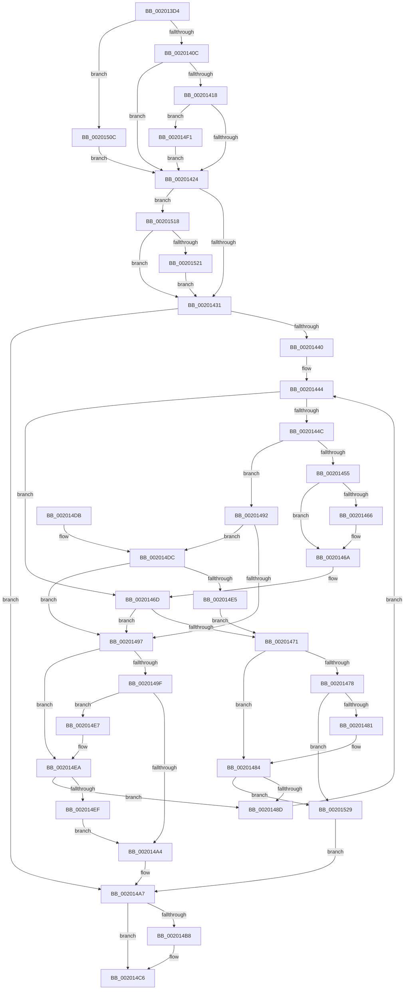

# KiInsertSchedulingGroupQueue

- RVA: `0x002013D4`–`0x00201531` (길이 `349` bytes)
- VA: `0x00000001402013D4`
- 실행 섹션: `.text`
- PDB 이름 있음: `예`; PDB Function 태그: `아니요`
- unwind 정보 RVA: `0x0005C75C`
- 디코드: `95`개 명령, `349/349` bytes 표시
- 미해석 바이트: `0` (있으면 어셈블리에 `.byte`로 보존)

> 이 문서는 커널 이미지의 기계어와 PDB 기호를 분석해 생성했습니다. 4번과 5번은 함수 원형과 자료형을 바이너리 사용 방식에서 추정한 C 해석이며 원본 소스 복구 결과는 아닙니다.

## 1. Dependencies

- 직접 호출 지점: **1**; 고유 호출 대상: **1**
- 직접 호출자로 확인된 함수: **2**
- RIP 상대 이미지 참조: **0**

### Outgoing calls
- `0x002014AE` → [RtlRbInsertNodeEx](../2E/RtlRbInsertNodeEx_function_002E4570.md) (function, `0x002E4570`)

### Direct callers
- [KiInsertNonMaxOverQuotaScb](KiInsertNonMaxOverQuotaScb_function_00201374.md) at `0x002013A1`
- [KiResortScbQueue](KiResortScbQueue_function_002024CC.md) at `0x002025B4`

### Static image references
- 디코드된 RIP-relative 메모리 참조가 없습니다.

## 2. Other-region calls and transfers

- 다른 실행 섹션으로 향하는 call: **0**
- 별도 외부 분기/꼬리 이동을 확인하지 못했습니다.

## 3. Assembly (complete function range)

```asm
002013D4  48 89 5C 24 08                  mov qword ptr [rsp + 8], rbx
002013D9  48 89 6C 24 10                  mov qword ptr [rsp + 0x10], rbp
002013DE  48 89 74 24 20                  mov qword ptr [rsp + 0x20], rsi
002013E3  57                              push rdi
002013E4  48 83 EC 20                     sub rsp, 0x20
002013E8  4C 8B 92 A0 01 00 00            mov r10, qword ptr [rdx + 0x1a0]
002013EF  BD 01 00 00 00                  mov ebp, 1
002013F4  66 09 6A 70                     or word ptr [rdx + 0x70], bp
002013F8  33 F6                           xor esi, esi
002013FA  41 8A F8                        mov dil, r8b
002013FD  48 8B DA                        mov rbx, rdx
00201400  48 8B C1                        mov rax, rcx
00201403  4D 85 D2                        test r10, r10
00201406  0F 85 00 01 00 00               jne 0x14020150c
0020140C  4C 8D 91 30 84 00 00            lea r10, [rcx + 0x8430]
00201413  49 39 32                        cmp qword ptr [r10], rsi
00201416  75 0C                           jne 0x140201424
00201418  39 B1 74 86 00 00               cmp dword ptr [rcx + 0x8674], esi
0020141E  0F 84 CD 00 00 00               je 0x1402014f1
00201424  49 8B 12                        mov rdx, qword ptr [r10]
00201427  41 84 6A 08                     test byte ptr [r10 + 8], bpl
0020142B  0F 85 E7 00 00 00               jne 0x140201518
00201431  41 0F B6 4A 08                  movzx ecx, byte ptr [r10 + 8]
00201436  44 8A C6                        mov r8b, sil
00201439  23 CD                           and ecx, ebp
0020143B  48 85 D2                        test rdx, rdx
0020143E  74 67                           je 0x1402014a7
00201440  44 8B 5B 7C                     mov r11d, dword ptr [rbx + 0x7c]
00201444  41 8B C3                        mov eax, r11d
00201447  2B 42 24                        sub eax, dword ptr [rdx + 0x24]
0020144A  75 21                           jne 0x14020146d
0020144C  0F B7 43 78                     movzx eax, word ptr [rbx + 0x78]
00201450  66 85 C0                        test ax, ax
00201453  74 3D                           je 0x140201492
00201455  44 0F B7 42 20                  movzx r8d, word ptr [rdx + 0x20]
0020145A  44 0F BD C8                     bsr r9d, eax
0020145E  8B C6                           mov eax, esi
00201460  66 45 85 C0                     test r8w, r8w
00201464  74 04                           je 0x14020146a
00201466  41 0F BD C0                     bsr eax, r8d
0020146A  41 2B C1                        sub eax, r9d
0020146D  85 C0                           test eax, eax
0020146F  79 26                           jns 0x140201497
00201471  48 8B 02                        mov rax, qword ptr [rdx]
00201474  85 C9                           test ecx, ecx
00201476  74 0C                           je 0x140201484
00201478  48 85 C0                        test rax, rax
0020147B  0F 84 A8 00 00 00               je 0x140201529
00201481  48 33 C2                        xor rax, rdx
00201484  48 85 C0                        test rax, rax
00201487  0F 84 9C 00 00 00               je 0x140201529
0020148D  48 8B D0                        mov rdx, rax
00201490  EB B2                           jmp 0x140201444
00201492  45 85 DB                        test r11d, r11d
00201495  74 45                           je 0x1402014dc
00201497  48 8B 42 08                     mov rax, qword ptr [rdx + 8]
0020149B  85 C9                           test ecx, ecx
0020149D  74 4B                           je 0x1402014ea
0020149F  48 85 C0                        test rax, rax
002014A2  75 43                           jne 0x1402014e7
002014A4  44 8A C5                        mov r8b, bpl
002014A7  4C 8D 4B 58                     lea r9, [rbx + 0x58]
002014AB  49 8B CA                        mov rcx, r10
002014AE  E8 BD 30 0E 00                  call 0x1402e4570
002014B3  40 84 FF                        test dil, dil
002014B6  74 0E                           je 0x1402014c6
002014B8  48 A1 08 00 00 00 80 F7 FF FF   movabs rax, qword ptr [0xfffff78000000008]
002014C2  48 89 43 40                     mov qword ptr [rbx + 0x40], rax
002014C6  48 8B 5C 24 30                  mov rbx, qword ptr [rsp + 0x30]
002014CB  48 8B 6C 24 38                  mov rbp, qword ptr [rsp + 0x38]
002014D0  48 8B 74 24 48                  mov rsi, qword ptr [rsp + 0x48]
002014D5  48 83 C4 20                     add rsp, 0x20
002014D9  5F                              pop rdi
002014DA  C3                              ret
002014DB  CC                              int3
002014DC  48 8B 42 A8                     mov rax, qword ptr [rdx - 0x58]
002014E0  48 39 03                        cmp qword ptr [rbx], rax
002014E3  77 B2                           ja 0x140201497
002014E5  EB 8A                           jmp 0x140201471
002014E7  48 33 C2                        xor rax, rdx
002014EA  48 85 C0                        test rax, rax
002014ED  75 9E                           jne 0x14020148d
002014EF  EB B3                           jmp 0x1402014a4
002014F1  48 8B 89 C0 00 00 00            mov rcx, qword ptr [rcx + 0xc0]
002014F8  48 8B 80 C8 00 00 00            mov rax, qword ptr [rax + 0xc8]
002014FF  F0 48 09 81 80 01 00 00         lock or qword ptr [rcx + 0x180], rax
00201507  E9 18 FF FF FF                  jmp 0x140201424
0020150C  49 81 C2 90 01 00 00            add r10, 0x190
00201513  E9 0C FF FF FF                  jmp 0x140201424
00201518  48 85 D2                        test rdx, rdx
0020151B  0F 84 10 FF FF FF               je 0x140201431
00201521  49 33 D2                        xor rdx, r10
00201524  E9 08 FF FF FF                  jmp 0x140201431
00201529  44 8A C6                        mov r8b, sil
0020152C  E9 76 FF FF FF                  jmp 0x1402014a7
```

## 4. C-style interpretation (structured pseudocode)

```c
__int64 __fastcall KiInsertSchedulingGroupQueue(__int64 a1, __int64 a2, unsigned __int8 a3)
{
    __int64 result;
    __int64 v_r10;
    __int64 v_rsi;
    __int64 v_rsp;
    unsigned __int64 v_stack_p10;
    unsigned __int64 v_stack_p20;
    unsigned __int64 v_stack_p8;

    v_stack_p8 = v_rbx;
    v_stack_p10 = v_rbp;
    v_stack_p20 = v_rsi;
    v_rsp = (v_rsp) - (32);
    v_rsi = 0;
    if (*(unsigned __int64 *)(a2 + 416) != 0) goto loc_0020150C;
    if ((*(unsigned __int64 *)(a1 + 33840)) != 0) goto loc_00201424;
    if ((*(unsigned int *)(a1 + 34420)) == 0) goto loc_002014F1;
loc_00201424:
    if (((*(unsigned __int8 *)(a1 + 33840 + 8)) & (1)) != 0) goto loc_00201518;
loc_00201431:
    a1 = (unsigned int)((*(unsigned __int8 *)(a1 + 33840 + 8)) & (1));
    if (*(unsigned __int64 *)(a1 + 33840) == 0) goto loc_002014A7;
loc_00201444:
    result = (unsigned int)(((unsigned int)((unsigned int)((unsigned int)(*(unsigned int *)(a2 + 124))))) - (*(unsigned int *)(*(unsigned __int64 *)(a1 + 33840) + 36)));
    if (condition_is_not_equal) goto loc_0020146D;
    if ((unsigned __int16)(*(unsigned __int16 *)(a2 + 120)) == 0) goto loc_00201492;
    if ((unsigned __int16)(*(unsigned __int16 *)(*(unsigned __int64 *)(a1 + 33840) + 32)) != 0) {
    }
    result = (unsigned int)((0) - ((unsigned int)(a4)));
loc_0020146D:
    if (!sign_flag) goto loc_00201497;
loc_00201471:
    if ((unsigned int)(a1) == 0) goto loc_00201484;
    if (*(unsigned __int64 *)(*(unsigned __int64 *)(a1 + 33840)) == 0) goto loc_00201529;
    result = (*(unsigned __int64 *)(*(unsigned __int64 *)(a1 + 33840))) ^ (*(unsigned __int64 *)(a1 + 33840));
loc_00201484:
    if (result == 0) goto loc_00201529;
loc_0020148D:
    goto loc_00201444;
loc_00201492:
    if ((unsigned int)((unsigned int)(*(unsigned int *)(a2 + 124))) == 0) goto loc_002014DC;
loc_00201497:
    if ((unsigned int)(a1) == 0) goto loc_002014EA;
    if (*(unsigned __int64 *)(result + 8) != 0) goto loc_002014E7;
loc_002014A4:
loc_002014A7:
    result = RtlRbInsertNodeEx(a1 + 33840, result, 1, a2 + 88);
    if (a3 != 0) {
        *(unsigned __int64 *)(a2 + 64) = result;
    }
    v_rsp = (v_rsp) + (32);
    return result;
loc_002014DC:
    if ((*(unsigned __int64 *)(v_stack_p8)) > (*(unsigned __int64 *)(result - 88))) goto loc_00201497;
    goto loc_00201471;
loc_002014E7:
    result = (*(unsigned __int64 *)(result - 88)) ^ (result);
loc_002014EA:
    if (result != 0) goto loc_0020148D;
    goto loc_002014A4;
loc_002014F1:
    goto loc_00201424;
loc_0020150C:
    v_r10 = (a1 + 33840) + (400);
    goto loc_00201424;
loc_00201518:
    if (result == 0) goto loc_00201431;
    a2 = (result) ^ (v_r10);
    goto loc_00201431;
loc_00201529:
    goto loc_002014A7;
}
```

## 5. (Beta) C Style

```c
int64_t KiInsertSchedulingGroupQueue(void *Arg1, void *Arg2, uint8_t Arg3)
{
    uint8_t *arg1 = (uint8_t *)Arg1;
    uint8_t *arg2 = (uint8_t *)Arg2;

    int64_t result;
    int64_t local_r10;
    int64_t local_rsi;
    int64_t local_rsp;
    uint64_t v_stack_p10;
    uint64_t v_stack_p20;
    uint64_t v_stack_p8;

    v_stack_p8 = local_rbx;
    v_stack_p10 = local_rbp;
    v_stack_p20 = local_rsi;
    local_rsp = (local_rsp) - (32);
    local_rsi = 0;
    if (*(uint64_t *)(arg2 + 0x1A0) != 0) goto loc_0020150C;
    if ((*(uint64_t *)(arg1 + 0x8430)) != 0) goto loc_00201424;
    if ((*(uint32_t *)(arg1 + 0x8674)) == 0) goto loc_002014F1;
loc_00201424:
    if (((*(uint8_t *)(arg1 + 0x8430 + 0x8)) & (1)) != 0) goto loc_00201518;
loc_00201431:
    Arg1 = (uint32_t)((*(uint8_t *)(arg1 + 0x8430 + 0x8)) & (1));
    if (*(uint64_t *)(arg1 + 0x8430) == 0) goto loc_002014A7;
loc_00201444:
    result = (uint32_t)(((uint32_t)((uint32_t)((uint32_t)(*(uint32_t *)(arg2 + 0x7C))))) - (*(uint32_t *)(*(uint64_t *)(arg1 + 0x8430) + 0x24)));
    if (condition_is_not_equal) goto loc_0020146D;
    if ((uint16_t)(*(uint16_t *)(arg2 + 0x78)) == 0) goto loc_00201492;
    if ((uint16_t)(*(uint16_t *)(*(uint64_t *)(arg1 + 0x8430) + 0x20)) != 0) {
    }
    result = (uint32_t)((0) - ((uint32_t)(a4)));
loc_0020146D:
    if (!sign_flag) goto loc_00201497;
loc_00201471:
    if ((uint32_t)(Arg1) == 0) goto loc_00201484;
    if (*(uint64_t *)(*(uint64_t *)(arg1 + 0x8430)) == 0) goto loc_00201529;
    result = (*(uint64_t *)(*(uint64_t *)(arg1 + 0x8430))) ^ (*(uint64_t *)(arg1 + 0x8430));
loc_00201484:
    if (result == 0) goto loc_00201529;
loc_0020148D:
    goto loc_00201444;
loc_00201492:
    if ((uint32_t)((uint32_t)(*(uint32_t *)(arg2 + 0x7C))) == 0) goto loc_002014DC;
loc_00201497:
    if ((uint32_t)(Arg1) == 0) goto loc_002014EA;
    if (*(uint64_t *)(result + 0x8) != 0) goto loc_002014E7;
loc_002014A4:
loc_002014A7:
    result = RtlRbInsertNodeEx(Arg1 + 33840, result, 1, Arg2 + 88);
    if (Arg3 != 0) {
        *(uint64_t *)(arg2 + 0x40) = result;
    }
    local_rsp = (local_rsp) + (32);
    return result;
loc_002014DC:
    if ((*(uint64_t *)(v_stack_p8)) > (*(uint64_t *)(result - 0x58))) goto loc_00201497;
    goto loc_00201471;
loc_002014E7:
    result = (*(uint64_t *)(result - 0x58)) ^ (result);
loc_002014EA:
    if (result != 0) goto loc_0020148D;
    goto loc_002014A4;
loc_002014F1:
    goto loc_00201424;
loc_0020150C:
    local_r10 = (Arg1 + 33840) + (400);
    goto loc_00201424;
loc_00201518:
    if (result == 0) goto loc_00201431;
    Arg2 = (result) ^ (local_r10);
    goto loc_00201431;
loc_00201529:
    goto loc_002014A7;
}
```

### 관측된 메모리 오프셋

구조체 형식이 확인되지 않은 접근은 인자 기준의 오프셋으로만 기록했습니다.

| 기준 인자 | 오프셋 표현 | 폭 (bit) | 접근 |
|---|---:|---:|---|
| `Arg1` | `+ 0x0` | `64` | `R` |
| `Arg1` | `+ 0xC0` | `64` | `R` |
| `Arg1` | `+ 0xC8` | `64` | `R` |
| `Arg1` | `+ 0x8430` | `64` | `R` |
| `Arg1` | `+ 0x8674` | `32` | `R` |
| `Arg2` | `+ 0x0` | `64` | `R` |
| `Arg2` | `+ 0x40` | `64` | `W` |
| `Arg2` | `+ 0x58` | `64` | `R` |
| `Arg2` | `+ 0x70` | `16` | `R/W` |
| `Arg2` | `+ 0x78` | `16` | `R` |
| `Arg2` | `+ 0x7C` | `32` | `R` |
| `Arg2` | `+ 0x1A0` | `64` | `R` |

## 6. Execution-region graph

[열기: 2D/3D 그래프와 함수 탐색 컨트롤 패널](../../../control-panel.html?section=text&rva=0x002013D4&view=graph)

- 2D 그래프는 위에서 아래로 흐르고, 3D 그래프는 빈 공간을 드래그해 회전합니다. Shift+드래그는 이동, 휠은 확대·축소, 함수 노드 선택은 대상 보고서 이동입니다.

### Static fallback


