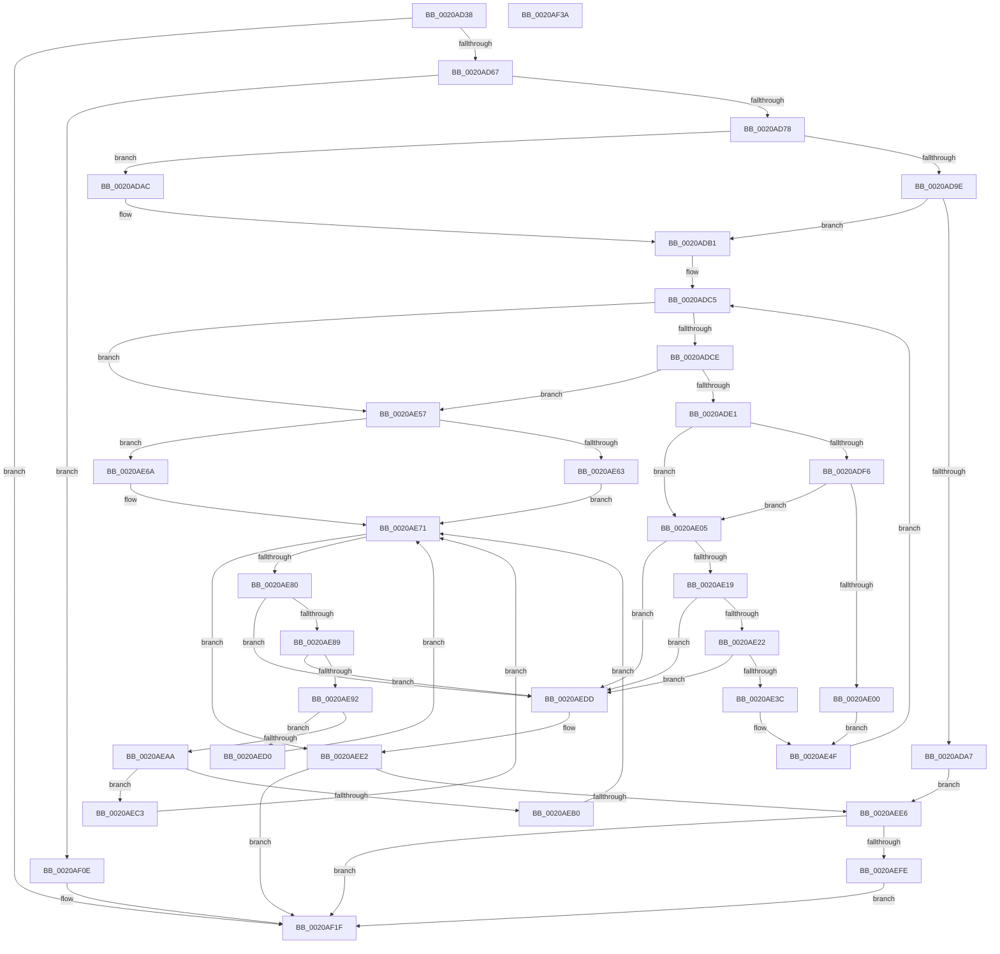

# KiRcuFlushCompleted

- RVA: `0x0020AD38`–`0x0020AF3B` (길이 `515` bytes)
- VA: `0x000000014020AD38`
- 실행 섹션: `.text`
- PDB 이름 있음: `예`; PDB Function 태그: `아니요`
- unwind 정보 RVA: `0x0005D7BC`
- 디코드: `135`개 명령, `515/515` bytes 표시
- 미해석 바이트: `0` (있으면 어셈블리에 `.byte`로 보존)

> 이 문서는 커널 이미지의 기계어와 PDB 기호를 분석해 생성했습니다. 4번과 5번은 함수 원형과 자료형을 바이너리 사용 방식에서 추정한 C 해석이며 원본 소스 복구 결과는 아닙니다.

## 1. Dependencies

- 직접 호출 지점: **11**; 고유 호출 대상: **11**
- 직접 호출자로 확인된 함수: **10**
- RIP 상대 이미지 참조: **7**

### Outgoing calls
- `0x0020AD67` → [KeGetEffectiveIrql](../2F/KeGetEffectiveIrql_function_002F8030.md) (function, `0x002F8030`)
- `0x0020AD9E` → [KxTryToAcquireSpinLock](../46/KxTryToAcquireSpinLock_function_0046BE18.md) (function, `0x0046BE18`)
- `0x0020ADAC` → [KeAcquireSpinLockRaiseToDpc](KeAcquireSpinLockRaiseToDpc_function_00208470.md) (function, `0x00208470`)
- `0x0020ADD8` → [KiRcuCompareGraceSequence](../4D/KiRcuCompareGraceSequence_function_004D6538.md) (function, `0x004D6538`)
- `0x0020AE63` → [KxReleaseSpinLock](KxReleaseSpinLock_function_00206670.md) (function, `0x00206670`)
- `0x0020AE6C` → [KeReleaseSpinLock](../39/KeReleaseSpinLock_function_00392BA0.md) (function, `0x00392BA0`)
- `0x0020AEBC` → [guard_dispatch_icall](../6B/guard_dispatch_icall_function_006BAAD0.md) (function, `0x006BAAD0`)
- `0x0020AEC9` → [ExFreePoolWithTag](../../poolcode/B8/ExFreePoolWithTag_function_00B82870.md) (function, `0x00B82870`)
- `0x0020AED6` → [KeSignalGate](../2C/KeSignalGate_function_002C748C.md) (function, `0x002C748C`)
- `0x0020AF07` → [ExQueueWorkItem](../2F/ExQueueWorkItem_function_002F9520.md) (function, `0x002F9520`)
- `0x0020AF1A` → [KeInsertQueueDpc](KeInsertQueueDpc_function_00207C50.md) (function, `0x00207C50`)

### Direct callers
- [sub_00209822](Unknown_function_00209822.md) at `0x002098E4`
- [sub_0020BDAA](Unknown_function_0020BDAA.md) at `0x0020C204`
- [sub_0020D1EC](Unknown_function_0020D1EC.md) at `0x0020D536`
- [KeWaitForSingleObject](KeWaitForSingleObject_function_0020E6B0.md) at `0x0020EC4B`
- [sub_0021B161](../21/Unknown_function_0021B161.md) at `0x0021B18F`
- [KeClockInterruptNotify](../39/KeClockInterruptNotify_function_0039A970.md) at `0x0039AB7B`
- [sub_003C601D](../3C/Unknown_function_003C601D.md) at `0x003C6113`
- [KiRcuFlushCompletedDpcRoutine](../5B/KiRcuFlushCompletedDpcRoutine_function_005BD2A0.md) at `0x005BD2A9`
- [KiRcuFlushCompletedWorkerRoutine](../5B/KiRcuFlushCompletedWorkerRoutine_function_005BD2C0.md) at `0x005BD2D1`
- [KiRcuStartGracePeriod](../5B/KiRcuStartGracePeriod_function_005BD2F4.md) at `0x005BD383`

### Static image references
- `0x0020AD51` → RVA `0x00F210F0` (`.data`; read)
- `0x0020AD8E` → RVA `0x00F210D8` (`.data`; read)
- `0x0020ADB1` → RVA `0x00F210E0` (`.data`; read)
- `0x0020AEE6` → RVA `0x00F21160` (`.data`; read/write)
- `0x0020AEF3` → RVA `0x00F21160` (`.data`; read)
- `0x0020AF00` → RVA `0x00F21140` (`.data`; read)
- `0x0020AF11` → RVA `0x00F21100` (`.data`; read)

## 2. Other-region calls and transfers

- 다른 실행 섹션으로 향하는 call: **1**
  - `0x0020AEC9` → [ExFreePoolWithTag](../../poolcode/B8/ExFreePoolWithTag_function_00B82870.md) (`.text` → `POOLCODE`)
- 별도 외부 분기/꼬리 이동을 확인하지 못했습니다.

## 3. Assembly (complete function range)

```asm
0020AD38  48 8B C4                        mov rax, rsp
0020AD3B  48 89 58 08                     mov qword ptr [rax + 8], rbx
0020AD3F  48 89 68 10                     mov qword ptr [rax + 0x10], rbp
0020AD43  48 89 70 18                     mov qword ptr [rax + 0x18], rsi
0020AD47  48 89 78 20                     mov qword ptr [rax + 0x20], rdi
0020AD4B  41 56                           push r14
0020AD4D  48 83 EC 30                     sub rsp, 0x30
0020AD51  48 8D 2D 98 63 D1 00            lea rbp, [rip + 0xd16398]
0020AD58  8B F1                           mov esi, ecx
0020AD5A  48 39 2D 8F 63 D1 00            cmp qword ptr [rip + 0xd1638f], rbp
0020AD61  0F 84 B8 01 00 00               je 0x14020af1f
0020AD67  E8 C4 D2 0E 00                  call 0x1402f8030
0020AD6C  0F B6 D8                        movzx ebx, al
0020AD6F  80 FB 02                        cmp bl, 2
0020AD72  0F 87 96 01 00 00               ja 0x14020af0e
0020AD78  48 8D 44 24 20                  lea rax, [rsp + 0x20]
0020AD7D  33 FF                           xor edi, edi
0020AD7F  48 89 44 24 28                  mov qword ptr [rsp + 0x28], rax
0020AD84  48 8D 44 24 20                  lea rax, [rsp + 0x20]
0020AD89  48 89 44 24 20                  mov qword ptr [rsp + 0x20], rax
0020AD8E  48 8D 0D 43 63 D1 00            lea rcx, [rip + 0xd16343]
0020AD95  44 8D 77 03                     lea r14d, [rdi + 3]
0020AD99  80 FB 02                        cmp bl, 2
0020AD9C  72 0E                           jb 0x14020adac
0020AD9E  E8 75 10 26 00                  call 0x14046be18
0020ADA3  84 C0                           test al, al
0020ADA5  75 0A                           jne 0x14020adb1
0020ADA7  E9 3A 01 00 00                  jmp 0x14020aee6
0020ADAC  E8 BF D6 FF FF                  call 0x140208470
0020ADB1  4C 8B 15 28 63 D1 00            mov r10, qword ptr [rip + 0xd16328]
0020ADB8  41 BB 01 00 00 00               mov r11d, 1
0020ADBE  4C 8B 05 2B 63 D1 00            mov r8, qword ptr [rip + 0xd1632b]
0020ADC5  4C 3B C5                        cmp r8, rbp
0020ADC8  0F 84 89 00 00 00               je 0x14020ae57
0020ADCE  49 8B 50 10                     mov rdx, qword ptr [r8 + 0x10]
0020ADD2  49 8B CA                        mov rcx, r10
0020ADD5  4D 8B C8                        mov r9, r8
0020ADD8  E8 5B B7 2C 00                  call 0x1404d6538
0020ADDD  85 C0                           test eax, eax
0020ADDF  78 76                           js 0x14020ae57
0020ADE1  49 8B 50 18                     mov rdx, qword ptr [r8 + 0x18]
0020ADE5  48 8B CA                        mov rcx, rdx
0020ADE8  49 23 CE                        and rcx, r14
0020ADEB  48 3B D9                        cmp rbx, rcx
0020ADEE  41 0F 47 FB                     cmova edi, r11d
0020ADF2  85 F6                           test esi, esi
0020ADF4  75 0F                           jne 0x14020ae05
0020ADF6  48 83 E2 FC                     and rdx, 0xfffffffffffffffc
0020ADFA  48 83 FA 08                     cmp rdx, 8
0020ADFE  76 05                           jbe 0x14020ae05
0020AE00  41 8B FB                        mov edi, r11d
0020AE03  EB 4A                           jmp 0x14020ae4f
0020AE05  49 8B 01                        mov rax, qword ptr [r9]
0020AE08  49 8D 48 08                     lea rcx, [r8 + 8]
0020AE0C  4C 8B 01                        mov r8, qword ptr [rcx]
0020AE0F  4C 39 48 08                     cmp qword ptr [rax + 8], r9
0020AE13  0F 85 C4 00 00 00               jne 0x14020aedd
0020AE19  4D 39 08                        cmp qword ptr [r8], r9
0020AE1C  0F 85 BB 00 00 00               jne 0x14020aedd
0020AE22  49 89 00                        mov qword ptr [r8], rax
0020AE25  48 8D 54 24 20                  lea rdx, [rsp + 0x20]
0020AE2A  4C 89 40 08                     mov qword ptr [rax + 8], r8
0020AE2E  48 8B 44 24 28                  mov rax, qword ptr [rsp + 0x28]
0020AE33  48 39 10                        cmp qword ptr [rax], rdx
0020AE36  0F 85 A1 00 00 00               jne 0x14020aedd
0020AE3C  48 89 01                        mov qword ptr [rcx], rax
0020AE3F  48 8D 54 24 20                  lea rdx, [rsp + 0x20]
0020AE44  49 89 11                        mov qword ptr [r9], rdx
0020AE47  4C 89 08                        mov qword ptr [rax], r9
0020AE4A  4C 89 4C 24 28                  mov qword ptr [rsp + 0x28], r9
0020AE4F  4D 8B 00                        mov r8, qword ptr [r8]
0020AE52  E9 6E FF FF FF                  jmp 0x14020adc5
0020AE57  48 8D 0D 7A 62 D1 00            lea rcx, [rip + 0xd1627a]
0020AE5E  80 FB 02                        cmp bl, 2
0020AE61  72 07                           jb 0x14020ae6a
0020AE63  E8 08 B8 FF FF                  call 0x140206670
0020AE68  EB 07                           jmp 0x14020ae71
0020AE6A  8A D3                           mov dl, bl
0020AE6C  E8 2F 7D 18 00                  call 0x140392ba0
0020AE71  48 8B 4C 24 20                  mov rcx, qword ptr [rsp + 0x20]
0020AE76  48 8D 44 24 20                  lea rax, [rsp + 0x20]
0020AE7B  48 3B C8                        cmp rcx, rax
0020AE7E  74 62                           je 0x14020aee2
0020AE80  48 8B 11                        mov rdx, qword ptr [rcx]
0020AE83  48 39 4A 08                     cmp qword ptr [rdx + 8], rcx
0020AE87  75 54                           jne 0x14020aedd
0020AE89  48 8B 41 08                     mov rax, qword ptr [rcx + 8]
0020AE8D  48 39 08                        cmp qword ptr [rax], rcx
0020AE90  75 4B                           jne 0x14020aedd
0020AE92  48 89 10                        mov qword ptr [rax], rdx
0020AE95  48 89 42 08                     mov qword ptr [rdx + 8], rax
0020AE99  48 8B 41 18                     mov rax, qword ptr [rcx + 0x18]
0020AE9D  48 8B D0                        mov rdx, rax
0020AEA0  48 C1 EA 02                     shr rdx, 2
0020AEA4  48 83 EA 01                     sub rdx, 1
0020AEA8  74 26                           je 0x14020aed0
0020AEAA  48 83 FA 02                     cmp rdx, 2
0020AEAE  74 13                           je 0x14020aec3
0020AEB0  48 8B 51 28                     mov rdx, qword ptr [rcx + 0x28]
0020AEB4  48 83 E0 FC                     and rax, 0xfffffffffffffffc
0020AEB8  48 8B 49 20                     mov rcx, qword ptr [rcx + 0x20]
0020AEBC  E8 0F FC 4A 00                  call 0x1406baad0
0020AEC1  EB AE                           jmp 0x14020ae71
0020AEC3  48 8B 49 20                     mov rcx, qword ptr [rcx + 0x20]
0020AEC7  33 D2                           xor edx, edx
0020AEC9  E8 A2 79 97 00                  call 0x140b82870
0020AECE  EB A1                           jmp 0x14020ae71
0020AED0  48 8B 49 20                     mov rcx, qword ptr [rcx + 0x20]
0020AED4  33 D2                           xor edx, edx
0020AED6  E8 B1 C5 0B 00                  call 0x1402c748c
0020AEDB  EB 94                           jmp 0x14020ae71
0020AEDD  49 8B CE                        mov rcx, r14
0020AEE0  CD 29                           int 0x29
0020AEE2  85 FF                           test edi, edi
0020AEE4  74 39                           je 0x14020af1f
0020AEE6  F0 83 0D 72 62 D1 00 02         lock or dword ptr [rip + 0xd16272], 2
0020AEEE  B8 02 00 00 00                  mov eax, 2
0020AEF3  F0 44 0F B1 35 64 62 D1 00      lock cmpxchg dword ptr [rip + 0xd16264], r14d
0020AEFC  75 21                           jne 0x14020af1f
0020AEFE  33 D2                           xor edx, edx
0020AF00  48 8D 0D 39 62 D1 00            lea rcx, [rip + 0xd16239]
0020AF07  E8 14 E6 0E 00                  call 0x1402f9520
0020AF0C  EB 11                           jmp 0x14020af1f
0020AF0E  45 33 C0                        xor r8d, r8d
0020AF11  48 8D 0D E8 61 D1 00            lea rcx, [rip + 0xd161e8]
0020AF18  33 D2                           xor edx, edx
0020AF1A  E8 31 CD FF FF                  call 0x140207c50
0020AF1F  48 8B 5C 24 40                  mov rbx, qword ptr [rsp + 0x40]
0020AF24  48 8B 6C 24 48                  mov rbp, qword ptr [rsp + 0x48]
0020AF29  48 8B 74 24 50                  mov rsi, qword ptr [rsp + 0x50]
0020AF2E  48 8B 7C 24 58                  mov rdi, qword ptr [rsp + 0x58]
0020AF33  48 83 C4 30                     add rsp, 0x30
0020AF37  41 5E                           pop r14
0020AF39  C3                              ret
0020AF3A  CC                              int3
```

## 4. C-style interpretation (structured pseudocode)

```c
__int64 __fastcall KiRcuFlushCompleted(int a1)
{
    __int64 result;
    __int64 v_rdi;
    __int64 v_rsp;
    unsigned __int64 v_stack_m10;
    unsigned __int64 v_stack_m18;
    unsigned __int64 v_stack_p10;
    unsigned __int64 v_stack_p18;
    unsigned __int64 v_stack_p20;
    unsigned __int64 v_stack_p8;

    *(unsigned __int64 *)(v_rsp + 8) = v_rbx;
    *(unsigned __int64 *)(v_rsp + 16) = v_rbp;
    *(unsigned __int64 *)(v_rsp + 24) = v_rsi;
    *(unsigned __int64 *)(v_rsp + 32) = v_rdi;
    v_rsp = (v_rsp) - (48);
    if ((*(unsigned __int64 *)(v_rip + 13722511)) == (v_rip + 13722520)) goto loc_0020AF1F;
    result = KeGetEffectiveIrql(a1, a2, a3, a4);
    if (((unsigned __int8)((unsigned __int8)(result))) > 2) goto loc_0020AF0E;
    v_rdi = 0;
    v_stack_m10 = v_stack_m18;
    v_stack_m18 = v_stack_m18;
    if (((unsigned __int8)((unsigned __int8)(result))) < 2) goto loc_0020ADAC;
    result = KxTryToAcquireSpinLock(v_rip + 13722435, a2, a3, a4);
    if ((unsigned __int8)(result) != 0) goto loc_0020ADB1;
    goto loc_0020AEE6;
loc_0020ADAC:
    result = KeAcquireSpinLockRaiseToDpc(v_rip + 13722435, a2, a3, a4);
loc_0020ADB1:
loc_0020ADC5:
    if ((*(unsigned __int64 *)(v_rip + 13722411)) == (v_rip + 13722520)) goto loc_0020AE57;
    result = KiRcuCompareGraceSequence(*(unsigned __int64 *)(v_rip + 13722408), *(unsigned __int64 *)(*(unsigned __int64 *)(v_rip + 13722411) + 16), *(unsigned __int64 *)(v_rip + 13722411), *(unsigned __int64 *)(v_rip + 13722411));
    if (sign_flag) goto loc_0020AE57;
    a1 = (*(unsigned __int64 *)(*(unsigned __int64 *)(v_rip + 13722411) + 24)) & (v_rdi + 3);
    if (((unsigned __int8)(result)) > a1) { v_rdi = 1; }
    if ((unsigned int)((unsigned int)(a1)) != 0) goto loc_0020AE05;
    a2 = (*(unsigned __int64 *)(*(unsigned __int64 *)(v_rip + 13722411) + 24)) & (-4);
    if (a2 <= 8) goto loc_0020AE05;
    goto loc_0020AE4F;
loc_0020AE05:
    if ((*(unsigned __int64 *)(*(unsigned __int64 *)(*(unsigned __int64 *)(v_rip + 13722411)) + 8)) != (*(unsigned __int64 *)(v_rip + 13722411))) goto loc_0020AEDD;
    if ((*(unsigned __int64 *)(*(unsigned __int64 *)(*(unsigned __int64 *)(v_rip + 13722411) + 8))) != (*(unsigned __int64 *)(v_rip + 13722411))) goto loc_0020AEDD;
    *(unsigned __int64 *)(*(unsigned __int64 *)(*(unsigned __int64 *)(v_rip + 13722411) + 8)) = *(unsigned __int64 *)(*(unsigned __int64 *)(v_rip + 13722411));
    *(unsigned __int64 *)(*(unsigned __int64 *)(*(unsigned __int64 *)(v_rip + 13722411)) + 8) = *(unsigned __int64 *)(*(unsigned __int64 *)(v_rip + 13722411) + 8);
    if ((*(unsigned __int64 *)(v_stack_m10)) != v_stack_m18) goto loc_0020AEDD;
    *(unsigned __int64 *)(*(unsigned __int64 *)(v_rip + 13722411) + 8) = v_stack_m10;
    *(unsigned __int64 *)(*(unsigned __int64 *)(v_rip + 13722411)) = v_stack_m18;
    *(unsigned __int64 *)(v_stack_m10) = *(unsigned __int64 *)(v_rip + 13722411);
    v_stack_m10 = *(unsigned __int64 *)(v_rip + 13722411);
loc_0020AE4F:
    goto loc_0020ADC5;
loc_0020AE57:
    if (((unsigned __int8)((unsigned __int8)(result))) < 2) goto loc_0020AE6A;
    result = KxReleaseSpinLock(v_rip + 13722234, v_stack_m18, *(unsigned __int64 *)(*(unsigned __int64 *)(*(unsigned __int64 *)(v_rip + 13722411) + 8)), *(unsigned __int64 *)(v_rip + 13722411));
    goto loc_0020AE71;
loc_0020AE6A:
    result = KeReleaseSpinLock(v_rip + 13722234, (unsigned __int8)((unsigned __int8)(result)), *(unsigned __int64 *)(*(unsigned __int64 *)(*(unsigned __int64 *)(v_rip + 13722411) + 8)), *(unsigned __int64 *)(v_rip + 13722411));
loc_0020AE71:
    if (v_stack_m18 == v_stack_m18) goto loc_0020AEE2;
    if ((*(unsigned __int64 *)(*(unsigned __int64 *)(v_stack_m18) + 8)) != v_stack_m18) goto loc_0020AEDD;
    if ((*(unsigned __int64 *)(*(unsigned __int64 *)(v_stack_m18 + 8))) != v_stack_m18) goto loc_0020AEDD;
    *(unsigned __int64 *)(*(unsigned __int64 *)(v_stack_m18 + 8)) = *(unsigned __int64 *)(v_stack_m18);
    *(unsigned __int64 *)(*(unsigned __int64 *)(v_stack_m18) + 8) = *(unsigned __int64 *)(v_stack_m18 + 8);
    a2 = (*(unsigned __int64 *)(v_stack_m18 + 24)) >> (2);
    a2 = (a2) - (1);
    if (condition_is_equal) goto loc_0020AED0;
    if (a2 == 2) goto loc_0020AEC3;
    result = (*(unsigned __int64 *)(v_stack_m18 + 24)) & (-4);
    result = guard_dispatch_icall(*(unsigned __int64 *)(v_stack_m18 + 32), *(unsigned __int64 *)(v_stack_m18 + 40), *(unsigned __int64 *)(*(unsigned __int64 *)(*(unsigned __int64 *)(v_rip + 13722411) + 8)), *(unsigned __int64 *)(v_rip + 13722411));
    goto loc_0020AE71;
loc_0020AEC3:
    a2 = 0;
    result = ExFreePoolWithTag(*(unsigned __int64 *)(*(unsigned __int64 *)(v_stack_m18 + 32) + 32), a2, *(unsigned __int64 *)(*(unsigned __int64 *)(*(unsigned __int64 *)(v_rip + 13722411) + 8)), *(unsigned __int64 *)(v_rip + 13722411));
    goto loc_0020AE71;
loc_0020AED0:
    a2 = 0;
    result = KeSignalGate(*(unsigned __int64 *)(*(unsigned __int64 *)(*(unsigned __int64 *)(v_stack_m18 + 32) + 32) + 32), a2, *(unsigned __int64 *)(*(unsigned __int64 *)(*(unsigned __int64 *)(v_rip + 13722411) + 8)), *(unsigned __int64 *)(v_rip + 13722411));
    goto loc_0020AE71;
loc_0020AEDD:
loc_0020AEE2:
    if (1 == 0) goto loc_0020AF1F;
loc_0020AEE6:
    if (1 != 0) goto loc_0020AF1F;
    a2 = 0;
    result = ExQueueWorkItem(v_rip + 13722169, a2, *(unsigned __int64 *)(*(unsigned __int64 *)(*(unsigned __int64 *)(v_rip + 13722411) + 8)), *(unsigned __int64 *)(v_rip + 13722411));
    goto loc_0020AF1F;
loc_0020AF0E:
    a3 = 0;
    a2 = 0;
    result = KeInsertQueueDpc(v_rip + 13722088, a2, a3, *(unsigned __int64 *)(v_rip + 13722411));
loc_0020AF1F:
    v_rsp = (v_rsp) + (48);
    return result;
}
```

## 5. (Beta) C Style

```c
int64_t KiRcuFlushCompleted(int32_t Arg1)
{
    int64_t result;
    int64_t local_rdi;
    int64_t local_rsp;
    uint64_t v_stack_m10;
    uint64_t v_stack_m18;
    uint64_t v_stack_p10;
    uint64_t v_stack_p18;
    uint64_t v_stack_p20;
    uint64_t v_stack_p8;

    *(uint64_t *)(local_rsp + 0x8) = local_rbx;
    *(uint64_t *)(local_rsp + 0x10) = local_rbp;
    *(uint64_t *)(local_rsp + 0x18) = local_rsi;
    *(uint64_t *)(local_rsp + 0x20) = local_rdi;
    local_rsp = (local_rsp) - (48);
    if ((*(uint64_t *)(v_rip + 0xD1638F)) == (v_rip + 13722520)) goto loc_0020AF1F;
    result = KeGetEffectiveIrql(Arg1, a2, a3, a4);
    if (((uint8_t)((uint8_t)(result))) > 2) goto loc_0020AF0E;
    local_rdi = 0;
    v_stack_m10 = v_stack_m18;
    v_stack_m18 = v_stack_m18;
    if (((uint8_t)((uint8_t)(result))) < 2) goto loc_0020ADAC;
    result = KxTryToAcquireSpinLock(v_rip + 13722435, a2, a3, a4);
    if ((uint8_t)(result) != 0) goto loc_0020ADB1;
    goto loc_0020AEE6;
loc_0020ADAC:
    result = KeAcquireSpinLockRaiseToDpc(v_rip + 13722435, a2, a3, a4);
loc_0020ADB1:
loc_0020ADC5:
    if ((*(uint64_t *)(v_rip + 0xD1632B)) == (v_rip + 13722520)) goto loc_0020AE57;
    result = KiRcuCompareGraceSequence(*(uint64_t *)(v_rip + 0xD16328), *(uint64_t *)(*(uint64_t *)(v_rip + 0xD1632B) + 0x10), *(uint64_t *)(v_rip + 0xD1632B), *(uint64_t *)(v_rip + 0xD1632B));
    if (sign_flag) goto loc_0020AE57;
    Arg1 = (*(uint64_t *)(*(uint64_t *)(v_rip + 0xD1632B) + 0x18)) & (local_rdi + 3);
    if (((uint8_t)(result)) > Arg1) { local_rdi = 1; }
    if ((uint32_t)((uint32_t)(Arg1)) != 0) goto loc_0020AE05;
    a2 = (*(uint64_t *)(*(uint64_t *)(v_rip + 0xD1632B) + 0x18)) & (-4);
    if (a2 <= 8) goto loc_0020AE05;
    goto loc_0020AE4F;
loc_0020AE05:
    if ((*(uint64_t *)(*(uint64_t *)(*(uint64_t *)(v_rip + 0xD1632B)) + 0x8)) != (*(uint64_t *)(v_rip + 0xD1632B))) goto loc_0020AEDD;
    if ((*(uint64_t *)(*(uint64_t *)(*(uint64_t *)(v_rip + 0xD1632B) + 0x8))) != (*(uint64_t *)(v_rip + 0xD1632B))) goto loc_0020AEDD;
    *(uint64_t *)(*(uint64_t *)(*(uint64_t *)(v_rip + 0xD1632B) + 0x8)) = *(uint64_t *)(*(uint64_t *)(v_rip + 0xD1632B));
    *(uint64_t *)(*(uint64_t *)(*(uint64_t *)(v_rip + 0xD1632B)) + 0x8) = *(uint64_t *)(*(uint64_t *)(v_rip + 0xD1632B) + 0x8);
    if ((*(uint64_t *)(v_stack_m10)) != v_stack_m18) goto loc_0020AEDD;
    *(uint64_t *)(*(uint64_t *)(v_rip + 0xD1632B) + 0x8) = v_stack_m10;
    *(uint64_t *)(*(uint64_t *)(v_rip + 0xD1632B)) = v_stack_m18;
    *(uint64_t *)(v_stack_m10) = *(uint64_t *)(v_rip + 0xD1632B);
    v_stack_m10 = *(uint64_t *)(v_rip + 0xD1632B);
loc_0020AE4F:
    goto loc_0020ADC5;
loc_0020AE57:
    if (((uint8_t)((uint8_t)(result))) < 2) goto loc_0020AE6A;
    result = KxReleaseSpinLock(v_rip + 13722234, v_stack_m18, *(uint64_t *)(*(uint64_t *)(*(uint64_t *)(v_rip + 0xD1632B) + 0x8)), *(uint64_t *)(v_rip + 0xD1632B));
    goto loc_0020AE71;
loc_0020AE6A:
    result = KeReleaseSpinLock(v_rip + 13722234, (uint8_t)((uint8_t)(result)), *(uint64_t *)(*(uint64_t *)(*(uint64_t *)(v_rip + 0xD1632B) + 0x8)), *(uint64_t *)(v_rip + 0xD1632B));
loc_0020AE71:
    if (v_stack_m18 == v_stack_m18) goto loc_0020AEE2;
    if ((*(uint64_t *)(*(uint64_t *)(v_stack_m18) + 0x8)) != v_stack_m18) goto loc_0020AEDD;
    if ((*(uint64_t *)(*(uint64_t *)(v_stack_m18 + 0x8))) != v_stack_m18) goto loc_0020AEDD;
    *(uint64_t *)(*(uint64_t *)(v_stack_m18 + 0x8)) = *(uint64_t *)(v_stack_m18);
    *(uint64_t *)(*(uint64_t *)(v_stack_m18) + 0x8) = *(uint64_t *)(v_stack_m18 + 0x8);
    a2 = (*(uint64_t *)(v_stack_m18 + 0x18)) >> (2);
    a2 = (a2) - (1);
    if (condition_is_equal) goto loc_0020AED0;
    if (a2 == 2) goto loc_0020AEC3;
    result = (*(uint64_t *)(v_stack_m18 + 0x18)) & (-4);
    result = guard_dispatch_icall(*(uint64_t *)(v_stack_m18 + 0x20), *(uint64_t *)(v_stack_m18 + 0x28), *(uint64_t *)(*(uint64_t *)(*(uint64_t *)(v_rip + 0xD1632B) + 0x8)), *(uint64_t *)(v_rip + 0xD1632B));
    goto loc_0020AE71;
loc_0020AEC3:
    a2 = 0;
    result = ExFreePoolWithTag(*(uint64_t *)(*(uint64_t *)(v_stack_m18 + 0x20) + 0x20), a2, *(uint64_t *)(*(uint64_t *)(*(uint64_t *)(v_rip + 0xD1632B) + 0x8)), *(uint64_t *)(v_rip + 0xD1632B));
    goto loc_0020AE71;
loc_0020AED0:
    a2 = 0;
    result = KeSignalGate(*(uint64_t *)(*(uint64_t *)(*(uint64_t *)(v_stack_m18 + 0x20) + 0x20) + 0x20), a2, *(uint64_t *)(*(uint64_t *)(*(uint64_t *)(v_rip + 0xD1632B) + 0x8)), *(uint64_t *)(v_rip + 0xD1632B));
    goto loc_0020AE71;
loc_0020AEDD:
loc_0020AEE2:
    if (1 == 0) goto loc_0020AF1F;
loc_0020AEE6:
    if (1 != 0) goto loc_0020AF1F;
    a2 = 0;
    result = ExQueueWorkItem(v_rip + 13722169, a2, *(uint64_t *)(*(uint64_t *)(*(uint64_t *)(v_rip + 0xD1632B) + 0x8)), *(uint64_t *)(v_rip + 0xD1632B));
    goto loc_0020AF1F;
loc_0020AF0E:
    a3 = 0;
    a2 = 0;
    result = KeInsertQueueDpc(v_rip + 13722088, a2, a3, *(uint64_t *)(v_rip + 0xD1632B));
loc_0020AF1F:
    local_rsp = (local_rsp) + (48);
    return result;
}
```

## 6. Execution-region graph

[열기: 2D/3D 그래프와 함수 탐색 컨트롤 패널](../../../control-panel.html?section=text&rva=0x0020AD38&view=graph)

- 2D 그래프는 위에서 아래로 흐르고, 3D 그래프는 빈 공간을 드래그해 회전합니다. Shift+드래그는 이동, 휠은 확대·축소, 함수 노드 선택은 대상 보고서 이동입니다.

### Static fallback


