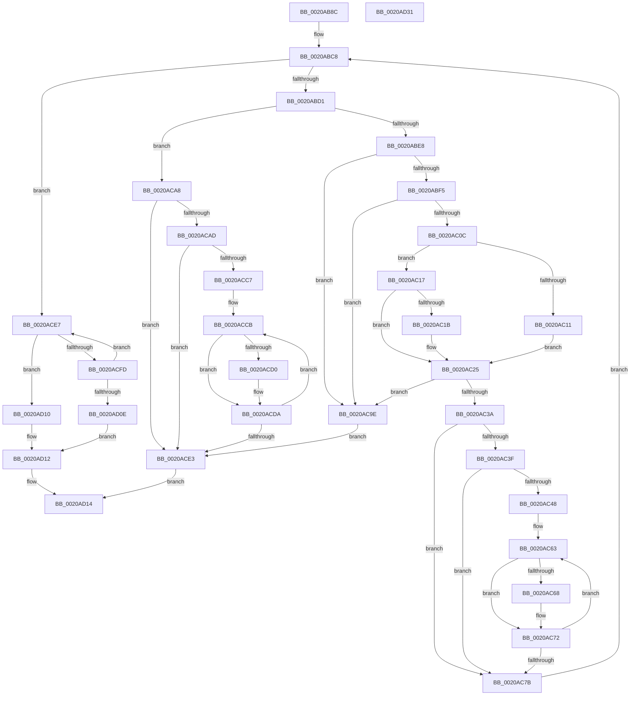

# KiRcuReportQuiescentState

- RVA: `0x0020AB8C`–`0x0020AD32` (길이 `422` bytes)
- VA: `0x000000014020AB8C`
- 실행 섹션: `.text`
- PDB 이름 있음: `예`; PDB Function 태그: `아니요`
- unwind 정보 RVA: `0x0005D79C`
- 디코드: `125`개 명령, `422/422` bytes 표시
- 미해석 바이트: `0` (있으면 어셈블리에 `.byte`로 보존)

> 이 문서는 커널 이미지의 기계어와 PDB 기호를 분석해 생성했습니다. 4번과 5번은 함수 원형과 자료형을 바이너리 사용 방식에서 추정한 C 해석이며 원본 소스 복구 결과는 아닙니다.

## 1. Dependencies

- 직접 호출 지점: **5**; 고유 호출 대상: **3**
- 직접 호출자로 확인된 함수: **8**
- RIP 상대 이미지 참조: **1**

### Outgoing calls
- `0x0020ABD8` → [KxTryToAcquireSpinLock](../46/KxTryToAcquireSpinLock_function_0046BE18.md) (function, `0x0046BE18`)
- `0x0020ABFF` → [KiRcuCompareGraceSequence](../4D/KiRcuCompareGraceSequence_function_004D6538.md) (function, `0x004D6538`)
- `0x0020AC86` → [KxReleaseSpinLock](KxReleaseSpinLock_function_00206670.md) (function, `0x00206670`)
- `0x0020ACA1` → [KxReleaseSpinLock](KxReleaseSpinLock_function_00206670.md) (function, `0x00206670`)
- `0x0020ACF4` → [KiRcuCompareGraceSequence](../4D/KiRcuCompareGraceSequence_function_004D6538.md) (function, `0x004D6538`)

### Direct callers
- [sub_00209822](Unknown_function_00209822.md) at `0x002098D0`
- [sub_0020BDAA](Unknown_function_0020BDAA.md) at `0x0020C1F0`
- [sub_0020D1EC](Unknown_function_0020D1EC.md) at `0x0020D521`
- [KeWaitForSingleObject](KeWaitForSingleObject_function_0020E6B0.md) at `0x0020EC37`
- [sub_0021B161](../21/Unknown_function_0021B161.md) at `0x0021B17F`
- [KeClockInterruptNotify](../39/KeClockInterruptNotify_function_0039A970.md) at `0x0039AB67`
- [sub_003C601D](../3C/Unknown_function_003C601D.md) at `0x003C60FF`
- [KiRcuCheckQuiescentForIdle](../4D/KiRcuCheckQuiescentForIdle_function_004DF6FC.md) at `0x004DF74A`

### Static image references
- `0x0020ACE7` → RVA `0x00F210E0` (`.data`; read)

## 2. Other-region calls and transfers

- 다른 실행 섹션으로 향하는 call: **0**
- 별도 외부 분기/꼬리 이동을 확인하지 못했습니다.

## 3. Assembly (complete function range)

```asm
0020AB8C  48 89 5C 24 10                  mov qword ptr [rsp + 0x10], rbx
0020AB91  48 89 6C 24 18                  mov qword ptr [rsp + 0x18], rbp
0020AB96  48 89 74 24 20                  mov qword ptr [rsp + 0x20], rsi
0020AB9B  57                              push rdi
0020AB9C  41 54                           push r12
0020AB9E  41 55                           push r13
0020ABA0  41 56                           push r14
0020ABA2  41 57                           push r15
0020ABA4  48 83 EC 20                     sub rsp, 0x20
0020ABA8  4C 8B 79 10                     mov r15, qword ptr [rcx + 0x10]
0020ABAC  BD 01 00 00 00                  mov ebp, 1
0020ABB1  48 8B 59 08                     mov rbx, qword ptr [rcx + 8]
0020ABB5  49 81 C7 F0 38 00 00            add r15, 0x38f0
0020ABBC  4C 8B 31                        mov r14, qword ptr [rcx]
0020ABBF  44 8B E5                        mov r12d, ebp
0020ABC2  48 8B FA                        mov rdi, rdx
0020ABC5  48 8B F1                        mov rsi, rcx
0020ABC8  48 85 DB                        test rbx, rbx
0020ABCB  0F 84 16 01 00 00               je 0x14020ace7
0020ABD1  4C 8D 6B 20                     lea r13, [rbx + 0x20]
0020ABD5  49 8B CD                        mov rcx, r13
0020ABD8  E8 3B 12 26 00                  call 0x14046be18
0020ABDD  45 33 D2                        xor r10d, r10d
0020ABE0  84 C0                           test al, al
0020ABE2  0F 84 C0 00 00 00               je 0x14020aca8
0020ABE8  4C 8B 43 38                     mov r8, qword ptr [rbx + 0x38]
0020ABEC  4D 85 C6                        test r14, r8
0020ABEF  0F 85 A9 00 00 00               jne 0x14020ac9e
0020ABF5  4C 8B 4B 28                     mov r9, qword ptr [rbx + 0x28]
0020ABF9  48 8B CF                        mov rcx, rdi
0020ABFC  49 8B D1                        mov rdx, r9
0020ABFF  E8 34 B9 2C 00                  call 0x1404d6538
0020AC04  85 C0                           test eax, eax
0020AC06  0F 88 92 00 00 00               js 0x14020ac9e
0020AC0C  4D 85 C0                        test r8, r8
0020AC0F  75 06                           jne 0x14020ac17
0020AC11  48 89 7B 28                     mov qword ptr [rbx + 0x28], rdi
0020AC15  EB 0E                           jmp 0x14020ac25
0020AC17  85 C0                           test eax, eax
0020AC19  7E 0A                           jle 0x14020ac25
0020AC1B  4D 0B C6                        or r8, r14
0020AC1E  49 8B F9                        mov rdi, r9
0020AC21  4C 09 43 40                     or qword ptr [rbx + 0x40], r8
0020AC25  49 89 3F                        mov qword ptr [r15], rdi
0020AC28  4C 09 73 38                     or qword ptr [rbx + 0x38], r14
0020AC2C  48 8B 43 38                     mov rax, qword ptr [rbx + 0x38]
0020AC30  48 0B 43 18                     or rax, qword ptr [rbx + 0x18]
0020AC34  48 3B 43 10                     cmp rax, qword ptr [rbx + 0x10]
0020AC38  75 64                           jne 0x14020ac9e
0020AC3A  45 85 E4                        test r12d, r12d
0020AC3D  74 3C                           je 0x14020ac7b
0020AC3F  48 8B 53 40                     mov rdx, qword ptr [rbx + 0x40]
0020AC43  48 85 D2                        test rdx, rdx
0020AC46  74 33                           je 0x14020ac7b
0020AC48  48 8B 06                        mov rax, qword ptr [rsi]
0020AC4B  48 0F BC C8                     bsf rcx, rax
0020AC4F  8B C1                           mov eax, ecx
0020AC51  89 4C 24 50                     mov dword ptr [rsp + 0x50], ecx
0020AC55  48 8B CE                        mov rcx, rsi
0020AC58  48 C1 E0 05                     shl rax, 5
0020AC5C  48 2B C8                        sub rcx, rax
0020AC5F  48 83 C1 10                     add rcx, 0x10
0020AC63  40 84 D5                        test bpl, dl
0020AC66  74 0A                           je 0x14020ac72
0020AC68  48 8B 01                        mov rax, qword ptr [rcx]
0020AC6B  48 89 B8 F0 38 00 00            mov qword ptr [rax + 0x38f0], rdi
0020AC72  48 83 C1 20                     add rcx, 0x20
0020AC76  48 D1 EA                        shr rdx, 1
0020AC79  75 E8                           jne 0x14020ac63
0020AC7B  49 8B CD                        mov rcx, r13
0020AC7E  4C 89 53 38                     mov qword ptr [rbx + 0x38], r10
0020AC82  4C 89 53 40                     mov qword ptr [rbx + 0x40], r10
0020AC86  E8 E5 B9 FF FF                  call 0x140206670
0020AC8B  4C 8B 33                        mov r14, qword ptr [rbx]
0020AC8E  4C 8D 7B 30                     lea r15, [rbx + 0x30]
0020AC92  48 8B 5B 08                     mov rbx, qword ptr [rbx + 8]
0020AC96  45 33 E4                        xor r12d, r12d
0020AC99  E9 2A FF FF FF                  jmp 0x14020abc8
0020AC9E  49 8B CD                        mov rcx, r13
0020ACA1  E8 CA B9 FF FF                  call 0x140206670
0020ACA6  EB 3B                           jmp 0x14020ace3
0020ACA8  45 85 E4                        test r12d, r12d
0020ACAB  75 36                           jne 0x14020ace3
0020ACAD  48 8B 06                        mov rax, qword ptr [rsi]
0020ACB0  48 8B 4B 10                     mov rcx, qword ptr [rbx + 0x10]
0020ACB4  48 0F BC C0                     bsf rax, rax
0020ACB8  48 C1 E0 05                     shl rax, 5
0020ACBC  48 2B F0                        sub rsi, rax
0020ACBF  48 FF CF                        dec rdi
0020ACC2  48 85 C9                        test rcx, rcx
0020ACC5  74 1C                           je 0x14020ace3
0020ACC7  48 8D 56 10                     lea rdx, [rsi + 0x10]
0020ACCB  40 84 CD                        test bpl, cl
0020ACCE  74 0A                           je 0x14020acda
0020ACD0  48 8B 02                        mov rax, qword ptr [rdx]
0020ACD3  48 89 B8 F0 38 00 00            mov qword ptr [rax + 0x38f0], rdi
0020ACDA  48 83 C2 20                     add rdx, 0x20
0020ACDE  48 D1 E9                        shr rcx, 1
0020ACE1  75 E8                           jne 0x14020accb
0020ACE3  33 C0                           xor eax, eax
0020ACE5  EB 2D                           jmp 0x14020ad14
0020ACE7  4C 8B 05 F2 63 D1 00            mov r8, qword ptr [rip + 0xd163f2]
0020ACEE  48 8B CF                        mov rcx, rdi
0020ACF1  49 8B D0                        mov rdx, r8
0020ACF4  E8 3F B8 2C 00                  call 0x1404d6538
0020ACF9  85 C0                           test eax, eax
0020ACFB  7E 13                           jle 0x14020ad10
0020ACFD  49 8B C0                        mov rax, r8
0020AD00  F0 48 0F B1 3D D7 63 D1 00      lock cmpxchg qword ptr [rip + 0xd163d7], rdi
0020AD09  4C 3B C0                        cmp r8, rax
0020AD0C  75 D9                           jne 0x14020ace7
0020AD0E  EB 02                           jmp 0x14020ad12
0020AD10  33 ED                           xor ebp, ebp
0020AD12  8B C5                           mov eax, ebp
0020AD14  48 8B 5C 24 58                  mov rbx, qword ptr [rsp + 0x58]
0020AD19  48 8B 6C 24 60                  mov rbp, qword ptr [rsp + 0x60]
0020AD1E  48 8B 74 24 68                  mov rsi, qword ptr [rsp + 0x68]
0020AD23  48 83 C4 20                     add rsp, 0x20
0020AD27  41 5F                           pop r15
0020AD29  41 5E                           pop r14
0020AD2B  41 5D                           pop r13
0020AD2D  41 5C                           pop r12
0020AD2F  5F                              pop rdi
0020AD30  C3                              ret
0020AD31  CC                              int3
```

## 4. C-style interpretation (structured pseudocode)

```c
__int64 __fastcall KiRcuReportQuiescentState(__int64 a1, __int64 a2)
{
    __int64 result;
    __int64 v_r10;
    __int64 v_r12;
    __int64 v_r15;
    __int64 v_rbp;
    __int64 v_rdi;
    __int64 v_rsi;
    __int64 v_rsp;
    unsigned __int64 v_stack_p10;
    unsigned __int64 v_stack_p18;
    unsigned __int64 v_stack_p20;
    unsigned int v_stack_p8;

    v_stack_p10 = v_rbx;
    v_stack_p18 = v_rbp;
    v_stack_p20 = v_rsi;
    v_rsp = (v_rsp) - (32);
    v_r15 = (*(unsigned __int64 *)(a1 + 16)) + (0x38F0ULL);
loc_0020ABC8:
    if (*(unsigned __int64 *)(a1 + 8) == 0) goto loc_0020ACE7;
    result = KxTryToAcquireSpinLock(*(unsigned __int64 *)(a1 + 8) + 32, a2, a3, a4);
    v_r10 = 0;
    if ((unsigned __int8)(result) == 0) goto loc_0020ACA8;
    if (((*(unsigned __int64 *)(a1)) & (*(unsigned __int64 *)(*(unsigned __int64 *)(a1 + 8) + 56))) != 0) goto loc_0020AC9E;
    result = KiRcuCompareGraceSequence(a2, *(unsigned __int64 *)(*(unsigned __int64 *)(a1 + 8) + 40), *(unsigned __int64 *)(*(unsigned __int64 *)(a1 + 8) + 56), *(unsigned __int64 *)(*(unsigned __int64 *)(a1 + 8) + 40));
    if (sign_flag) goto loc_0020AC9E;
    if (*(unsigned __int64 *)(*(unsigned __int64 *)(a1 + 8) + 56) != 0) goto loc_0020AC17;
    *(unsigned __int64 *)(*(unsigned __int64 *)(a1 + 8) + 40) = a2;
    goto loc_0020AC25;
loc_0020AC17:
    v_rdi = a2;
    if (!(condition_is_less_or_equal)) {
        a3 = (*(unsigned __int64 *)(*(unsigned __int64 *)(a1 + 8) + 56)) | (*(unsigned __int64 *)(a1));
        v_rdi = *(unsigned __int64 *)(*(unsigned __int64 *)(a1 + 8) + 40);
    }
    *(unsigned __int64 *)(v_r15) = v_rdi;
    result = (*(unsigned __int64 *)(*(unsigned __int64 *)(a1 + 8) + 56)) | (*(unsigned __int64 *)(*(unsigned __int64 *)(a1 + 8) + 24));
    if (result != (*(unsigned __int64 *)(*(unsigned __int64 *)(a1 + 8) + 16))) goto loc_0020AC9E;
    if (1 == 0) goto loc_0020AC7B;
    if (*(unsigned __int64 *)(*(unsigned __int64 *)(a1 + 8) + 64) == 0) goto loc_0020AC7B;
    v_stack_p8 = (unsigned int)(a2);
    result = ((unsigned int)((unsigned int)(a2))) << (5);
    a1 = (a1) - (result);
    a1 = (a1) + (16);
loc_0020AC63:
    if (((1) & ((unsigned __int8)(*(unsigned __int64 *)(*(unsigned __int64 *)(a1 + 8) + 64)))) != 0) {
        result = *(unsigned __int64 *)(a1);
        *(unsigned __int64 *)(result + 14576) = v_rdi;
    }
    a1 = (a1) + (32);
    a2 = (*(unsigned __int64 *)(*(unsigned __int64 *)(a1 + 8) + 64)) >> (1);
    if (condition_is_not_equal) goto loc_0020AC63;
loc_0020AC7B:
    *(unsigned __int64 *)(*(unsigned __int64 *)(a1 + 8) + 56) = 0;
    *(unsigned __int64 *)(*(unsigned __int64 *)(a1 + 8) + 64) = 0;
    result = KxReleaseSpinLock(*(unsigned __int64 *)(a1 + 8) + 32, a2, a3, *(unsigned __int64 *)(*(unsigned __int64 *)(a1 + 8) + 40));
    v_r12 = 0;
    goto loc_0020ABC8;
loc_0020AC9E:
    result = KxReleaseSpinLock(*(unsigned __int64 *)(a1 + 8) + 32, a2, a3, *(unsigned __int64 *)(*(unsigned __int64 *)(a1 + 8) + 40));
    goto loc_0020ACE3;
loc_0020ACA8:
    if (0 != 0) goto loc_0020ACE3;
    result = (*(unsigned __int64 *)(a1)) << (5);
    v_rsi = (a1) - (result);
    v_rdi = (v_rdi) - 1;
    if (*(unsigned __int64 *)(*(unsigned __int64 *)(*(unsigned __int64 *)(a1 + 8) + 8) + 16) == 0) goto loc_0020ACE3;
loc_0020ACCB:
    if (((1) & ((unsigned __int8)(*(unsigned __int64 *)(*(unsigned __int64 *)(*(unsigned __int64 *)(a1 + 8) + 8) + 16)))) != 0) {
        result = *(unsigned __int64 *)(v_rsi + 16);
        *(unsigned __int64 *)(result + 14576) = v_rdi;
    }
    a2 = (v_rsi + 16) + (32);
    a1 = (*(unsigned __int64 *)(*(unsigned __int64 *)(*(unsigned __int64 *)(a1 + 8) + 8) + 16)) >> (1);
    if (condition_is_not_equal) goto loc_0020ACCB;
loc_0020ACE3:
    result = 0;
    goto loc_0020AD14;
loc_0020ACE7:
    result = KiRcuCompareGraceSequence(v_rdi, *(unsigned __int64 *)(v_rip + 13722610), *(unsigned __int64 *)(v_rip + 13722610), *(unsigned __int64 *)(*(unsigned __int64 *)(a1 + 8) + 40));
    if (condition_is_less_or_equal) goto loc_0020AD10;
    if ((*(unsigned __int64 *)(v_rip + 13722610)) != (*(unsigned __int64 *)(v_rip + 13722610))) goto loc_0020ACE7;
    goto loc_0020AD12;
loc_0020AD10:
    v_rbp = 0;
loc_0020AD12:
loc_0020AD14:
    v_rsp = (v_rsp) + (32);
    return 0;
}
```

## 5. (Beta) C Style

```c
int64_t KiRcuReportQuiescentState(void *Arg1, int64_t Arg2)
{
    uint8_t *arg1 = (uint8_t *)Arg1;

    int64_t result;
    int64_t local_r10;
    int64_t local_r12;
    int64_t local_r15;
    int64_t local_rbp;
    int64_t local_rdi;
    int64_t local_rsi;
    int64_t local_rsp;
    uint64_t v_stack_p10;
    uint64_t v_stack_p18;
    uint64_t v_stack_p20;
    uint32_t v_stack_p8;

    v_stack_p10 = local_rbx;
    v_stack_p18 = local_rbp;
    v_stack_p20 = local_rsi;
    local_rsp = (local_rsp) - (32);
    local_r15 = (*(uint64_t *)(arg1 + 0x10)) + (0x38F0ULL);
loc_0020ABC8:
    if (*(uint64_t *)(arg1 + 0x8) == 0) goto loc_0020ACE7;
    result = KxTryToAcquireSpinLock(*(uint64_t *)(arg1 + 0x8) + 32, Arg2, a3, a4);
    local_r10 = 0;
    if ((uint8_t)(result) == 0) goto loc_0020ACA8;
    if (((*(uint64_t *)(arg1)) & (*(uint64_t *)(*(uint64_t *)(arg1 + 0x8) + 0x38))) != 0) goto loc_0020AC9E;
    result = KiRcuCompareGraceSequence(Arg2, *(uint64_t *)(*(uint64_t *)(arg1 + 0x8) + 0x28), *(uint64_t *)(*(uint64_t *)(arg1 + 0x8) + 0x38), *(uint64_t *)(*(uint64_t *)(arg1 + 0x8) + 0x28));
    if (sign_flag) goto loc_0020AC9E;
    if (*(uint64_t *)(*(uint64_t *)(arg1 + 0x8) + 0x38) != 0) goto loc_0020AC17;
    *(uint64_t *)(*(uint64_t *)(arg1 + 0x8) + 0x28) = Arg2;
    goto loc_0020AC25;
loc_0020AC17:
    local_rdi = Arg2;
    if (!(condition_is_less_or_equal)) {
        a3 = (*(uint64_t *)(*(uint64_t *)(arg1 + 0x8) + 0x38)) | (*(uint64_t *)(arg1));
        local_rdi = *(uint64_t *)(*(uint64_t *)(arg1 + 0x8) + 0x28);
    }
    *(uint64_t *)(local_r15) = local_rdi;
    result = (*(uint64_t *)(*(uint64_t *)(arg1 + 0x8) + 0x38)) | (*(uint64_t *)(*(uint64_t *)(arg1 + 0x8) + 0x18));
    if (result != (*(uint64_t *)(*(uint64_t *)(arg1 + 0x8) + 0x10))) goto loc_0020AC9E;
    if (1 == 0) goto loc_0020AC7B;
    if (*(uint64_t *)(*(uint64_t *)(arg1 + 0x8) + 0x40) == 0) goto loc_0020AC7B;
    v_stack_p8 = (uint32_t)(Arg2);
    result = ((uint32_t)((uint32_t)(Arg2))) << (5);
    Arg1 = (Arg1) - (result);
    Arg1 = (Arg1) + (16);
loc_0020AC63:
    if (((1) & ((uint8_t)(*(uint64_t *)(*(uint64_t *)(arg1 + 0x8) + 0x40)))) != 0) {
        result = *(uint64_t *)(arg1);
        *(uint64_t *)(result + 0x38F0) = local_rdi;
    }
    Arg1 = (Arg1) + (32);
    Arg2 = (*(uint64_t *)(*(uint64_t *)(arg1 + 0x8) + 0x40)) >> (1);
    if (condition_is_not_equal) goto loc_0020AC63;
loc_0020AC7B:
    *(uint64_t *)(*(uint64_t *)(arg1 + 0x8) + 0x38) = 0;
    *(uint64_t *)(*(uint64_t *)(arg1 + 0x8) + 0x40) = 0;
    result = KxReleaseSpinLock(*(uint64_t *)(arg1 + 0x8) + 32, Arg2, a3, *(uint64_t *)(*(uint64_t *)(arg1 + 0x8) + 0x28));
    local_r12 = 0;
    goto loc_0020ABC8;
loc_0020AC9E:
    result = KxReleaseSpinLock(*(uint64_t *)(arg1 + 0x8) + 32, Arg2, a3, *(uint64_t *)(*(uint64_t *)(arg1 + 0x8) + 0x28));
    goto loc_0020ACE3;
loc_0020ACA8:
    if (0 != 0) goto loc_0020ACE3;
    result = (*(uint64_t *)(arg1)) << (5);
    local_rsi = (Arg1) - (result);
    local_rdi = (local_rdi) - 1;
    if (*(uint64_t *)(*(uint64_t *)(*(uint64_t *)(arg1 + 0x8) + 0x8) + 0x10) == 0) goto loc_0020ACE3;
loc_0020ACCB:
    if (((1) & ((uint8_t)(*(uint64_t *)(*(uint64_t *)(*(uint64_t *)(arg1 + 0x8) + 0x8) + 0x10)))) != 0) {
        result = *(uint64_t *)(local_rsi + 0x10);
        *(uint64_t *)(result + 0x38F0) = local_rdi;
    }
    Arg2 = (local_rsi + 16) + (32);
    Arg1 = (*(uint64_t *)(*(uint64_t *)(*(uint64_t *)(arg1 + 0x8) + 0x8) + 0x10)) >> (1);
    if (condition_is_not_equal) goto loc_0020ACCB;
loc_0020ACE3:
    result = 0;
    goto loc_0020AD14;
loc_0020ACE7:
    result = KiRcuCompareGraceSequence(local_rdi, *(uint64_t *)(v_rip + 0xD163F2), *(uint64_t *)(v_rip + 0xD163F2), *(uint64_t *)(*(uint64_t *)(arg1 + 0x8) + 0x28));
    if (condition_is_less_or_equal) goto loc_0020AD10;
    if ((*(uint64_t *)(v_rip + 0xD163F2)) != (*(uint64_t *)(v_rip + 0xD163F2))) goto loc_0020ACE7;
    goto loc_0020AD12;
loc_0020AD10:
    local_rbp = 0;
loc_0020AD12:
loc_0020AD14:
    local_rsp = (local_rsp) + (32);
    return 0;
}
```

### 관측된 메모리 오프셋

구조체 형식이 확인되지 않은 접근은 인자 기준의 오프셋으로만 기록했습니다.

| 기준 인자 | 오프셋 표현 | 폭 (bit) | 접근 |
|---|---:|---:|---|
| `Arg1` | `+ 0x0` | `64` | `R` |
| `Arg1` | `+ 0x8` | `64` | `R` |
| `Arg1` | `+ 0x10` | `64` | `R` |

## 6. Execution-region graph

[열기: 2D/3D 그래프와 함수 탐색 컨트롤 패널](../../../control-panel.html?section=text&rva=0x0020AB8C&view=graph)

- 2D 그래프는 위에서 아래로 흐르고, 3D 그래프는 빈 공간을 드래그해 회전합니다. Shift+드래그는 이동, 휠은 확대·축소, 함수 노드 선택은 대상 보고서 이동입니다.

### Static fallback


