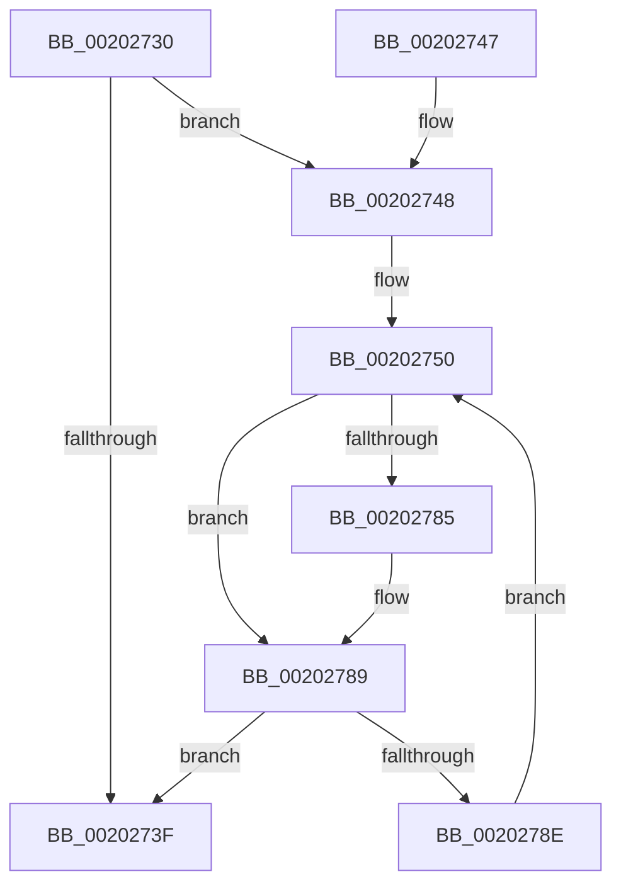

# KiReduceToUnderMaxQuotaSet

- RVA: `0x00202730`–`0x00202790` (길이 `96` bytes)
- VA: `0x0000000140202730`
- 실행 섹션: `.text`
- PDB 이름 있음: `예`; PDB Function 태그: `아니요`
- unwind 정보 RVA: `0x0005C948`
- 디코드: `28`개 명령, `96/96` bytes 표시
- 미해석 바이트: `0` (있으면 어셈블리에 `.byte`로 보존)

> 이 문서는 커널 이미지의 기계어와 PDB 기호를 분석해 생성했습니다. 4번과 5번은 함수 원형과 자료형을 바이너리 사용 방식에서 추정한 C 해석이며 원본 소스 복구 결과는 아닙니다.

## 1. Dependencies

- 직접 호출 지점: **1**; 고유 호출 대상: **1**
- 직접 호출자로 확인된 함수: **1**
- RIP 상대 이미지 참조: **1**

### Outgoing calls
- `0x0020277C` → [KiCheckForMaxOverQuotaScb](KiCheckForMaxOverQuotaScb_function_002027A0.md) (function, `0x002027A0`)

### Direct callers
- [KiSearchForNewThreadsOnTarget](../30/KiSearchForNewThreadsOnTarget_function_0030F500.md) at `0x003106FA`
- [KiSearchForNewThreadsOnTarget](../30/KiSearchForNewThreadsOnTarget_function_0030F500.md) at `0x00310763`
- [KiSearchForNewThreadsOnTarget](../30/KiSearchForNewThreadsOnTarget_function_0030F500.md) at `0x0031103E`

### Static image references
- `0x00202764` → RVA `0x00F231B8` (`.data`; read)

## 2. Other-region calls and transfers

- 다른 실행 섹션으로 향하는 call: **0**
- 별도 외부 분기/꼬리 이동을 확인하지 못했습니다.

## 3. Assembly (complete function range)

```asm
00202730  48 83 EC 28                     sub rsp, 0x28
00202734  45 33 C9                        xor r9d, r9d
00202737  4D 8B D8                        mov r11, r8
0020273A  48 85 D2                        test rdx, rdx
0020273D  75 09                           jne 0x140202748
0020273F  49 8B C1                        mov rax, r9
00202742  48 83 C4 28                     add rsp, 0x28
00202746  C3                              ret
00202747  CC                              int3
00202748  44 0F B7 D1                     movzx r10d, cx
0020274C  41 C1 E2 06                     shl r10d, 6
00202750  83 64 24 38 00                  and dword ptr [rsp + 0x38], 0
00202755  48 0F BC C2                     bsf rax, rdx
00202759  44 8B C0                        mov r8d, eax
0020275C  4C 0F B3 C2                     btr rdx, r8
00202760  41 8D 0C 02                     lea ecx, [r10 + rax]
00202764  48 8B 05 4D 0A D2 00            mov rax, qword ptr [rip + 0xd20a4d]
0020276B  8B 0C 88                        mov ecx, dword ptr [rax + rcx*4]
0020276E  48 69 C9 B8 01 00 00            imul rcx, rcx, 0x1b8
00202775  48 83 E9 80                     sub rcx, -0x80
00202779  49 03 CB                        add rcx, r11
0020277C  E8 1F 00 00 00                  call 0x1402027a0
00202781  84 C0                           test al, al
00202783  75 04                           jne 0x140202789
00202785  4D 0F AB C1                     bts r9, r8
00202789  48 85 D2                        test rdx, rdx
0020278C  74 B1                           je 0x14020273f
0020278E  EB C0                           jmp 0x140202750
```

## 4. C-style interpretation (structured pseudocode)

```c
__int64 __fastcall KiReduceToUnderMaxQuotaSet(unsigned __int16 a1, __int64 a2, __int64 a3, int a4)
{
    __int64 result;
    __int64 v_r10;
    __int64 v_rsp;
    unsigned int v_stack_p38;

    v_rsp = (v_rsp) - (40);
    a4 = 0;
    if (a2 != 0) goto loc_00202748;
loc_0020273F:
    v_rsp = (v_rsp) + (40);
    return 0;
loc_00202748:
    v_r10 = (unsigned int)((a1) << (6));
loc_00202750:
    a1 = ((unsigned int)(*(unsigned int *)(*(unsigned __int64 *)(v_rip + 13765197) + v_r10 + 0 * 1 * 4))) * ((unsigned int)(*(unsigned int *)(*(unsigned __int64 *)(v_rip + 13765197) + v_r10 + 0 * 1 * 4)));
    a1 = (a1) - (-128);
    a1 = (a1) + (a3);
    result = KiCheckForMaxOverQuotaScb(a1, a2, 0, a4);
    if ((unsigned __int8)(result) == 0) {
    }
    if (a2 == 0) goto loc_0020273F;
    goto loc_00202750;
}
```

## 5. (Beta) C Style

```c
int64_t KiReduceToUnderMaxQuotaSet(uint16_t Arg1, int64_t Arg2, int64_t Arg3, int32_t Arg4)
{
    int64_t result;
    int64_t local_r10;
    int64_t local_rsp;
    uint32_t v_stack_p38;

    local_rsp = (local_rsp) - (40);
    Arg4 = 0;
    if (Arg2 != 0) goto loc_00202748;
loc_0020273F:
    local_rsp = (local_rsp) + (40);
    return 0;
loc_00202748:
    local_r10 = (uint32_t)((Arg1) << (6));
loc_00202750:
    Arg1 = ((uint32_t)(*(uint32_t *)(*(uint64_t *)(v_rip + 0xD20A4D) + local_r10 + 0x0 * 1 * 4))) * ((uint32_t)(*(uint32_t *)(*(uint64_t *)(v_rip + 0xD20A4D) + local_r10 + 0x0 * 1 * 4)));
    Arg1 = (Arg1) - (-128);
    Arg1 = (Arg1) + (Arg3);
    result = KiCheckForMaxOverQuotaScb(Arg1, Arg2, 0, Arg4);
    if ((uint8_t)(result) == 0) {
    }
    if (Arg2 == 0) goto loc_0020273F;
    goto loc_00202750;
}
```

## 6. Execution-region graph

[열기: 2D/3D 그래프와 함수 탐색 컨트롤 패널](../../../control-panel.html?section=text&rva=0x00202730&view=graph)

- 2D 그래프는 위에서 아래로 흐르고, 3D 그래프는 빈 공간을 드래그해 회전합니다. Shift+드래그는 이동, 휠은 확대·축소, 함수 노드 선택은 대상 보고서 이동입니다.

### Static fallback


