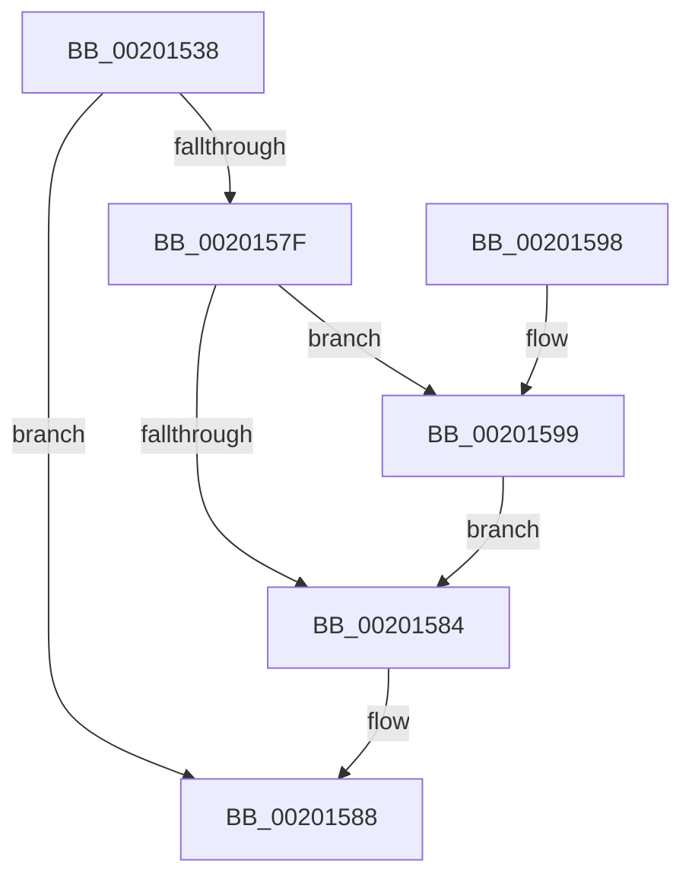

# KiRemoveCurrentThreadScbReadyQueueEnumerator

- RVA: `0x00201538`–`0x002015AF` (길이 `119` bytes)
- VA: `0x0000000140201538`
- 실행 섹션: `.text`
- PDB 이름 있음: `예`; PDB Function 태그: `아니요`
- unwind 정보 RVA: `0x0005C774`
- 디코드: `34`개 명령, `119/119` bytes 표시
- 미해석 바이트: `0` (있으면 어셈블리에 `.byte`로 보존)

> 이 문서는 커널 이미지의 기계어와 PDB 기호를 분석해 생성했습니다. 4번과 5번은 함수 원형과 자료형을 바이너리 사용 방식에서 추정한 C 해석이며 원본 소스 복구 결과는 아닙니다.

## 1. Dependencies

- 직접 호출 지점: **3**; 고유 호출 대상: **3**
- 직접 호출자로 확인된 함수: **1**
- RIP 상대 이미지 참조: **0**

### Outgoing calls
- `0x00201565` → [KiDetermineNextScbForScbReadyQueueEnumerator](../25/KiDetermineNextScbForScbReadyQueueEnumerator_function_00256CE8.md) (function, `0x00256CE8`)
- `0x00201576` → [KiRemoveThreadFromScbQueue](KiRemoveThreadFromScbQueue_function_00201B64.md) (function, `0x00201B64`)
- `0x002015A8` → [KiStartReadyListEnumerator](KiStartReadyListEnumerator_function_00200740.md) (function, `0x00200740`)

### Direct callers
- [KiSearchForNewThreadsOnTarget](../30/KiSearchForNewThreadsOnTarget_function_0030F500.md) at `0x0030FE9F`
- [KiSearchForNewThreadsOnTarget](../30/KiSearchForNewThreadsOnTarget_function_0030F500.md) at `0x0031040A`
- [KiSearchForNewThreadsOnTarget](../30/KiSearchForNewThreadsOnTarget_function_0030F500.md) at `0x003108BA`
- [KiSearchForNewThreadsOnTarget](../30/KiSearchForNewThreadsOnTarget_function_0030F500.md) at `0x003109FD`

### Static image references
- 디코드된 RIP-relative 메모리 참조가 없습니다.

## 2. Other-region calls and transfers

- 다른 실행 섹션으로 향하는 call: **0**
- 별도 외부 분기/꼬리 이동을 확인하지 못했습니다.

## 3. Assembly (complete function range)

```asm
00201538  48 89 5C 24 08                  mov qword ptr [rsp + 8], rbx
0020153D  48 89 74 24 10                  mov qword ptr [rsp + 0x10], rsi
00201542  57                              push rdi
00201543  48 83 EC 20                     sub rsp, 0x20
00201547  48 8B 41 18                     mov rax, qword ptr [rcx + 0x18]
0020154B  48 8B F9                        mov rdi, rcx
0020154E  44 0F B6 49 14                  movzx r9d, byte ptr [rcx + 0x14]
00201553  4C 8B DA                        mov r11, rdx
00201556  4C 8B 40 08                     mov r8, qword ptr [rax + 8]
0020155A  4C 89 41 18                     mov qword ptr [rcx + 0x18], r8
0020155E  4C 8B 51 08                     mov r10, qword ptr [rcx + 8]
00201562  49 8B CA                        mov rcx, r10
00201565  E8 7E 57 05 00                  call 0x140256ce8
0020156A  48 8B 0F                        mov rcx, qword ptr [rdi]
0020156D  4D 8B C3                        mov r8, r11
00201570  49 8B D2                        mov rdx, r10
00201573  48 8B D8                        mov rbx, rax
00201576  E8 E9 05 00 00                  call 0x140201b64
0020157B  84 C0                           test al, al
0020157D  74 09                           je 0x140201588
0020157F  48 85 DB                        test rbx, rbx
00201582  75 15                           jne 0x140201599
00201584  48 89 5F 08                     mov qword ptr [rdi + 8], rbx
00201588  48 8B 5C 24 30                  mov rbx, qword ptr [rsp + 0x30]
0020158D  48 8B 74 24 38                  mov rsi, qword ptr [rsp + 0x38]
00201592  48 83 C4 20                     add rsp, 0x20
00201596  5F                              pop rdi
00201597  C3                              ret
00201598  CC                              int3
00201599  0F B7 53 78                     movzx edx, word ptr [rbx + 0x78]
0020159D  4C 8D 83 90 00 00 00            lea r8, [rbx + 0x90]
002015A4  48 8D 4F 10                     lea rcx, [rdi + 0x10]
002015A8  E8 93 F1 FF FF                  call 0x140200740
002015AD  EB D5                           jmp 0x140201584
```

## 4. C-style interpretation (structured pseudocode)

```c
__int64 __fastcall KiRemoveCurrentThreadScbReadyQueueEnumerator(__int64 a1, __int64 a2)
{
    __int64 result;
    __int64 v_rsp;
    unsigned __int64 v_stack_p10;
    unsigned __int64 v_stack_p8;

    v_stack_p8 = v_rbx;
    v_stack_p10 = v_rsi;
    v_rsp = (v_rsp) - (32);
    *(unsigned __int64 *)(a1 + 24) = *(unsigned __int64 *)(*(unsigned __int64 *)(a1 + 24) + 8);
    result = KiDetermineNextScbForScbReadyQueueEnumerator(*(unsigned __int64 *)(a1 + 8), a2, *(unsigned __int64 *)(*(unsigned __int64 *)(a1 + 24) + 8), *(unsigned __int8 *)(a1 + 20));
    result = KiRemoveThreadFromScbQueue(*(unsigned __int64 *)(a1), *(unsigned __int64 *)(a1 + 8), a2, *(unsigned __int8 *)(a1 + 20));
    if ((unsigned __int8)(result) == 0) goto loc_00201588;
    if (result != 0) goto loc_00201599;
loc_00201584:
    *(unsigned __int64 *)(a1 + 8) = result;
loc_00201588:
    v_rsp = (v_rsp) + (32);
    return result;
loc_00201599:
    result = KiStartReadyListEnumerator(a1 + 16, *(unsigned __int16 *)(v_stack_p8 + 120), v_stack_p8 + 144, *(unsigned __int8 *)(a1 + 20));
    goto loc_00201584;
}
```

## 5. (Beta) C Style

```c
int64_t KiRemoveCurrentThreadScbReadyQueueEnumerator(void *Arg1, int64_t Arg2)
{
    uint8_t *arg1 = (uint8_t *)Arg1;

    int64_t result;
    int64_t local_rsp;
    uint64_t v_stack_p10;
    uint64_t v_stack_p8;

    v_stack_p8 = local_rbx;
    v_stack_p10 = local_rsi;
    local_rsp = (local_rsp) - (32);
    *(uint64_t *)(arg1 + 0x18) = *(uint64_t *)(*(uint64_t *)(arg1 + 0x18) + 0x8);
    result = KiDetermineNextScbForScbReadyQueueEnumerator(*(uint64_t *)(arg1 + 0x8), Arg2, *(uint64_t *)(*(uint64_t *)(arg1 + 0x18) + 0x8), *(uint8_t *)(arg1 + 0x14));
    result = KiRemoveThreadFromScbQueue(*(uint64_t *)(arg1), *(uint64_t *)(arg1 + 0x8), Arg2, *(uint8_t *)(arg1 + 0x14));
    if ((uint8_t)(result) == 0) goto loc_00201588;
    if (result != 0) goto loc_00201599;
loc_00201584:
    *(uint64_t *)(arg1 + 0x8) = result;
loc_00201588:
    local_rsp = (local_rsp) + (32);
    return result;
loc_00201599:
    result = KiStartReadyListEnumerator(Arg1 + 16, *(uint16_t *)(v_stack_p8 + 0x78), v_stack_p8 + 144, *(uint8_t *)(arg1 + 0x14));
    goto loc_00201584;
}
```

### 관측된 메모리 오프셋

구조체 형식이 확인되지 않은 접근은 인자 기준의 오프셋으로만 기록했습니다.

| 기준 인자 | 오프셋 표현 | 폭 (bit) | 접근 |
|---|---:|---:|---|
| `Arg1` | `+ 0x0` | `64` | `R` |
| `Arg1` | `+ 0x8` | `64` | `R` |
| `Arg1` | `+ 0x8` | `64` | `W` |
| `Arg1` | `+ 0x10` | `64` | `R` |
| `Arg1` | `+ 0x14` | `8` | `R` |
| `Arg1` | `+ 0x18` | `64` | `R` |
| `Arg1` | `+ 0x18` | `64` | `W` |

## 6. Execution-region graph

[열기: 2D/3D 그래프와 함수 탐색 컨트롤 패널](../../../control-panel.html?section=text&rva=0x00201538&view=graph)

- 2D 그래프는 위에서 아래로 흐르고, 3D 그래프는 빈 공간을 드래그해 회전합니다. Shift+드래그는 이동, 휠은 확대·축소, 함수 노드 선택은 대상 보고서 이동입니다.

### Static fallback


