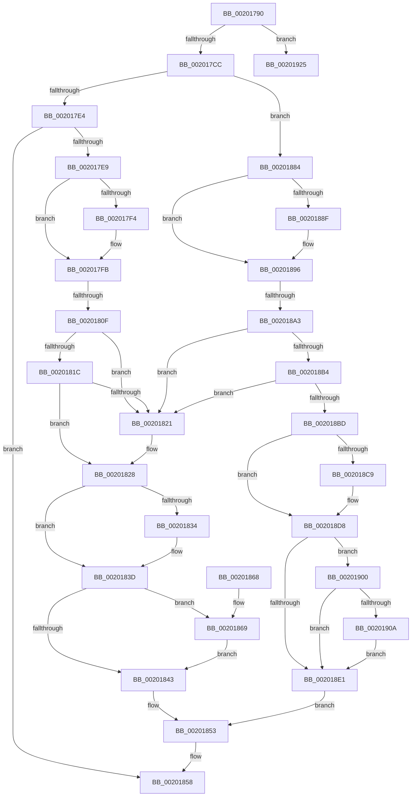

# KiRemoveCurrentlyEnumeratedThreadFromReadyQueue

- RVA: `0x00201790`–`0x00201929` (길이 `409` bytes)
- VA: `0x0000000140201790`
- 실행 섹션: `.text`
- PDB 이름 있음: `예`; PDB Function 태그: `아니요`
- unwind 정보 RVA: `0x0005C7AC`
- 디코드: `100`개 명령, `409/409` bytes 표시
- 미해석 바이트: `0` (있으면 어셈블리에 `.byte`로 보존)

> 이 문서는 커널 이미지의 기계어와 PDB 기호를 분석해 생성했습니다. 4번과 5번은 함수 원형과 자료형을 바이너리 사용 방식에서 추정한 C 해석이며 원본 소스 복구 결과는 아닙니다.

## 1. Dependencies

- 직접 호출 지점: **1**; 고유 호출 대상: **1**
- 직접 호출자로 확인된 함수: **2**
- RIP 상대 이미지 참조: **0**

### Outgoing calls
- `0x00201853` → [KiUpdateSoftParkElectionStatisticsOnRemoval](KiUpdateSoftParkElectionStatisticsOnRemoval_function_00201A50.md) (function, `0x00201A50`)

### Direct callers
- [KiSearchForNewThreadsForRescheduleContext](../25/KiSearchForNewThreadsForRescheduleContext_function_00258620.md) at `0x002597B0`
- [KiAttemptToScheduleThreadToBusyIsolationUnit](../25/KiAttemptToScheduleThreadToBusyIsolationUnit_function_00259B00.md) at `0x0025A7C4`
- [KiAttemptToScheduleThreadToBusyIsolationUnit](../25/KiAttemptToScheduleThreadToBusyIsolationUnit_function_00259B00.md) at `0x0025AD15`

### Static image references
- 디코드된 RIP-relative 메모리 참조가 없습니다.

## 2. Other-region calls and transfers

- 다른 실행 섹션으로 향하는 call: **0**
- call이 아닌 외부 분기/꼬리 이동: **2**
  - `0x00201809` → [sub_00201977](Unknown_function_00201977.md) (`tail-transfer`)
  - `0x0020189D` → [sub_00201977 + 0x13](Unknown_function_00201977.md) (`tail-transfer`)

## 3. Assembly (complete function range)

```asm
00201790  48 89 5C 24 10                  mov qword ptr [rsp + 0x10], rbx
00201795  48 89 74 24 18                  mov qword ptr [rsp + 0x18], rsi
0020179A  57                              push rdi
0020179B  48 83 EC 20                     sub rsp, 0x20
0020179F  0F B6 41 0A                     movzx eax, byte ptr [rcx + 0xa]
002017A3  48 8B FA                        mov rdi, rdx
002017A6  0F B6 71 08                     movzx esi, byte ptr [rcx + 8]
002017AA  48 FF C0                        inc rax
002017AD  48 8B D1                        mov rdx, rcx
002017B0  4C 8D 87 D8 00 00 00            lea r8, [rdi + 0xd8]
002017B7  48 8D 04 40                     lea rax, [rax + rax*2]
002017BB  48 03 C0                        add rax, rax
002017BE  80 79 0D 02                     cmp byte ptr [rcx + 0xd], 2
002017C2  48 8B 1C C1                     mov rbx, qword ptr [rcx + rax*8]
002017C6  0F 84 59 01 00 00               je 0x140201925
002017CC  48 8B 41 28                     mov rax, qword ptr [rcx + 0x28]
002017D0  48 8B 48 08                     mov rcx, qword ptr [rax + 8]
002017D4  48 89 4A 28                     mov qword ptr [rdx + 0x28], rcx
002017D8  0F B6 4A 0C                     movzx ecx, byte ptr [rdx + 0xc]
002017DC  85 C9                           test ecx, ecx
002017DE  0F 84 A0 00 00 00               je 0x140201884
002017E4  83 F9 01                        cmp ecx, 1
002017E7  75 6F                           jne 0x140201858
002017E9  0F B6 4A 0B                     movzx ecx, byte ptr [rdx + 0xb]
002017ED  8D 41 FF                        lea eax, [rcx - 1]
002017F0  85 C1                           test ecx, eax
002017F2  74 07                           je 0x1402017fb
002017F4  0F AB B3 DC 83 00 00            bts dword ptr [rbx + 0x83dc], esi
002017FB  F7 47 78 00 00 40 00            test dword ptr [rdi + 0x78], 0x400000
00201802  48 8B 8B 48 8E 00 00            mov rcx, qword ptr [rbx + 0x8e48]
00201809  0F 85 68 01 00 00               jne 0x140201977
0020180F  49 8B 10                        mov rdx, qword ptr [r8]
00201812  49 8B 40 08                     mov rax, qword ptr [r8 + 8]
00201816  4C 39 42 08                     cmp qword ptr [rdx + 8], r8
0020181A  75 05                           jne 0x140201821
0020181C  4C 39 00                        cmp qword ptr [rax], r8
0020181F  74 07                           je 0x140201828
00201821  B9 03 00 00 00                  mov ecx, 3
00201826  CD 29                           int 0x29
00201828  48 89 10                        mov qword ptr [rax], rdx
0020182B  48 89 42 08                     mov qword ptr [rdx + 8], rax
0020182F  48 3B C2                        cmp rax, rdx
00201832  75 09                           jne 0x14020183d
00201834  8B 51 08                        mov edx, dword ptr [rcx + 8]
00201837  0F BB F2                        btc edx, esi
0020183A  89 51 08                        mov dword ptr [rcx + 8], edx
0020183D  83 41 0C FF                     add dword ptr [rcx + 0xc], -1
00201841  74 26                           je 0x140201869
00201843  8B 87 F8 06 00 00               mov eax, dword ptr [rdi + 0x6f8]
00201849  48 8B D7                        mov rdx, rdi
0020184C  48 29 41 10                     sub qword ptr [rcx + 0x10], rax
00201850  45 33 C0                        xor r8d, r8d
00201853  E8 F8 01 00 00                  call 0x140201a50
00201858  48 8B 5C 24 38                  mov rbx, qword ptr [rsp + 0x38]
0020185D  48 8B 74 24 40                  mov rsi, qword ptr [rsp + 0x40]
00201862  48 83 C4 20                     add rsp, 0x20
00201866  5F                              pop rdi
00201867  C3                              ret
00201868  CC                              int3
00201869  48 8B 91 C8 02 00 00            mov rdx, qword ptr [rcx + 0x2c8]
00201870  48 8B 81 D0 02 00 00            mov rax, qword ptr [rcx + 0x2d0]
00201877  48 F7 D2                        not rdx
0020187A  F0 48 21 90 88 01 00 00         lock and qword ptr [rax + 0x188], rdx
00201882  EB BF                           jmp 0x140201843
00201884  0F B6 4A 0B                     movzx ecx, byte ptr [rdx + 0xb]
00201888  8D 41 FF                        lea eax, [rcx - 1]
0020188B  85 C1                           test ecx, eax
0020188D  74 07                           je 0x140201896
0020188F  0F B3 B3 DC 83 00 00            btr dword ptr [rbx + 0x83dc], esi
00201896  F7 47 78 00 00 40 00            test dword ptr [rdi + 0x78], 0x400000
0020189D  0F 85 E7 00 00 00               jne 0x14020198a
002018A3  49 8B 08                        mov rcx, qword ptr [r8]
002018A6  49 8B 40 08                     mov rax, qword ptr [r8 + 8]
002018AA  4C 39 41 08                     cmp qword ptr [rcx + 8], r8
002018AE  0F 85 6D FF FF FF               jne 0x140201821
002018B4  4C 39 00                        cmp qword ptr [rax], r8
002018B7  0F 85 64 FF FF FF               jne 0x140201821
002018BD  48 89 08                        mov qword ptr [rax], rcx
002018C0  48 89 41 08                     mov qword ptr [rcx + 8], rax
002018C4  48 3B C1                        cmp rax, rcx
002018C7  75 0F                           jne 0x1402018d8
002018C9  8B 8B D8 83 00 00               mov ecx, dword ptr [rbx + 0x83d8]
002018CF  0F BB F1                        btc ecx, esi
002018D2  89 8B D8 83 00 00               mov dword ptr [rbx + 0x83d8], ecx
002018D8  83 83 74 86 00 00 FF            add dword ptr [rbx + 0x8674], -1
002018DF  74 1F                           je 0x140201900
002018E1  8B 87 F8 06 00 00               mov eax, dword ptr [rdi + 0x6f8]
002018E7  48 8B D7                        mov rdx, rdi
002018EA  48 29 83 78 86 00 00            sub qword ptr [rbx + 0x8678], rax
002018F1  48 8B 8B 48 8E 00 00            mov rcx, qword ptr [rbx + 0x8e48]
002018F8  45 33 C0                        xor r8d, r8d
002018FB  E9 53 FF FF FF                  jmp 0x140201853
00201900  48 83 BB 30 84 00 00 00         cmp qword ptr [rbx + 0x8430], 0
00201908  75 D7                           jne 0x1402018e1
0020190A  48 8B 8B C8 00 00 00            mov rcx, qword ptr [rbx + 0xc8]
00201911  48 8B 83 C0 00 00 00            mov rax, qword ptr [rbx + 0xc0]
00201918  48 F7 D1                        not rcx
0020191B  F0 48 21 88 80 01 00 00         lock and qword ptr [rax + 0x180], rcx
00201923  EB BC                           jmp 0x1402018e1
00201925  48 8B 41 20                     mov rax, qword ptr [rcx + 0x20]
```

## 4. C-style interpretation (structured pseudocode)

```c
__int64 __fastcall KiRemoveCurrentlyEnumeratedThreadFromReadyQueue(__int64 a1, __int64 a2)
{
    __int64 result;
    __int64 v_rsp;
    unsigned __int64 v_stack_p10;
    unsigned __int64 v_stack_p18;

    v_stack_p10 = v_rbx;
    v_stack_p18 = v_rsi;
    v_rsp = (v_rsp) - (32);
    result = (*(unsigned __int8 *)(a1 + 10)) + 1;
    result = (result + result * 2) + (result + result * 2);
    if ((*(unsigned __int8 *)(a1 + 13)) == 2) goto loc_00201925;
    *(unsigned __int64 *)(a1 + 40) = *(unsigned __int64 *)(*(unsigned __int64 *)(a1 + 40) + 8);
    if ((unsigned int)(*(unsigned __int8 *)(a1 + 12)) == 0) goto loc_00201884;
    if (((unsigned int)(*(unsigned __int8 *)(a1 + 12))) != 1) goto loc_00201858;
    if ((((unsigned int)(*(unsigned __int8 *)(a1 + 11))) & ((unsigned int)(*(unsigned __int8 *)(a1 + 11) - 1))) != 0) {
    }
    if ((*(unsigned __int64 *)(*(unsigned __int64 *)(a2 + 216) + 8)) != (a2 + 216)) goto loc_00201821;
    if ((*(unsigned __int64 *)(*(unsigned __int64 *)(a2 + 216 + 8))) != (a2 + 216)) {
        a1 = 3;
    }
    *(unsigned __int64 *)(*(unsigned __int64 *)(a2 + 216 + 8)) = *(unsigned __int64 *)(a2 + 216);
    *(unsigned __int64 *)(*(unsigned __int64 *)(a2 + 216) + 8) = *(unsigned __int64 *)(a2 + 216 + 8);
    if ((*(unsigned __int64 *)(a2 + 216 + 8)) == (*(unsigned __int64 *)(a2 + 216))) {
        a2 = *(unsigned int *)(a1 + 8);
        *(unsigned int *)(a1 + 8) = (unsigned int)(a2);
    }
    if ((*(unsigned __int64 *)(a2 + 216 + 8)) == (*(unsigned __int64 *)(a2 + 216))) goto loc_00201869;
loc_00201843:
    a3 = 0;
loc_00201853:
    result = KiUpdateSoftParkElectionStatisticsOnRemoval(a1, a2, a3, a4);
loc_00201858:
    v_rsp = (v_rsp) + (32);
    return result;
loc_00201869:
    a2 = ~(*(unsigned __int64 *)(a1 + 712));
    goto loc_00201843;
loc_00201884:
    if ((((unsigned int)(*(unsigned __int8 *)(a2 + 11))) & ((unsigned int)(*(unsigned __int8 *)(a2 + 11) - 1))) != 0) {
    }
    if ((*(unsigned __int64 *)(*(unsigned __int64 *)(a3) + 8)) != 0) goto loc_00201821;
    if ((*(unsigned __int64 *)(*(unsigned __int64 *)(a3 + 8))) != 0) goto loc_00201821;
    *(unsigned __int64 *)(*(unsigned __int64 *)(a3 + 8)) = *(unsigned __int64 *)(a3);
    *(unsigned __int64 *)(*(unsigned __int64 *)(a3) + 8) = *(unsigned __int64 *)(a3 + 8);
    if ((*(unsigned __int64 *)(a3 + 8)) == (*(unsigned __int64 *)(a3))) {
        a1 = *(unsigned int *)(v_stack_p10 + 33752);
        *(unsigned int *)(v_stack_p10 + 33752) = (unsigned int)(a1);
    }
    if ((*(unsigned __int64 *)(a3 + 8)) == (*(unsigned __int64 *)(a3))) goto loc_00201900;
loc_002018E1:
    a3 = 0;
    goto loc_00201853;
loc_00201900:
    if ((*(unsigned __int64 *)(v_stack_p10 + 33840)) != 0) goto loc_002018E1;
    a1 = ~(*(unsigned __int64 *)(v_stack_p10 + 200));
    goto loc_002018E1;
loc_00201925:
    return *(unsigned __int64 *)(a1 + 32);
}
```

## 5. (Beta) C Style

```c
int64_t KiRemoveCurrentlyEnumeratedThreadFromReadyQueue(void *Arg1, void *Arg2)
{
    uint8_t *arg1 = (uint8_t *)Arg1;
    uint8_t *arg2 = (uint8_t *)Arg2;

    int64_t result;
    int64_t local_rsp;
    uint64_t v_stack_p10;
    uint64_t v_stack_p18;

    v_stack_p10 = local_rbx;
    v_stack_p18 = local_rsi;
    local_rsp = (local_rsp) - (32);
    result = (*(uint8_t *)(arg1 + 0xA)) + 1;
    result = (result + result * 2) + (result + result * 2);
    if ((*(uint8_t *)(arg1 + 0xD)) == 2) goto loc_00201925;
    *(uint64_t *)(arg1 + 0x28) = *(uint64_t *)(*(uint64_t *)(arg1 + 0x28) + 0x8);
    if ((uint32_t)(*(uint8_t *)(arg1 + 0xC)) == 0) goto loc_00201884;
    if (((uint32_t)(*(uint8_t *)(arg1 + 0xC))) != 1) goto loc_00201858;
    if ((((uint32_t)(*(uint8_t *)(arg1 + 0xB))) & ((uint32_t)(*(uint8_t *)(arg1 + 0xB) - 1))) != 0) {
    }
    if ((*(uint64_t *)(*(uint64_t *)(arg2 + 0xD8) + 0x8)) != (Arg2 + 216)) goto loc_00201821;
    if ((*(uint64_t *)(*(uint64_t *)(arg2 + 0xD8 + 0x8))) != (Arg2 + 216)) {
        Arg1 = 3;
    }
    *(uint64_t *)(*(uint64_t *)(arg2 + 0xD8 + 0x8)) = *(uint64_t *)(arg2 + 0xD8);
    *(uint64_t *)(*(uint64_t *)(arg2 + 0xD8) + 0x8) = *(uint64_t *)(arg2 + 0xD8 + 0x8);
    if ((*(uint64_t *)(arg2 + 0xD8 + 0x8)) == (*(uint64_t *)(arg2 + 0xD8))) {
        Arg2 = *(uint32_t *)(arg1 + 0x8);
        *(uint32_t *)(arg1 + 0x8) = (uint32_t)(Arg2);
    }
    if ((*(uint64_t *)(arg2 + 0xD8 + 0x8)) == (*(uint64_t *)(arg2 + 0xD8))) goto loc_00201869;
loc_00201843:
    a3 = 0;
loc_00201853:
    result = KiUpdateSoftParkElectionStatisticsOnRemoval(Arg1, Arg2, a3, a4);
loc_00201858:
    local_rsp = (local_rsp) + (32);
    return result;
loc_00201869:
    Arg2 = ~(*(uint64_t *)(arg1 + 0x2C8));
    goto loc_00201843;
loc_00201884:
    if ((((uint32_t)(*(uint8_t *)(arg2 + 0xB))) & ((uint32_t)(*(uint8_t *)(arg2 + 0xB) - 1))) != 0) {
    }
    if ((*(uint64_t *)(*(uint64_t *)(a3) + 0x8)) != 0) goto loc_00201821;
    if ((*(uint64_t *)(*(uint64_t *)(a3 + 0x8))) != 0) goto loc_00201821;
    *(uint64_t *)(*(uint64_t *)(a3 + 0x8)) = *(uint64_t *)(a3);
    *(uint64_t *)(*(uint64_t *)(a3) + 0x8) = *(uint64_t *)(a3 + 0x8);
    if ((*(uint64_t *)(a3 + 0x8)) == (*(uint64_t *)(a3))) {
        Arg1 = *(uint32_t *)(v_stack_p10 + 0x83D8);
        *(uint32_t *)(v_stack_p10 + 0x83D8) = (uint32_t)(Arg1);
    }
    if ((*(uint64_t *)(a3 + 0x8)) == (*(uint64_t *)(a3))) goto loc_00201900;
loc_002018E1:
    a3 = 0;
    goto loc_00201853;
loc_00201900:
    if ((*(uint64_t *)(v_stack_p10 + 0x8430)) != 0) goto loc_002018E1;
    Arg1 = ~(*(uint64_t *)(v_stack_p10 + 0xC8));
    goto loc_002018E1;
loc_00201925:
    return *(uint64_t *)(arg1 + 0x20);
}
```

### 관측된 메모리 오프셋

구조체 형식이 확인되지 않은 접근은 인자 기준의 오프셋으로만 기록했습니다.

| 기준 인자 | 오프셋 표현 | 폭 (bit) | 접근 |
|---|---:|---:|---|
| `Arg1` | `+ 0x0 + rax*8` | `64` | `R` |
| `Arg1` | `+ 0x8` | `8` | `R` |
| `Arg1` | `+ 0xA` | `8` | `R` |
| `Arg1` | `+ 0xB` | `8` | `R` |
| `Arg1` | `+ 0xC` | `8` | `R` |
| `Arg1` | `+ 0xD` | `8` | `R` |
| `Arg1` | `+ 0x20` | `64` | `R` |
| `Arg1` | `+ 0x28` | `64` | `R` |
| `Arg1` | `+ 0x28` | `64` | `W` |
| `Arg2` | `+ 0x0` | `64` | `R` |
| `Arg2` | `+ 0x8` | `64` | `R` |
| `Arg2` | `+ 0x78` | `32` | `R` |
| `Arg2` | `+ 0xD8` | `64` | `R` |
| `Arg2` | `+ 0x6F8` | `32` | `R` |

## 6. Execution-region graph

[열기: 2D/3D 그래프와 함수 탐색 컨트롤 패널](../../../control-panel.html?section=text&rva=0x00201790&view=graph)

- 2D 그래프는 위에서 아래로 흐르고, 3D 그래프는 빈 공간을 드래그해 회전합니다. Shift+드래그는 이동, 휠은 확대·축소, 함수 노드 선택은 대상 보고서 이동입니다.

### Static fallback


