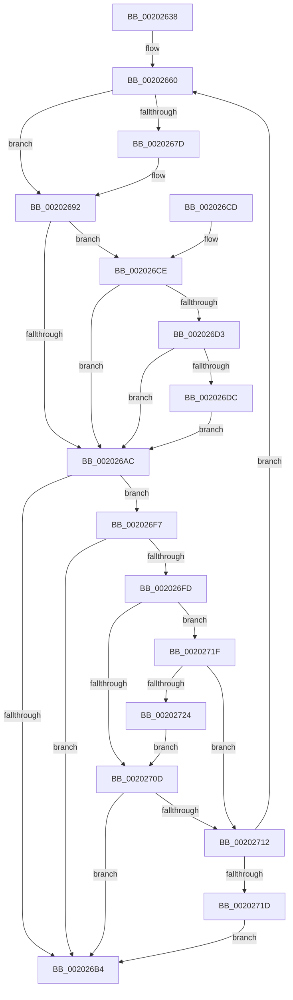

# KiRemoveSchedulingGroupQueue

- RVA: `0x00202638`–`0x00202729` (길이 `241` bytes)
- VA: `0x0000000140202638`
- 실행 섹션: `.text`
- PDB 이름 있음: `예`; PDB Function 태그: `아니요`
- unwind 정보 RVA: `0x0005C92C`
- 디코드: `65`개 명령, `241/241` bytes 표시
- 미해석 바이트: `0` (있으면 어셈블리에 `.byte`로 보존)

> 이 문서는 커널 이미지의 기계어와 PDB 기호를 분석해 생성했습니다. 4번과 5번은 함수 원형과 자료형을 바이너리 사용 방식에서 추정한 C 해석이며 원본 소스 복구 결과는 아닙니다.

## 1. Dependencies

- 직접 호출 지점: **1**; 고유 호출 대상: **1**
- 직접 호출자로 확인된 함수: **8**
- RIP 상대 이미지 참조: **0**

### Outgoing calls
- `0x002026A2` → [RtlRbRemoveNode](../2E/RtlRbRemoveNode_function_002E4C10.md) (function, `0x002E4C10`)

### Direct callers
- [KiRemoveThreadFromScbQueue](KiRemoveThreadFromScbQueue_function_00201B64.md) at `0x00201C22`
- [KiResortScbQueue](KiResortScbQueue_function_002024CC.md) at `0x002025A6`
- [KiQueueReadyThread](../21/KiQueueReadyThread_function_0021C7B0.md) at `0x0021D12E`
- [KiComputeGroupSchedulingRank](../21/KiComputeGroupSchedulingRank_function_0021EB84.md) at `0x0021EDBD`
- [KiGroupSchedulingQuantumEnd](../30/KiGroupSchedulingQuantumEnd_function_0030B220.md) at `0x0030B623`
- [sub_00356086](../35/Unknown_function_00356086.md) at `0x00356242`
- [sub_00356086](../35/Unknown_function_00356086.md) at `0x003562D1`
- [KiResetScb](../46/KiResetScb_function_0046DA94.md) at `0x0046DB47`
- [sub_006F340E](../6F/Unknown_function_006F340E.md) at `0x006F3480`

### Static image references
- 디코드된 RIP-relative 메모리 참조가 없습니다.

## 2. Other-region calls and transfers

- 다른 실행 섹션으로 향하는 call: **0**
- 별도 외부 분기/꼬리 이동을 확인하지 못했습니다.

## 3. Assembly (complete function range)

```asm
00202638  48 89 5C 24 08                  mov qword ptr [rsp + 8], rbx
0020263D  48 89 6C 24 10                  mov qword ptr [rsp + 0x10], rbp
00202642  48 89 74 24 18                  mov qword ptr [rsp + 0x18], rsi
00202647  57                              push rdi
00202648  41 56                           push r14
0020264A  41 57                           push r15
0020264C  48 83 EC 20                     sub rsp, 0x20
00202650  41 8A E8                        mov bpl, r8b
00202653  48 8D B1 30 84 00 00            lea rsi, [rcx + 0x8430]
0020265A  48 8B D9                        mov rbx, rcx
0020265D  45 33 FF                        xor r15d, r15d
00202660  4C 8D B2 A0 01 00 00            lea r14, [rdx + 0x1a0]
00202667  49 8B 06                        mov rax, qword ptr [r14]
0020266A  48 85 C0                        test rax, rax
0020266D  48 8D B8 90 01 00 00            lea rdi, [rax + 0x190]
00202674  48 0F 44 FE                     cmove rdi, rsi
00202678  40 84 ED                        test bpl, bpl
0020267B  74 15                           je 0x140202692
0020267D  48 B8 08 00 00 00 80 F7 FF FF   movabs rax, 0xfffff78000000008
00202687  48 8B 00                        mov rax, qword ptr [rax]
0020268A  48 2B 42 40                     sub rax, qword ptr [rdx + 0x40]
0020268E  48 01 42 38                     add qword ptr [rdx + 0x38], rax
00202692  B8 FE FF 00 00                  mov eax, 0xfffe
00202697  48 8B CF                        mov rcx, rdi
0020269A  66 21 42 70                     and word ptr [rdx + 0x70], ax
0020269E  48 83 C2 58                     add rdx, 0x58
002026A2  E8 69 25 0E 00                  call 0x1402e4c10
002026A7  48 3B FE                        cmp rdi, rsi
002026AA  74 22                           je 0x1402026ce
002026AC  49 8B 16                        mov rdx, qword ptr [r14]
002026AF  48 85 D2                        test rdx, rdx
002026B2  75 43                           jne 0x1402026f7
002026B4  48 8B 5C 24 40                  mov rbx, qword ptr [rsp + 0x40]
002026B9  48 8B 6C 24 48                  mov rbp, qword ptr [rsp + 0x48]
002026BE  48 8B 74 24 50                  mov rsi, qword ptr [rsp + 0x50]
002026C3  48 83 C4 20                     add rsp, 0x20
002026C7  41 5F                           pop r15
002026C9  41 5E                           pop r14
002026CB  5F                              pop rdi
002026CC  C3                              ret
002026CD  CC                              int3
002026CE  4C 39 3E                        cmp qword ptr [rsi], r15
002026D1  75 D9                           jne 0x1402026ac
002026D3  44 39 BB 74 86 00 00            cmp dword ptr [rbx + 0x8674], r15d
002026DA  75 D0                           jne 0x1402026ac
002026DC  48 8B 8B C8 00 00 00            mov rcx, qword ptr [rbx + 0xc8]
002026E3  48 8B 83 C0 00 00 00            mov rax, qword ptr [rbx + 0xc0]
002026EA  48 F7 D1                        not rcx
002026ED  F0 48 21 88 80 01 00 00         lock and qword ptr [rax + 0x180], rcx
002026F5  EB B5                           jmp 0x1402026ac
002026F7  F6 42 70 01                     test byte ptr [rdx + 0x70], 1
002026FB  74 B7                           je 0x1402026b4
002026FD  48 8D 8A 90 01 00 00            lea rcx, [rdx + 0x190]
00202704  F6 41 08 01                     test byte ptr [rcx + 8], 1
00202708  48 8B 01                        mov rax, qword ptr [rcx]
0020270B  75 12                           jne 0x14020271f
0020270D  48 85 C0                        test rax, rax
00202710  75 A2                           jne 0x1402026b4
00202712  66 44 39 7A 78                  cmp word ptr [rdx + 0x78], r15w
00202717  0F 84 43 FF FF FF               je 0x140202660
0020271D  EB 95                           jmp 0x1402026b4
0020271F  48 85 C0                        test rax, rax
00202722  74 EE                           je 0x140202712
00202724  48 33 C1                        xor rax, rcx
00202727  EB E4                           jmp 0x14020270d
```

## 4. C-style interpretation (structured pseudocode)

```c
__int64 __fastcall KiRemoveSchedulingGroupQueue(__int64 a1, __int64 a2, unsigned __int8 a3)
{
    __int64 result;
    __int64 v_r15;
    __int64 v_rdi;
    __int64 v_rsp;
    unsigned __int64 v_stack_p10;
    unsigned __int64 v_stack_p18;
    unsigned __int64 v_stack_p8;

    v_stack_p8 = v_rbx;
    v_stack_p10 = v_rbp;
    v_stack_p18 = v_rsi;
    v_rsp = (v_rsp) - (32);
    v_r15 = 0;
loc_00202660:
    v_rdi = *(unsigned __int64 *)(a2 + 416) + 400;
    if (*(unsigned __int64 *)(a2 + 416) == 0) { v_rdi = a1 + 33840; }
    result = *(unsigned __int64 *)(a2 + 416);
    if (a3 != 0) {
        result = *(unsigned __int64 *)(*(unsigned __int64 *)(a2 + 416));
        result = (result) - (*(unsigned __int64 *)(a2 + 64));
    }
    a2 = (a2) + (88);
    result = RtlRbRemoveNode(v_rdi, a2, a3, a4);
    if (v_rdi == (a1 + 33840)) goto loc_002026CE;
loc_002026AC:
    if (*(unsigned __int64 *)(a2 + 416) != 0) goto loc_002026F7;
loc_002026B4:
    v_rsp = (v_rsp) + (32);
    return result;
loc_002026CE:
    if ((*(unsigned __int64 *)(v_stack_p18)) != 0) goto loc_002026AC;
    if ((*(unsigned int *)(v_stack_p8 + 34420)) != 0) goto loc_002026AC;
    a1 = ~(*(unsigned __int64 *)(v_stack_p8 + 200));
    goto loc_002026AC;
loc_002026F7:
    if (((*(unsigned __int8 *)(*(unsigned __int64 *)(a2 + 416) + 112)) & (1)) == 0) goto loc_002026B4;
    if (((*(unsigned __int8 *)(*(unsigned __int64 *)(a2 + 416) + 400 + 8)) & (1)) != 0) goto loc_0020271F;
loc_0020270D:
    if (*(unsigned __int64 *)(*(unsigned __int64 *)(a2 + 416) + 400) != 0) goto loc_002026B4;
loc_00202712:
    if ((*(unsigned __int16 *)(*(unsigned __int64 *)(a2 + 416) + 120)) == 0) goto loc_00202660;
    goto loc_002026B4;
loc_0020271F:
    if (*(unsigned __int64 *)(*(unsigned __int64 *)(a2 + 416) + 400) == 0) goto loc_00202712;
    result = (*(unsigned __int64 *)(*(unsigned __int64 *)(a2 + 416) + 400)) ^ (*(unsigned __int64 *)(a2 + 416) + 400);
    goto loc_0020270D;
}
```

## 5. (Beta) C Style

```c
int64_t KiRemoveSchedulingGroupQueue(void *Arg1, int64_t Arg2, uint8_t Arg3)
{
    uint8_t *arg1 = (uint8_t *)Arg1;

    int64_t result;
    int64_t local_r15;
    int64_t local_rdi;
    int64_t local_rsp;
    uint64_t v_stack_p10;
    uint64_t v_stack_p18;
    uint64_t v_stack_p8;

    v_stack_p8 = local_rbx;
    v_stack_p10 = local_rbp;
    v_stack_p18 = local_rsi;
    local_rsp = (local_rsp) - (32);
    local_r15 = 0;
loc_00202660:
    local_rdi = *(uint64_t *)(Arg2 + 0x1A0) + 400;
    if (*(uint64_t *)(Arg2 + 0x1A0) == 0) { local_rdi = Arg1 + 33840; }
    result = *(uint64_t *)(Arg2 + 0x1A0);
    if (Arg3 != 0) {
        result = *(uint64_t *)(*(uint64_t *)(Arg2 + 0x1A0));
        result = (result) - (*(uint64_t *)(Arg2 + 0x40));
    }
    Arg2 = (Arg2) + (88);
    result = RtlRbRemoveNode(local_rdi, Arg2, Arg3, a4);
    if (local_rdi == (Arg1 + 33840)) goto loc_002026CE;
loc_002026AC:
    if (*(uint64_t *)(Arg2 + 0x1A0) != 0) goto loc_002026F7;
loc_002026B4:
    local_rsp = (local_rsp) + (32);
    return result;
loc_002026CE:
    if ((*(uint64_t *)(v_stack_p18)) != 0) goto loc_002026AC;
    if ((*(uint32_t *)(v_stack_p8 + 0x8674)) != 0) goto loc_002026AC;
    Arg1 = ~(*(uint64_t *)(v_stack_p8 + 0xC8));
    goto loc_002026AC;
loc_002026F7:
    if (((*(uint8_t *)(*(uint64_t *)(Arg2 + 0x1A0) + 0x70)) & (1)) == 0) goto loc_002026B4;
    if (((*(uint8_t *)(*(uint64_t *)(Arg2 + 0x1A0) + 0x190 + 0x8)) & (1)) != 0) goto loc_0020271F;
loc_0020270D:
    if (*(uint64_t *)(*(uint64_t *)(Arg2 + 0x1A0) + 0x190) != 0) goto loc_002026B4;
loc_00202712:
    if ((*(uint16_t *)(*(uint64_t *)(Arg2 + 0x1A0) + 0x78)) == 0) goto loc_00202660;
    goto loc_002026B4;
loc_0020271F:
    if (*(uint64_t *)(*(uint64_t *)(Arg2 + 0x1A0) + 0x190) == 0) goto loc_00202712;
    result = (*(uint64_t *)(*(uint64_t *)(Arg2 + 0x1A0) + 0x190)) ^ (*(uint64_t *)(Arg2 + 0x1A0) + 400);
    goto loc_0020270D;
}
```

### 관측된 메모리 오프셋

구조체 형식이 확인되지 않은 접근은 인자 기준의 오프셋으로만 기록했습니다.

| 기준 인자 | 오프셋 표현 | 폭 (bit) | 접근 |
|---|---:|---:|---|
| `Arg1` | `+ 0x0` | `64` | `R` |
| `Arg1` | `+ 0xC0` | `64` | `R` |
| `Arg1` | `+ 0xC8` | `64` | `R` |
| `Arg1` | `+ 0x8430` | `64` | `R` |
| `Arg1` | `+ 0x8674` | `32` | `R` |

## 6. Execution-region graph

[열기: 2D/3D 그래프와 함수 탐색 컨트롤 패널](../../../control-panel.html?section=text&rva=0x00202638&view=graph)

- 2D 그래프는 위에서 아래로 흐르고, 3D 그래프는 빈 공간을 드래그해 회전합니다. Shift+드래그는 이동, 휠은 확대·축소, 함수 노드 선택은 대상 보고서 이동입니다.

### Static fallback


