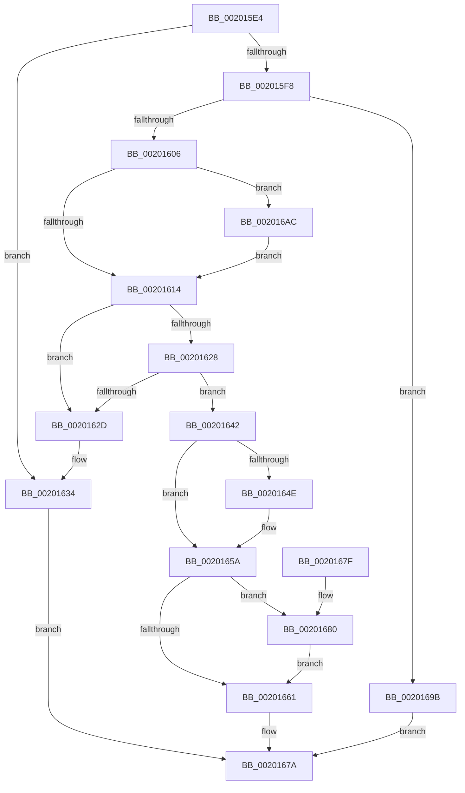

# KiRemoveThreadFromAnyReadyQueue

- RVA: `0x002015E4`–`0x002016BF` (길이 `219` bytes)
- VA: `0x00000001402015E4`
- 실행 섹션: `.text`
- PDB 이름 있음: `예`; PDB Function 태그: `아니요`
- unwind 정보 RVA: `0x0005C794`
- 디코드: `51`개 명령, `219/219` bytes 표시
- 미해석 바이트: `0` (있으면 어셈블리에 `.byte`로 보존)

> 이 문서는 커널 이미지의 기계어와 PDB 기호를 분석해 생성했습니다. 4번과 5번은 함수 원형과 자료형을 바이너리 사용 방식에서 추정한 C 해석이며 원본 소스 복구 결과는 아닙니다.

## 1. Dependencies

- 직접 호출 지점: **3**; 고유 호출 대상: **3**
- 직접 호출자로 확인된 함수: **3**
- RIP 상대 이미지 참조: **0**

### Outgoing calls
- `0x0020163B` → [KiRemoveThreadFromScbQueue](KiRemoveThreadFromScbQueue_function_00201B64.md) (function, `0x00201B64`)
- `0x00201675` → [KiUpdateSoftParkElectionStatisticsOnRemoval](KiUpdateSoftParkElectionStatisticsOnRemoval_function_00201A50.md) (function, `0x00201A50`)
- `0x002016A5` → [KiRemoveThreadFromReadyQueue](KiRemoveThreadFromReadyQueue_function_002016C8.md) (function, `0x002016C8`)

### Direct callers
- [KiSetPriorityThread](../22/KiSetPriorityThread_function_00220E78.md) at `0x00220FF3`
- [KiRescheduleThreadAfterAffinityChange](../30/KiRescheduleThreadAfterAffinityChange_function_0030C9E8.md) at `0x0030CE78`
- [KiApplyForegroundBoostThread](../4F/KiApplyForegroundBoostThread_function_004F7DC0.md) at `0x004F7F06`

### Static image references
- 디코드된 RIP-relative 메모리 참조가 없습니다.

## 2. Other-region calls and transfers

- 다른 실행 섹션으로 향하는 call: **0**
- 별도 외부 분기/꼬리 이동을 확인하지 못했습니다.

## 3. Assembly (complete function range)

```asm
002015E4  48 83 EC 28                     sub rsp, 0x28
002015E8  41 F7 40 74 00 20 00 00         test dword ptr [r8 + 0x74], 0x2000
002015F0  4D 8B D8                        mov r11, r8
002015F3  4C 8B D2                        mov r10, rdx
002015F6  75 3C                           jne 0x140201634
002015F8  41 83 B8 18 02 00 00 00         cmp dword ptr [r8 + 0x218], 0
00201600  0F 8D 95 00 00 00               jge 0x14020169b
00201606  41 F7 40 78 00 00 40 00         test dword ptr [r8 + 0x78], 0x400000
0020160E  0F 85 98 00 00 00               jne 0x1402016ac
00201614  49 8D 90 D8 00 00 00            lea rdx, [r8 + 0xd8]
0020161B  48 8B 0A                        mov rcx, qword ptr [rdx]
0020161E  48 8B 42 08                     mov rax, qword ptr [rdx + 8]
00201622  48 39 51 08                     cmp qword ptr [rcx + 8], rdx
00201626  75 05                           jne 0x14020162d
00201628  48 39 10                        cmp qword ptr [rax], rdx
0020162B  74 15                           je 0x140201642
0020162D  B9 03 00 00 00                  mov ecx, 3
00201632  CD 29                           int 0x29
00201634  49 8B 90 B0 03 00 00            mov rdx, qword ptr [r8 + 0x3b0]
0020163B  E8 24 05 00 00                  call 0x140201b64
00201640  EB 38                           jmp 0x14020167a
00201642  48 89 08                        mov qword ptr [rax], rcx
00201645  48 89 41 08                     mov qword ptr [rcx + 8], rax
00201649  48 3B C1                        cmp rax, rcx
0020164C  75 0C                           jne 0x14020165a
0020164E  41 8B 42 08                     mov eax, dword ptr [r10 + 8]
00201652  44 0F BB C8                     btc eax, r9d
00201656  41 89 42 08                     mov dword ptr [r10 + 8], eax
0020165A  41 83 42 0C FF                  add dword ptr [r10 + 0xc], -1
0020165F  74 1F                           je 0x140201680
00201661  41 8B 80 F8 06 00 00            mov eax, dword ptr [r8 + 0x6f8]
00201668  49 8B D3                        mov rdx, r11
0020166B  49 29 42 10                     sub qword ptr [r10 + 0x10], rax
0020166F  45 33 C0                        xor r8d, r8d
00201672  49 8B CA                        mov rcx, r10
00201675  E8 D6 03 00 00                  call 0x140201a50
0020167A  48 83 C4 28                     add rsp, 0x28
0020167E  C3                              ret
0020167F  CC                              int3
00201680  49 8B 8A C8 02 00 00            mov rcx, qword ptr [r10 + 0x2c8]
00201687  49 8B 82 D0 02 00 00            mov rax, qword ptr [r10 + 0x2d0]
0020168E  48 F7 D1                        not rcx
00201691  F0 48 21 88 88 01 00 00         lock and qword ptr [rax + 0x188], rcx
00201699  EB C6                           jmp 0x140201661
0020169B  49 8D 90 D8 00 00 00            lea rdx, [r8 + 0xd8]
002016A2  45 8B C1                        mov r8d, r9d
002016A5  E8 1E 00 00 00                  call 0x1402016c8
002016AA  EB CE                           jmp 0x14020167a
002016AC  49 8B 80 C8 03 00 00            mov rax, qword ptr [r8 + 0x3c8]
002016B3  F0 81 20 FF FF FB FF            lock and dword ptr [rax], 0xfffbffff
002016BA  E9 55 FF FF FF                  jmp 0x140201614
```

## 4. C-style interpretation (structured pseudocode)

```c
__int64 __fastcall KiRemoveThreadFromAnyReadyQueue(__int64 a1, __int64 a2, __int64 a3, int a4)
{
    __int64 result;
    __int64 v_rsp;

    v_rsp = (v_rsp) - (40);
    if (((*(unsigned int *)(a3 + 116)) & (0x2000ULL)) != 0) goto loc_00201634;
    if ((*(unsigned int *)(a3 + 536)) >= 0) goto loc_0020169B;
    if (((*(unsigned int *)(a3 + 120)) & (0x400000ULL)) != 0) goto loc_002016AC;
loc_00201614:
    if ((*(unsigned __int64 *)(*(unsigned __int64 *)(a3 + 216) + 8)) != (a3 + 216)) goto loc_0020162D;
    if ((*(unsigned __int64 *)(*(unsigned __int64 *)(a3 + 216 + 8))) == (a3 + 216)) goto loc_00201642;
loc_0020162D:
loc_00201634:
    result = KiRemoveThreadFromScbQueue(3, *(unsigned __int64 *)(a3 + 944), a3, a4);
    goto loc_0020167A;
loc_00201642:
    *(unsigned __int64 *)(result) = 3;
    *(unsigned __int64 *)(3 + 8) = result;
    if (result == 3) {
        result = *(unsigned int *)(a2 + 8);
        *(unsigned int *)(a2 + 8) = (unsigned int)(result);
    }
    if (result == 3) goto loc_00201680;
loc_00201661:
    a3 = 0;
    result = KiUpdateSoftParkElectionStatisticsOnRemoval(a2, a3, a3, a4);
loc_0020167A:
    v_rsp = (v_rsp) + (40);
    return result;
loc_00201680:
    a1 = ~(*(unsigned __int64 *)(a2 + 712));
    goto loc_00201661;
loc_0020169B:
    result = KiRemoveThreadFromReadyQueue(a1, a3 + 216, (unsigned int)(a4), a4);
    goto loc_0020167A;
loc_002016AC:
    goto loc_00201614;
}
```

## 5. (Beta) C Style

```c
int64_t KiRemoveThreadFromAnyReadyQueue(int64_t Arg1, void *Arg2, void *Arg3, int32_t Arg4)
{
    uint8_t *arg2 = (uint8_t *)Arg2;
    uint8_t *arg3 = (uint8_t *)Arg3;

    int64_t result;
    int64_t local_rsp;

    local_rsp = (local_rsp) - (40);
    if (((*(uint32_t *)(arg3 + 0x74)) & (0x2000ULL)) != 0) goto loc_00201634;
    if ((*(uint32_t *)(arg3 + 0x218)) >= 0) goto loc_0020169B;
    if (((*(uint32_t *)(arg3 + 0x78)) & (0x400000ULL)) != 0) goto loc_002016AC;
loc_00201614:
    if ((*(uint64_t *)(*(uint64_t *)(arg3 + 0xD8) + 0x8)) != (Arg3 + 216)) goto loc_0020162D;
    if ((*(uint64_t *)(*(uint64_t *)(arg3 + 0xD8 + 0x8))) == (Arg3 + 216)) goto loc_00201642;
loc_0020162D:
loc_00201634:
    result = KiRemoveThreadFromScbQueue(3, *(uint64_t *)(arg3 + 0x3B0), Arg3, Arg4);
    goto loc_0020167A;
loc_00201642:
    *(uint64_t *)(result) = 3;
    *(uint64_t *)(3 + 0x8) = result;
    if (result == 3) {
        result = *(uint32_t *)(arg2 + 0x8);
        *(uint32_t *)(arg2 + 0x8) = (uint32_t)(result);
    }
    if (result == 3) goto loc_00201680;
loc_00201661:
    Arg3 = 0;
    result = KiUpdateSoftParkElectionStatisticsOnRemoval(Arg2, Arg3, Arg3, Arg4);
loc_0020167A:
    local_rsp = (local_rsp) + (40);
    return result;
loc_00201680:
    Arg1 = ~(*(uint64_t *)(arg2 + 0x2C8));
    goto loc_00201661;
loc_0020169B:
    result = KiRemoveThreadFromReadyQueue(Arg1, Arg3 + 216, (uint32_t)(Arg4), Arg4);
    goto loc_0020167A;
loc_002016AC:
    goto loc_00201614;
}
```

### 관측된 메모리 오프셋

구조체 형식이 확인되지 않은 접근은 인자 기준의 오프셋으로만 기록했습니다.

| 기준 인자 | 오프셋 표현 | 폭 (bit) | 접근 |
|---|---:|---:|---|
| `Arg2` | `+ 0x8` | `32` | `R` |
| `Arg2` | `+ 0x8` | `32` | `W` |
| `Arg2` | `+ 0xC` | `32` | `R/W` |
| `Arg2` | `+ 0x10` | `64` | `R/W` |
| `Arg2` | `+ 0x2C8` | `64` | `R` |
| `Arg2` | `+ 0x2D0` | `64` | `R` |
| `Arg3` | `+ 0x0` | `64` | `R` |
| `Arg3` | `+ 0x8` | `64` | `R` |
| `Arg3` | `+ 0x74` | `32` | `R` |
| `Arg3` | `+ 0x78` | `32` | `R` |
| `Arg3` | `+ 0xD8` | `64` | `R` |
| `Arg3` | `+ 0x218` | `32` | `R` |
| `Arg3` | `+ 0x3B0` | `64` | `R` |
| `Arg3` | `+ 0x3C8` | `64` | `R` |
| `Arg3` | `+ 0x6F8` | `32` | `R` |

## 6. Execution-region graph

[열기: 2D/3D 그래프와 함수 탐색 컨트롤 패널](../../../control-panel.html?section=text&rva=0x002015E4&view=graph)

- 2D 그래프는 위에서 아래로 흐르고, 3D 그래프는 빈 공간을 드래그해 회전합니다. Shift+드래그는 이동, 휠은 확대·축소, 함수 노드 선택은 대상 보고서 이동입니다.

### Static fallback


