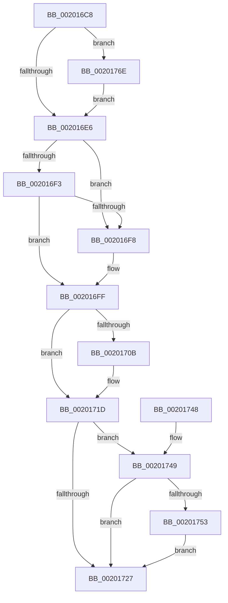

# KiRemoveThreadFromReadyQueue

- RVA: `0x002016C8`–`0x00201781` (길이 `185` bytes)
- VA: `0x00000001402016C8`
- 실행 섹션: `.text`
- PDB 이름 있음: `예`; PDB Function 태그: `아니요`
- unwind 정보 RVA: `0x0005C7A0`
- 디코드: `41`개 명령, `185/185` bytes 표시
- 미해석 바이트: `0` (있으면 어셈블리에 `.byte`로 보존)

> 이 문서는 커널 이미지의 기계어와 PDB 기호를 분석해 생성했습니다. 4번과 5번은 함수 원형과 자료형을 바이너리 사용 방식에서 추정한 C 해석이며 원본 소스 복구 결과는 아닙니다.

## 1. Dependencies

- 직접 호출 지점: **1**; 고유 호출 대상: **1**
- 직접 호출자로 확인된 함수: **6**
- RIP 상대 이미지 참조: **0**

### Outgoing calls
- `0x0020173E` → [KiUpdateSoftParkElectionStatisticsOnRemoval](KiUpdateSoftParkElectionStatisticsOnRemoval_function_00201A50.md) (function, `0x00201A50`)

### Direct callers
- [KiRemoveThreadFromAnyReadyQueue](KiRemoveThreadFromAnyReadyQueue_function_002015E4.md) at `0x002016A5`
- [KiNormalPriorityReadyScan](../21/KiNormalPriorityReadyScan_function_0021B400.md) at `0x0021B6CD`
- [sub_0021C284](../21/Unknown_function_0021C284.md) at `0x0021C3A6`
- [sub_0021C57C](../21/Unknown_function_0021C57C.md) at `0x0021C58F`
- [KiSearchForNewThreadsForRescheduleContext](../25/KiSearchForNewThreadsForRescheduleContext_function_00258620.md) at `0x0025936A`
- [KiSearchForNewThreadsOnTarget](../30/KiSearchForNewThreadsOnTarget_function_0030F500.md) at `0x0030FE17`
- [KiSearchForNewThreadsOnTarget](../30/KiSearchForNewThreadsOnTarget_function_0030F500.md) at `0x0031002E`
- [KiSearchForNewThreadsOnTarget](../30/KiSearchForNewThreadsOnTarget_function_0030F500.md) at `0x00310890`

### Static image references
- 디코드된 RIP-relative 메모리 참조가 없습니다.

## 2. Other-region calls and transfers

- 다른 실행 섹션으로 향하는 call: **0**
- 별도 외부 분기/꼬리 이동을 확인하지 못했습니다.

## 3. Assembly (complete function range)

```asm
002016C8  48 83 EC 28                     sub rsp, 0x28
002016CC  4C 8B D2                        mov r10, rdx
002016CF  4C 8B C9                        mov r9, rcx
002016D2  48 81 C2 28 FF FF FF            add rdx, -0xd8
002016D9  F7 42 78 00 00 40 00            test dword ptr [rdx + 0x78], 0x400000
002016E0  0F 85 88 00 00 00               jne 0x14020176e
002016E6  49 8B 0A                        mov rcx, qword ptr [r10]
002016E9  49 8B 42 08                     mov rax, qword ptr [r10 + 8]
002016ED  4C 39 51 08                     cmp qword ptr [rcx + 8], r10
002016F1  75 05                           jne 0x1402016f8
002016F3  4C 39 10                        cmp qword ptr [rax], r10
002016F6  74 07                           je 0x1402016ff
002016F8  B9 03 00 00 00                  mov ecx, 3
002016FD  CD 29                           int 0x29
002016FF  48 89 08                        mov qword ptr [rax], rcx
00201702  48 89 41 08                     mov qword ptr [rcx + 8], rax
00201706  48 3B C1                        cmp rax, rcx
00201709  75 12                           jne 0x14020171d
0020170B  41 8B 81 D8 83 00 00            mov eax, dword ptr [r9 + 0x83d8]
00201712  44 0F BB C0                     btc eax, r8d
00201716  41 89 81 D8 83 00 00            mov dword ptr [r9 + 0x83d8], eax
0020171D  41 83 81 74 86 00 00 FF         add dword ptr [r9 + 0x8674], -1
00201725  74 22                           je 0x140201749
00201727  8B 82 F8 06 00 00               mov eax, dword ptr [rdx + 0x6f8]
0020172D  45 33 C0                        xor r8d, r8d
00201730  49 29 81 78 86 00 00            sub qword ptr [r9 + 0x8678], rax
00201737  49 8B 89 48 8E 00 00            mov rcx, qword ptr [r9 + 0x8e48]
0020173E  E8 0D 03 00 00                  call 0x140201a50
00201743  48 83 C4 28                     add rsp, 0x28
00201747  C3                              ret
00201748  CC                              int3
00201749  49 83 B9 30 84 00 00 00         cmp qword ptr [r9 + 0x8430], 0
00201751  75 D4                           jne 0x140201727
00201753  49 8B 89 C8 00 00 00            mov rcx, qword ptr [r9 + 0xc8]
0020175A  49 8B 81 C0 00 00 00            mov rax, qword ptr [r9 + 0xc0]
00201761  48 F7 D1                        not rcx
00201764  F0 48 21 88 80 01 00 00         lock and qword ptr [rax + 0x180], rcx
0020176C  EB B9                           jmp 0x140201727
0020176E  48 8B 82 C8 03 00 00            mov rax, qword ptr [rdx + 0x3c8]
00201775  F0 81 20 FF FF FB FF            lock and dword ptr [rax], 0xfffbffff
0020177C  E9 65 FF FF FF                  jmp 0x1402016e6
```

## 4. C-style interpretation (structured pseudocode)

```c
__int64 __fastcall KiRemoveThreadFromReadyQueue(__int64 a1, __int64 a2, int a3)
{
    __int64 result;
    __int64 v_rsp;

    v_rsp = (v_rsp) - (40);
    a2 = (a2) + (-216);
    if (((*(unsigned int *)(a2 + 120)) & (0x400000ULL)) != 0) goto loc_0020176E;
loc_002016E6:
    if ((*(unsigned __int64 *)(*(unsigned __int64 *)(a2) + 8)) != a2) goto loc_002016F8;
    if ((*(unsigned __int64 *)(*(unsigned __int64 *)(a2 + 8))) != a2) {
        a1 = 3;
    }
    *(unsigned __int64 *)(*(unsigned __int64 *)(a2 + 8)) = a1;
    *(unsigned __int64 *)(a1 + 8) = *(unsigned __int64 *)(a2 + 8);
    result = *(unsigned __int64 *)(a2 + 8);
    if ((*(unsigned __int64 *)(a2 + 8)) == a1) {
        result = *(unsigned int *)(a1 + 33752);
        *(unsigned int *)(a1 + 33752) = (unsigned int)(result);
    }
    if ((*(unsigned __int64 *)(a2 + 8)) == a1) goto loc_00201749;
loc_00201727:
    a3 = 0;
    result = KiUpdateSoftParkElectionStatisticsOnRemoval(*(unsigned __int64 *)(a1 + 36424), a2, a3, a1);
    v_rsp = (v_rsp) + (40);
    return result;
loc_00201749:
    if ((*(unsigned __int64 *)(a1 + 33840)) != 0) goto loc_00201727;
    a1 = ~(*(unsigned __int64 *)(a1 + 200));
    goto loc_00201727;
loc_0020176E:
    goto loc_002016E6;
}
```

## 5. (Beta) C Style

```c
int64_t KiRemoveThreadFromReadyQueue(void *Arg1, void *Arg2, int32_t Arg3)
{
    uint8_t *arg1 = (uint8_t *)Arg1;
    uint8_t *arg2 = (uint8_t *)Arg2;

    int64_t result;
    int64_t local_rsp;

    local_rsp = (local_rsp) - (40);
    Arg2 = (Arg2) + (-216);
    if (((*(uint32_t *)(arg2 + 0x78)) & (0x400000ULL)) != 0) goto loc_0020176E;
loc_002016E6:
    if ((*(uint64_t *)(*(uint64_t *)(arg2) + 0x8)) != Arg2) goto loc_002016F8;
    if ((*(uint64_t *)(*(uint64_t *)(arg2 + 0x8))) != Arg2) {
        Arg1 = 3;
    }
    *(void **)(*(uint64_t *)(arg2 + 0x8)) = Arg1;
    *(uint64_t *)(arg1 + 0x8) = *(uint64_t *)(arg2 + 0x8);
    result = *(uint64_t *)(arg2 + 0x8);
    if ((*(uint64_t *)(arg2 + 0x8)) == Arg1) {
        result = *(uint32_t *)(arg1 + 0x83D8);
        *(uint32_t *)(arg1 + 0x83D8) = (uint32_t)(result);
    }
    if ((*(uint64_t *)(arg2 + 0x8)) == Arg1) goto loc_00201749;
loc_00201727:
    Arg3 = 0;
    result = KiUpdateSoftParkElectionStatisticsOnRemoval(*(uint64_t *)(arg1 + 0x8E48), Arg2, Arg3, Arg1);
    local_rsp = (local_rsp) + (40);
    return result;
loc_00201749:
    if ((*(uint64_t *)(arg1 + 0x8430)) != 0) goto loc_00201727;
    Arg1 = ~(*(uint64_t *)(arg1 + 0xC8));
    goto loc_00201727;
loc_0020176E:
    goto loc_002016E6;
}
```

### 관측된 메모리 오프셋

구조체 형식이 확인되지 않은 접근은 인자 기준의 오프셋으로만 기록했습니다.

| 기준 인자 | 오프셋 표현 | 폭 (bit) | 접근 |
|---|---:|---:|---|
| `Arg1` | `+ 0xC0` | `64` | `R` |
| `Arg1` | `+ 0xC8` | `64` | `R` |
| `Arg1` | `+ 0x83D8` | `32` | `R` |
| `Arg1` | `+ 0x83D8` | `32` | `W` |
| `Arg1` | `+ 0x8430` | `64` | `R` |
| `Arg1` | `+ 0x8674` | `32` | `R/W` |
| `Arg1` | `+ 0x8678` | `64` | `R/W` |
| `Arg1` | `+ 0x8E48` | `64` | `R` |
| `Arg2` | `+ 0x0` | `64` | `R` |
| `Arg2` | `+ 0x8` | `64` | `R` |
| `Arg2` | `+ 0x78` | `32` | `R` |
| `Arg2` | `+ 0x3C8` | `64` | `R` |
| `Arg2` | `+ 0x6F8` | `32` | `R` |

## 6. Execution-region graph

[열기: 2D/3D 그래프와 함수 탐색 컨트롤 패널](../../../control-panel.html?section=text&rva=0x002016C8&view=graph)

- 2D 그래프는 위에서 아래로 흐르고, 3D 그래프는 빈 공간을 드래그해 회전합니다. Shift+드래그는 이동, 휠은 확대·축소, 함수 노드 선택은 대상 보고서 이동입니다.

### Static fallback


