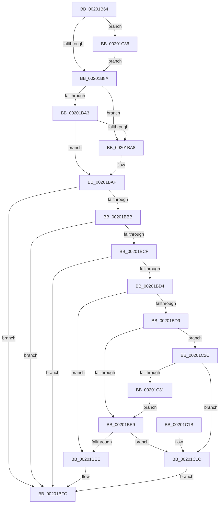

# KiRemoveThreadFromScbQueue

- RVA: `0x00201B64`–`0x00201C49` (길이 `229` bytes)
- VA: `0x0000000140201B64`
- 실행 섹션: `.text`
- PDB 이름 있음: `예`; PDB Function 태그: `아니요`
- unwind 정보 RVA: `0x0005C878`
- 디코드: `65`개 명령, `229/229` bytes 표시
- 미해석 바이트: `0` (있으면 어셈블리에 `.byte`로 보존)

> 이 문서는 커널 이미지의 기계어와 PDB 기호를 분석해 생성했습니다. 4번과 5번은 함수 원형과 자료형을 바이너리 사용 방식에서 추정한 C 해석이며 원본 소스 복구 결과는 아닙니다.

## 1. Dependencies

- 직접 호출 지점: **2**; 고유 호출 대상: **2**
- 직접 호출자로 확인된 함수: **6**
- RIP 상대 이미지 참조: **0**

### Outgoing calls
- `0x00201BF4` → [KiResortScbQueue](KiResortScbQueue_function_002024CC.md) (function, `0x002024CC`)
- `0x00201C22` → [KiRemoveSchedulingGroupQueue](KiRemoveSchedulingGroupQueue_function_00202638.md) (function, `0x00202638`)

### Direct callers
- [KiRemoveCurrentThreadScbReadyQueueEnumerator](KiRemoveCurrentThreadScbReadyQueueEnumerator_function_00201538.md) at `0x00201576`
- [KiRemoveThreadFromAnyReadyQueue](KiRemoveThreadFromAnyReadyQueue_function_002015E4.md) at `0x0020163B`
- [sub_00201929](Unknown_function_00201929.md) at `0x0020194E`
- [KiSearchForNewThreadsForRescheduleContext](../25/KiSearchForNewThreadsForRescheduleContext_function_00258620.md) at `0x002592C1`
- [KiSearchForNewThreadsForRescheduleContext](../25/KiSearchForNewThreadsForRescheduleContext_function_00258620.md) at `0x00259420`
- [KiAttemptToScheduleThreadToBusyIsolationUnit](../25/KiAttemptToScheduleThreadToBusyIsolationUnit_function_00259B00.md) at `0x0025AE17`
- [KiRemoveThreadFromSchedulingGroup](../35/KiRemoveThreadFromSchedulingGroup_function_00356514.md) at `0x00356789`

### Static image references
- 디코드된 RIP-relative 메모리 참조가 없습니다.

## 2. Other-region calls and transfers

- 다른 실행 섹션으로 향하는 call: **0**
- 별도 외부 분기/꼬리 이동을 확인하지 못했습니다.

## 3. Assembly (complete function range)

```asm
00201B64  48 89 5C 24 08                  mov qword ptr [rsp + 8], rbx
00201B69  48 89 74 24 10                  mov qword ptr [rsp + 0x10], rsi
00201B6E  57                              push rdi
00201B6F  48 83 EC 20                     sub rsp, 0x20
00201B73  41 F7 40 78 00 00 40 00         test dword ptr [r8 + 0x78], 0x400000
00201B7B  41 8B F9                        mov edi, r9d
00201B7E  49 8B D8                        mov rbx, r8
00201B81  4C 8B D9                        mov r11, rcx
00201B84  0F 85 AC 00 00 00               jne 0x140201c36
00201B8A  4C 8D 93 D8 00 00 00            lea r10, [rbx + 0xd8]
00201B91  33 F6                           xor esi, esi
00201B93  4D 8B 0A                        mov r9, qword ptr [r10]
00201B96  44 8A C6                        mov r8b, sil
00201B99  49 8B 42 08                     mov rax, qword ptr [r10 + 8]
00201B9D  4D 39 51 08                     cmp qword ptr [r9 + 8], r10
00201BA1  75 05                           jne 0x140201ba8
00201BA3  4C 39 10                        cmp qword ptr [rax], r10
00201BA6  74 07                           je 0x140201baf
00201BA8  B9 03 00 00 00                  mov ecx, 3
00201BAD  CD 29                           int 0x29
00201BAF  4C 89 08                        mov qword ptr [rax], r9
00201BB2  49 89 41 08                     mov qword ptr [r9 + 8], rax
00201BB6  49 3B C1                        cmp rax, r9
00201BB9  75 41                           jne 0x140201bfc
00201BBB  0F B7 42 78                     movzx eax, word ptr [rdx + 0x78]
00201BBF  0F B7 4A 70                     movzx ecx, word ptr [rdx + 0x70]
00201BC3  0F BB F8                        btc eax, edi
00201BC6  66 89 42 78                     mov word ptr [rdx + 0x78], ax
00201BCA  F6 C1 02                        test cl, 2
00201BCD  75 2D                           jne 0x140201bfc
00201BCF  F6 C1 01                        test cl, 1
00201BD2  74 28                           je 0x140201bfc
00201BD4  66 85 C0                        test ax, ax
00201BD7  75 15                           jne 0x140201bee
00201BD9  48 8D 8A 90 01 00 00            lea rcx, [rdx + 0x190]
00201BE0  F6 41 08 01                     test byte ptr [rcx + 8], 1
00201BE4  48 8B 01                        mov rax, qword ptr [rcx]
00201BE7  75 43                           jne 0x140201c2c
00201BE9  48 85 C0                        test rax, rax
00201BEC  74 2E                           je 0x140201c1c
00201BEE  41 B0 01                        mov r8b, 1
00201BF1  49 8B CB                        mov rcx, r11
00201BF4  E8 D3 08 00 00                  call 0x1402024cc
00201BF9  44 8A C0                        mov r8b, al
00201BFC  0F BA 73 74 0D                  btr dword ptr [rbx + 0x74], 0xd
00201C01  41 8A C0                        mov al, r8b
00201C04  48 89 B3 B0 03 00 00            mov qword ptr [rbx + 0x3b0], rsi
00201C0B  48 8B 5C 24 30                  mov rbx, qword ptr [rsp + 0x30]
00201C10  48 8B 74 24 38                  mov rsi, qword ptr [rsp + 0x38]
00201C15  48 83 C4 20                     add rsp, 0x20
00201C19  5F                              pop rdi
00201C1A  C3                              ret
00201C1B  CC                              int3
00201C1C  41 B0 01                        mov r8b, 1
00201C1F  49 8B CB                        mov rcx, r11
00201C22  E8 11 0A 00 00                  call 0x140202638
00201C27  41 B0 01                        mov r8b, 1
00201C2A  EB D0                           jmp 0x140201bfc
00201C2C  48 85 C0                        test rax, rax
00201C2F  74 EB                           je 0x140201c1c
00201C31  48 33 C1                        xor rax, rcx
00201C34  EB B3                           jmp 0x140201be9
00201C36  49 8B 80 C8 03 00 00            mov rax, qword ptr [r8 + 0x3c8]
00201C3D  F0 81 20 FF FF FB FF            lock and dword ptr [rax], 0xfffbffff
00201C44  E9 41 FF FF FF                  jmp 0x140201b8a
```

## 4. C-style interpretation (structured pseudocode)

```c
__int64 __fastcall KiRemoveThreadFromScbQueue(__int64 a1, __int64 a2, __int64 a3, int a4)
{
    __int64 result;
    __int64 v_rsi;
    __int64 v_rsp;
    unsigned __int64 v_stack_p10;
    unsigned __int64 v_stack_p8;

    v_stack_p8 = v_rbx;
    v_stack_p10 = v_rsi;
    v_rsp = (v_rsp) - (32);
    if (((*(unsigned int *)(a3 + 120)) & (0x400000ULL)) != 0) goto loc_00201C36;
loc_00201B8A:
    v_rsi = 0;
    if ((*(unsigned __int64 *)(*(unsigned __int64 *)(a3 + 216) + 8)) != (a3 + 216)) goto loc_00201BA8;
    if ((*(unsigned __int64 *)(*(unsigned __int64 *)(a3 + 216 + 8))) != (a3 + 216)) {
        a1 = 3;
    }
    *(unsigned __int64 *)(*(unsigned __int64 *)(a3 + 216 + 8)) = *(unsigned __int64 *)(a3 + 216);
    *(unsigned __int64 *)(*(unsigned __int64 *)(a3 + 216) + 8) = *(unsigned __int64 *)(a3 + 216 + 8);
    if ((*(unsigned __int64 *)(a3 + 216 + 8)) != (*(unsigned __int64 *)(a3 + 216))) goto loc_00201BFC;
    *(unsigned __int16 *)(a2 + 120) = (unsigned __int16)(*(unsigned __int16 *)(a2 + 120));
    if ((((unsigned __int8)(*(unsigned __int16 *)(a2 + 112))) & (2)) != 0) goto loc_00201BFC;
    if ((((unsigned __int8)(*(unsigned __int16 *)(a2 + 112))) & (1)) == 0) goto loc_00201BFC;
    if ((unsigned __int16)(*(unsigned __int16 *)(a2 + 120)) != 0) goto loc_00201BEE;
    if (((*(unsigned __int8 *)(a2 + 400 + 8)) & (1)) != 0) goto loc_00201C2C;
loc_00201BE9:
    if (*(unsigned __int64 *)(a2 + 400) == 0) goto loc_00201C1C;
loc_00201BEE:
    result = KiResortScbQueue(a1, a2, 1, *(unsigned __int64 *)(a3 + 216));
loc_00201BFC:
    *(unsigned __int64 *)(a3 + 944) = 0;
    v_rsp = (v_rsp) + (32);
    return (unsigned __int8)((unsigned __int8)(result));
loc_00201C1C:
    result = KiRemoveSchedulingGroupQueue(a1, a2, 1, *(unsigned __int64 *)(a3 + 216));
    goto loc_00201BFC;
loc_00201C2C:
    if (result == 0) goto loc_00201C1C;
    result = (result) ^ (a1);
    goto loc_00201BE9;
loc_00201C36:
    goto loc_00201B8A;
}
```

## 5. (Beta) C Style

```c
int64_t KiRemoveThreadFromScbQueue(int64_t Arg1, void *Arg2, void *Arg3, int32_t Arg4)
{
    uint8_t *arg2 = (uint8_t *)Arg2;
    uint8_t *arg3 = (uint8_t *)Arg3;

    int64_t result;
    int64_t local_rsi;
    int64_t local_rsp;
    uint64_t v_stack_p10;
    uint64_t v_stack_p8;

    v_stack_p8 = local_rbx;
    v_stack_p10 = local_rsi;
    local_rsp = (local_rsp) - (32);
    if (((*(uint32_t *)(arg3 + 0x78)) & (0x400000ULL)) != 0) goto loc_00201C36;
loc_00201B8A:
    local_rsi = 0;
    if ((*(uint64_t *)(*(uint64_t *)(arg3 + 0xD8) + 0x8)) != (Arg3 + 216)) goto loc_00201BA8;
    if ((*(uint64_t *)(*(uint64_t *)(arg3 + 0xD8 + 0x8))) != (Arg3 + 216)) {
        Arg1 = 3;
    }
    *(uint64_t *)(*(uint64_t *)(arg3 + 0xD8 + 0x8)) = *(uint64_t *)(arg3 + 0xD8);
    *(uint64_t *)(*(uint64_t *)(arg3 + 0xD8) + 0x8) = *(uint64_t *)(arg3 + 0xD8 + 0x8);
    if ((*(uint64_t *)(arg3 + 0xD8 + 0x8)) != (*(uint64_t *)(arg3 + 0xD8))) goto loc_00201BFC;
    *(uint16_t *)(arg2 + 0x78) = (uint16_t)(*(uint16_t *)(arg2 + 0x78));
    if ((((uint8_t)(*(uint16_t *)(arg2 + 0x70))) & (2)) != 0) goto loc_00201BFC;
    if ((((uint8_t)(*(uint16_t *)(arg2 + 0x70))) & (1)) == 0) goto loc_00201BFC;
    if ((uint16_t)(*(uint16_t *)(arg2 + 0x78)) != 0) goto loc_00201BEE;
    if (((*(uint8_t *)(arg2 + 0x190 + 0x8)) & (1)) != 0) goto loc_00201C2C;
loc_00201BE9:
    if (*(uint64_t *)(arg2 + 0x190) == 0) goto loc_00201C1C;
loc_00201BEE:
    result = KiResortScbQueue(Arg1, Arg2, 1, *(uint64_t *)(arg3 + 0xD8));
loc_00201BFC:
    *(uint64_t *)(arg3 + 0x3B0) = 0;
    local_rsp = (local_rsp) + (32);
    return (uint8_t)((uint8_t)(result));
loc_00201C1C:
    result = KiRemoveSchedulingGroupQueue(Arg1, Arg2, 1, *(uint64_t *)(arg3 + 0xD8));
    goto loc_00201BFC;
loc_00201C2C:
    if (result == 0) goto loc_00201C1C;
    result = (result) ^ (Arg1);
    goto loc_00201BE9;
loc_00201C36:
    goto loc_00201B8A;
}
```

### 관측된 메모리 오프셋

구조체 형식이 확인되지 않은 접근은 인자 기준의 오프셋으로만 기록했습니다.

| 기준 인자 | 오프셋 표현 | 폭 (bit) | 접근 |
|---|---:|---:|---|
| `Arg2` | `+ 0x0` | `64` | `R` |
| `Arg2` | `+ 0x8` | `8` | `R` |
| `Arg2` | `+ 0x70` | `16` | `R` |
| `Arg2` | `+ 0x78` | `16` | `R` |
| `Arg2` | `+ 0x78` | `16` | `W` |
| `Arg2` | `+ 0x190` | `64` | `R` |
| `Arg3` | `+ 0x0` | `64` | `R` |
| `Arg3` | `+ 0x8` | `64` | `R` |
| `Arg3` | `+ 0x74` | `32` | `R/W` |
| `Arg3` | `+ 0x78` | `32` | `R` |
| `Arg3` | `+ 0xD8` | `64` | `R` |
| `Arg3` | `+ 0x3B0` | `64` | `W` |
| `Arg3` | `+ 0x3C8` | `64` | `R` |

## 6. Execution-region graph

[열기: 2D/3D 그래프와 함수 탐색 컨트롤 패널](../../../control-panel.html?section=text&rva=0x00201B64&view=graph)

- 2D 그래프는 위에서 아래로 흐르고, 3D 그래프는 빈 공간을 드래그해 회전합니다. Shift+드래그는 이동, 휠은 확대·축소, 함수 노드 선택은 대상 보고서 이동입니다.

### Static fallback


