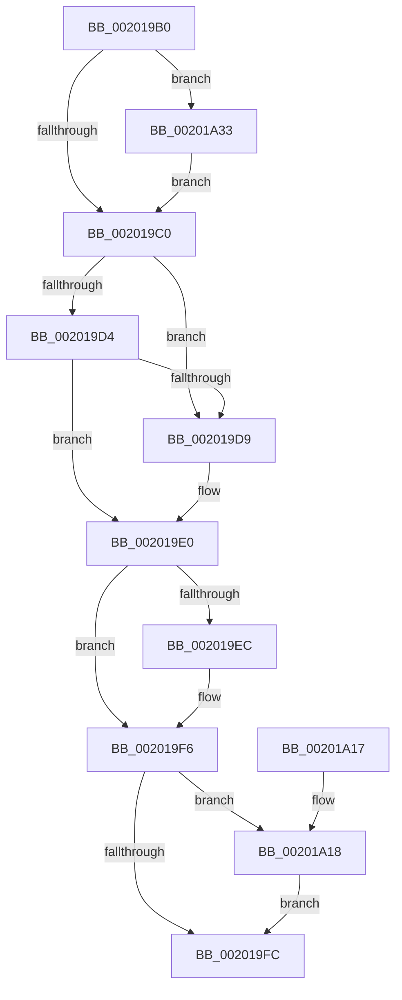

# KiRemoveThreadFromSharedReadyQueue

- RVA: `0x002019B0`–`0x00201A46` (길이 `150` bytes)
- VA: `0x00000001402019B0`
- 실행 섹션: `.text`
- PDB 이름 있음: `예`; PDB Function 태그: `아니요`
- unwind 정보 RVA: `0x0005C80C`
- 디코드: `38`개 명령, `150/150` bytes 표시
- 미해석 바이트: `0` (있으면 어셈블리에 `.byte`로 보존)

> 이 문서는 커널 이미지의 기계어와 PDB 기호를 분석해 생성했습니다. 4번과 5번은 함수 원형과 자료형을 바이너리 사용 방식에서 추정한 C 해석이며 원본 소스 복구 결과는 아닙니다.

## 1. Dependencies

- 직접 호출 지점: **1**; 고유 호출 대상: **1**
- 직접 호출자로 확인된 함수: **4**
- RIP 상대 이미지 참조: **0**

### Outgoing calls
- `0x00201A0D` → [KiUpdateSoftParkElectionStatisticsOnRemoval](KiUpdateSoftParkElectionStatisticsOnRemoval_function_00201A50.md) (function, `0x00201A50`)

### Direct callers
- [KiRemoveCurrentThreadSharedReadyQueueEnumerator](KiRemoveCurrentThreadSharedReadyQueueEnumerator_function_002015B8.md) at `0x002015D0`
- [KiSearchForNewThreadsOnTarget](../30/KiSearchForNewThreadsOnTarget_function_0030F500.md) at `0x00310BA9`
- [KiSearchForNewThreadsOnTarget](../30/KiSearchForNewThreadsOnTarget_function_0030F500.md) at `0x003110DB`
- [KiSearchForNewThreadsOnTarget](../30/KiSearchForNewThreadsOnTarget_function_0030F500.md) at `0x00311155`
- [KiSetThreadSchedulingGroup](../46/KiSetThreadSchedulingGroup_function_0046E458.md) at `0x0046E5AA`
- [KiScanSharedReadyThreads](../46/KiScanSharedReadyThreads_function_0046F120.md) at `0x0046F5C8`

### Static image references
- 디코드된 RIP-relative 메모리 참조가 없습니다.

## 2. Other-region calls and transfers

- 다른 실행 섹션으로 향하는 call: **0**
- 별도 외부 분기/꼬리 이동을 확인하지 못했습니다.

## 3. Assembly (complete function range)

```asm
002019B0  48 83 EC 28                     sub rsp, 0x28
002019B4  F7 42 78 00 00 40 00            test dword ptr [rdx + 0x78], 0x400000
002019BB  4C 8B CA                        mov r9, rdx
002019BE  75 73                           jne 0x140201a33
002019C0  4C 8D 92 D8 00 00 00            lea r10, [rdx + 0xd8]
002019C7  49 8B 12                        mov rdx, qword ptr [r10]
002019CA  49 8B 42 08                     mov rax, qword ptr [r10 + 8]
002019CE  4C 39 52 08                     cmp qword ptr [rdx + 8], r10
002019D2  75 05                           jne 0x1402019d9
002019D4  4C 39 10                        cmp qword ptr [rax], r10
002019D7  74 07                           je 0x1402019e0
002019D9  B9 03 00 00 00                  mov ecx, 3
002019DE  CD 29                           int 0x29
002019E0  48 89 10                        mov qword ptr [rax], rdx
002019E3  48 89 42 08                     mov qword ptr [rdx + 8], rax
002019E7  48 3B C2                        cmp rax, rdx
002019EA  75 0A                           jne 0x1402019f6
002019EC  8B 41 08                        mov eax, dword ptr [rcx + 8]
002019EF  44 0F BB C0                     btc eax, r8d
002019F3  89 41 08                        mov dword ptr [rcx + 8], eax
002019F6  83 41 0C FF                     add dword ptr [rcx + 0xc], -1
002019FA  74 1C                           je 0x140201a18
002019FC  41 8B 81 F8 06 00 00            mov eax, dword ptr [r9 + 0x6f8]
00201A03  45 33 C0                        xor r8d, r8d
00201A06  48 29 41 10                     sub qword ptr [rcx + 0x10], rax
00201A0A  49 8B D1                        mov rdx, r9
00201A0D  E8 3E 00 00 00                  call 0x140201a50
00201A12  48 83 C4 28                     add rsp, 0x28
00201A16  C3                              ret
00201A17  CC                              int3
00201A18  48 8B 91 C8 02 00 00            mov rdx, qword ptr [rcx + 0x2c8]
00201A1F  48 8B 81 D0 02 00 00            mov rax, qword ptr [rcx + 0x2d0]
00201A26  48 F7 D2                        not rdx
00201A29  F0 48 21 90 88 01 00 00         lock and qword ptr [rax + 0x188], rdx
00201A31  EB C9                           jmp 0x1402019fc
00201A33  48 8B 82 C8 03 00 00            mov rax, qword ptr [rdx + 0x3c8]
00201A3A  F0 81 20 FF FF FB FF            lock and dword ptr [rax], 0xfffbffff
00201A41  E9 7A FF FF FF                  jmp 0x1402019c0
```

## 4. C-style interpretation (structured pseudocode)

```c
__int64 __fastcall KiRemoveThreadFromSharedReadyQueue(__int64 a1, __int64 a2, int a3)
{
    __int64 result;
    __int64 v_rsp;

    v_rsp = (v_rsp) - (40);
    if (((*(unsigned int *)(a2 + 120)) & (0x400000ULL)) != 0) goto loc_00201A33;
loc_002019C0:
    if ((*(unsigned __int64 *)(*(unsigned __int64 *)(a2 + 216) + 8)) != (a2 + 216)) goto loc_002019D9;
    if ((*(unsigned __int64 *)(*(unsigned __int64 *)(a2 + 216 + 8))) != (a2 + 216)) {
        a1 = 3;
    }
    *(unsigned __int64 *)(*(unsigned __int64 *)(a2 + 216 + 8)) = *(unsigned __int64 *)(a2 + 216);
    *(unsigned __int64 *)(*(unsigned __int64 *)(a2 + 216) + 8) = *(unsigned __int64 *)(a2 + 216 + 8);
    result = *(unsigned __int64 *)(a2 + 216 + 8);
    if ((*(unsigned __int64 *)(a2 + 216 + 8)) == (*(unsigned __int64 *)(a2 + 216))) {
        result = *(unsigned int *)(a1 + 8);
        *(unsigned int *)(a1 + 8) = (unsigned int)(result);
    }
    if ((*(unsigned __int64 *)(a2 + 216 + 8)) == (*(unsigned __int64 *)(a2 + 216))) goto loc_00201A18;
loc_002019FC:
    a3 = 0;
    result = KiUpdateSoftParkElectionStatisticsOnRemoval(a1, a2, a3, a2);
    v_rsp = (v_rsp) + (40);
    return result;
loc_00201A18:
    a2 = ~(*(unsigned __int64 *)(a1 + 712));
    goto loc_002019FC;
loc_00201A33:
    goto loc_002019C0;
}
```

## 5. (Beta) C Style

```c
int64_t KiRemoveThreadFromSharedReadyQueue(int64_t Arg1, void *Arg2, int32_t Arg3)
{
    uint8_t *arg2 = (uint8_t *)Arg2;

    int64_t result;
    int64_t local_rsp;

    local_rsp = (local_rsp) - (40);
    if (((*(uint32_t *)(arg2 + 0x78)) & (0x400000ULL)) != 0) goto loc_00201A33;
loc_002019C0:
    if ((*(uint64_t *)(*(uint64_t *)(arg2 + 0xD8) + 0x8)) != (Arg2 + 216)) goto loc_002019D9;
    if ((*(uint64_t *)(*(uint64_t *)(arg2 + 0xD8 + 0x8))) != (Arg2 + 216)) {
        Arg1 = 3;
    }
    *(uint64_t *)(*(uint64_t *)(arg2 + 0xD8 + 0x8)) = *(uint64_t *)(arg2 + 0xD8);
    *(uint64_t *)(*(uint64_t *)(arg2 + 0xD8) + 0x8) = *(uint64_t *)(arg2 + 0xD8 + 0x8);
    result = *(uint64_t *)(arg2 + 0xD8 + 0x8);
    if ((*(uint64_t *)(arg2 + 0xD8 + 0x8)) == (*(uint64_t *)(arg2 + 0xD8))) {
        result = *(uint32_t *)(Arg1 + 0x8);
        *(uint32_t *)(Arg1 + 0x8) = (uint32_t)(result);
    }
    if ((*(uint64_t *)(arg2 + 0xD8 + 0x8)) == (*(uint64_t *)(arg2 + 0xD8))) goto loc_00201A18;
loc_002019FC:
    Arg3 = 0;
    result = KiUpdateSoftParkElectionStatisticsOnRemoval(Arg1, Arg2, Arg3, Arg2);
    local_rsp = (local_rsp) + (40);
    return result;
loc_00201A18:
    Arg2 = ~(*(uint64_t *)(Arg1 + 0x2C8));
    goto loc_002019FC;
loc_00201A33:
    goto loc_002019C0;
}
```

### 관측된 메모리 오프셋

구조체 형식이 확인되지 않은 접근은 인자 기준의 오프셋으로만 기록했습니다.

| 기준 인자 | 오프셋 표현 | 폭 (bit) | 접근 |
|---|---:|---:|---|
| `Arg2` | `+ 0x0` | `64` | `R` |
| `Arg2` | `+ 0x8` | `64` | `R` |
| `Arg2` | `+ 0x78` | `32` | `R` |
| `Arg2` | `+ 0xD8` | `64` | `R` |
| `Arg2` | `+ 0x3C8` | `64` | `R` |
| `Arg2` | `+ 0x6F8` | `32` | `R` |

## 6. Execution-region graph

[열기: 2D/3D 그래프와 함수 탐색 컨트롤 패널](../../../control-panel.html?section=text&rva=0x002019B0&view=graph)

- 2D 그래프는 위에서 아래로 흐르고, 3D 그래프는 빈 공간을 드래그해 회전합니다. Shift+드래그는 이동, 휠은 확대·축소, 함수 노드 선택은 대상 보고서 이동입니다.

### Static fallback


