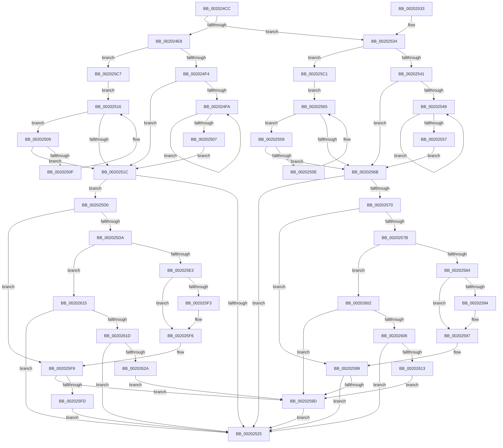

# KiResortScbQueue

- RVA: `0x002024CC`–`0x0020262F` (길이 `355` bytes)
- VA: `0x00000001402024CC`
- 실행 섹션: `.text`
- PDB 이름 있음: `예`; PDB Function 태그: `아니요`
- unwind 정보 RVA: `0x0005C91C`
- 디코드: `112`개 명령, `355/355` bytes 표시
- 미해석 바이트: `0` (있으면 어셈블리에 `.byte`로 보존)

> 이 문서는 커널 이미지의 기계어와 PDB 기호를 분석해 생성했습니다. 4번과 5번은 함수 원형과 자료형을 바이너리 사용 방식에서 추정한 C 해석이며 원본 소스 복구 결과는 아닙니다.

## 1. Dependencies

- 직접 호출 지점: **2**; 고유 호출 대상: **2**
- 직접 호출자로 확인된 함수: **6**
- RIP 상대 이미지 참조: **0**

### Outgoing calls
- `0x002025A6` → [KiRemoveSchedulingGroupQueue](KiRemoveSchedulingGroupQueue_function_00202638.md) (function, `0x00202638`)
- `0x002025B4` → [KiInsertSchedulingGroupQueue](KiInsertSchedulingGroupQueue_function_002013D4.md) (function, `0x002013D4`)

### Direct callers
- [KiInsertNonMaxOverQuotaScb](KiInsertNonMaxOverQuotaScb_function_00201374.md) at `0x002013C6`
- [KiRemoveThreadFromScbQueue](KiRemoveThreadFromScbQueue_function_00201B64.md) at `0x00201BF4`
- [KiComputeGroupSchedulingRank](../21/KiComputeGroupSchedulingRank_function_0021EB84.md) at `0x0021ECF3`
- [sub_00356086](../35/Unknown_function_00356086.md) at `0x003561B4`
- [KiRecomputeGroupSchedulingRank](../45/KiRecomputeGroupSchedulingRank_function_00452FC8.md) at `0x00453066`
- [sub_006F340E](../6F/Unknown_function_006F340E.md) at `0x006F3414`

### Static image references
- 디코드된 RIP-relative 메모리 참조가 없습니다.

## 2. Other-region calls and transfers

- 다른 실행 섹션으로 향하는 call: **0**
- 별도 외부 분기/꼬리 이동을 확인하지 못했습니다.

## 3. Assembly (complete function range)

```asm
002024CC  48 89 5C 24 08                  mov qword ptr [rsp + 8], rbx
002024D1  57                              push rdi
002024D2  48 83 EC 20                     sub rsp, 0x20
002024D6  45 33 C9                        xor r9d, r9d
002024D9  4C 8D 52 58                     lea r10, [rdx + 0x58]
002024DD  48 8B DA                        mov rbx, rdx
002024E0  48 8B F9                        mov rdi, rcx
002024E3  45 84 C0                        test r8b, r8b
002024E6  75 4C                           jne 0x140202534
002024E8  49 8B 0A                        mov rcx, qword ptr [r10]
002024EB  48 85 C9                        test rcx, rcx
002024EE  0F 84 D3 00 00 00               je 0x1402025c7
002024F4  4C 39 49 08                     cmp qword ptr [rcx + 8], r9
002024F8  74 22                           je 0x14020251c
002024FA  48 8B 41 08                     mov rax, qword ptr [rcx + 8]
002024FE  48 8B C8                        mov rcx, rax
00202501  4C 39 48 08                     cmp qword ptr [rax + 8], r9
00202505  75 F3                           jne 0x1402024fa
00202507  EB 13                           jmp 0x14020251c
00202509  4C 39 51 08                     cmp qword ptr [rcx + 8], r10
0020250D  74 0D                           je 0x14020251c
0020250F  4C 8B D1                        mov r10, rcx
00202512  48 8B 49 10                     mov rcx, qword ptr [rcx + 0x10]
00202516  48 83 E1 FC                     and rcx, 0xfffffffffffffffc
0020251A  75 ED                           jne 0x140202509
0020251C  48 85 C9                        test rcx, rcx
0020251F  0F 85 AB 00 00 00               jne 0x1402025d0
00202525  48 8B 5C 24 30                  mov rbx, qword ptr [rsp + 0x30]
0020252A  41 8A C1                        mov al, r9b
0020252D  48 83 C4 20                     add rsp, 0x20
00202531  5F                              pop rdi
00202532  C3                              ret
00202533  CC                              int3
00202534  4D 8B 42 08                     mov r8, qword ptr [r10 + 8]
00202538  4D 85 C0                        test r8, r8
0020253B  0F 84 80 00 00 00               je 0x1402025c1
00202541  49 8B 08                        mov rcx, qword ptr [r8]
00202544  48 85 C9                        test rcx, rcx
00202547  74 22                           je 0x14020256b
00202549  48 8B 01                        mov rax, qword ptr [rcx]
0020254C  4C 8B C1                        mov r8, rcx
0020254F  48 8B C8                        mov rcx, rax
00202552  48 85 C0                        test rax, rax
00202555  75 F2                           jne 0x140202549
00202557  EB 12                           jmp 0x14020256b
00202559  4D 39 10                        cmp qword ptr [r8], r10
0020255C  74 0D                           je 0x14020256b
0020255E  4D 8B D0                        mov r10, r8
00202561  4D 8B 40 10                     mov r8, qword ptr [r8 + 0x10]
00202565  49 83 E0 FC                     and r8, 0xfffffffffffffffc
00202569  75 EE                           jne 0x140202559
0020256B  4D 85 C0                        test r8, r8
0020256E  74 B5                           je 0x140202525
00202570  8B 4A 7C                        mov ecx, dword ptr [rdx + 0x7c]
00202573  8B C1                           mov eax, ecx
00202575  41 2B 40 24                     sub eax, dword ptr [r8 + 0x24]
00202579  75 1E                           jne 0x140202599
0020257B  0F B7 42 78                     movzx eax, word ptr [rdx + 0x78]
0020257F  66 85 C0                        test ax, ax
00202582  74 7E                           je 0x140202602
00202584  41 0F B7 48 20                  movzx ecx, word ptr [r8 + 0x20]
00202589  0F BD D0                        bsr edx, eax
0020258C  41 8B C1                        mov eax, r9d
0020258F  66 85 C9                        test cx, cx
00202592  74 03                           je 0x140202597
00202594  0F BD C1                        bsr eax, ecx
00202597  2B C2                           sub eax, edx
00202599  85 C0                           test eax, eax
0020259B  7E 88                           jle 0x140202525
0020259D  45 33 C0                        xor r8d, r8d
002025A0  48 8B D3                        mov rdx, rbx
002025A3  48 8B CF                        mov rcx, rdi
002025A6  E8 8D 00 00 00                  call 0x140202638
002025AB  45 33 C0                        xor r8d, r8d
002025AE  48 8B D3                        mov rdx, rbx
002025B1  48 8B CF                        mov rcx, rdi
002025B4  E8 1B EE FF FF                  call 0x1402013d4
002025B9  41 B1 01                        mov r9b, 1
002025BC  E9 64 FF FF FF                  jmp 0x140202525
002025C1  4D 8B 42 10                     mov r8, qword ptr [r10 + 0x10]
002025C5  EB 9E                           jmp 0x140202565
002025C7  49 8B 4A 10                     mov rcx, qword ptr [r10 + 0x10]
002025CB  E9 46 FF FF FF                  jmp 0x140202516
002025D0  8B 52 7C                        mov edx, dword ptr [rdx + 0x7c]
002025D3  8B C2                           mov eax, edx
002025D5  2B 41 24                        sub eax, dword ptr [rcx + 0x24]
002025D8  75 1F                           jne 0x1402025f9
002025DA  0F B7 43 78                     movzx eax, word ptr [rbx + 0x78]
002025DE  66 85 C0                        test ax, ax
002025E1  74 32                           je 0x140202615
002025E3  0F B7 51 20                     movzx edx, word ptr [rcx + 0x20]
002025E7  44 0F BD C0                     bsr r8d, eax
002025EB  41 8B C1                        mov eax, r9d
002025EE  66 85 D2                        test dx, dx
002025F1  74 03                           je 0x1402025f6
002025F3  0F BD C2                        bsr eax, edx
002025F6  41 2B C0                        sub eax, r8d
002025F9  85 C0                           test eax, eax
002025FB  78 A0                           js 0x14020259d
002025FD  E9 23 FF FF FF                  jmp 0x140202525
00202602  85 C9                           test ecx, ecx
00202604  75 97                           jne 0x14020259d
00202606  49 8B 40 A8                     mov rax, qword ptr [r8 - 0x58]
0020260A  48 39 02                        cmp qword ptr [rdx], rax
0020260D  0F 86 12 FF FF FF               jbe 0x140202525
00202613  EB 88                           jmp 0x14020259d
00202615  85 D2                           test edx, edx
00202617  0F 85 08 FF FF FF               jne 0x140202525
0020261D  48 8B 41 A8                     mov rax, qword ptr [rcx - 0x58]
00202621  48 39 03                        cmp qword ptr [rbx], rax
00202624  0F 87 FB FE FF FF               ja 0x140202525
0020262A  E9 6E FF FF FF                  jmp 0x14020259d
```

## 4. C-style interpretation (structured pseudocode)

```c
__int64 __fastcall KiResortScbQueue(__int64 a1, __int64 a2, unsigned __int8 a3, int a4)
{
    __int64 result;
    __int64 v_rsp;
    unsigned __int64 v_stack_p8;

    v_stack_p8 = v_rbx;
    v_rsp = (v_rsp) - (32);
    a4 = 0;
    if (a3 != 0) goto loc_00202534;
    if (*(unsigned __int64 *)(a2 + 88) == 0) goto loc_002025C7;
    if ((*(unsigned __int64 *)(*(unsigned __int64 *)(a2 + 88) + 8)) == 0) goto loc_0020251C;
loc_002024FA:
    if ((*(unsigned __int64 *)(*(unsigned __int64 *)(*(unsigned __int64 *)(a2 + 88) + 8) + 8)) != 0) goto loc_002024FA;
    goto loc_0020251C;
loc_00202509:
    if ((*(unsigned __int64 *)(*(unsigned __int64 *)(*(unsigned __int64 *)(a2 + 88) + 8) + 8)) == (a2 + 88)) goto loc_0020251C;
loc_00202516:
    a1 = (*(unsigned __int64 *)(*(unsigned __int64 *)(*(unsigned __int64 *)(a2 + 88) + 8) + 16)) & (-4);
    if (condition_is_not_equal) goto loc_00202509;
loc_0020251C:
    if (a1 != 0) goto loc_002025D0;
loc_00202525:
    v_rsp = (v_rsp) + (32);
    return 0;
loc_00202534:
    if (*(unsigned __int64 *)(*(unsigned __int64 *)(*(unsigned __int64 *)(a2 + 88) + 8) + 8) == 0) goto loc_002025C1;
    if (*(unsigned __int64 *)(*(unsigned __int64 *)(*(unsigned __int64 *)(*(unsigned __int64 *)(a2 + 88) + 8) + 8)) == 0) goto loc_0020256B;
loc_00202549:
    if (*(unsigned __int64 *)(*(unsigned __int64 *)(*(unsigned __int64 *)(*(unsigned __int64 *)(*(unsigned __int64 *)(a2 + 88) + 8) + 8))) != 0) goto loc_00202549;
    goto loc_0020256B;
loc_00202559:
    if ((*(unsigned __int64 *)(*(unsigned __int64 *)(*(unsigned __int64 *)(*(unsigned __int64 *)(*(unsigned __int64 *)(a2 + 88) + 8) + 8)))) == (*(unsigned __int64 *)(*(unsigned __int64 *)(a2 + 88) + 8))) goto loc_0020256B;
loc_00202565:
    a3 = (*(unsigned __int64 *)(*(unsigned __int64 *)(*(unsigned __int64 *)(*(unsigned __int64 *)(*(unsigned __int64 *)(a2 + 88) + 8) + 8)) + 16)) & (-4);
    if (condition_is_not_equal) goto loc_00202559;
loc_0020256B:
    if (a3 == 0) goto loc_00202525;
    result = (unsigned int)(((unsigned int)((unsigned int)((unsigned int)(*(unsigned int *)(a2 + 124))))) - (*(unsigned int *)(a3 + 36)));
    if (condition_is_not_equal) goto loc_00202599;
    if ((unsigned __int16)(*(unsigned __int16 *)(a2 + 120)) == 0) goto loc_00202602;
    if ((unsigned __int16)(*(unsigned __int16 *)(a3 + 32)) != 0) {
    }
    result = (unsigned int)((0) - ((unsigned int)(a2)));
loc_00202599:
    if (condition_is_less_or_equal) goto loc_00202525;
loc_0020259D:
    a3 = 0;
    result = KiRemoveSchedulingGroupQueue(a1, v_stack_p8, a3, a4);
    a3 = 0;
    result = KiInsertSchedulingGroupQueue(a1, v_stack_p8, a3, a4);
    goto loc_00202525;
loc_002025C1:
    goto loc_00202565;
loc_002025C7:
    goto loc_00202516;
loc_002025D0:
    result = (unsigned int)(((unsigned int)((unsigned int)((unsigned int)(*(unsigned int *)(v_stack_p8 + 124))))) - (*(unsigned int *)(*(unsigned __int64 *)(*(unsigned __int64 *)(*(unsigned __int64 *)(*(unsigned __int64 *)(*(unsigned __int64 *)(a2 + 88) + 8) + 8)) + 16) + 36)));
    if (condition_is_not_equal) goto loc_002025F9;
    if ((unsigned __int16)(*(unsigned __int16 *)(v_stack_p8 + 120)) == 0) goto loc_00202615;
    if ((unsigned __int16)(*(unsigned __int16 *)(*(unsigned __int64 *)(*(unsigned __int64 *)(*(unsigned __int64 *)(*(unsigned __int64 *)(*(unsigned __int64 *)(a2 + 88) + 8) + 8)) + 16) + 32)) != 0) {
    }
    result = (unsigned int)((1) - ((unsigned int)(*(unsigned __int64 *)(*(unsigned __int64 *)(*(unsigned __int64 *)(*(unsigned __int64 *)(*(unsigned __int64 *)(a2 + 88) + 8) + 8)) + 16))));
loc_002025F9:
    if (sign_flag) goto loc_0020259D;
    goto loc_00202525;
loc_00202602:
    if ((unsigned int)(*(unsigned __int64 *)(*(unsigned __int64 *)(*(unsigned __int64 *)(*(unsigned __int64 *)(*(unsigned __int64 *)(a2 + 88) + 8) + 8)) + 16)) != 0) goto loc_0020259D;
    if ((*(unsigned __int64 *)(*(unsigned __int16 *)(*(unsigned __int64 *)(*(unsigned __int64 *)(*(unsigned __int64 *)(*(unsigned __int64 *)(*(unsigned __int64 *)(a2 + 88) + 8) + 8)) + 16) + 32))) <= (*(unsigned __int64 *)(*(unsigned __int64 *)(*(unsigned __int64 *)(*(unsigned __int64 *)(*(unsigned __int64 *)(*(unsigned __int64 *)(a2 + 88) + 8) + 8)) + 16) - 88))) goto loc_00202525;
    goto loc_0020259D;
loc_00202615:
    if ((unsigned int)(*(unsigned __int16 *)(*(unsigned __int64 *)(*(unsigned __int64 *)(*(unsigned __int64 *)(*(unsigned __int64 *)(*(unsigned __int64 *)(a2 + 88) + 8) + 8)) + 16) + 32)) != 0) goto loc_00202525;
    if ((*(unsigned __int64 *)(v_stack_p8)) > (*(unsigned __int64 *)(*(unsigned __int64 *)(*(unsigned __int64 *)(*(unsigned __int64 *)(*(unsigned __int64 *)(*(unsigned __int64 *)(a2 + 88) + 8) + 8)) + 16) - 88))) goto loc_00202525;
    goto loc_0020259D;
}
```

## 5. (Beta) C Style

```c
int64_t KiResortScbQueue(int64_t Arg1, void *Arg2, uint8_t Arg3, int32_t Arg4)
{
    uint8_t *arg2 = (uint8_t *)Arg2;

    int64_t result;
    int64_t local_rsp;
    uint64_t v_stack_p8;

    v_stack_p8 = local_rbx;
    local_rsp = (local_rsp) - (32);
    Arg4 = 0;
    if (Arg3 != 0) goto loc_00202534;
    if (*(uint64_t *)(arg2 + 0x58) == 0) goto loc_002025C7;
    if ((*(uint64_t *)(*(uint64_t *)(arg2 + 0x58) + 0x8)) == 0) goto loc_0020251C;
loc_002024FA:
    if ((*(uint64_t *)(*(uint64_t *)(*(uint64_t *)(arg2 + 0x58) + 0x8) + 0x8)) != 0) goto loc_002024FA;
    goto loc_0020251C;
loc_00202509:
    if ((*(uint64_t *)(*(uint64_t *)(*(uint64_t *)(arg2 + 0x58) + 0x8) + 0x8)) == (Arg2 + 88)) goto loc_0020251C;
loc_00202516:
    Arg1 = (*(uint64_t *)(*(uint64_t *)(*(uint64_t *)(arg2 + 0x58) + 0x8) + 0x10)) & (-4);
    if (condition_is_not_equal) goto loc_00202509;
loc_0020251C:
    if (Arg1 != 0) goto loc_002025D0;
loc_00202525:
    local_rsp = (local_rsp) + (32);
    return 0;
loc_00202534:
    if (*(uint64_t *)(*(uint64_t *)(*(uint64_t *)(arg2 + 0x58) + 0x8) + 0x8) == 0) goto loc_002025C1;
    if (*(uint64_t *)(*(uint64_t *)(*(uint64_t *)(*(uint64_t *)(arg2 + 0x58) + 0x8) + 0x8)) == 0) goto loc_0020256B;
loc_00202549:
    if (*(uint64_t *)(*(uint64_t *)(*(uint64_t *)(*(uint64_t *)(*(uint64_t *)(arg2 + 0x58) + 0x8) + 0x8))) != 0) goto loc_00202549;
    goto loc_0020256B;
loc_00202559:
    if ((*(uint64_t *)(*(uint64_t *)(*(uint64_t *)(*(uint64_t *)(*(uint64_t *)(arg2 + 0x58) + 0x8) + 0x8)))) == (*(uint64_t *)(*(uint64_t *)(arg2 + 0x58) + 0x8))) goto loc_0020256B;
loc_00202565:
    Arg3 = (*(uint64_t *)(*(uint64_t *)(*(uint64_t *)(*(uint64_t *)(*(uint64_t *)(arg2 + 0x58) + 0x8) + 0x8)) + 0x10)) & (-4);
    if (condition_is_not_equal) goto loc_00202559;
loc_0020256B:
    if (Arg3 == 0) goto loc_00202525;
    result = (uint32_t)(((uint32_t)((uint32_t)((uint32_t)(*(uint32_t *)(arg2 + 0x7C))))) - (*(uint32_t *)(Arg3 + 0x24)));
    if (condition_is_not_equal) goto loc_00202599;
    if ((uint16_t)(*(uint16_t *)(arg2 + 0x78)) == 0) goto loc_00202602;
    if ((uint16_t)(*(uint16_t *)(Arg3 + 0x20)) != 0) {
    }
    result = (uint32_t)((0) - ((uint32_t)(Arg2)));
loc_00202599:
    if (condition_is_less_or_equal) goto loc_00202525;
loc_0020259D:
    Arg3 = 0;
    result = KiRemoveSchedulingGroupQueue(Arg1, v_stack_p8, Arg3, Arg4);
    Arg3 = 0;
    result = KiInsertSchedulingGroupQueue(Arg1, v_stack_p8, Arg3, Arg4);
    goto loc_00202525;
loc_002025C1:
    goto loc_00202565;
loc_002025C7:
    goto loc_00202516;
loc_002025D0:
    result = (uint32_t)(((uint32_t)((uint32_t)((uint32_t)(*(uint32_t *)(v_stack_p8 + 0x7C))))) - (*(uint32_t *)(*(uint64_t *)(*(uint64_t *)(*(uint64_t *)(*(uint64_t *)(*(uint64_t *)(arg2 + 0x58) + 0x8) + 0x8)) + 0x10) + 0x24)));
    if (condition_is_not_equal) goto loc_002025F9;
    if ((uint16_t)(*(uint16_t *)(v_stack_p8 + 0x78)) == 0) goto loc_00202615;
    if ((uint16_t)(*(uint16_t *)(*(uint64_t *)(*(uint64_t *)(*(uint64_t *)(*(uint64_t *)(*(uint64_t *)(arg2 + 0x58) + 0x8) + 0x8)) + 0x10) + 0x20)) != 0) {
    }
    result = (uint32_t)((1) - ((uint32_t)(*(uint64_t *)(*(uint64_t *)(*(uint64_t *)(*(uint64_t *)(*(uint64_t *)(arg2 + 0x58) + 0x8) + 0x8)) + 0x10))));
loc_002025F9:
    if (sign_flag) goto loc_0020259D;
    goto loc_00202525;
loc_00202602:
    if ((uint32_t)(*(uint64_t *)(*(uint64_t *)(*(uint64_t *)(*(uint64_t *)(*(uint64_t *)(arg2 + 0x58) + 0x8) + 0x8)) + 0x10)) != 0) goto loc_0020259D;
    if ((*(uint64_t *)(*(uint16_t *)(*(uint64_t *)(*(uint64_t *)(*(uint64_t *)(*(uint64_t *)(*(uint64_t *)(arg2 + 0x58) + 0x8) + 0x8)) + 0x10) + 0x20))) <= (*(uint64_t *)(*(uint64_t *)(*(uint64_t *)(*(uint64_t *)(*(uint64_t *)(*(uint64_t *)(arg2 + 0x58) + 0x8) + 0x8)) + 0x10) - 0x58))) goto loc_00202525;
    goto loc_0020259D;
loc_00202615:
    if ((uint32_t)(*(uint16_t *)(*(uint64_t *)(*(uint64_t *)(*(uint64_t *)(*(uint64_t *)(*(uint64_t *)(arg2 + 0x58) + 0x8) + 0x8)) + 0x10) + 0x20)) != 0) goto loc_00202525;
    if ((*(uint64_t *)(v_stack_p8)) > (*(uint64_t *)(*(uint64_t *)(*(uint64_t *)(*(uint64_t *)(*(uint64_t *)(*(uint64_t *)(arg2 + 0x58) + 0x8) + 0x8)) + 0x10) - 0x58))) goto loc_00202525;
    goto loc_0020259D;
}
```

### 관측된 메모리 오프셋

구조체 형식이 확인되지 않은 접근은 인자 기준의 오프셋으로만 기록했습니다.

| 기준 인자 | 오프셋 표현 | 폭 (bit) | 접근 |
|---|---:|---:|---|
| `Arg2` | `+ 0x0` | `64` | `R` |
| `Arg2` | `+ 0x8` | `64` | `R` |
| `Arg2` | `+ 0x10` | `64` | `R` |
| `Arg2` | `+ 0x58` | `64` | `R` |
| `Arg2` | `+ 0x78` | `16` | `R` |
| `Arg2` | `+ 0x7C` | `32` | `R` |

## 6. Execution-region graph

[열기: 2D/3D 그래프와 함수 탐색 컨트롤 패널](../../../control-panel.html?section=text&rva=0x002024CC&view=graph)

- 2D 그래프는 위에서 아래로 흐르고, 3D 그래프는 빈 공간을 드래그해 회전합니다. Shift+드래그는 이동, 휠은 확대·축소, 함수 노드 선택은 대상 보고서 이동입니다.

### Static fallback


