# KiSchedulerApc

- RVA: `0x00202BC0`–`0x00202EC4` (길이 `772` bytes)
- VA: `0x0000000140202BC0`
- 실행 섹션: `.text`
- PDB 이름 있음: `예`; PDB Function 태그: `예`
- unwind 정보 RVA: `0x0005C9C4`
- 디코드: `186`개 명령, `772/772` bytes 표시
- 미해석 바이트: `0` (있으면 어셈블리에 `.byte`로 보존)

> 이 문서는 커널 이미지의 기계어와 PDB 기호를 분석해 생성했습니다. 4번과 5번은 함수 원형과 자료형을 바이너리 사용 방식에서 추정한 C 해석이며 원본 소스 복구 결과는 아닙니다.

## 1. Dependencies

- 직접 호출 지점: **17**; 고유 호출 대상: **15**
- 직접 호출자로 확인된 함수: **1**
- RIP 상대 이미지 참조: **5**

### Outgoing calls
- `0x00202BFC` → [memset](../6C/memset_function_006C6C40.md) (function, `0x006C6C40`)
- `0x00202C46` → [_security_check_cookie](../6A/_security_check_cookie_function_006AC640.md) (function, `0x006AC640`)
- `0x00202C70` → [KiHandleDeferredPreemption](KiHandleDeferredPreemption_function_00202ECC.md) (function, `0x00202ECC`)
- `0x00202CB2` → [KeWaitForSingleObject](KeWaitForSingleObject_function_0020E6B0.md) (function, `0x0020E6B0`)
- `0x00202D0D` → [KiCheckForKernelApcDelivery](../2E/KiCheckForKernelApcDelivery_function_002E2C80.md) (function, `0x002E2C80`)
- `0x00202DB0` → [KiInsertQueueApc](KiInsertQueueApc_function_002041F0.md) (function, `0x002041F0`)
- `0x00202DC1` → [KiSignalThreadForApc](KiSignalThreadForApc_function_00204360.md) (function, `0x00204360`)
- `0x00202DDE` → [KiExitDispatcher](../25/KiExitDispatcher_function_00251CF0.md) (function, `0x00251CF0`)
- `0x00202DEE` → [KiRaiseIrqlProcessIrqlFlags](../4F/KiRaiseIrqlProcessIrqlFlags_function_004F56FC.md) (function, `0x004F56FC`)
- `0x00202E06` → [KiCheckVpBackingLongSpinWaitHypercall](../30/KiCheckVpBackingLongSpinWaitHypercall_function_0030F490.md) (function, `0x0030F490`)
- `0x00202E15` → [HvlNotifyLongSpinWait](../30/HvlNotifyLongSpinWait_function_0030F460.md) (function, `0x0030F460`)
- `0x00202E27` → [KiAcquireThreadLockRaiseToDpc](../39/KiAcquireThreadLockRaiseToDpc_function_00396280.md) (function, `0x00396280`)
- `0x00202E4A` → [KiReleaseThreadLockLowerIrql](../3C/KiReleaseThreadLockLowerIrql_function_003C65D0.md) (function, `0x003C65D0`)
- `0x00202E5C` → [KiAcquireThreadLockRaiseToDpc](../39/KiAcquireThreadLockRaiseToDpc_function_00396280.md) (function, `0x00396280`)
- `0x00202E9E` → [DbgkForwardException](../../page/8A/DbgkForwardException_function_008A2D60.md) (function, `0x008A2D60`)
- `0x00202EAD` → [DbgkForwardException](../../page/8A/DbgkForwardException_function_008A2D60.md) (function, `0x008A2D60`)
- `0x00202EBA` → [KiRemoveQueueApc](../3C/KiRemoveQueueApc_function_003C4870.md) (function, `0x003C4870`)

### Direct callers
- [sub_00250F85](../25/Unknown_function_00250F85.md) at `0x0025113B`

### Static image references
- `0x00202BDE` → RVA `0x00E0A740` (`.data`; read)
- `0x00202D49` → RVA `0x00FC6D20` (`ALMOSTRO`; read)
- `0x00202D72` → RVA `0x00FC52AC` (`ALMOSTRO`; reference)
- `0x00202D94` → RVA `0x00905D40` (`KiSchedulerApcTerminate`; read)
- `0x00202DF8` → RVA `0x00FC6AB8` (`ALMOSTRO`; read)

## 2. Other-region calls and transfers

- 다른 실행 섹션으로 향하는 call: **2**
  - `0x00202E9E` → [DbgkForwardException](../../page/8A/DbgkForwardException_function_008A2D60.md) (`.text` → `PAGE`)
  - `0x00202EAD` → [DbgkForwardException](../../page/8A/DbgkForwardException_function_008A2D60.md) (`.text` → `PAGE`)
- call이 아닌 외부 분기/꼬리 이동: **2**
  - `0x00202E70` → [sub_006D6528](../6D/Unknown_function_006D6528.md) (`tail-transfer`)
  - `0x00202E7D` → [sub_006D6528](../6D/Unknown_function_006D6528.md) (`tail-transfer`)

## 3. Assembly (complete function range)

```asm
00202BC0  48 89 5C 24 10                  mov qword ptr [rsp + 0x10], rbx
00202BC5  48 89 74 24 18                  mov qword ptr [rsp + 0x18], rsi
00202BCA  55                              push rbp
00202BCB  57                              push rdi
00202BCC  41 55                           push r13
00202BCE  41 56                           push r14
00202BD0  41 57                           push r15
00202BD2  48 8D 6C 24 C9                  lea rbp, [rsp - 0x37]
00202BD7  48 81 EC 00 01 00 00            sub rsp, 0x100
00202BDE  48 8B 05 5B 7B C0 00            mov rax, qword ptr [rip + 0xc07b5b]
00202BE5  48 33 C4                        xor rax, rsp
00202BE8  48 89 45 27                     mov qword ptr [rbp + 0x27], rax
00202BEC  48 8B D9                        mov rbx, rcx
00202BEF  33 D2                           xor edx, edx
00202BF1  48 8D 4C 24 40                  lea rcx, [rsp + 0x40]
00202BF6  41 B8 98 00 00 00               mov r8d, 0x98
00202BFC  E8 3F 40 4C 00                  call 0x1406c6c40
00202C01  44 8B 73 78                     mov r14d, dword ptr [rbx + 0x78]
00202C05  41 81 E6 00 80 00 00            and r14d, 0x8000
00202C0C  C6 44 24 30 00                  mov byte ptr [rsp + 0x30], 0
00202C11  F7 43 78 00 04 00 00            test dword ptr [rbx + 0x78], 0x400
00202C18  75 4E                           jne 0x140202c68
00202C1A  BE 02 00 00 00                  mov esi, 2
00202C1F  4C 8D BB E0 02 00 00            lea r15, [rbx + 0x2e0]
00202C26  41 83 7F 04 00                  cmp dword ptr [r15 + 4], 0
00202C2B  44 8D 6E FF                     lea r13d, [rsi - 1]
00202C2F  74 46                           je 0x140202c77
00202C31  0F BA 73 74 12                  btr dword ptr [rbx + 0x74], 0x12
00202C36  45 85 F6                        test r14d, r14d
00202C39  0F 85 D8 00 00 00               jne 0x140202d17
00202C3F  48 8B 4D 27                     mov rcx, qword ptr [rbp + 0x27]
00202C43  48 33 CC                        xor rcx, rsp
00202C46  E8 F5 99 4A 00                  call 0x1406ac640
00202C4B  4C 8D 9C 24 00 01 00 00         lea r11, [rsp + 0x100]
00202C53  49 8B 5B 38                     mov rbx, qword ptr [r11 + 0x38]
00202C57  49 8B 73 40                     mov rsi, qword ptr [r11 + 0x40]
00202C5B  49 8B E3                        mov rsp, r11
00202C5E  41 5F                           pop r15
00202C60  41 5E                           pop r14
00202C62  41 5D                           pop r13
00202C64  5F                              pop rdi
00202C65  5D                              pop rbp
00202C66  C3                              ret
00202C67  CC                              int3
00202C68  45 85 F6                        test r14d, r14d
00202C6B  75 AD                           jne 0x140202c1a
00202C6D  48 8B CB                        mov rcx, rbx
00202C70  E8 57 02 00 00                  call 0x140202ecc
00202C75  EB A3                           jmp 0x140202c1a
00202C77  45 85 F6                        test r14d, r14d
00202C7A  75 B5                           jne 0x140202c31
00202C7C  8B 7B 74                        mov edi, dword ptr [rbx + 0x74]
00202C7F  C1 EF 12                        shr edi, 0x12
00202C82  41 22 FD                        and dil, r13b
00202C85  74 48                           je 0x140202ccf
00202C87  40 8A B3 C2 00 00 00            mov sil, byte ptr [rbx + 0xc2]
00202C8E  40 D0 EE                        shr sil, 1
00202C91  41 22 F5                        and sil, r13b
00202C94  0F 85 85 01 00 00               jne 0x140202e1f
00202C9A  0F BA 6B 74 13                  bts dword ptr [rbx + 0x74], 0x13
00202C9F  45 33 C9                        xor r9d, r9d
00202CA2  48 83 64 24 20 00               and qword ptr [rsp + 0x20], 0
00202CA8  44 8A C7                        mov r8b, dil
00202CAB  49 8B CF                        mov rcx, r15
00202CAE  41 8D 51 05                     lea edx, [r9 + 5]
00202CB2  E8 F9 B9 00 00                  call 0x14020e6b0
00202CB7  0F BA 73 74 13                  btr dword ptr [rbx + 0x74], 0x13
00202CBC  40 84 F6                        test sil, sil
00202CBF  0F 85 8F 01 00 00               jne 0x140202e54
00202CC5  BE 02 00 00 00                  mov esi, 2
00202CCA  E9 62 FF FF FF                  jmp 0x140202c31
00202CCF  48 8B B3 90 00 00 00            mov rsi, qword ptr [rbx + 0x90]
00202CD6  48 85 F6                        test rsi, rsi
00202CD9  74 AC                           je 0x140202c87
00202CDB  66 44 29 AB E6 01 00 00         sub word ptr [rbx + 0x1e6], r13w
00202CE3  90                              nop
00202CE4  40 8A B6 70 01 00 00            mov sil, byte ptr [rsi + 0x170]
00202CEB  90                              nop
00202CEC  41 22 F5                        and sil, r13b
00202CEF  66 44 01 AB E6 01 00 00         add word ptr [rbx + 0x1e6], r13w
00202CF7  40 8A FE                        mov dil, sil
00202CFA  75 8B                           jne 0x140202c87
00202CFC  48 8D 83 98 00 00 00            lea rax, [rbx + 0x98]
00202D03  90                              nop
00202D04  48 39 00                        cmp qword ptr [rax], rax
00202D07  0F 84 7A FF FF FF               je 0x140202c87
00202D0D  E8 6E FF 0D 00                  call 0x1402e2c80
00202D12  E9 70 FF FF FF                  jmp 0x140202c87
00202D17  8B 43 78                        mov eax, dword ptr [rbx + 0x78]
00202D1A  C7 45 17 2D 01 00 C0            mov dword ptr [rbp + 0x17], 0xc000012d
00202D21  C7 45 1B 24 07 00 C0            mov dword ptr [rbp + 0x1b], 0xc0000724
00202D28  C7 45 1F 25 07 00 C0            mov dword ptr [rbp + 0x1f], 0xc0000725
00202D2F  25 00 00 0C 00                  and eax, 0xc0000
00202D34  0F 85 48 01 00 00               jne 0x140202e82
00202D3A  48 8D BB 88 02 00 00            lea rdi, [rbx + 0x288]
00202D41  45 0F 20 C6                     mov r14, cr8
00202D45  44 0F 22 C6                     mov cr8, rsi
00202D49  83 3D D0 3F DC 00 00            cmp dword ptr [rip + 0xdc3fd0], 0
00202D50  0F 85 92 00 00 00               jne 0x140202de8
00202D56  65 4C 8B 3C 25 20 00 00 00      mov r15, qword ptr gs:[0x20]
00202D5F  33 F6                           xor esi, esi
00202D61  44 88 74 24 30                  mov byte ptr [rsp + 0x30], r14b
00202D66  F0 48 0F BA 6B 40 00            lock bts qword ptr [rbx + 0x40], 0
00202D6D  73 18                           jae 0x140202d87
00202D6F  41 03 F5                        add esi, r13d
00202D72  85 35 34 25 DC 00               test dword ptr [rip + 0xdc2534], esi
00202D78  74 7E                           je 0x140202df8
00202D7A  F3 90                           pause
00202D7C  48 8B 43 40                     mov rax, qword ptr [rbx + 0x40]
00202D80  48 85 C0                        test rax, rax
00202D83  74 E1                           je 0x140202d66
00202D85  EB E8                           jmp 0x140202d6f
00202D87  F7 43 74 00 40 00 00            test dword ptr [rbx + 0x74], 0x4000
00202D8E  74 36                           je 0x140202dc6
00202D90  80 7F 52 00                     cmp byte ptr [rdi + 0x52], 0
00202D94  48 8D 05 A5 2F 70 00            lea rax, [rip + 0x702fa5]
00202D9B  48 89 47 20                     mov qword ptr [rdi + 0x20], rax
00202D9F  44 88 6F 51                     mov byte ptr [rdi + 0x51], r13b
00202DA3  0F 85 0E 01 00 00               jne 0x140202eb7
00202DA9  48 8B CF                        mov rcx, rdi
00202DAC  44 88 6F 52                     mov byte ptr [rdi + 0x52], r13b
00202DB0  E8 3B 14 00 00                  call 0x1402041f0
00202DB5  45 33 C9                        xor r9d, r9d
00202DB8  45 8A C6                        mov r8b, r14b
00202DBB  48 8B D7                        mov rdx, rdi
00202DBE  49 8B CF                        mov rcx, r15
00202DC1  E8 9A 15 00 00                  call 0x140204360
00202DC6  45 33 C9                        xor r9d, r9d
00202DC9  48 C7 43 40 00 00 00 00         mov qword ptr [rbx + 0x40], 0
00202DD1  45 8B C5                        mov r8d, r13d
00202DD4  44 88 74 24 20                  mov byte ptr [rsp + 0x20], r14b
00202DD9  33 D2                           xor edx, edx
00202DDB  49 8B CF                        mov rcx, r15
00202DDE  E8 0D EF 04 00                  call 0x140251cf0
00202DE3  E9 57 FE FF FF                  jmp 0x140202c3f
00202DE8  40 8A D6                        mov dl, sil
00202DEB  41 8A CE                        mov cl, r14b
00202DEE  E8 09 29 2F 00                  call 0x1404f56fc
00202DF3  E9 5E FF FF FF                  jmp 0x140202d56
00202DF8  8B 05 BA 3C DC 00               mov eax, dword ptr [rip + 0xdc3cba]
00202DFE  A8 40                           test al, 0x40
00202E00  0F 84 74 FF FF FF               je 0x140202d7a
00202E06  E8 85 C6 10 00                  call 0x14030f490
00202E0B  84 C0                           test al, al
00202E0D  0F 84 67 FF FF FF               je 0x140202d7a
00202E13  8B CE                           mov ecx, esi
00202E15  E8 46 C6 10 00                  call 0x14030f460
00202E1A  E9 5D FF FF FF                  jmp 0x140202d7c
00202E1F  48 8D 54 24 30                  lea rdx, [rsp + 0x30]
00202E24  48 8B CB                        mov rcx, rbx
00202E27  E8 54 34 19 00                  call 0x140396280
00202E2C  8A 83 C2 00 00 00               mov al, byte ptr [rbx + 0xc2]
00202E32  48 8B CB                        mov rcx, rbx
00202E35  8A 54 24 30                     mov dl, byte ptr [rsp + 0x30]
00202E39  40 8A F0                        mov sil, al
00202E3C  40 D0 EE                        shr sil, 1
00202E3F  24 FD                           and al, 0xfd
00202E41  41 22 F5                        and sil, r13b
00202E44  88 83 C2 00 00 00               mov byte ptr [rbx + 0xc2], al
00202E4A  E8 81 37 1C 00                  call 0x1403c65d0
00202E4F  E9 46 FE FF FF                  jmp 0x140202c9a
00202E54  48 8D 54 24 30                  lea rdx, [rsp + 0x30]
00202E59  48 8B CB                        mov rcx, rbx
00202E5C  E8 1F 34 19 00                  call 0x140396280
00202E61  48 8D 83 A8 00 00 00            lea rax, [rbx + 0xa8]
00202E68  BE 02 00 00 00                  mov esi, 2
00202E6D  48 39 00                        cmp qword ptr [rax], rax
00202E70  0F 84 B2 36 4D 00               je 0x1406d6528
00202E76  40 08 B3 C2 00 00 00            or byte ptr [rbx + 0xc2], sil
00202E7D  E9 A6 36 4D 00                  jmp 0x1406d6528
00202E82  48 C1 E8 12                     shr rax, 0x12
00202E86  48 8D 4C 24 40                  lea rcx, [rsp + 0x40]
00202E8B  45 8A C5                        mov r8b, r13b
00202E8E  44 89 6C 24 44                  mov dword ptr [rsp + 0x44], r13d
00202E93  41 8A D5                        mov dl, r13b
00202E96  8B 44 85 13                     mov eax, dword ptr [rbp + rax*4 + 0x13]
00202E9A  89 44 24 40                     mov dword ptr [rsp + 0x40], eax
00202E9E  E8 BD FE 69 00                  call 0x1408a2d60
00202EA3  45 8A C5                        mov r8b, r13b
00202EA6  48 8D 4C 24 40                  lea rcx, [rsp + 0x40]
00202EAB  33 D2                           xor edx, edx
00202EAD  E8 AE FE 69 00                  call 0x1408a2d60
00202EB2  E9 83 FE FF FF                  jmp 0x140202d3a
00202EB7  48 8B CF                        mov rcx, rdi
00202EBA  E8 B1 19 1C 00                  call 0x1403c4870
00202EBF  E9 E5 FE FF FF                  jmp 0x140202da9
```

## 4. C-style interpretation (structured pseudocode)

```c
__int64 __fastcall KiSchedulerApc(__int64 a1, int a2, __int64 a3, int a4)
{
    __int64 result;
    __int64 v_r14;
    __int64 v_rdi;
    __int64 v_rsi;
    __int64 v_rsp;
    unsigned __int64 v_stack_m28;
    unsigned __int64 v_stack_m38;
    unsigned int v_stack_m40;
    unsigned int v_stack_m44;
    unsigned int v_stack_m48;
    unsigned __int64 v_stack_m5F;
    unsigned int v_stack_mBC;
    unsigned __int64 v_stack_mC0;
    unsigned __int8 v_stack_mD0;
    unsigned __int64 v_stack_mE0;
    unsigned __int64 v_stack_mE8;
    unsigned __int8 v_stack_mF8;
    unsigned __int64 v_stack_p10;
    unsigned __int64 v_stack_p18;

    v_stack_p10 = v_rbx;
    v_stack_p18 = v_rsi;
    v_rsp = (v_rsp) - (256);
    result = (*(unsigned __int64 *)(v_rip + 12614491)) ^ (v_rsp);
    v_stack_m38 = result;
    a2 = 0;
    result = memset(v_stack_mE8, a2, 152, a4);
    v_r14 = (unsigned int)(((unsigned int)(*(unsigned int *)(a1 + 120))) & (0x8000ULL));
    v_stack_mF8 = 0;
    if (((*(unsigned int *)(a1 + 120)) & (0x400ULL)) != 0) goto loc_00202C68;
loc_00202C1A:
    if ((*(unsigned int *)(a1 + 736 + 4)) == 0) goto loc_00202C77;
loc_00202C31:
    if ((unsigned int)(v_r14) != 0) goto loc_00202D17;
loc_00202C3F:
    a1 = (v_stack_m38) ^ (v_rsp);
    result = _security_check_cookie(a1, a2, 152, a4);
    return result;
loc_00202C68:
    if ((unsigned int)(v_r14) != 0) goto loc_00202C1A;
    result = KiHandleDeferredPreemption(*(unsigned __int64 *)(v_stack_m28 + 56), a2, 152, a4);
    goto loc_00202C1A;
loc_00202C77:
    if ((unsigned int)(v_r14) != 0) goto loc_00202C31;
    v_rdi = (unsigned int)(((unsigned int)(*(unsigned int *)(*(unsigned __int64 *)(v_stack_m28 + 56) + 116))) >> (18));
    v_rdi = (unsigned __int8)((v_rdi) & ((unsigned __int8)(2 - 1)));
    if (condition_is_equal) goto loc_00202CCF;
loc_00202C87:
    v_rsi = (unsigned __int8)((*(unsigned __int8 *)(*(unsigned __int64 *)(v_stack_m28 + 56) + 194)) >> (1));
    v_rsi = (unsigned __int8)((v_rsi) & ((unsigned __int8)(2 - 1)));
    if (condition_is_not_equal) goto loc_00202E1F;
loc_00202C9A:
    a4 = 0;
    result = KeWaitForSingleObject(a1 + 736, a4 + 5, (unsigned __int8)(v_rdi), a4);
    if ((unsigned __int8)(v_rsi) != 0) goto loc_00202E54;
    goto loc_00202C31;
loc_00202CCF:
    if (*(unsigned __int64 *)(*(unsigned __int64 *)(v_stack_m28 + 56) + 144) == 0) goto loc_00202C87;
    v_rsi = (unsigned __int8)((*(unsigned __int8 *)(*(unsigned __int64 *)(*(unsigned __int64 *)(v_stack_m28 + 56) + 144) + 368)) & ((unsigned __int8)(2 - 1)));
    if (condition_is_not_equal) goto loc_00202C87;
    if ((*(unsigned __int64 *)(*(unsigned __int64 *)(v_stack_m28 + 56) + 152)) == (*(unsigned __int64 *)(v_stack_m28 + 56) + 152)) goto loc_00202C87;
    result = KiCheckForKernelApcDelivery(a1 + 736, a4 + 5, (unsigned __int8)(v_rdi), a4);
    goto loc_00202C87;
loc_00202D17:
    v_stack_m48 = 0xC000012DULL;
    v_stack_m44 = 0xC0000724ULL;
    v_stack_m40 = 0xC0000725ULL;
    result = (unsigned int)(((unsigned int)(*(unsigned int *)(*(unsigned __int64 *)(v_stack_m28 + 56) + 120))) & (0xC0000ULL));
    if (condition_is_not_equal) goto loc_00202E82;
loc_00202D3A:
    if ((*(unsigned int *)(v_rip + 14434256)) != 0) goto loc_00202DE8;
loc_00202D56:
    v_rsi = 0;
    v_stack_mD0 = (unsigned __int8)(v_cr8);
loc_00202D66:
    if (condition_is_above_or_equal) goto loc_00202D87;
loc_00202D6F:
    v_rsi = (unsigned int)((v_rsi) + ((unsigned int)(2 - 1)));
    if (((*(unsigned int *)(v_rip + 14427444)) & ((unsigned int)(v_rsi))) == 0) goto loc_00202DF8;
loc_00202D7A:
loc_00202D7C:
    if (*(unsigned __int64 *)(*(unsigned __int64 *)(v_stack_m28 + 56) + 64) == 0) goto loc_00202D66;
    goto loc_00202D6F;
loc_00202D87:
    if (((*(unsigned int *)(*(unsigned __int64 *)(v_stack_m28 + 56) + 116)) & (0x4000ULL)) == 0) goto loc_00202DC6;
    *(unsigned __int64 *)(*(unsigned __int64 *)(v_stack_m28 + 56) + 648 + 32) = v_rip + 7352229;
    *(unsigned __int8 *)(*(unsigned __int64 *)(v_stack_m28 + 56) + 648 + 81) = (unsigned __int8)(2 - 1);
    if ((*(unsigned __int8 *)(*(unsigned __int64 *)(v_stack_m28 + 56) + 648 + 82)) != 0) goto loc_00202EB7;
loc_00202DA9:
    *(unsigned __int8 *)(*(unsigned __int64 *)(v_stack_m28 + 56) + 648 + 82) = (unsigned __int8)(2 - 1);
    result = KiInsertQueueApc(*(unsigned __int64 *)(v_stack_m28 + 56) + 648, a4 + 5, (unsigned __int8)(v_rdi), a4);
    a4 = 0;
    result = KiSignalThreadForApc(*(unsigned __int64 *)(gs_base + (0 + 32)), *(unsigned __int64 *)(v_stack_m28 + 56) + 648, (unsigned __int8)(v_cr8), a4);
loc_00202DC6:
    a4 = 0;
    *(unsigned __int64 *)(*(unsigned __int64 *)(v_stack_m28 + 56) + 64) = 0;
    v_stack_mE0 = (unsigned __int8)(v_cr8);
    a2 = 0;
    result = KiExitDispatcher(*(unsigned __int64 *)(gs_base + (0 + 32)), a2, (unsigned int)((unsigned int)(2 - 1)), a4);
    goto loc_00202C3F;
loc_00202DE8:
    result = KiRaiseIrqlProcessIrqlFlags((unsigned __int8)(v_cr8), (unsigned __int8)(v_rsi), (unsigned int)((unsigned int)(2 - 1)), a4);
    goto loc_00202D56;
loc_00202DF8:
    if ((((unsigned __int8)((unsigned int)(*(unsigned int *)(v_rip + 14433466)))) & (64)) == 0) goto loc_00202D7A;
    result = KiCheckVpBackingLongSpinWaitHypercall((unsigned __int8)(v_cr8), (unsigned __int8)(v_rsi), (unsigned int)((unsigned int)(2 - 1)), a4);
    if ((unsigned __int8)(result) == 0) goto loc_00202D7A;
    result = HvlNotifyLongSpinWait((unsigned int)((unsigned int)(v_rsi)), (unsigned __int8)(v_rsi), (unsigned int)((unsigned int)(2 - 1)), a4);
    goto loc_00202D7C;
loc_00202E1F:
    result = KiAcquireThreadLockRaiseToDpc(*(unsigned __int64 *)(v_stack_m28 + 56), v_stack_mD0, (unsigned int)((unsigned int)(2 - 1)), a4);
    v_rsi = (unsigned __int8)(((unsigned __int8)(*(unsigned __int8 *)(*(unsigned __int64 *)(v_stack_m28 + 56) + 194))) >> (1));
    result = (unsigned __int8)((*(unsigned __int8 *)(*(unsigned __int64 *)(v_stack_m28 + 56) + 194)) & (253));
    v_rsi = (unsigned __int8)((v_rsi) & ((unsigned __int8)(2 - 1)));
    *(unsigned __int8 *)(*(unsigned __int64 *)(v_stack_m28 + 56) + 194) = (unsigned __int8)(result);
    result = KiReleaseThreadLockLowerIrql(*(unsigned __int64 *)(v_stack_m28 + 56), v_stack_mD0, (unsigned int)((unsigned int)(2 - 1)), a4);
    goto loc_00202C9A;
loc_00202E54:
    result = KiAcquireThreadLockRaiseToDpc(*(unsigned __int64 *)(v_stack_m28 + 56), v_stack_mD0, (unsigned int)((unsigned int)(2 - 1)), a4);
loc_00202E82:
    result = (*(unsigned __int64 *)(v_stack_m28 + 56) + 168) >> (18);
    v_stack_mBC = (unsigned int)(2 - 1);
    v_stack_mC0 = (unsigned int)((unsigned int)(*(unsigned int *)(v_stack_m5F + result * 4 + 19)));
    result = DbgkForwardException(v_stack_mC0, (unsigned __int8)(2 - 1), (unsigned __int8)(2 - 1), a4);
    a2 = 0;
    result = DbgkForwardException(v_stack_mC0, a2, (unsigned __int8)(2 - 1), a4);
    goto loc_00202D3A;
loc_00202EB7:
    result = KiRemoveQueueApc(*(unsigned __int64 *)(v_stack_m28 + 56) + 648, a2, (unsigned __int8)(2 - 1), a4);
    goto loc_00202DA9;
}
```

## 5. (Beta) C Style

```c
int64_t KiSchedulerApc(void *Arg1, int32_t Arg2, int64_t Arg3, int32_t Arg4)
{
    uint8_t *arg1 = (uint8_t *)Arg1;

    int64_t result;
    int64_t local_r14;
    int64_t local_rdi;
    int64_t local_rsi;
    int64_t local_rsp;
    uint64_t v_stack_m28;
    uint64_t v_stack_m38;
    uint32_t v_stack_m40;
    uint32_t v_stack_m44;
    uint32_t v_stack_m48;
    uint64_t v_stack_m5F;
    uint32_t v_stack_mBC;
    uint64_t v_stack_mC0;
    uint8_t v_stack_mD0;
    uint64_t v_stack_mE0;
    uint64_t v_stack_mE8;
    uint8_t v_stack_mF8;
    uint64_t v_stack_p10;
    uint64_t v_stack_p18;

    v_stack_p10 = local_rbx;
    v_stack_p18 = local_rsi;
    local_rsp = (local_rsp) - (256);
    result = (*(uint64_t *)(v_rip + 0xC07B5B)) ^ (local_rsp);
    v_stack_m38 = result;
    Arg2 = 0;
    result = memset(v_stack_mE8, Arg2, 152, Arg4);
    local_r14 = (uint32_t)(((uint32_t)(*(uint32_t *)(arg1 + 0x78))) & (0x8000ULL));
    v_stack_mF8 = 0;
    if (((*(uint32_t *)(arg1 + 0x78)) & (0x400ULL)) != 0) goto loc_00202C68;
loc_00202C1A:
    if ((*(uint32_t *)(arg1 + 0x2E0 + 0x4)) == 0) goto loc_00202C77;
loc_00202C31:
    if ((uint32_t)(local_r14) != 0) goto loc_00202D17;
loc_00202C3F:
    Arg1 = (v_stack_m38) ^ (local_rsp);
    result = _security_check_cookie(Arg1, Arg2, 152, Arg4);
    return result;
loc_00202C68:
    if ((uint32_t)(local_r14) != 0) goto loc_00202C1A;
    result = KiHandleDeferredPreemption(*(uint64_t *)(v_stack_m28 + 0x38), Arg2, 152, Arg4);
    goto loc_00202C1A;
loc_00202C77:
    if ((uint32_t)(local_r14) != 0) goto loc_00202C31;
    local_rdi = (uint32_t)(((uint32_t)(*(uint32_t *)(*(uint64_t *)(v_stack_m28 + 0x38) + 0x74))) >> (18));
    local_rdi = (uint8_t)((local_rdi) & ((uint8_t)(2 - 1)));
    if (condition_is_equal) goto loc_00202CCF;
loc_00202C87:
    local_rsi = (uint8_t)((*(uint8_t *)(*(uint64_t *)(v_stack_m28 + 0x38) + 0xC2)) >> (1));
    local_rsi = (uint8_t)((local_rsi) & ((uint8_t)(2 - 1)));
    if (condition_is_not_equal) goto loc_00202E1F;
loc_00202C9A:
    Arg4 = 0;
    result = KeWaitForSingleObject(Arg1 + 736, Arg4 + 5, (uint8_t)(local_rdi), Arg4);
    if ((uint8_t)(local_rsi) != 0) goto loc_00202E54;
    goto loc_00202C31;
loc_00202CCF:
    if (*(uint64_t *)(*(uint64_t *)(v_stack_m28 + 0x38) + 0x90) == 0) goto loc_00202C87;
    local_rsi = (uint8_t)((*(uint8_t *)(*(uint64_t *)(*(uint64_t *)(v_stack_m28 + 0x38) + 0x90) + 0x170)) & ((uint8_t)(2 - 1)));
    if (condition_is_not_equal) goto loc_00202C87;
    if ((*(uint64_t *)(*(uint64_t *)(v_stack_m28 + 0x38) + 0x98)) == (*(uint64_t *)(v_stack_m28 + 0x38) + 152)) goto loc_00202C87;
    result = KiCheckForKernelApcDelivery(Arg1 + 736, Arg4 + 5, (uint8_t)(local_rdi), Arg4);
    goto loc_00202C87;
loc_00202D17:
    v_stack_m48 = 0xC000012DULL;
    v_stack_m44 = 0xC0000724ULL;
    v_stack_m40 = 0xC0000725ULL;
    result = (uint32_t)(((uint32_t)(*(uint32_t *)(*(uint64_t *)(v_stack_m28 + 0x38) + 0x78))) & (0xC0000ULL));
    if (condition_is_not_equal) goto loc_00202E82;
loc_00202D3A:
    if ((*(uint32_t *)(v_rip + 0xDC3FD0)) != 0) goto loc_00202DE8;
loc_00202D56:
    local_rsi = 0;
    v_stack_mD0 = (uint8_t)(v_cr8);
loc_00202D66:
    if (condition_is_above_or_equal) goto loc_00202D87;
loc_00202D6F:
    local_rsi = (uint32_t)((local_rsi) + ((uint32_t)(2 - 1)));
    if (((*(uint32_t *)(v_rip + 0xDC2534)) & ((uint32_t)(local_rsi))) == 0) goto loc_00202DF8;
loc_00202D7A:
loc_00202D7C:
    if (*(uint64_t *)(*(uint64_t *)(v_stack_m28 + 0x38) + 0x40) == 0) goto loc_00202D66;
    goto loc_00202D6F;
loc_00202D87:
    if (((*(uint32_t *)(*(uint64_t *)(v_stack_m28 + 0x38) + 0x74)) & (0x4000ULL)) == 0) goto loc_00202DC6;
    *(uint64_t *)(*(uint64_t *)(v_stack_m28 + 0x38) + 0x288 + 0x20) = v_rip + 7352229;
    *(uint8_t *)(*(uint64_t *)(v_stack_m28 + 0x38) + 0x288 + 0x51) = (uint8_t)(2 - 1);
    if ((*(uint8_t *)(*(uint64_t *)(v_stack_m28 + 0x38) + 0x288 + 0x52)) != 0) goto loc_00202EB7;
loc_00202DA9:
    *(uint8_t *)(*(uint64_t *)(v_stack_m28 + 0x38) + 0x288 + 0x52) = (uint8_t)(2 - 1);
    result = KiInsertQueueApc(*(uint64_t *)(v_stack_m28 + 0x38) + 648, Arg4 + 5, (uint8_t)(local_rdi), Arg4);
    Arg4 = 0;
    result = KiSignalThreadForApc(*(uint64_t *)(gs_base + (0 + 0x20)), *(uint64_t *)(v_stack_m28 + 0x38) + 648, (uint8_t)(v_cr8), Arg4);
loc_00202DC6:
    Arg4 = 0;
    *(uint64_t *)(*(uint64_t *)(v_stack_m28 + 0x38) + 0x40) = 0;
    v_stack_mE0 = (uint8_t)(v_cr8);
    Arg2 = 0;
    result = KiExitDispatcher(*(uint64_t *)(gs_base + (0 + 0x20)), Arg2, (uint32_t)((uint32_t)(2 - 1)), Arg4);
    goto loc_00202C3F;
loc_00202DE8:
    result = KiRaiseIrqlProcessIrqlFlags((uint8_t)(v_cr8), (uint8_t)(local_rsi), (uint32_t)((uint32_t)(2 - 1)), Arg4);
    goto loc_00202D56;
loc_00202DF8:
    if ((((uint8_t)((uint32_t)(*(uint32_t *)(v_rip + 0xDC3CBA)))) & (64)) == 0) goto loc_00202D7A;
    result = KiCheckVpBackingLongSpinWaitHypercall((uint8_t)(v_cr8), (uint8_t)(local_rsi), (uint32_t)((uint32_t)(2 - 1)), Arg4);
    if ((uint8_t)(result) == 0) goto loc_00202D7A;
    result = HvlNotifyLongSpinWait((uint32_t)((uint32_t)(local_rsi)), (uint8_t)(local_rsi), (uint32_t)((uint32_t)(2 - 1)), Arg4);
    goto loc_00202D7C;
loc_00202E1F:
    result = KiAcquireThreadLockRaiseToDpc(*(uint64_t *)(v_stack_m28 + 0x38), v_stack_mD0, (uint32_t)((uint32_t)(2 - 1)), Arg4);
    local_rsi = (uint8_t)(((uint8_t)(*(uint8_t *)(*(uint64_t *)(v_stack_m28 + 0x38) + 0xC2))) >> (1));
    result = (uint8_t)((*(uint8_t *)(*(uint64_t *)(v_stack_m28 + 0x38) + 0xC2)) & (253));
    local_rsi = (uint8_t)((local_rsi) & ((uint8_t)(2 - 1)));
    *(uint8_t *)(*(uint64_t *)(v_stack_m28 + 0x38) + 0xC2) = (uint8_t)(result);
    result = KiReleaseThreadLockLowerIrql(*(uint64_t *)(v_stack_m28 + 0x38), v_stack_mD0, (uint32_t)((uint32_t)(2 - 1)), Arg4);
    goto loc_00202C9A;
loc_00202E54:
    result = KiAcquireThreadLockRaiseToDpc(*(uint64_t *)(v_stack_m28 + 0x38), v_stack_mD0, (uint32_t)((uint32_t)(2 - 1)), Arg4);
loc_00202E82:
    result = (*(uint64_t *)(v_stack_m28 + 0x38) + 168) >> (18);
    v_stack_mBC = (uint32_t)(2 - 1);
    v_stack_mC0 = (uint32_t)((uint32_t)(*(uint32_t *)(v_stack_m5F + result * 4 + 0x13)));
    result = DbgkForwardException(v_stack_mC0, (uint8_t)(2 - 1), (uint8_t)(2 - 1), Arg4);
    Arg2 = 0;
    result = DbgkForwardException(v_stack_mC0, Arg2, (uint8_t)(2 - 1), Arg4);
    goto loc_00202D3A;
loc_00202EB7:
    result = KiRemoveQueueApc(*(uint64_t *)(v_stack_m28 + 0x38) + 648, Arg2, (uint8_t)(2 - 1), Arg4);
    goto loc_00202DA9;
}
```

### 관측된 메모리 오프셋

구조체 형식이 확인되지 않은 접근은 인자 기준의 오프셋으로만 기록했습니다.

| 기준 인자 | 오프셋 표현 | 폭 (bit) | 접근 |
|---|---:|---:|---|
| `Arg1` | `+ 0x0` | `64` | `R` |
| `Arg1` | `+ 0x4` | `32` | `R` |
| `Arg1` | `+ 0x20` | `64` | `W` |
| `Arg1` | `+ 0x40` | `64` | `R` |
| `Arg1` | `+ 0x40` | `64` | `R/W` |
| `Arg1` | `+ 0x40` | `64` | `W` |
| `Arg1` | `+ 0x51` | `8` | `W` |
| `Arg1` | `+ 0x52` | `8` | `R` |
| `Arg1` | `+ 0x52` | `8` | `W` |
| `Arg1` | `+ 0x74` | `32` | `R` |
| `Arg1` | `+ 0x74` | `32` | `R/W` |
| `Arg1` | `+ 0x78` | `32` | `R` |
| `Arg1` | `+ 0x90` | `64` | `R` |
| `Arg1` | `+ 0x98` | `64` | `R` |
| `Arg1` | `+ 0xA8` | `64` | `R` |
| `Arg1` | `+ 0xC2` | `8` | `R` |
| `Arg1` | `+ 0xC2` | `8` | `R/W` |
| `Arg1` | `+ 0xC2` | `8` | `W` |
| `Arg1` | `+ 0x1E6` | `16` | `R/W` |
| `Arg1` | `+ 0x288` | `64` | `R` |
| `Arg1` | `+ 0x2E0` | `64` | `R` |

## 6. Execution-region graph

[열기: 2D/3D 그래프와 함수 탐색 컨트롤 패널](../../../control-panel.html?section=text&rva=0x00202BC0&view=graph)

- 2D 그래프는 위에서 아래로 흐르고, 3D 그래프는 빈 공간을 드래그해 회전합니다. Shift+드래그는 이동, 휠은 확대·축소, 함수 노드 선택은 대상 보고서 이동입니다.

### Static fallback

```mermaid
flowchart TD
  bb_00202BC0[BB_00202BC0]
  bb_00202C1A[BB_00202C1A]
  bb_00202C31[BB_00202C31]
  bb_00202C3F[BB_00202C3F]
  bb_00202C67[BB_00202C67]
  bb_00202C68[BB_00202C68]
  bb_00202C6D[BB_00202C6D]
  bb_00202C77[BB_00202C77]
  bb_00202C7C[BB_00202C7C]
  bb_00202C87[BB_00202C87]
  bb_00202C9A[BB_00202C9A]
  bb_00202CC5[BB_00202CC5]
  bb_00202CCF[BB_00202CCF]
  bb_00202CDB[BB_00202CDB]
  bb_00202CFC[BB_00202CFC]
  bb_00202D0D[BB_00202D0D]
  bb_00202D17[BB_00202D17]
  bb_00202D3A[BB_00202D3A]
  bb_00202D56[BB_00202D56]
  bb_00202D66[BB_00202D66]
  bb_00202D6F[BB_00202D6F]
  bb_00202D7A[BB_00202D7A]
  bb_00202D7C[BB_00202D7C]
  bb_00202D85[BB_00202D85]
  bb_00202D87[BB_00202D87]
  bb_00202D90[BB_00202D90]
  bb_00202DA9[BB_00202DA9]
  bb_00202DC6[BB_00202DC6]
  bb_00202DE8[BB_00202DE8]
  bb_00202DF8[BB_00202DF8]
  bb_00202E06[BB_00202E06]
  bb_00202E13[BB_00202E13]
  bb_00202E1F[BB_00202E1F]
  bb_00202E54[BB_00202E54]
  bb_00202E76[BB_00202E76]
  bb_00202E82[BB_00202E82]
  bb_00202EB7[BB_00202EB7]
  bb_00202BC0 -->|branch| bb_00202C68
  bb_00202BC0 -->|fallthrough| bb_00202C1A
  bb_00202C1A -->|branch| bb_00202C77
  bb_00202C1A -->|fallthrough| bb_00202C31
  bb_00202C31 -->|branch| bb_00202D17
  bb_00202C31 -->|fallthrough| bb_00202C3F
  bb_00202C67 -->|flow| bb_00202C68
  bb_00202C68 -->|branch| bb_00202C1A
  bb_00202C68 -->|fallthrough| bb_00202C6D
  bb_00202C6D -->|branch| bb_00202C1A
  bb_00202C77 -->|branch| bb_00202C31
  bb_00202C77 -->|fallthrough| bb_00202C7C
  bb_00202C7C -->|branch| bb_00202CCF
  bb_00202C7C -->|fallthrough| bb_00202C87
  bb_00202C87 -->|branch| bb_00202E1F
  bb_00202C87 -->|fallthrough| bb_00202C9A
  bb_00202C9A -->|branch| bb_00202E54
  bb_00202C9A -->|fallthrough| bb_00202CC5
  bb_00202CC5 -->|branch| bb_00202C31
  bb_00202CCF -->|branch| bb_00202C87
  bb_00202CCF -->|fallthrough| bb_00202CDB
  bb_00202CDB -->|branch| bb_00202C87
  bb_00202CDB -->|fallthrough| bb_00202CFC
  bb_00202CFC -->|branch| bb_00202C87
  bb_00202CFC -->|fallthrough| bb_00202D0D
  bb_00202D0D -->|branch| bb_00202C87
  bb_00202D17 -->|branch| bb_00202E82
  bb_00202D17 -->|fallthrough| bb_00202D3A
  bb_00202D3A -->|branch| bb_00202DE8
  bb_00202D3A -->|fallthrough| bb_00202D56
  bb_00202D56 -->|flow| bb_00202D66
  bb_00202D66 -->|branch| bb_00202D87
  bb_00202D66 -->|fallthrough| bb_00202D6F
  bb_00202D6F -->|branch| bb_00202DF8
  bb_00202D6F -->|fallthrough| bb_00202D7A
  bb_00202D7A -->|flow| bb_00202D7C
  bb_00202D7C -->|branch| bb_00202D66
  bb_00202D7C -->|fallthrough| bb_00202D85
  bb_00202D85 -->|branch| bb_00202D6F
  bb_00202D87 -->|branch| bb_00202DC6
  bb_00202D87 -->|fallthrough| bb_00202D90
  bb_00202D90 -->|branch| bb_00202EB7
  bb_00202D90 -->|fallthrough| bb_00202DA9
  bb_00202DA9 -->|flow| bb_00202DC6
  bb_00202DC6 -->|branch| bb_00202C3F
  bb_00202DE8 -->|branch| bb_00202D56
  bb_00202DF8 -->|branch| bb_00202D7A
  bb_00202DF8 -->|fallthrough| bb_00202E06
  bb_00202E06 -->|branch| bb_00202D7A
  bb_00202E06 -->|fallthrough| bb_00202E13
  bb_00202E13 -->|branch| bb_00202D7C
  bb_00202E1F -->|branch| bb_00202C9A
  bb_00202E54 -->|fallthrough| bb_00202E76
  bb_00202E82 -->|branch| bb_00202D3A
  bb_00202EB7 -->|branch| bb_00202DA9
```


