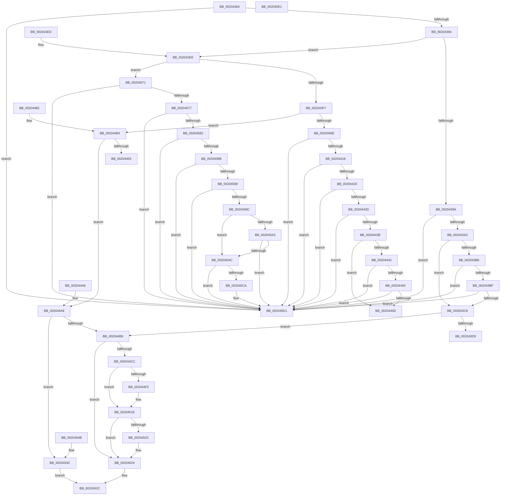

# KiSignalThreadForApc

- RVA: `0x00204360`–`0x002045E2` (길이 `642` bytes)
- VA: `0x0000000140204360`
- 실행 섹션: `.text`
- PDB 이름 있음: `예`; PDB Function 태그: `아니요`
- unwind 정보 RVA: `0x0005CB70`
- 디코드: `161`개 명령, `642/642` bytes 표시
- 미해석 바이트: `0` (있으면 어셈블리에 `.byte`로 보존)

> 이 문서는 커널 이미지의 기계어와 PDB 기호를 분석해 생성했습니다. 4번과 5번은 함수 원형과 자료형을 바이너리 사용 방식에서 추정한 C 해석이며 원본 소스 복구 결과는 아닙니다.

## 1. Dependencies

- 직접 호출 지점: **5**; 고유 호출 대상: **4**
- 직접 호출자로 확인된 함수: **9**
- RIP 상대 이미지 참조: **1**

### Outgoing calls
- `0x00204469` → [KiSignalThread](../21/KiSignalThread_function_0021F9E0.md) (function, `0x0021F9E0`)
- `0x00204493` → [KiRequestApcInterruptSynchronously](../5C/KiRequestApcInterruptSynchronously_function_005C47CC.md) (function, `0x005C47CC`)
- `0x002044D5` → [HalpDisableInterrupts](../25/HalpDisableInterrupts_function_002521A0.md) (function, `0x002521A0`)
- `0x00204536` → [HalpInterruptSendIpi](../25/HalpInterruptSendIpi_function_00252310.md) (function, `0x00252310`)
- `0x002045C1` → [KiSignalThread](../21/KiSignalThread_function_0021F9E0.md) (function, `0x0021F9E0`)

### Direct callers
- [KiSchedulerApc](KiSchedulerApc_function_00202BC0.md) at `0x00202DC1`
- [KiResumeThread](KiResumeThread_function_00203644.md) at `0x0020370E`
- [KeInsertQueueApc](KeInsertQueueApc_function_00203F10.md) at `0x0020407E`
- [KiQueueTebUpdateApc](../2C/KiQueueTebUpdateApc_function_002CE3F4.md) at `0x002CE45B`
- [KiInsertDeferredPreemptionApc](../30/KiInsertDeferredPreemptionApc_function_0030A8E8.md) at `0x0030A957`
- [KiSuspendThread](../46/KiSuspendThread_function_0046B964.md) at `0x0046BC24`
- [KeRequestTerminationThread](../48/KeRequestTerminationThread_function_00489A58.md) at `0x00489AE1`
- [KeTryToInsertQueueApc](../4D/KeTryToInsertQueueApc_function_004D72B8.md) at `0x004D733A`
- [KiRequestSchedulerApcThread](../5C/KiRequestSchedulerApcThread_function_005C44E4.md) at `0x005C4544`

### Static image references
- `0x002044BE` → RVA `0x00FC6BC5` (`ALMOSTRO`; read)

## 2. Other-region calls and transfers

- 다른 실행 섹션으로 향하는 call: **0**
- 별도 외부 분기/꼬리 이동을 확인하지 못했습니다.

## 3. Assembly (complete function range)

```asm
00204360  48 89 5C 24 08                  mov qword ptr [rsp + 8], rbx
00204365  48 89 74 24 10                  mov qword ptr [rsp + 0x10], rsi
0020436A  57                              push rdi
0020436B  48 83 EC 40                     sub rsp, 0x40
0020436F  48 8B 5A 08                     mov rbx, qword ptr [rdx + 8]
00204373  41 0F B6 F0                     movzx esi, r8b
00204377  0F BE 42 50                     movsx eax, byte ptr [rdx + 0x50]
0020437B  48 8B F9                        mov rdi, rcx
0020437E  44 0F B6 5A 51                  movzx r11d, byte ptr [rdx + 0x51]
00204383  44 0F B6 93 4A 02 00 00         movzx r10d, byte ptr [rbx + 0x24a]
0020438B  41 3B C2                        cmp eax, r10d
0020438E  0F 85 3D 02 00 00               jne 0x1402045d1
00204394  48 3B 59 08                     cmp rbx, qword ptr [rcx + 8]
00204398  75 54                           jne 0x1402043ee
0020439A  45 84 DB                        test r11b, r11b
0020439D  0F 85 2E 02 00 00               jne 0x1402045d1
002043A3  8B 83 E4 01 00 00               mov eax, dword ptr [rbx + 0x1e4]
002043A9  8B C8                           mov ecx, eax
002043AB  4C 8B 42 30                     mov r8, qword ptr [rdx + 0x30]
002043AF  C1 E9 10                        shr ecx, 0x10
002043B2  85 C0                           test eax, eax
002043B4  74 12                           je 0x1402043c8
002043B6  4D 85 C0                        test r8, r8
002043B9  0F 85 12 02 00 00               jne 0x1402045d1
002043BF  66 85 C9                        test cx, cx
002043C2  0F 85 09 02 00 00               jne 0x1402045d1
002043C8  C6 83 C1 00 00 00 01            mov byte ptr [rbx + 0xc1], 1
002043CF  40 80 FE 01                     cmp sil, 1
002043D3  0F 83 E0 00 00 00               jae 0x1402044b9
002043D9  83 4B 74 40                     or dword ptr [rbx + 0x74], 0x40
002043DD  48 8B 5C 24 50                  mov rbx, qword ptr [rsp + 0x50]
002043E2  48 8B 74 24 58                  mov rsi, qword ptr [rsp + 0x58]
002043E7  48 83 C4 40                     add rsp, 0x40
002043EB  5F                              pop rdi
002043EC  C3                              ret
002043ED  CC                              int3
002043EE  45 84 DB                        test r11b, r11b
002043F1  0F 85 7A 01 00 00               jne 0x140204571
002043F7  C6 83 C1 00 00 00 01            mov byte ptr [rbx + 0xc1], 1
002043FE  F0 83 0C 24 00                  lock or dword ptr [rsp], 0
00204403  0F B6 83 84 01 00 00            movzx eax, byte ptr [rbx + 0x184]
0020440A  3C 02                           cmp al, 2
0020440C  74 75                           je 0x140204483
0020440E  41 F6 C1 01                     test r9b, 1
00204412  0F 85 B9 01 00 00               jne 0x1402045d1
00204418  3C 05                           cmp al, 5
0020441A  0F 85 B1 01 00 00               jne 0x1402045d1
00204420  44 38 9B 86 01 00 00            cmp byte ptr [rbx + 0x186], r11b
00204427  0F 85 A4 01 00 00               jne 0x1402045d1
0020442D  66 83 BB E6 01 00 00 00         cmp word ptr [rbx + 0x1e6], 0
00204435  0F 85 96 01 00 00               jne 0x1402045d1
0020443B  48 83 7A 30 00                  cmp qword ptr [rdx + 0x30], 0
00204440  74 1B                           je 0x14020445d
00204442  66 83 BB E4 01 00 00 00         cmp word ptr [rbx + 0x1e4], 0
0020444A  0F 85 81 01 00 00               jne 0x1402045d1
00204450  44 38 9B C0 00 00 00            cmp byte ptr [rbx + 0xc0], r11b
00204457  0F 85 74 01 00 00               jne 0x1402045d1
0020445D  45 33 C9                        xor r9d, r9d
00204460  41 B8 00 01 00 00               mov r8d, 0x100
00204466  48 8B D3                        mov rdx, rbx
00204469  E8 72 B5 01 00                  call 0x14021f9e0
0020446E  80 4B 70 20                     or byte ptr [rbx + 0x70], 0x20
00204472  48 8B 5C 24 50                  mov rbx, qword ptr [rsp + 0x50]
00204477  48 8B 74 24 58                  mov rsi, qword ptr [rsp + 0x58]
0020447C  48 83 C4 40                     add rsp, 0x40
00204480  5F                              pop rdi
00204481  C3                              ret
00204482  CC                              int3
00204483  8B 8B 18 02 00 00               mov ecx, dword ptr [rbx + 0x218]
00204489  0F BA F1 1F                     btr ecx, 0x1f
0020448D  41 F6 C1 02                     test r9b, 2
00204491  74 16                           je 0x1402044a9
00204493  E8 34 03 3C 00                  call 0x1405c47cc
00204498  48 8B 5C 24 50                  mov rbx, qword ptr [rsp + 0x50]
0020449D  48 8B 74 24 58                  mov rsi, qword ptr [rsp + 0x58]
002044A2  48 83 C4 40                     add rsp, 0x40
002044A6  5F                              pop rdi
002044A7  C3                              ret
002044A8  CC                              int3
002044A9  65 8B 04 25 A4 01 00 00         mov eax, dword ptr gs:[0x1a4]
002044B1  3B C1                           cmp eax, ecx
002044B3  0F 85 93 00 00 00               jne 0x14020454c
002044B9  33 C0                           xor eax, eax
002044BB  0F 57 C0                        xorps xmm0, xmm0
002044BE  38 05 01 27 DC 00               cmp byte ptr [rip + 0xdc2701], al
002044C4  F3 0F 7F 44 24 24               movdqu xmmword ptr [rsp + 0x24], xmm0
002044CA  74 58                           je 0x140204524
002044CC  65 4C 8B 04 25 20 00 00 00      mov r8, qword ptr gs:[0x20]
002044D5  E8 C6 DC 04 00                  call 0x1402521a0
002044DA  41 8B 90 A8 00 00 00            mov edx, dword ptr [r8 + 0xa8]
002044E1  44 0F B6 C8                     movzx r9d, al
002044E5  8B CA                           mov ecx, edx
002044E7  83 C9 02                        or ecx, 2
002044EA  41 89 88 A8 00 00 00            mov dword ptr [r8 + 0xa8], ecx
002044F1  85 D2                           test edx, edx
002044F3  75 29                           jne 0x14020451e
002044F5  B9 15 00 01 C0                  mov ecx, 0xc0010015
002044FA  0F 32                           rdmsr
002044FC  48 C1 E2 20                     shl rdx, 0x20
00204500  48 B9 00 00 00 00 01 00 00 00   movabs rcx, 0x100000000
0020450A  48 0B C2                        or rax, rdx
0020450D  48 0B C1                        or rax, rcx
00204510  B9 15 00 01 C0                  mov ecx, 0xc0010015
00204515  48 8B D0                        mov rdx, rax
00204518  48 C1 EA 20                     shr rdx, 0x20
0020451C  0F 30                           wrmsr
0020451E  45 84 C9                        test r9b, r9b
00204521  74 01                           je 0x140204524
00204523  FB                              sti
00204524  C7 44 24 20 05 00 00 00         mov dword ptr [rsp + 0x20], 5
0020452C  BA 1F 00 00 00                  mov edx, 0x1f
00204531  48 8D 4C 24 20                  lea rcx, [rsp + 0x20]
00204536  E8 D5 DD 04 00                  call 0x140252310
0020453B  48 8B 5C 24 50                  mov rbx, qword ptr [rsp + 0x50]
00204540  48 8B 74 24 58                  mov rsi, qword ptr [rsp + 0x58]
00204545  48 83 C4 40                     add rsp, 0x40
00204549  5F                              pop rdi
0020454A  C3                              ret
0020454B  CC                              int3
0020454C  65 48 8B 04 25 20 00 00 00      mov rax, qword ptr gs:[0x20]
00204555  48 C7 44 24 20 06 00 00 00      mov qword ptr [rsp + 0x20], 6
0020455E  89 4C 24 28                     mov dword ptr [rsp + 0x28], ecx
00204562  FF 80 D4 8E 00 00               inc dword ptr [rax + 0x8ed4]
00204568  33 C0                           xor eax, eax
0020456A  48 89 44 24 2C                  mov qword ptr [rsp + 0x2c], rax
0020456F  EB BB                           jmp 0x14020452c
00204571  41 F6 C1 01                     test r9b, 1
00204575  75 5A                           jne 0x1402045d1
00204577  0F B6 83 84 01 00 00            movzx eax, byte ptr [rbx + 0x184]
0020457E  3C 05                           cmp al, 5
00204580  75 4F                           jne 0x1402045d1
00204582  80 BB 87 01 00 00 01            cmp byte ptr [rbx + 0x187], 1
00204589  75 46                           jne 0x1402045d1
0020458B  0F B6 4B 70                     movzx ecx, byte ptr [rbx + 0x70]
0020458F  0F B6 C1                        movzx eax, cl
00204592  24 07                           and al, 7
00204594  3C 04                           cmp al, 4
00204596  74 39                           je 0x1402045d1
00204598  3C 03                           cmp al, 3
0020459A  74 35                           je 0x1402045d1
0020459C  8B 43 74                        mov eax, dword ptr [rbx + 0x74]
0020459F  A8 10                           test al, 0x10
002045A1  75 09                           jne 0x1402045ac
002045A3  F6 83 C2 00 00 00 02            test byte ptr [rbx + 0xc2], 2
002045AA  74 25                           je 0x1402045d1
002045AC  80 C9 40                        or cl, 0x40
002045AF  45 33 C9                        xor r9d, r9d
002045B2  88 4B 70                        mov byte ptr [rbx + 0x70], cl
002045B5  41 B8 C0 00 00 00               mov r8d, 0xc0
002045BB  48 8B CF                        mov rcx, rdi
002045BE  48 8B D3                        mov rdx, rbx
002045C1  E8 1A B4 01 00                  call 0x14021f9e0
002045C6  84 C0                           test al, al
002045C8  74 07                           je 0x1402045d1
002045CA  80 8B C2 00 00 00 02            or byte ptr [rbx + 0xc2], 2
002045D1  48 8B 5C 24 50                  mov rbx, qword ptr [rsp + 0x50]
002045D6  48 8B 74 24 58                  mov rsi, qword ptr [rsp + 0x58]
002045DB  48 83 C4 40                     add rsp, 0x40
002045DF  5F                              pop rdi
002045E0  C3                              ret
002045E1  CC                              int3
```

## 4. C-style interpretation (structured pseudocode)

```c
__int64 __fastcall KiSignalThreadForApc(__int64 a1, __int64 a2, unsigned __int8 a3, int a4)
{
    __int64 result;
    __int64 v_rsp;
    unsigned int v_stack_p0;
    unsigned __int64 v_stack_p10;
    unsigned int v_stack_p100;
    unsigned __int64 v_stack_p104;
    unsigned __int64 v_stack_p128;
    unsigned __int64 v_stack_p130;
    unsigned __int64 v_stack_p50;
    unsigned __int64 v_stack_p58;
    unsigned __int64 v_stack_p8;
    unsigned __int64 v_stack_p98;
    unsigned __int64 v_stack_pA0;
    unsigned int v_stack_pB0;
    unsigned __int64 v_stack_pB4;
    unsigned __int64 v_stack_pE0;
    unsigned __int64 v_stack_pE8;
    unsigned __int64 v_stack_pF8;

    v_stack_p8 = v_rbx;
    v_stack_p10 = v_rsi;
    v_rsp = (v_rsp) - (64);
    if (((unsigned int)((__int8)(*(unsigned __int8 *)(a2 + 80)))) != ((unsigned int)(*(unsigned __int8 *)(*(unsigned __int64 *)(a2 + 8) + 586)))) goto loc_002045D1;
    if ((*(unsigned __int64 *)(a2 + 8)) != (*(unsigned __int64 *)(a1 + 8))) goto loc_002043EE;
    if ((unsigned __int8)(*(unsigned __int8 *)(a2 + 81)) != 0) goto loc_002045D1;
    a1 = (unsigned int)(((unsigned int)((unsigned int)((unsigned int)(*(unsigned int *)(*(unsigned __int64 *)(a2 + 8) + 484))))) >> (16));
    if ((unsigned int)((unsigned int)(*(unsigned int *)(*(unsigned __int64 *)(a2 + 8) + 484))) == 0) goto loc_002043C8;
    if (*(unsigned __int64 *)(a2 + 48) != 0) goto loc_002045D1;
    if ((unsigned __int16)(a1) != 0) goto loc_002045D1;
loc_002043C8:
    *(unsigned __int8 *)(*(unsigned __int64 *)(a2 + 8) + 193) = 1;
    if (a3 >= 1) goto loc_002044B9;
    v_rsp = (v_rsp) + (64);
    return (unsigned int)(*(unsigned int *)(*(unsigned __int64 *)(a2 + 8) + 484));
loc_002043EE:
    if ((unsigned __int8)(*(unsigned __int8 *)(a2 + 81)) != 0) goto loc_00204571;
    *(unsigned __int8 *)(v_stack_p8 + 193) = 1;
    if (((unsigned __int8)(*(unsigned __int8 *)(v_stack_p8 + 388))) == 2) goto loc_00204483;
    if ((((unsigned __int8)(a4)) & (1)) != 0) goto loc_002045D1;
    if (((unsigned __int8)(*(unsigned __int8 *)(v_stack_p8 + 388))) != 5) goto loc_002045D1;
    if ((*(unsigned __int8 *)(v_stack_p8 + 390)) != ((unsigned __int8)(*(unsigned __int8 *)(a2 + 81)))) goto loc_002045D1;
    if ((*(unsigned __int16 *)(v_stack_p8 + 486)) != 0) goto loc_002045D1;
    if ((*(unsigned __int64 *)(a2 + 48)) == 0) goto loc_0020445D;
    if ((*(unsigned __int16 *)(v_stack_p8 + 484)) != 0) goto loc_002045D1;
    if ((*(unsigned __int8 *)(v_stack_p8 + 192)) != ((unsigned __int8)(*(unsigned __int8 *)(a2 + 81)))) goto loc_002045D1;
loc_0020445D:
    a4 = 0;
    result = KiSignalThread(a1, v_stack_p8, 256, a4);
    v_rsp = (v_rsp) + (64);
    return result;
loc_00204483:
    if (((0) & (2)) == 0) goto loc_002044A9;
    result = KiRequestApcInterruptSynchronously((unsigned int)(*(unsigned int *)(v_stack_p50 + 536)), v_stack_p8, 256, a4);
    v_rsp = (v_rsp) + (64);
    return result;
loc_002044A9:
    if (((unsigned int)((unsigned int)(*(unsigned int *)(gs_base + (0 + 420))))) != ((unsigned int)((unsigned int)(*(unsigned int *)(v_stack_p50 + 536))))) goto loc_0020454C;
loc_002044B9:
    result = 0;
    v_stack_pB4 = v_xmm0;
    if ((*(unsigned __int8 *)(v_rip + 14427905)) == 0) goto loc_00204524;
    result = HalpDisableInterrupts((unsigned int)(*(unsigned int *)(v_stack_p50 + 536)), v_stack_p8, *(unsigned __int64 *)(gs_base + (0 + 32)), a4);
    a1 = (unsigned int)(((unsigned int)((unsigned int)((unsigned int)(*(unsigned int *)(*(unsigned __int64 *)(gs_base + (0 + 32)) + 168))))) | (2));
    *(unsigned int *)(*(unsigned __int64 *)(gs_base + (0 + 32)) + 168) = (unsigned int)(a1);
    if ((unsigned int)((unsigned int)(*(unsigned int *)(*(unsigned __int64 *)(gs_base + (0 + 32)) + 168))) == 0) {
        a1 = 0xC0010015ULL;
        a2 = ((unsigned int)(*(unsigned int *)(*(unsigned __int64 *)(gs_base + (0 + 32)) + 168))) << (32);
        result = (result) | (a2);
        result = (result) | (a1);
        a1 = 0xC0010015ULL;
        a2 = result;
        a2 = (a2) >> (32);
    }
    if ((unsigned __int8)((unsigned __int8)(result)) != 0) {
    }
    v_stack_pB0 = 5;
loc_0020452C:
    result = HalpInterruptSendIpi(v_stack_pB0, 31, *(unsigned __int64 *)(gs_base + (0 + 32)), (unsigned __int8)(result));
    v_rsp = (v_rsp) + (64);
    return result;
loc_0020454C:
    v_stack_pF8 = 6;
    v_stack_p100 = (unsigned int)(v_stack_pB0);
    result = 0;
    v_stack_p104 = 0;
    goto loc_0020452C;
loc_00204571:
    if ((((unsigned __int8)((unsigned __int8)(result))) & (1)) != 0) goto loc_002045D1;
    if (((unsigned __int8)(*(unsigned __int8 *)(v_stack_pE0 + 388))) != 5) goto loc_002045D1;
    if ((*(unsigned __int8 *)(v_stack_pE0 + 391)) != 1) goto loc_002045D1;
    result = (unsigned __int8)(((unsigned __int8)(*(unsigned __int8 *)(v_stack_pE0 + 112))) & (7));
    if (((unsigned __int8)(result)) == 4) goto loc_002045D1;
    if (((unsigned __int8)(result)) == 3) goto loc_002045D1;
    if ((((unsigned __int8)((unsigned int)(*(unsigned int *)(v_stack_pE0 + 116)))) & (16)) != 0) goto loc_002045AC;
    if (((*(unsigned __int8 *)(v_stack_pE0 + 194)) & (2)) == 0) goto loc_002045D1;
loc_002045AC:
    a1 = (unsigned __int8)((*(unsigned __int8 *)(v_stack_pE0 + 112)) | (64));
    a4 = 0;
    *(unsigned __int8 *)(v_stack_pE0 + 112) = (unsigned __int8)(a1);
    result = KiSignalThread(a1, v_stack_pE0, 192, a4);
    if ((unsigned __int8)(result) != 0) {
    }
    v_rsp = (v_rsp) + (64);
    return result;
}
```

## 5. (Beta) C Style

```c
int64_t KiSignalThreadForApc(void *Arg1, void *Arg2, uint8_t Arg3, int32_t Arg4)
{
    uint8_t *arg1 = (uint8_t *)Arg1;
    uint8_t *arg2 = (uint8_t *)Arg2;

    int64_t result;
    int64_t local_rsp;
    uint32_t v_stack_p0;
    uint64_t v_stack_p10;
    uint32_t v_stack_p100;
    uint64_t v_stack_p104;
    uint64_t v_stack_p128;
    uint64_t v_stack_p130;
    uint64_t v_stack_p50;
    uint64_t v_stack_p58;
    uint64_t v_stack_p8;
    uint64_t v_stack_p98;
    uint64_t v_stack_pA0;
    uint32_t v_stack_pB0;
    uint64_t v_stack_pB4;
    uint64_t v_stack_pE0;
    uint64_t v_stack_pE8;
    uint64_t v_stack_pF8;

    v_stack_p8 = local_rbx;
    v_stack_p10 = local_rsi;
    local_rsp = (local_rsp) - (64);
    if (((uint32_t)((int8_t)(*(uint8_t *)(arg2 + 0x50)))) != ((uint32_t)(*(uint8_t *)(*(uint64_t *)(arg2 + 0x8) + 0x24A)))) goto loc_002045D1;
    if ((*(uint64_t *)(arg2 + 0x8)) != (*(uint64_t *)(arg1 + 0x8))) goto loc_002043EE;
    if ((uint8_t)(*(uint8_t *)(arg2 + 0x51)) != 0) goto loc_002045D1;
    Arg1 = (uint32_t)(((uint32_t)((uint32_t)((uint32_t)(*(uint32_t *)(*(uint64_t *)(arg2 + 0x8) + 0x1E4))))) >> (16));
    if ((uint32_t)((uint32_t)(*(uint32_t *)(*(uint64_t *)(arg2 + 0x8) + 0x1E4))) == 0) goto loc_002043C8;
    if (*(uint64_t *)(arg2 + 0x30) != 0) goto loc_002045D1;
    if ((uint16_t)(Arg1) != 0) goto loc_002045D1;
loc_002043C8:
    *(uint8_t *)(*(uint64_t *)(arg2 + 0x8) + 0xC1) = 1;
    if (Arg3 >= 1) goto loc_002044B9;
    local_rsp = (local_rsp) + (64);
    return (uint32_t)(*(uint32_t *)(*(uint64_t *)(arg2 + 0x8) + 0x1E4));
loc_002043EE:
    if ((uint8_t)(*(uint8_t *)(arg2 + 0x51)) != 0) goto loc_00204571;
    *(uint8_t *)(v_stack_p8 + 0xC1) = 1;
    if (((uint8_t)(*(uint8_t *)(v_stack_p8 + 0x184))) == 2) goto loc_00204483;
    if ((((uint8_t)(Arg4)) & (1)) != 0) goto loc_002045D1;
    if (((uint8_t)(*(uint8_t *)(v_stack_p8 + 0x184))) != 5) goto loc_002045D1;
    if ((*(uint8_t *)(v_stack_p8 + 0x186)) != ((uint8_t)(*(uint8_t *)(arg2 + 0x51)))) goto loc_002045D1;
    if ((*(uint16_t *)(v_stack_p8 + 0x1E6)) != 0) goto loc_002045D1;
    if ((*(uint64_t *)(arg2 + 0x30)) == 0) goto loc_0020445D;
    if ((*(uint16_t *)(v_stack_p8 + 0x1E4)) != 0) goto loc_002045D1;
    if ((*(uint8_t *)(v_stack_p8 + 0xC0)) != ((uint8_t)(*(uint8_t *)(arg2 + 0x51)))) goto loc_002045D1;
loc_0020445D:
    Arg4 = 0;
    result = KiSignalThread(Arg1, v_stack_p8, 256, Arg4);
    local_rsp = (local_rsp) + (64);
    return result;
loc_00204483:
    if (((0) & (2)) == 0) goto loc_002044A9;
    result = KiRequestApcInterruptSynchronously((uint32_t)(*(uint32_t *)(v_stack_p50 + 0x218)), v_stack_p8, 256, Arg4);
    local_rsp = (local_rsp) + (64);
    return result;
loc_002044A9:
    if (((uint32_t)((uint32_t)(*(uint32_t *)(gs_base + (0 + 0x1A4))))) != ((uint32_t)((uint32_t)(*(uint32_t *)(v_stack_p50 + 0x218))))) goto loc_0020454C;
loc_002044B9:
    result = 0;
    v_stack_pB4 = v_xmm0;
    if ((*(uint8_t *)(v_rip + 0xDC2701)) == 0) goto loc_00204524;
    result = HalpDisableInterrupts((uint32_t)(*(uint32_t *)(v_stack_p50 + 0x218)), v_stack_p8, *(uint64_t *)(gs_base + (0 + 0x20)), Arg4);
    Arg1 = (uint32_t)(((uint32_t)((uint32_t)((uint32_t)(*(uint32_t *)(*(uint64_t *)(gs_base + (0 + 0x20)) + 0xA8))))) | (2));
    *(uint32_t *)(*(uint64_t *)(gs_base + (0 + 0x20)) + 0xA8) = (uint32_t)(Arg1);
    if ((uint32_t)((uint32_t)(*(uint32_t *)(*(uint64_t *)(gs_base + (0 + 0x20)) + 0xA8))) == 0) {
        Arg1 = 0xC0010015ULL;
        Arg2 = ((uint32_t)(*(uint32_t *)(*(uint64_t *)(gs_base + (0 + 0x20)) + 0xA8))) << (32);
        result = (result) | (Arg2);
        result = (result) | (Arg1);
        Arg1 = 0xC0010015ULL;
        Arg2 = result;
        Arg2 = (Arg2) >> (32);
    }
    if ((uint8_t)((uint8_t)(result)) != 0) {
    }
    v_stack_pB0 = 5;
loc_0020452C:
    result = HalpInterruptSendIpi(v_stack_pB0, 31, *(uint64_t *)(gs_base + (0 + 0x20)), (uint8_t)(result));
    local_rsp = (local_rsp) + (64);
    return result;
loc_0020454C:
    v_stack_pF8 = 6;
    v_stack_p100 = (uint32_t)(v_stack_pB0);
    result = 0;
    v_stack_p104 = 0;
    goto loc_0020452C;
loc_00204571:
    if ((((uint8_t)((uint8_t)(result))) & (1)) != 0) goto loc_002045D1;
    if (((uint8_t)(*(uint8_t *)(v_stack_pE0 + 0x184))) != 5) goto loc_002045D1;
    if ((*(uint8_t *)(v_stack_pE0 + 0x187)) != 1) goto loc_002045D1;
    result = (uint8_t)(((uint8_t)(*(uint8_t *)(v_stack_pE0 + 0x70))) & (7));
    if (((uint8_t)(result)) == 4) goto loc_002045D1;
    if (((uint8_t)(result)) == 3) goto loc_002045D1;
    if ((((uint8_t)((uint32_t)(*(uint32_t *)(v_stack_pE0 + 0x74)))) & (16)) != 0) goto loc_002045AC;
    if (((*(uint8_t *)(v_stack_pE0 + 0xC2)) & (2)) == 0) goto loc_002045D1;
loc_002045AC:
    Arg1 = (uint8_t)((*(uint8_t *)(v_stack_pE0 + 0x70)) | (64));
    Arg4 = 0;
    *(uint8_t *)(v_stack_pE0 + 0x70) = (uint8_t)(Arg1);
    result = KiSignalThread(Arg1, v_stack_pE0, 192, Arg4);
    if ((uint8_t)(result) != 0) {
    }
    local_rsp = (local_rsp) + (64);
    return result;
}
```

### 관측된 메모리 오프셋

구조체 형식이 확인되지 않은 접근은 인자 기준의 오프셋으로만 기록했습니다.

| 기준 인자 | 오프셋 표현 | 폭 (bit) | 접근 |
|---|---:|---:|---|
| `Arg1` | `+ 0x8` | `64` | `R` |
| `Arg2` | `+ 0x8` | `64` | `R` |
| `Arg2` | `+ 0x30` | `64` | `R` |
| `Arg2` | `+ 0x50` | `8` | `R` |
| `Arg2` | `+ 0x51` | `8` | `R` |

## 6. Execution-region graph

[열기: 2D/3D 그래프와 함수 탐색 컨트롤 패널](../../../control-panel.html?section=text&rva=0x00204360&view=graph)

- 2D 그래프는 위에서 아래로 흐르고, 3D 그래프는 빈 공간을 드래그해 회전합니다. Shift+드래그는 이동, 휠은 확대·축소, 함수 노드 선택은 대상 보고서 이동입니다.

### Static fallback


