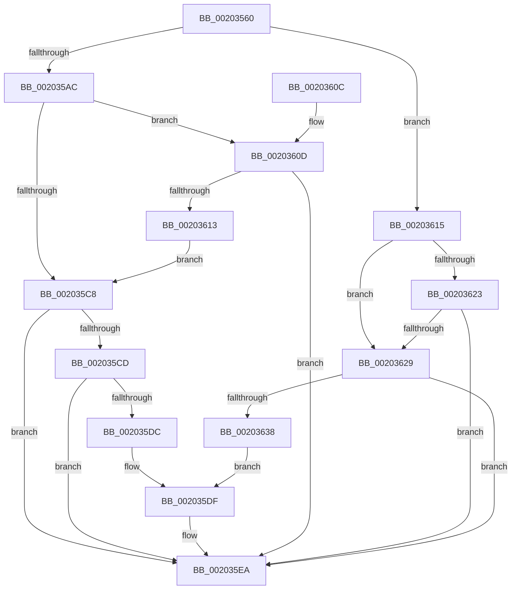

# KiThawSingleThread

- RVA: `0x00203560`–`0x0020363D` (길이 `221` bytes)
- VA: `0x0000000140203560`
- 실행 섹션: `.text`
- PDB 이름 있음: `예`; PDB Function 태그: `아니요`
- unwind 정보 RVA: `0x0005CA74`
- 디코드: `62`개 명령, `221/221` bytes 표시
- 미해석 바이트: `0` (있으면 어셈블리에 `.byte`로 보존)

> 이 문서는 커널 이미지의 기계어와 PDB 기호를 분석해 생성했습니다. 4번과 5번은 함수 원형과 자료형을 바이너리 사용 방식에서 추정한 C 해석이며 원본 소스 복구 결과는 아닙니다.

## 1. Dependencies

- 직접 호출 지점: **2**; 고유 호출 대상: **2**
- 직접 호출자로 확인된 함수: **2**
- RIP 상대 이미지 참조: **0**

### Outgoing calls
- `0x0020358F` → [KiAcquireKobjectLockSafe](../25/KiAcquireKobjectLockSafe_function_00251C90.md) (function, `0x00251C90`)
- `0x002035E5` → [KiResumeThread](KiResumeThread_function_00203644.md) (function, `0x00203644`)

### Direct callers
- [KeThawMultiProcess](KeThawMultiProcess_function_00202A04.md) at `0x00202B03`
- [KeForceResumeProcess](../3C/KeForceResumeProcess_function_003C1BE4.md) at `0x003C1CBC`

### Static image references
- 디코드된 RIP-relative 메모리 참조가 없습니다.

## 2. Other-region calls and transfers

- 다른 실행 섹션으로 향하는 call: **0**
- 별도 외부 분기/꼬리 이동을 확인하지 못했습니다.

## 3. Assembly (complete function range)

```asm
00203560  48 8B C4                        mov rax, rsp
00203563  48 89 58 08                     mov qword ptr [rax + 8], rbx
00203567  48 89 68 10                     mov qword ptr [rax + 0x10], rbp
0020356B  48 89 70 18                     mov qword ptr [rax + 0x18], rsi
0020356F  48 89 78 20                     mov qword ptr [rax + 0x20], rdi
00203573  41 56                           push r14
00203575  48 83 EC 20                     sub rsp, 0x20
00203579  48 8D B2 E0 02 00 00            lea rsi, [rdx + 0x2e0]
00203580  48 8B E9                        mov rbp, rcx
00203583  48 8B CE                        mov rcx, rsi
00203586  45 8A F1                        mov r14b, r9b
00203589  41 8A D8                        mov bl, r8b
0020358C  48 8B FA                        mov rdi, rdx
0020358F  E8 FC E6 04 00                  call 0x140251c90
00203594  44 8A 87 1A 03 00 00            mov r8b, byte ptr [rdi + 0x31a]
0020359B  41 8A D0                        mov dl, r8b
0020359E  45 8A C8                        mov r9b, r8b
002035A1  80 E2 FD                        and dl, 0xfd
002035A4  41 80 E1 02                     and r9b, 2
002035A8  84 DB                           test bl, bl
002035AA  75 69                           jne 0x140203615
002035AC  41 8A C0                        mov al, r8b
002035AF  24 FB                           and al, 0xfb
002035B1  0F B6 C8                        movzx ecx, al
002035B4  45 84 F6                        test r14b, r14b
002035B7  0F B6 C2                        movzx eax, dl
002035BA  0F 44 C8                        cmove ecx, eax
002035BD  88 8F 1A 03 00 00               mov byte ptr [rdi + 0x31a], cl
002035C3  45 84 C9                        test r9b, r9b
002035C6  74 45                           je 0x14020360d
002035C8  F6 C1 06                        test cl, 6
002035CB  75 1D                           jne 0x1402035ea
002035CD  F0 0F BA 77 78 0E               lock btr dword ptr [rdi + 0x78], 0xe
002035D3  80 BF 84 02 00 00 00            cmp byte ptr [rdi + 0x284], 0
002035DA  75 0E                           jne 0x1402035ea
002035DC  45 33 C0                        xor r8d, r8d
002035DF  48 8B D5                        mov rdx, rbp
002035E2  48 8B CF                        mov rcx, rdi
002035E5  E8 5A 00 00 00                  call 0x140203644
002035EA  F0 81 26 7F FF FF FF            lock and dword ptr [rsi], 0xffffff7f
002035F1  48 8B 5C 24 30                  mov rbx, qword ptr [rsp + 0x30]
002035F6  48 8B 6C 24 38                  mov rbp, qword ptr [rsp + 0x38]
002035FB  48 8B 74 24 40                  mov rsi, qword ptr [rsp + 0x40]
00203600  48 8B 7C 24 48                  mov rdi, qword ptr [rsp + 0x48]
00203605  48 83 C4 20                     add rsp, 0x20
00203609  41 5E                           pop r14
0020360B  C3                              ret
0020360C  CC                              int3
0020360D  41 F6 C0 04                     test r8b, 4
00203611  74 D7                           je 0x1402035ea
00203613  EB B3                           jmp 0x1402035c8
00203615  80 E2 FB                        and dl, 0xfb
00203618  88 97 1A 03 00 00               mov byte ptr [rdi + 0x31a], dl
0020361E  45 84 C9                        test r9b, r9b
00203621  75 06                           jne 0x140203629
00203623  41 F6 C0 04                     test r8b, 4
00203627  74 C1                           je 0x1402035ea
00203629  F0 0F BA 77 78 0E               lock btr dword ptr [rdi + 0x78], 0xe
0020362F  80 BF 84 02 00 00 00            cmp byte ptr [rdi + 0x284], 0
00203636  75 B2                           jne 0x1402035ea
00203638  41 B0 01                        mov r8b, 1
0020363B  EB A2                           jmp 0x1402035df
```

## 4. C-style interpretation (structured pseudocode)

```c
__int64 __fastcall KiThawSingleThread(__int64 a1, __int64 a2, unsigned __int8 a3, unsigned __int8 a4)
{
    __int64 result;
    __int64 v_rsp;
    unsigned __int64 v_stack_p10;
    unsigned __int64 v_stack_p18;
    unsigned __int64 v_stack_p20;
    unsigned __int64 v_stack_p8;

    *(unsigned __int64 *)(v_rsp + 8) = v_rbx;
    *(unsigned __int64 *)(v_rsp + 16) = v_rbp;
    *(unsigned __int64 *)(v_rsp + 24) = v_rsi;
    *(unsigned __int64 *)(v_rsp + 32) = v_rdi;
    v_rsp = (v_rsp) - (32);
    result = KiAcquireKobjectLockSafe(a2 + 736, a2, a3, a4);
    a2 = (unsigned __int8)(((unsigned __int8)(*(unsigned __int8 *)(a2 + 794))) & (253));
    a4 = (unsigned __int8)(((unsigned __int8)(*(unsigned __int8 *)(a2 + 794))) & (2));
    if (a3 != 0) goto loc_00203615;
    result = (unsigned __int8)(((unsigned __int8)(*(unsigned __int8 *)(a2 + 794))) & (251));
    a1 = (unsigned __int8)(result);
    if (a4 == 0) { a1 = (unsigned int)((unsigned __int8)(a2)); }
    *(unsigned __int8 *)(a2 + 794) = (unsigned __int8)(a1);
    if (a4 == 0) goto loc_0020360D;
loc_002035C8:
    if ((((unsigned __int8)(a1)) & (6)) != 0) goto loc_002035EA;
    if ((*(unsigned __int8 *)(a2 + 644)) != 0) goto loc_002035EA;
    a3 = 0;
loc_002035DF:
    result = KiResumeThread(a2, a1, a3, a4);
loc_002035EA:
    v_rsp = (v_rsp) + (32);
    return result;
loc_0020360D:
    if (((0) & (4)) == 0) goto loc_002035EA;
    goto loc_002035C8;
loc_00203615:
    a2 = (unsigned __int8)((a1) & (251));
    *(unsigned __int8 *)(v_stack_p20 + 794) = (unsigned __int8)(a2);
    if (a4 != 0) goto loc_00203629;
    if (((0) & (4)) == 0) goto loc_002035EA;
loc_00203629:
    if ((*(unsigned __int8 *)(v_stack_p20 + 644)) != 0) goto loc_002035EA;
    goto loc_002035DF;
}
```

## 5. (Beta) C Style

```c
int64_t KiThawSingleThread(int64_t Arg1, void *Arg2, uint8_t Arg3, uint8_t Arg4)
{
    uint8_t *arg2 = (uint8_t *)Arg2;

    int64_t result;
    int64_t local_rsp;
    uint64_t v_stack_p10;
    uint64_t v_stack_p18;
    uint64_t v_stack_p20;
    uint64_t v_stack_p8;

    *(uint64_t *)(local_rsp + 0x8) = local_rbx;
    *(uint64_t *)(local_rsp + 0x10) = local_rbp;
    *(uint64_t *)(local_rsp + 0x18) = local_rsi;
    *(uint64_t *)(local_rsp + 0x20) = local_rdi;
    local_rsp = (local_rsp) - (32);
    result = KiAcquireKobjectLockSafe(Arg2 + 736, Arg2, Arg3, Arg4);
    Arg2 = (uint8_t)(((uint8_t)(*(uint8_t *)(arg2 + 0x31A))) & (253));
    Arg4 = (uint8_t)(((uint8_t)(*(uint8_t *)(arg2 + 0x31A))) & (2));
    if (Arg3 != 0) goto loc_00203615;
    result = (uint8_t)(((uint8_t)(*(uint8_t *)(arg2 + 0x31A))) & (251));
    Arg1 = (uint8_t)(result);
    if (Arg4 == 0) { Arg1 = (uint32_t)((uint8_t)(Arg2)); }
    *(uint8_t *)(arg2 + 0x31A) = (uint8_t)(Arg1);
    if (Arg4 == 0) goto loc_0020360D;
loc_002035C8:
    if ((((uint8_t)(Arg1)) & (6)) != 0) goto loc_002035EA;
    if ((*(uint8_t *)(arg2 + 0x284)) != 0) goto loc_002035EA;
    Arg3 = 0;
loc_002035DF:
    result = KiResumeThread(Arg2, Arg1, Arg3, Arg4);
loc_002035EA:
    local_rsp = (local_rsp) + (32);
    return result;
loc_0020360D:
    if (((0) & (4)) == 0) goto loc_002035EA;
    goto loc_002035C8;
loc_00203615:
    Arg2 = (uint8_t)((Arg1) & (251));
    *(uint8_t *)(v_stack_p20 + 0x31A) = (uint8_t)(Arg2);
    if (Arg4 != 0) goto loc_00203629;
    if (((0) & (4)) == 0) goto loc_002035EA;
loc_00203629:
    if ((*(uint8_t *)(v_stack_p20 + 0x284)) != 0) goto loc_002035EA;
    goto loc_002035DF;
}
```

### 관측된 메모리 오프셋

구조체 형식이 확인되지 않은 접근은 인자 기준의 오프셋으로만 기록했습니다.

| 기준 인자 | 오프셋 표현 | 폭 (bit) | 접근 |
|---|---:|---:|---|
| `Arg2` | `+ 0x0` | `32` | `R/W` |
| `Arg2` | `+ 0x78` | `32` | `R/W` |
| `Arg2` | `+ 0x284` | `8` | `R` |
| `Arg2` | `+ 0x2E0` | `64` | `R` |
| `Arg2` | `+ 0x31A` | `8` | `R` |
| `Arg2` | `+ 0x31A` | `8` | `W` |

## 6. Execution-region graph

[열기: 2D/3D 그래프와 함수 탐색 컨트롤 패널](../../../control-panel.html?section=text&rva=0x00203560&view=graph)

- 2D 그래프는 위에서 아래로 흐르고, 3D 그래프는 빈 공간을 드래그해 회전합니다. Shift+드래그는 이동, 휠은 확대·축소, 함수 노드 선택은 대상 보고서 이동입니다.

### Static fallback


