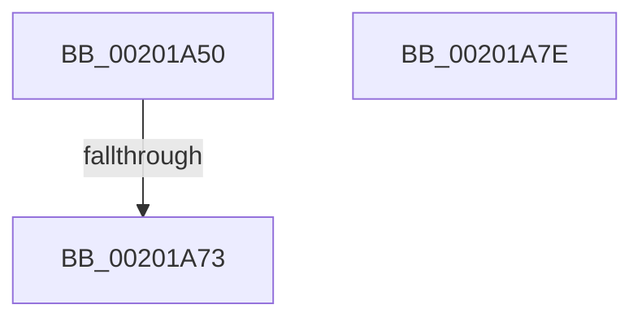

# KiUpdateSoftParkElectionStatisticsOnRemoval

- RVA: `0x00201A50`–`0x00201A7F` (길이 `47` bytes)
- VA: `0x0000000140201A50`
- 실행 섹션: `.text`
- PDB 이름 있음: `예`; PDB Function 태그: `아니요`
- unwind 정보 RVA: `0x0005C818`
- 디코드: `14`개 명령, `47/47` bytes 표시
- 미해석 바이트: `0` (있으면 어셈블리에 `.byte`로 보존)

> 이 문서는 커널 이미지의 기계어와 PDB 기호를 분석해 생성했습니다. 4번과 5번은 함수 원형과 자료형을 바이너리 사용 방식에서 추정한 C 해석이며 원본 소스 복구 결과는 아닙니다.

## 1. Dependencies

- 직접 호출 지점: **0**; 고유 호출 대상: **0**
- 직접 호출자로 확인된 함수: **7**
- RIP 상대 이미지 참조: **0**

### Outgoing calls
- 직접 디코드된 call 명령이 없습니다.

### Direct callers
- [KiFlushReadyLists](KiFlushReadyLists_function_002011E8.md) at `0x002012E0`
- [KiRemoveThreadFromAnyReadyQueue](KiRemoveThreadFromAnyReadyQueue_function_002015E4.md) at `0x00201675`
- [KiRemoveThreadFromReadyQueue](KiRemoveThreadFromReadyQueue_function_002016C8.md) at `0x0020173E`
- [KiRemoveCurrentlyEnumeratedThreadFromReadyQueue](KiRemoveCurrentlyEnumeratedThreadFromReadyQueue_function_00201790.md) at `0x00201853`
- [KiRemoveThreadFromSharedReadyQueue](KiRemoveThreadFromSharedReadyQueue_function_002019B0.md) at `0x00201A0D`
- [KiSearchForNewThreadsForRescheduleContext](../25/KiSearchForNewThreadsForRescheduleContext_function_00258620.md) at `0x00258DFA`
- [KiSearchForNewThreadsForRescheduleContext](../25/KiSearchForNewThreadsForRescheduleContext_function_00258620.md) at `0x00259184`
- [KiAttemptToScheduleThreadToBusyIsolationUnit](../25/KiAttemptToScheduleThreadToBusyIsolationUnit_function_00259B00.md) at `0x0025AA2E`

### Static image references
- 디코드된 RIP-relative 메모리 참조가 없습니다.

## 2. Other-region calls and transfers

- 다른 실행 섹션으로 향하는 call: **0**
- call이 아닌 외부 분기/꼬리 이동: **1**
  - `0x00201A71` → [sub_00201A7F](Unknown_function_00201A7F.md) (`tail-transfer`)

## 3. Assembly (complete function range)

```asm
00201A50  48 89 74 24 18                  mov qword ptr [rsp + 0x18], rsi
00201A55  57                              push rdi
00201A56  48 83 EC 20                     sub rsp, 0x20
00201A5A  48 8B 81 08 03 00 00            mov rax, qword ptr [rcx + 0x308]
00201A61  45 32 C9                        xor r9b, r9b
00201A64  48 8B F2                        mov rsi, rdx
00201A67  48 8B F9                        mov rdi, rcx
00201A6A  48 39 82 00 07 00 00            cmp qword ptr [rdx + 0x700], rax
00201A71  74 0C                           je 0x140201a7f
00201A73  48 8B 74 24 40                  mov rsi, qword ptr [rsp + 0x40]
00201A78  48 83 C4 20                     add rsp, 0x20
00201A7C  5F                              pop rdi
00201A7D  C3                              ret
00201A7E  CC                              int3
```

## 4. C-style interpretation (structured pseudocode)

```c
__int64 __fastcall KiUpdateSoftParkElectionStatisticsOnRemoval(__int64 a1, __int64 a2, __int64 a3, unsigned __int8 a4)
{
    __int64 v_rsp;
    unsigned __int64 v_stack_p18;

    v_stack_p18 = v_rsi;
    v_rsp = (v_rsp) - (32);
    a4 = 0;
    v_rsp = (v_rsp) + (32);
    return *(unsigned __int64 *)(a1 + 776);
}
```

## 5. (Beta) C Style

```c
int64_t KiUpdateSoftParkElectionStatisticsOnRemoval(void *Arg1, void *Arg2, int64_t Arg3, uint8_t Arg4)
{
    uint8_t *arg1 = (uint8_t *)Arg1;
    uint8_t *arg2 = (uint8_t *)Arg2;

    int64_t local_rsp;
    uint64_t v_stack_p18;

    v_stack_p18 = local_rsi;
    local_rsp = (local_rsp) - (32);
    Arg4 = 0;
    local_rsp = (local_rsp) + (32);
    return *(uint64_t *)(arg1 + 0x308);
}
```

### 관측된 메모리 오프셋

구조체 형식이 확인되지 않은 접근은 인자 기준의 오프셋으로만 기록했습니다.

| 기준 인자 | 오프셋 표현 | 폭 (bit) | 접근 |
|---|---:|---:|---|
| `Arg1` | `+ 0x308` | `64` | `R` |
| `Arg2` | `+ 0x700` | `64` | `R` |

## 6. Execution-region graph

[열기: 2D/3D 그래프와 함수 탐색 컨트롤 패널](../../../control-panel.html?section=text&rva=0x00201A50&view=graph)

- 2D 그래프는 위에서 아래로 흐르고, 3D 그래프는 빈 공간을 드래그해 회전합니다. Shift+드래그는 이동, 휠은 확대·축소, 함수 노드 선택은 대상 보고서 이동입니다.

### Static fallback


