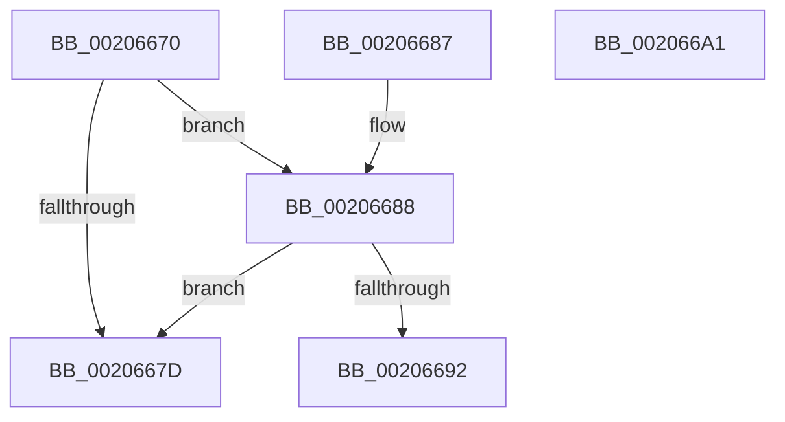

# KxReleaseSpinLock

- RVA: `0x00206670`–`0x002066A2` (길이 `50` bytes)
- VA: `0x0000000140206670`
- 실행 섹션: `.text`
- PDB 이름 있음: `예`; PDB Function 태그: `아니요`
- unwind 정보 RVA: `0x0005CF0C`
- 디코드: `15`개 명령, `50/50` bytes 표시
- 미해석 바이트: `0` (있으면 어셈블리에 `.byte`로 보존)

> 이 문서는 커널 이미지의 기계어와 PDB 기호를 분석해 생성했습니다. 4번과 5번은 함수 원형과 자료형을 바이너리 사용 방식에서 추정한 C 해석이며 원본 소스 복구 결과는 아닙니다.

## 1. Dependencies

- 직접 호출 지점: **1**; 고유 호출 대상: **1**
- 직접 호출자로 확인된 함수: **195**
- RIP 상대 이미지 참조: **2**

### Outgoing calls
- `0x00206697` → [KiReleaseSpinLockInstrumented](../39/KiReleaseSpinLockInstrumented_function_00392EF0.md) (function, `0x00392EF0`)

### Direct callers
- [PpmIdleSnapConcurrency](PpmIdleSnapConcurrency_function_00204694.md) at `0x0020470C`
- [sub_00204795](Unknown_function_00204795.md) at `0x00204851`
- [sub_00206865](Unknown_function_00206865.md) at `0x00206979`
- [KiRcuReportQuiescentState](KiRcuReportQuiescentState_function_0020AB8C.md) at `0x0020AC86`
- [KiRcuReportQuiescentState](KiRcuReportQuiescentState_function_0020AB8C.md) at `0x0020ACA1`
- [KiRcuFlushCompleted](KiRcuFlushCompleted_function_0020AD38.md) at `0x0020AE63`
- [sub_00211104](../21/Unknown_function_00211104.md) at `0x0021123C`
- [ExpAcquireFastResourceSharedSlow](../21/ExpAcquireFastResourceSharedSlow_function_00211260.md) at `0x00211B4D`
- [ExpAcquireFastResourceSharedSlow](../21/ExpAcquireFastResourceSharedSlow_function_00211260.md) at `0x00211B8F`
- [sub_00211E87](../21/Unknown_function_00211E87.md) at `0x00211F8D`
- [sub_002142F9](../21/Unknown_function_002142F9.md) at `0x00214CDE`
- [sub_00215166](../21/Unknown_function_00215166.md) at `0x00215B0F`
- [IoBoostThreadIoPriority](../21/IoBoostThreadIoPriority_function_00216110.md) at `0x002161B3`
- [sub_00218E7C](../21/Unknown_function_00218E7C.md) at `0x00218EEE`
- [KiUpdateVpBackingThreadPriorityOnReadyQueueInsertion](../21/KiUpdateVpBackingThreadPriorityOnReadyQueueInsertion_function_0021D360.md) at `0x0021D3E6`
- [ExRemoveVirtualizedTimer](../22/ExRemoveVirtualizedTimer_function_0022FCEC.md) at `0x0022FD3A`
- [PsRemoveVirtualizedTimer](../23/PsRemoveVirtualizedTimer_function_00230B5C.md) at `0x00230B94`
- [PsRemoveVirtualizedTimer](../23/PsRemoveVirtualizedTimer_function_00230B5C.md) at `0x00230BE6`
- [PsRemoveVirtualizedTimer](../23/PsRemoveVirtualizedTimer_function_00230B5C.md) at `0x00230BEE`
- [ExpSetTimerObject](../23/ExpSetTimerObject_function_00231730.md) at `0x00231986`
- [ExpSetTimerObject](../23/ExpSetTimerObject_function_00231730.md) at `0x0023199B`
- [ExpSetTimerObject](../23/ExpSetTimerObject_function_00231730.md) at `0x00232484`
- [ExpCancelTimer](../23/ExpCancelTimer_function_00232700.md) at `0x0023277A`
- [KiExecuteAllDpcs](../25/KiExecuteAllDpcs_function_0025B740.md) at `0x0025C0DE`
- [PopFxNextParentRelationSafe](../26/PopFxNextParentRelationSafe_function_0026EAC0.md) at `0x0026EB37`
- [PopFxNextParentRelationSafe](../26/PopFxNextParentRelationSafe_function_0026EAC0.md) at `0x0026EB80`
- [sub_002BD95A](../2B/Unknown_function_002BD95A.md) at `0x002BDBEA`
- [PopFxUpdateComponentAccountingEnhanced](../2B/PopFxUpdateComponentAccountingEnhanced_function_002BE924.md) at `0x002BE966`
- [PopFxActivateComponentDependents](../2B/PopFxActivateComponentDependents_function_002BE9F0.md) at `0x002BEBBC`
- [PopFxActivateComponentDependents](../2B/PopFxActivateComponentDependents_function_002BE9F0.md) at `0x002BECF3`
- [PopFxActivateComponentDependents](../2B/PopFxActivateComponentDependents_function_002BE9F0.md) at `0x002BEE30`
- [PopPepCompleteComponentIdleStateChangeActivity](../2B/PopPepCompleteComponentIdleStateChangeActivity_function_002BF1B0.md) at `0x002BF2B2`
- [PpmPerfSetProcessorIdle](../2C/PpmPerfSetProcessorIdle_function_002CFD7C.md) at `0x002CFEA8`
- [HalpReleaseHighLevelLock](../2D/HalpReleaseHighLevelLock_function_002D1C58.md) at `0x002D1C61`
- [HalpMaskInterrupt](../2D/HalpMaskInterrupt_function_002D1DB0.md) at `0x002D1E67`
- [HalpUnmaskInterrupt](../2D/HalpUnmaskInterrupt_function_002D1EE0.md) at `0x002D1FC6`
- [HalpFindSecondaryIcEntry](../2D/HalpFindSecondaryIcEntry_function_002D219C.md) at `0x002D21D8`
- [HalpVpptAcknowledgeInterrupt](../2D/HalpVpptAcknowledgeInterrupt_function_002D2230.md) at `0x002D229D`
- [KiConfigureCpuSetSchedulingInformation](../2D/KiConfigureCpuSetSchedulingInformation_function_002D2E1C.md) at `0x002D2F5D`
- [PopFxActivateComponentDependencies](../2D/PopFxActivateComponentDependencies_function_002D9B10.md) at `0x002D9C63`
- [PopFxActivateComponentDependencies](../2D/PopFxActivateComponentDependencies_function_002D9B10.md) at `0x002D9D0F`
- [PpmPerfApplyProcessorState](../2D/PpmPerfApplyProcessorState_function_002DA4BC.md) at `0x002DA645`
- [EtwpUnlockBufferList](../2D/EtwpUnlockBufferList_function_002DFC28.md) at `0x002DFC82`
- [KiUpdateVpBackingThreadPriorityDpcRoutine](../30/KiUpdateVpBackingThreadPriorityDpcRoutine_function_00303790.md) at `0x003037D5`
- [KeCpuSetReportParkedProcessors](../30/KeCpuSetReportParkedProcessors_function_003052B0.md) at `0x00305445`
- [HalpIommuFlushDmaDomain](../30/HalpIommuFlushDmaDomain_function_003093B4.md) at `0x00309407`
- [SMKM_STORE&lt;SM_TRAITS&gt;::SmStWorkItemQueue](../31/SMKM_STORE_SM_TRAITS_SmStWorkItemQueue_function_00317A34.md) at `0x00317AF5`
- [SMKM_STORE&lt;SM_TRAITS&gt;::SmStWorkItemQueue](../31/SMKM_STORE_SM_TRAITS_SmStWorkItemQueue_function_00317A34.md) at `0x00317C3A`
- [PfSnTraceGetLogEntry](../34/PfSnTraceGetLogEntry_function_003437A0.md) at `0x00343861`
- [KeTransitionProcessorParkState](../35/KeTransitionProcessorParkState_function_003527EC.md) at `0x00352B0E`
- [WmipFindRegEntryByProviderId](../38/WmipFindRegEntryByProviderId_function_00386908.md) at `0x00386957`
- [FsRtlUninitializeFileLock](../38/FsRtlUninitializeFileLock_function_00386F50.md) at `0x00386FCD`
- [FsRtlFastUnlockSingleExclusive](../38/FsRtlFastUnlockSingleExclusive_function_0038C8E0.md) at `0x0038CA8A`
- [FsRtlFastUnlockSingleExclusive](../38/FsRtlFastUnlockSingleExclusive_function_0038C8E0.md) at `0x0038CAB8`
- [sub_0038CBC6](../38/Unknown_function_0038CBC6.md) at `0x0038CBF0`
- [sub_0038CBC6](../38/Unknown_function_0038CBC6.md) at `0x0038CE1A`
- [sub_0038CE61](../38/Unknown_function_0038CE61.md) at `0x0038CF82`
- [sub_0038CE61](../38/Unknown_function_0038CE61.md) at `0x0038CFE7`
- [sub_0038D5A3](../38/Unknown_function_0038D5A3.md) at `0x0038D5A8`
- [PopIncrementPowerSettingPendingUpdates](../38/PopIncrementPowerSettingPendingUpdates_function_0038FE38.md) at `0x0038FE92`
- [PopDeepSleepSetDisengageReason](../38/PopDeepSleepSetDisengageReason_function_0038FEC4.md) at `0x0038FF06`
- [PopDecrementPowerSettingPendingUpdates](../39/PopDecrementPowerSettingPendingUpdates_function_0039007C.md) at `0x003900C3`
- [PopDeepSleepClearDisengageReason](../39/PopDeepSleepClearDisengageReason_function_0039010C.md) at `0x00390165`
- [PopDeepSleepResiliencyPhaseAccountingUpdate](../39/PopDeepSleepResiliencyPhaseAccountingUpdate_function_003901D0.md) at `0x00390220`
- [FsRtlFastCheckLockForWrite](../39/FsRtlFastCheckLockForWrite_function_003910D0.md) at `0x00391138`
- [ExpUpdateTimerResolution](../39/ExpUpdateTimerResolution_function_003914A0.md) at `0x0039163B`
- [sub_00391AFF](../39/Unknown_function_00391AFF.md) at `0x00391B3E`
- [sub_00391D5F](../39/Unknown_function_00391D5F.md) at `0x00391DB8`
- [PpmExecutePeriodicPerfCheck](../39/PpmExecutePeriodicPerfCheck_function_0039D0CC.md) at `0x0039D1DD`
- [KeDisableTimer2](../39/KeDisableTimer2_function_0039FD58.md) at `0x0039FFE8`
- [KeCancelTimer2](../3A/KeCancelTimer2_function_003A01E0.md) at `0x003A0259`
- [KiAcquireTimer2CollectionLockIfInserted](../3A/KiAcquireTimer2CollectionLockIfInserted_function_003A1150.md) at `0x003A11BD`
- [KiTraceSetTimer2](../3A/KiTraceSetTimer2_function_003A1F28.md) at `0x003A1F9D`
- [KiInsertTimer2](../3A/KiInsertTimer2_function_003A244C.md) at `0x003A2491`
- [KiExpireTimer2](../3A/KiExpireTimer2_function_003A24E0.md) at `0x003A2842`
- [ExAcquireFastResourceSharedStarveExclusive](../3B/ExAcquireFastResourceSharedStarveExclusive_function_003BDC80.md) at `0x003BDFD2`
- [sub_003BE29A](../3B/Unknown_function_003BE29A.md) at `0x003BE2CF`
- [ExpAcquireFastResourceExclusiveSlow](../3B/ExpAcquireFastResourceExclusiveSlow_function_003BE2E0.md) at `0x003BE72E`
- [KiQueryCpuPartitionAffinityProcess](../3C/KiQueryCpuPartitionAffinityProcess_function_003C01A0.md) at `0x003C0226`
- [ExpTimerPause](../3D/ExpTimerPause_function_003D38C4.md) at `0x003D393B`
- [HalpFreeDmaChannels](../3D/HalpFreeDmaChannels_function_003D9F80.md) at `0x003DA02E`
- [HalpFreeDmaChannels](../3D/HalpFreeDmaChannels_function_003D9F80.md) at `0x003DA080`
- [HalpDmaControllerQueryMaxFragments](../3D/HalpDmaControllerQueryMaxFragments_function_003DA0C0.md) at `0x003DA161`
- [HalpAllocateDmaChannels](../3D/HalpAllocateDmaChannels_function_003DA3C8.md) at `0x003DA43A`
- [HalpDmaControllerFlushChannel](../3D/HalpDmaControllerFlushChannel_function_003DB25C.md) at `0x003DB328`
- [HalpDmaControllerProgramChannel](../3D/HalpDmaControllerProgramChannel_function_003DB990.md) at `0x003DBAA8`
- [HalpDmaControllerProgramChannel](../3D/HalpDmaControllerProgramChannel_function_003DB990.md) at `0x003DBACF`
- [IopCompleteIoRingEntry](../3E/IopCompleteIoRingEntry_function_003ED2C0.md) at `0x003ED3A2`
- [EtwpTraceStackKey](../3F/EtwpTraceStackKey_function_003FC290.md) at `0x003FC607`
- [EtwpTraceStackKey](../3F/EtwpTraceStackKey_function_003FC290.md) at `0x003FC73F`
- [sub_003FD43F](../3F/Unknown_function_003FD43F.md) at `0x003FD471`
- [FsRtlPrivateFastUnlockAll](../3F/FsRtlPrivateFastUnlockAll_function_003FD554.md) at `0x003FD5B3`
- [KiInsertNewDpcRuntime](../3F/KiInsertNewDpcRuntime_function_003FE4CC.md) at `0x003FE5D9`
- [PpmParkSnapNodeStatistics](../41/PpmParkSnapNodeStatistics_function_0041419C.md) at `0x00414253`
- [ExpMoveSharedFastResourceOwnershipWithFlags](../41/ExpMoveSharedFastResourceOwnershipWithFlags_function_00415C4C.md) at `0x00415FD1`
- [ExpReleaseDisownedFastResourceShared](../41/ExpReleaseDisownedFastResourceShared_function_00416338.md) at `0x004163E6`
- [ExpReleaseDisownedFastResourceExclusive](../41/ExpReleaseDisownedFastResourceExclusive_function_00416470.md) at `0x004164F9`
- [IopCloseWaitCompletionPacket](../42/IopCloseWaitCompletionPacket_function_0042F520.md) at `0x0042F57B`
- [IopCancelWaitCompletionPacket](../42/IopCancelWaitCompletionPacket_function_0042F614.md) at `0x0042F663`
- [SMKM_STORE_MGR&lt;SM_TRAITS&gt;::SmAsyncReadQueueWorker](../43/SMKM_STORE_MGR_SM_TRAITS_SmAsyncReadQueueWorker_function_004382D0.md) at `0x004383AD`
- [PopFxDeactivateComponentDependencies](../43/PopFxDeactivateComponentDependencies_function_0043CF70.md) at `0x0043CFD1`
- [PopFxDeactivateComponentDependencies](../43/PopFxDeactivateComponentDependencies_function_0043CF70.md) at `0x0043D050`
- [PopFxDeactivateComponentDependencies](../43/PopFxDeactivateComponentDependencies_function_0043CF70.md) at `0x0043D0B4`
- [KiReleaseCpuPartitionAssignmentLock](../43/KiReleaseCpuPartitionAssignmentLock_function_0043F9C0.md) at `0x0043F9D0`
- [PpmInstallNewIdleStates](../44/PpmInstallNewIdleStates_function_00446E80.md) at `0x004471C8`
- [sub_00450C96](../45/Unknown_function_00450C96.md) at `0x00450CDB`
- [sub_00450D22](../45/Unknown_function_00450D22.md) at `0x00450D26`
- [ExNotifyWithProcessing](../45/ExNotifyWithProcessing_function_004523F4.md) at `0x0045248E`
- [IopCancelApcRequired](../45/IopCancelApcRequired_function_00456BB0.md) at `0x00456BF9`
- [IopReleaseGlobalPassiveInterruptListLock](../45/IopReleaseGlobalPassiveInterruptListLock_function_0045F5F0.md) at `0x0045F600`
- [IopReleasePassiveInterruptBlockLock](../45/IopReleasePassiveInterruptBlockLock_function_0045F62C.md) at `0x0045F639`
- [PopSetWatchdog](../46/PopSetWatchdog_function_00460CAC.md) at `0x00460EA0`
- [PsInsertVirtualizedTimer](../46/PsInsertVirtualizedTimer_function_0046C130.md) at `0x0046C19C`
- [KeIpiGenericCall](../47/KeIpiGenericCall_function_00471720.md) at `0x00471853`
- [KeRegisterBugCheckReasonCallback](../47/KeRegisterBugCheckReasonCallback_function_004720A0.md) at `0x004720FE`
- [PoNotifyMediaBuffering](../48/PoNotifyMediaBuffering_function_00481FC0.md) at `0x00481FF9`
- [KiDpcRuntimeHistoryHashTableCleanupDpcRoutine](../48/KiDpcRuntimeHistoryHashTableCleanupDpcRoutine_function_00482F60.md) at `0x0048305B`
- [PpmIdleUpdateConcurrency](../48/PpmIdleUpdateConcurrency_function_004854C0.md) at `0x0048551E`
- [PfSnTraceTimerRoutine](../48/PfSnTraceTimerRoutine_function_0048AEC0.md) at `0x0048AFEB`
- [CcPerformReadAhead](../48/CcPerformReadAhead_function_0048F738.md) at `0x0048F99F`
- [CcPerformReadAhead](../48/CcPerformReadAhead_function_0048F738.md) at `0x0048FCCF`
- [KiIdealProcessorRebalancerTimerCallback](../49/KiIdealProcessorRebalancerTimerCallback_function_004951C0.md) at `0x004951F3`
- [ExpTimerApcRoutine](../49/ExpTimerApcRoutine_function_0049A5E0.md) at `0x0049A6A0`
- [IopQueueInvalidateBusRelationsRequest](../49/IopQueueInvalidateBusRelationsRequest_function_0049E28C.md) at `0x0049E37C`
- [PpmIdleSnapConcurrencyIdleTime](../4A/PpmIdleSnapConcurrencyIdleTime_function_004A0BD4.md) at `0x004A0C46`
- [ExpTimerDpcRoutine](../4A/ExpTimerDpcRoutine_function_004A1570.md) at `0x004A160B`
- [ExDisownFastResource](../4A/ExDisownFastResource_function_004A2C10.md) at `0x004A2D86`
- [PopDeepSleepResiliencyPhaseAccountingBegin](../4A/PopDeepSleepResiliencyPhaseAccountingBegin_function_004A72B4.md) at `0x004A7345`
- [CmpLazyFlushDpcRoutine](../4A/CmpLazyFlushDpcRoutine_function_004A8900.md) at `0x004A8978`
- [HalConfigureAdapterChannel](../4A/HalConfigureAdapterChannel_function_004AB140.md) at `0x004AB1D6`
- [KeDeregisterBugCheckReasonCallback](../4A/KeDeregisterBugCheckReasonCallback_function_004AB240.md) at `0x004AB2B8`
- [PopPepUpdateDripsDeviceVetoMask](../4B/PopPepUpdateDripsDeviceVetoMask_function_004B079C.md) at `0x004B08B1`
- [HalpDmaControllerReadDmaCounter](../4B/HalpDmaControllerReadDmaCounter_function_004BF470.md) at `0x004BF50A`
- [HalpIommuTraceFault](../4C/HalpIommuTraceFault_function_004C031C.md) at `0x004C03B4`
- [KiProcessPendingForegroundBoosts](../4C/KiProcessPendingForegroundBoosts_function_004C5A80.md) at `0x004C5B2D`
- [ExWakeTimersPause](../4C/ExWakeTimersPause_function_004C6EB4.md) at `0x004C6F63`
- [KeRegisterBugCheckCallback](../4C/KeRegisterBugCheckCallback_function_004C8530.md) at `0x004C85F3`
- [PopPepInitializeVetoMasks](../4C/PopPepInitializeVetoMasks_function_004C9350.md) at `0x004C9634`
- [PopPepInitializeVetoMasks](../4C/PopPepInitializeVetoMasks_function_004C9350.md) at `0x004C97CD`
- [PopFxBeginDeviceIRPhaseAccounting](../4C/PopFxBeginDeviceIRPhaseAccounting_function_004CDD80.md) at `0x004CDDC6`
- [PiDrvDbUnloadNodeDpcRoutine](../4C/PiDrvDbUnloadNodeDpcRoutine_function_004CFF40.md) at `0x004CFF93`
- [PpmInstallFeedbackCounters](../4D/PpmInstallFeedbackCounters_function_004D477C.md) at `0x004D48BC`
- [FsRtlPrivateCancelFileLockIrp](../4D/FsRtlPrivateCancelFileLockIrp_function_004D4B70.md) at `0x004D4BF4`
- [KdPowerTransitionEx](../4D/KdPowerTransitionEx_function_004D9150.md) at `0x004D9299`
- [PspSetProcessFreezeStateCallback](../4E/PspSetProcessFreezeStateCallback_function_004E98E0.md) at `0x004E99C8`
- [KeThawExecution](../4F/KeThawExecution_function_004F5240.md) at `0x004F52BB`
- [KeThawExecution](../4F/KeThawExecution_function_004F5240.md) at `0x004F52CC`
- [KiReleaseCpuPartitionLock](../4F/KiReleaseCpuPartitionLock_function_004F54FC.md) at `0x004F5509`
- [HalpHandleMachineCheck](../54/HalpHandleMachineCheck_function_005413C8.md) at `0x00541446`
- [HalpMceHandlerCore](../54/HalpMceHandlerCore_function_00542038.md) at `0x005421A6`
- [HalpMceHandlerCore](../54/HalpMceHandlerCore_function_00542038.md) at `0x005421BA`
- [HalpAddAdapterToSystemList](../55/HalpAddAdapterToSystemList_function_00553FE0.md) at `0x00554054`
- [HalpDmaControllerCancelTransfer](../55/HalpDmaControllerCancelTransfer_function_00554090.md) at `0x0055414F`
- [HalpDmaControllerValidateRequestLineBinding](../55/HalpDmaControllerValidateRequestLineBinding_function_00554274.md) at `0x005542FD`
- [HalpDmaRemoveAdapterFromChannelQueue](../55/HalpDmaRemoveAdapterFromChannelQueue_function_00554374.md) at `0x0055441E`
- [HalpFindAdapterByRequestLine](../55/HalpFindAdapterByRequestLine_function_00554460.md) at `0x005544CF`
- [HalpReadWriteWheaPhysicalMemory](../56/HalpReadWriteWheaPhysicalMemory_function_005648B0.md) at `0x005649EB`
- [IommuBeginDeviceReset](../56/IommuBeginDeviceReset_function_00564A60.md) at `0x00564B3C`
- [IommuDisableDevicePasid](../56/IommuDisableDevicePasid_function_00564E80.md) at `0x00565081`
- [IommuDisableDevicePasid](../56/IommuDisableDevicePasid_function_00564E80.md) at `0x0056508B`
- [IommuDisableDevicePasid](../56/IommuDisableDevicePasid_function_00564E80.md) at `0x005650DC`
- [IommuEnableDevicePasid](../56/IommuEnableDevicePasid_function_00565150.md) at `0x005653A7`
- [IommuEnableDevicePasid](../56/IommuEnableDevicePasid_function_00565150.md) at `0x005653B0`
- [IommuFinalizeDeviceReset](../56/IommuFinalizeDeviceReset_function_005653F0.md) at `0x0056550D`
- [IommuFinalizeDeviceReset](../56/IommuFinalizeDeviceReset_function_005653F0.md) at `0x0056553A`
- [IommuFlushAllPasid](../56/IommuFlushAllPasid_function_005655C0.md) at `0x00565660`
- [IommuFlushTb](../56/IommuFlushTb_function_005656B0.md) at `0x0056576A`
- [IommuProcessPageRequestQueue](../56/IommuProcessPageRequestQueue_function_00565BA0.md) at `0x00565D6A`
- [IommuSetAddressSpace](../56/IommuSetAddressSpace_function_00566060.md) at `0x005661B4`
- [IommupMapDeviceInternal](../56/IommupMapDeviceInternal_function_00566478.md) at `0x00566787`
- [IommupUnmapDeviceInternal](../56/IommupUnmapDeviceInternal_function_005667D8.md) at `0x00566928`
- [IommuDomainAttachDevice](../56/IommuDomainAttachDevice_function_00567960.md) at `0x00567AE9`
- [IommuDomainAttachDeviceEx](../56/IommuDomainAttachDeviceEx_function_00567B60.md) at `0x00567D06`
- [IommuDomainDetachDevice](../56/IommuDomainDetachDevice_function_00567D40.md) at `0x00567DF1`
- [IommuSetDeviceFaultReporting](../56/IommuSetDeviceFaultReporting_function_00568540.md) at `0x005685E1`
- [IommupFindAndPopCachedDevice](../56/IommupFindAndPopCachedDevice_function_005688DC.md) at `0x00568979`
- [IvtHandleInterrupt](../56/IvtHandleInterrupt_function_0056FF00.md) at `0x0057012F`
- [BvgaReleaseLock](../59/BvgaReleaseLock_function_00591690.md) at `0x005916A4`
- [IopLiveDumpGetCapturePages](../59/IopLiveDumpGetCapturePages_function_0059C254.md) at `0x0059C31D`
- [KdDisableDebuggerWithLock](../5B/KdDisableDebuggerWithLock_function_005B0918.md) at `0x005B099C`
- [KdDisableDebuggerWithLock](../5B/KdDisableDebuggerWithLock_function_005B0918.md) at `0x005B0A01`
- [KdEnableDebuggerWithLock](../5B/KdEnableDebuggerWithLock_function_005B0A7C.md) at `0x005B0AF3`
- [KdEnableDebuggerWithLock](../5B/KdEnableDebuggerWithLock_function_005B0A7C.md) at `0x005B0BA0`
- [KdReleaseDebuggerLock](../5B/KdReleaseDebuggerLock_function_005B0BE0.md) at `0x005B0BF0`
- [KeDeregisterBugCheckCallback](../5B/KeDeregisterBugCheckCallback_function_005B37D0.md) at `0x005B383C`
- [KiProcessNMI](../5B/KiProcessNMI_function_005B8950.md) at `0x005B8A5E`
- [KeReleaseSpinLockForDpc](../5B/KeReleaseSpinLockForDpc_function_005BD5D0.md) at `0x005BD5F2`
- [KiReleaseSecondarySignalListLock](../5B/KiReleaseSecondarySignalListLock_function_005BDAE8.md) at `0x005BDAF8`
- [KeEnumerateProcessorDpcs](../5B/KeEnumerateProcessorDpcs_function_005BE1AC.md) at `0x005BE237`
- [KeCpuPartitionMoveCpus](../5C/KeCpuPartitionMoveCpus_function_005C0B70.md) at `0x005C0C6B`
- [KeCpuPartitionMoveCpus](../5C/KeCpuPartitionMoveCpus_function_005C0B70.md) at `0x005C0CB8`
- [KeCpuPartitionMoveCpus](../5C/KeCpuPartitionMoveCpus_function_005C0B70.md) at `0x005C0D6A`
- [KeCpuPartitionMoveCpus](../5C/KeCpuPartitionMoveCpus_function_005C0B70.md) at `0x005C0D9C`
- [KeSetTagCpuSets](../5C/KeSetTagCpuSets_function_005C11BC.md) at `0x005C127F`
- [KiCpuPartitionCheckAffinitization](../5C/KiCpuPartitionCheckAffinitization_function_005C1420.md) at `0x005C153A`
- [KiSrcuFlushCompleted](../5C/KiSrcuFlushCompleted_function_005C22B4.md) at `0x005C2398`
- [KiSrcuReportQuiescent](../5C/KiSrcuReportQuiescent_function_005C2C08.md) at `0x005C2D34`
- [KiSrcuReportQuiescent](../5C/KiSrcuReportQuiescent_function_005C2C08.md) at `0x005C2D5A`
- [KiEpfComplete](../5C/KiEpfComplete_function_005C4958.md) at `0x005C4A07`
- [KiEpfDrainCompletionQueue](../5C/KiEpfDrainCompletionQueue_function_005C4A6C.md) at `0x005C4AC2`
- [KiEpfStart](../5C/KiEpfStart_function_005C4B14.md) at `0x005C4C3B`
- [KiScheduleNextForegroundBoost](../5C/KiScheduleNextForegroundBoost_function_005C6670.md) at `0x005C66D9`
- [KiAcquireReleaseDpcData](../5C/KiAcquireReleaseDpcData_function_005C8404.md) at `0x005C8431`
- [PfpPowerActionDpcRoutine](../5C/PfpPowerActionDpcRoutine_function_005CDAE0.md) at `0x005CDB5A`
- [PpmRemoveIdleStates](../5D/PpmRemoveIdleStates_function_005D0730.md) at `0x005D07D5`
- [PoFxRemoveComponentRelation](../5D/PoFxRemoveComponentRelation_function_005D1C90.md) at `0x005D1E1C`
- [PoFxRemoveDeviceRelation](../5D/PoFxRemoveDeviceRelation_function_005D1EF0.md) at `0x005D204B`
- [PopFxComponentRelationsCleanup](../5D/PopFxComponentRelationsCleanup_function_005D221C.md) at `0x005D22D1`
- [PopFxComponentRelationsCleanup](../5D/PopFxComponentRelationsCleanup_function_005D221C.md) at `0x005D22DD`
- [PopFxComponentRelationsCleanup](../5D/PopFxComponentRelationsCleanup_function_005D221C.md) at `0x005D23C6`
- [PopFxComponentRelationsCleanup](../5D/PopFxComponentRelationsCleanup_function_005D221C.md) at `0x005D23D7`
- [PopFxDeviceRelationsCleanup](../5D/PopFxDeviceRelationsCleanup_function_005D2660.md) at `0x005D274D`
- [PopFxDeviceRelationsCleanup](../5D/PopFxDeviceRelationsCleanup_function_005D2660.md) at `0x005D275E`
- [PopPowerButtonTimerCallback](../5D/PopPowerButtonTimerCallback_function_005D9A00.md) at `0x005D9A52`
- [DifKeReleaseSpinLockFromDpcLevelWrapper](../63/DifKeReleaseSpinLockFromDpcLevelWrapper_function_00631C50.md) at `0x00631D16`
- [ExAcquireFastResourceWithFlags](../65/ExAcquireFastResourceWithFlags_function_00658120.md) at `0x006582A0`
- [ExAcquireFastResourceWithFlags](../65/ExAcquireFastResourceWithFlags_function_00658120.md) at `0x006585B9`
- [ExWakeTimersResume](../65/ExWakeTimersResume_function_00659270.md) at `0x0065930E`
- [ExpTimerAdjust](../65/ExpTimerAdjust_function_006593CC.md) at `0x006594CC`
- [BgfxGrowDirtyRect](../69/BgfxGrowDirtyRect_function_0069F0E0.md) at `0x0069F173`
- [CcPerformReadAhead$fin$1](../6D/CcPerformReadAhead_fin_1_function_006D3929.md) at `0x006D39E4`
- [sub_006DD630](../6D/Unknown_function_006DD630.md) at `0x006DD7D3`
- [sub_006E4D86](../6E/Unknown_function_006E4D86.md) at `0x006E4D94`
- [sub_006E5E2E](../6E/Unknown_function_006E5E2E.md) at `0x006E5EC2`
- [sub_006E9AF0](../6E/Unknown_function_006E9AF0.md) at `0x006E9B01`
- [sub_006EBEFC](../6E/Unknown_function_006EBEFC.md) at `0x006EC05E`
- [sub_006F322E](../6F/Unknown_function_006F322E.md) at `0x006F32A6`
- [KiAddCpuToSystemCpuPartition](../../pagelk/B6/KiAddCpuToSystemCpuPartition_function_00B680F0.md) at `0x00B68122`
- [KiCreateCpuSetForProcessor](../../pagelk/B6/KiCreateCpuSetForProcessor_function_00B681A0.md) at `0x00B682AF`
- [PopBroadcastBlameBugcheckCallback](../../pagelk/B7/PopBroadcastBlameBugcheckCallback_function_00B70B40.md) at `0x00B70C14`
- [ViWdBeforeCancelIrp](../../pagevrfy/BA/ViWdBeforeCancelIrp_function_00BACA68.md) at `0x00BACB57`
- [ViWdIrpBeforeCompletionRoutine](../../pagevrfy/BA/ViWdIrpBeforeCompletionRoutine_function_00BACB7C.md) at `0x00BACBDD`
- [ViWdIrpTimerDpcRoutine](../../pagevrfy/BA/ViWdIrpTimerDpcRoutine_function_00BACC10.md) at `0x00BACC7E`

### Static image references
- `0x00206674` → RVA `0x00FC6B06` (`ALMOSTRO`; read)
- `0x00206688` → RVA `0x00F0DE58` (`.data`; read)

## 2. Other-region calls and transfers

- 다른 실행 섹션으로 향하는 call: **0**
- 별도 외부 분기/꼬리 이동을 확인하지 못했습니다.

## 3. Assembly (complete function range)

```asm
00206670  48 83 EC 28                     sub rsp, 0x28
00206674  F6 05 8B 04 DC 00 01            test byte ptr [rip + 0xdc048b], 1
0020667B  75 0B                           jne 0x140206688
0020667D  F0 48 83 21 00                  lock and qword ptr [rcx], 0
00206682  48 83 C4 28                     add rsp, 0x28
00206686  C3                              ret
00206687  CC                              int3
00206688  8B 05 CA 77 D0 00               mov eax, dword ptr [rip + 0xd077ca]
0020668E  85 C0                           test eax, eax
00206690  75 EB                           jne 0x14020667d
00206692  48 8B 54 24 28                  mov rdx, qword ptr [rsp + 0x28]
00206697  E8 54 C8 18 00                  call 0x140392ef0
0020669C  48 83 C4 28                     add rsp, 0x28
002066A0  C3                              ret
002066A1  CC                              int3
```

## 4. C-style interpretation (structured pseudocode)

```c
__int64 __fastcall KxReleaseSpinLock(__int64 a1)
{
    __int64 result;
    __int64 v_rsp;
    unsigned __int64 v_stack_p28;

    v_rsp = (v_rsp) - (40);
    if (((*(unsigned __int8 *)(v_rip + 14419083)) & (1)) != 0) goto loc_00206688;
loc_0020667D:
    v_rsp = (v_rsp) + (40);
    return result;
loc_00206688:
    if ((unsigned int)((unsigned int)(*(unsigned int *)(v_rip + 13662154))) != 0) goto loc_0020667D;
    result = KiReleaseSpinLockInstrumented(a1, v_stack_p28, a3, a4);
    v_rsp = (v_rsp) + (40);
    return result;
}
```

## 5. (Beta) C Style

```c
int64_t KxReleaseSpinLock(void *Arg1)
{
    uint8_t *arg1 = (uint8_t *)Arg1;

    int64_t result;
    int64_t local_rsp;
    uint64_t v_stack_p28;

    local_rsp = (local_rsp) - (40);
    if (((*(uint8_t *)(v_rip + 0xDC048B)) & (1)) != 0) goto loc_00206688;
loc_0020667D:
    local_rsp = (local_rsp) + (40);
    return result;
loc_00206688:
    if ((uint32_t)((uint32_t)(*(uint32_t *)(v_rip + 0xD077CA))) != 0) goto loc_0020667D;
    result = KiReleaseSpinLockInstrumented(Arg1, v_stack_p28, a3, a4);
    local_rsp = (local_rsp) + (40);
    return result;
}
```

### 관측된 메모리 오프셋

구조체 형식이 확인되지 않은 접근은 인자 기준의 오프셋으로만 기록했습니다.

| 기준 인자 | 오프셋 표현 | 폭 (bit) | 접근 |
|---|---:|---:|---|
| `Arg1` | `+ 0x0` | `64` | `R/W` |

## 6. Execution-region graph

[열기: 2D/3D 그래프와 함수 탐색 컨트롤 패널](../../../control-panel.html?section=text&rva=0x00206670&view=graph)

- 2D 그래프는 위에서 아래로 흐르고, 3D 그래프는 빈 공간을 드래그해 회전합니다. Shift+드래그는 이동, 휠은 확대·축소, 함수 노드 선택은 대상 보고서 이동입니다.

### Static fallback


