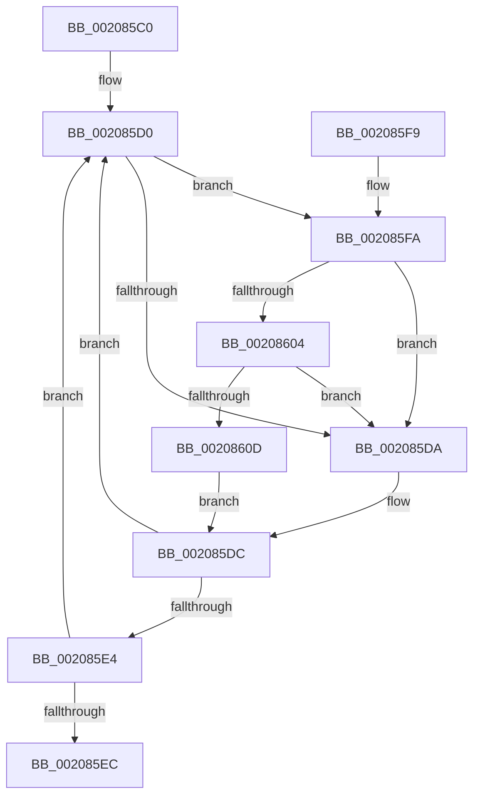

# KxWaitForSpinLockAndAcquire

- RVA: `0x002085C0`–`0x00208616` (길이 `86` bytes)
- VA: `0x00000001402085C0`
- 실행 섹션: `.text`
- PDB 이름 있음: `예`; PDB Function 태그: `아니요`
- unwind 정보 RVA: `0x0005D394`
- 디코드: `30`개 명령, `86/86` bytes 표시
- 미해석 바이트: `0` (있으면 어셈블리에 `.byte`로 보존)

> 이 문서는 커널 이미지의 기계어와 PDB 기호를 분석해 생성했습니다. 4번과 5번은 함수 원형과 자료형을 바이너리 사용 방식에서 추정한 C 해석이며 원본 소스 복구 결과는 아닙니다.

## 1. Dependencies

- 직접 호출 지점: **2**; 고유 호출 대상: **2**
- 직접 호출자로 확인된 함수: **31**
- RIP 상대 이미지 참조: **2**

### Outgoing calls
- `0x00208604` → [KiCheckVpBackingLongSpinWaitHypercall](../30/KiCheckVpBackingLongSpinWaitHypercall_function_0030F490.md) (function, `0x0030F490`)
- `0x0020860F` → [HvlNotifyLongSpinWait](../30/HvlNotifyLongSpinWait_function_0030F460.md) (function, `0x0030F460`)

### Direct callers
- [sub_00207002](Unknown_function_00207002.md) at `0x00207013`
- [sub_00207002](Unknown_function_00207002.md) at `0x0020702E`
- [sub_00207282](Unknown_function_00207282.md) at `0x00207291`
- [sub_00207480](Unknown_function_00207480.md) at `0x00207488`
- [IopQueueThreadIrp](IopQueueThreadIrp_function_002075C0.md) at `0x00207639`
- [sub_00207BA7](Unknown_function_00207BA7.md) at `0x00207BBA`
- [sub_00207D3E](Unknown_function_00207D3E.md) at `0x00207E6A`
- [KeAcquireSpinLockAtDpcLevel](KeAcquireSpinLockAtDpcLevel_function_00208430.md) at `0x0020845A`
- [KeAcquireSpinLockRaiseToDpc](KeAcquireSpinLockRaiseToDpc_function_00208470.md) at `0x002084C9`
- [KiAcquireSpinLockInstrumented](KiAcquireSpinLockInstrumented_function_002084F0.md) at `0x00208559`
- [sub_002089AC](Unknown_function_002089AC.md) at `0x00208A23`
- [IoRemoveIoCompletion](IoRemoveIoCompletion_function_0020B580.md) at `0x0020BA15`
- [ExpSetTimerObject](../23/ExpSetTimerObject_function_00231730.md) at `0x00231960`
- [ExpSetTimerObject](../23/ExpSetTimerObject_function_00231730.md) at `0x00231972`
- [ExpSetTimerObject](../23/ExpSetTimerObject_function_00231730.md) at `0x002319B2`
- [sub_00235B5D](../23/Unknown_function_00235B5D.md) at `0x00235CDF`
- [KiExecuteAllDpcs](../25/KiExecuteAllDpcs_function_0025B740.md) at `0x0025C0A9`
- [PopFxActivateComponentDependents](../2B/PopFxActivateComponentDependents_function_002BE9F0.md) at `0x002BEABD`
- [PpmUpdatePerformanceFeedback](../2D/PpmUpdatePerformanceFeedback_function_002DE580.md) at `0x002DE664`
- [EtwpApcPoolThunk](../2F/EtwpApcPoolThunk_function_002FA090.md) at `0x002FA26D`
- [sub_0034DB86](../34/Unknown_function_0034DB86.md) at `0x0034DB9D`
- [IopFreeWaitCompletionPacket](../35/IopFreeWaitCompletionPacket_function_00351A50.md) at `0x00351BC3`
- [ExpUpdateTimerResolution](../39/ExpUpdateTimerResolution_function_003914A0.md) at `0x003915ED`
- [KeSetTimer2](../3A/KeSetTimer2_function_003A08E0.md) at `0x003A0BE7`
- [KiAcquireTimer2CollectionLockIfInserted](../3A/KiAcquireTimer2CollectionLockIfInserted_function_003A1150.md) at `0x003A11AF`
- [sub_003A18D4](../3A/Unknown_function_003A18D4.md) at `0x003A1917`
- [EtwpLockBufferList](../3E/EtwpLockBufferList_function_003EB49C.md) at `0x003EB50A`
- [EtwpTraceStackKey](../3F/EtwpTraceStackKey_function_003FC290.md) at `0x003FC452`
- [ExGenRandom](../41/ExGenRandom_function_0041B010.md) at `0x0041B156`
- [sub_004314C3](../43/Unknown_function_004314C3.md) at `0x004314D4`
- [sub_004338BF](../43/Unknown_function_004338BF.md) at `0x004338CE`
- [HalpPCIAcquireConfigSpaceLock](../43/HalpPCIAcquireConfigSpaceLock_function_004394CC.md) at `0x00439539`
- [KeAcquireInterruptSpinLock](../44/KeAcquireInterruptSpinLock_function_0044B9F0.md) at `0x0044BA49`
- [BgpFwAcquireLock](../4B/BgpFwAcquireLock_function_004B3AA4.md) at `0x004B3AE4`

### Static image references
- `0x002085D2` → RVA `0x00FC52AC` (`ALMOSTRO`; reference)
- `0x002085FA` → RVA `0x00FC6AB8` (`ALMOSTRO`; read)

## 2. Other-region calls and transfers

- 다른 실행 섹션으로 향하는 call: **0**
- 별도 외부 분기/꼬리 이동을 확인하지 못했습니다.

## 3. Assembly (complete function range)

```asm
002085C0  48 89 5C 24 08                  mov qword ptr [rsp + 8], rbx
002085C5  57                              push rdi
002085C6  48 83 EC 20                     sub rsp, 0x20
002085CA  48 8B F9                        mov rdi, rcx
002085CD  33 DB                           xor ebx, ebx
002085CF  90                              nop
002085D0  FF C3                           inc ebx
002085D2  85 1D D4 CC DB 00               test dword ptr [rip + 0xdbccd4], ebx
002085D8  74 20                           je 0x1402085fa
002085DA  F3 90                           pause
002085DC  48 8B 07                        mov rax, qword ptr [rdi]
002085DF  48 85 C0                        test rax, rax
002085E2  75 EC                           jne 0x1402085d0
002085E4  F0 48 0F BA 2F 00               lock bts qword ptr [rdi], 0
002085EA  72 E4                           jb 0x1402085d0
002085EC  8B C3                           mov eax, ebx
002085EE  48 8B 5C 24 30                  mov rbx, qword ptr [rsp + 0x30]
002085F3  48 83 C4 20                     add rsp, 0x20
002085F7  5F                              pop rdi
002085F8  C3                              ret
002085F9  CC                              int3
002085FA  8B 05 B8 E4 DB 00               mov eax, dword ptr [rip + 0xdbe4b8]
00208600  A8 40                           test al, 0x40
00208602  74 D6                           je 0x1402085da
00208604  E8 87 6E 10 00                  call 0x14030f490
00208609  84 C0                           test al, al
0020860B  74 CD                           je 0x1402085da
0020860D  8B CB                           mov ecx, ebx
0020860F  E8 4C 6E 10 00                  call 0x14030f460
00208614  EB C6                           jmp 0x1402085dc
```

## 4. C-style interpretation (structured pseudocode)

```c
__int64 __fastcall KxWaitForSpinLockAndAcquire(__int64 a1)
{
    __int64 result;
    __int64 v_rbx;
    __int64 v_rsp;
    unsigned __int64 v_stack_p8;

    v_stack_p8 = v_rbx;
    v_rsp = (v_rsp) - (32);
    v_rbx = 0;
loc_002085D0:
    v_rbx = (unsigned int)((v_rbx) + 1);
    if (((*(unsigned int *)(v_rip + 14404820)) & ((unsigned int)(v_rbx))) == 0) goto loc_002085FA;
loc_002085DA:
loc_002085DC:
    if (*(unsigned __int64 *)(a1) != 0) goto loc_002085D0;
    if (condition_is_below) goto loc_002085D0;
    v_rsp = (v_rsp) + (32);
    return (unsigned int)((unsigned int)(v_rbx));
loc_002085FA:
    if ((((unsigned __int8)((unsigned int)(*(unsigned int *)(v_rip + 14410936)))) & (64)) == 0) goto loc_002085DA;
    result = KiCheckVpBackingLongSpinWaitHypercall(a1, a2, a3, a4);
    if ((unsigned __int8)(result) == 0) goto loc_002085DA;
    result = HvlNotifyLongSpinWait((unsigned int)((unsigned int)(v_stack_p8)), a2, a3, a4);
    goto loc_002085DC;
}
```

## 5. (Beta) C Style

```c
int64_t KxWaitForSpinLockAndAcquire(void *Arg1)
{
    uint8_t *arg1 = (uint8_t *)Arg1;

    int64_t result;
    int64_t local_rbx;
    int64_t local_rsp;
    uint64_t v_stack_p8;

    v_stack_p8 = local_rbx;
    local_rsp = (local_rsp) - (32);
    local_rbx = 0;
loc_002085D0:
    local_rbx = (uint32_t)((local_rbx) + 1);
    if (((*(uint32_t *)(v_rip + 0xDBCCD4)) & ((uint32_t)(local_rbx))) == 0) goto loc_002085FA;
loc_002085DA:
loc_002085DC:
    if (*(uint64_t *)(arg1) != 0) goto loc_002085D0;
    if (condition_is_below) goto loc_002085D0;
    local_rsp = (local_rsp) + (32);
    return (uint32_t)((uint32_t)(local_rbx));
loc_002085FA:
    if ((((uint8_t)((uint32_t)(*(uint32_t *)(v_rip + 0xDBE4B8)))) & (64)) == 0) goto loc_002085DA;
    result = KiCheckVpBackingLongSpinWaitHypercall(Arg1, a2, a3, a4);
    if ((uint8_t)(result) == 0) goto loc_002085DA;
    result = HvlNotifyLongSpinWait((uint32_t)((uint32_t)(v_stack_p8)), a2, a3, a4);
    goto loc_002085DC;
}
```

### 관측된 메모리 오프셋

구조체 형식이 확인되지 않은 접근은 인자 기준의 오프셋으로만 기록했습니다.

| 기준 인자 | 오프셋 표현 | 폭 (bit) | 접근 |
|---|---:|---:|---|
| `Arg1` | `+ 0x0` | `64` | `R` |
| `Arg1` | `+ 0x0` | `64` | `R/W` |

## 6. Execution-region graph

[열기: 2D/3D 그래프와 함수 탐색 컨트롤 패널](../../../control-panel.html?section=text&rva=0x002085C0&view=graph)

- 2D 그래프는 위에서 아래로 흐르고, 3D 그래프는 빈 공간을 드래그해 회전합니다. Shift+드래그는 이동, 휠은 확대·축소, 함수 노드 선택은 대상 보고서 이동입니다.

### Static fallback


