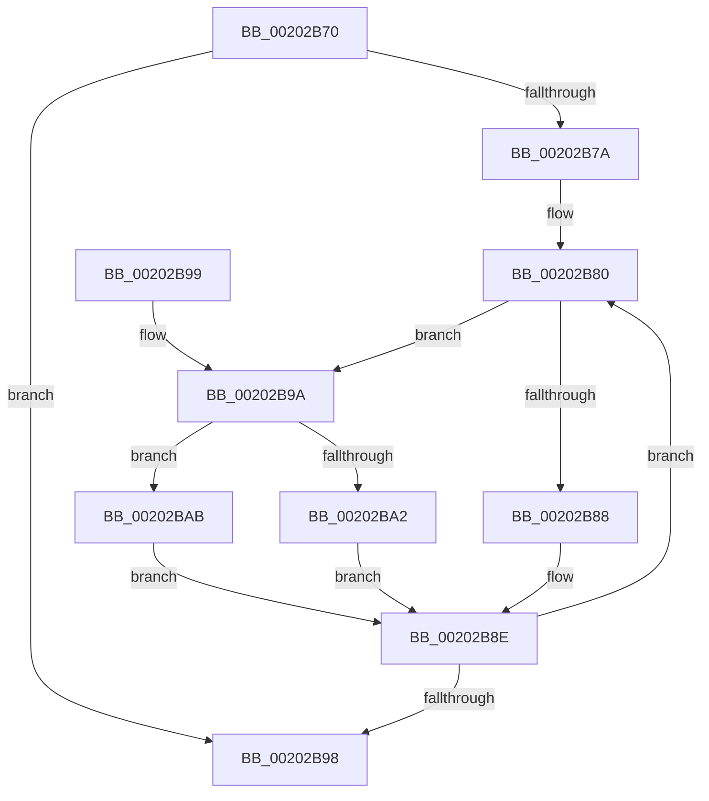

# KzReleaseAdditionalPrcbLocks

- RVA: `0x00202B70`–`0x00202BB1` (길이 `65` bytes)
- VA: `0x0000000140202B70`
- 실행 섹션: `.text`
- PDB 이름 있음: `예`; PDB Function 태그: `아니요`
- unwind 정보 RVA: `0x000DB714`
- 디코드: `22`개 명령, `65/65` bytes 표시
- 미해석 바이트: `0` (있으면 어셈블리에 `.byte`로 보존)

> 이 문서는 커널 이미지의 기계어와 PDB 기호를 분석해 생성했습니다. 4번과 5번은 함수 원형과 자료형을 바이너리 사용 방식에서 추정한 C 해석이며 원본 소스 복구 결과는 아닙니다.

## 1. Dependencies

- 직접 호출 지점: **0**; 고유 호출 대상: **0**
- 직접 호출자로 확인된 함수: **3**
- RIP 상대 이미지 참조: **0**

### Outgoing calls
- 직접 디코드된 call 명령이 없습니다.

### Direct callers
- [KiHandleDeferredPreemption](KiHandleDeferredPreemption_function_00202ECC.md) at `0x00202F85`
- [KeYieldExecution](KeYieldExecution_function_00209FA0.md) at `0x0020A0E7`
- [KiTryUpgradeIsolationUnitLockHandle](../5B/KiTryUpgradeIsolationUnitLockHandle_function_005B23E0.md) at `0x005B24B8`

### Static image references
- 디코드된 RIP-relative 메모리 참조가 없습니다.

## 2. Other-region calls and transfers

- 다른 실행 섹션으로 향하는 call: **0**
- 별도 외부 분기/꼬리 이동을 확인하지 못했습니다.

## 3. Assembly (complete function range)

```asm
00202B70  4D 8B 10                        mov r10, qword ptr [r8]
00202B73  45 33 DB                        xor r11d, r11d
00202B76  85 D2                           test edx, edx
00202B78  74 1E                           je 0x140202b98
00202B7A  8B D2                           mov edx, edx
00202B7C  0F 1F 40 00                     nop dword ptr [rax]
00202B80  48 8B 01                        mov rax, qword ptr [rcx]
00202B83  4C 3B D0                        cmp r10, rax
00202B86  74 12                           je 0x140202b9a
00202B88  F0 48 83 60 30 00               lock and qword ptr [rax + 0x30], 0
00202B8E  48 83 C1 08                     add rcx, 8
00202B92  48 83 EA 01                     sub rdx, 1
00202B96  75 E8                           jne 0x140202b80
00202B98  C3                              ret
00202B99  CC                              int3
00202B9A  41 FF C3                        inc r11d
00202B9D  45 3B D9                        cmp r11d, r9d
00202BA0  75 09                           jne 0x140202bab
00202BA2  49 C7 C2 FF FF FF FF            mov r10, 0xffffffffffffffff
00202BA9  EB E3                           jmp 0x140202b8e
00202BAB  4F 8B 14 D8                     mov r10, qword ptr [r8 + r11*8]
00202BAF  EB DD                           jmp 0x140202b8e
```

## 4. C-style interpretation (structured pseudocode)

```c
__int64 __fastcall KzReleaseAdditionalPrcbLocks(__int64 a1, int a2, __int64 a3, int a4)
{
    __int64 v_r11;

    v_r11 = 0;
    if (a2 == 0) goto loc_00202B98;
loc_00202B80:
    if ((*(unsigned __int64 *)(a3)) == (*(unsigned __int64 *)(a1))) goto loc_00202B9A;
loc_00202B8E:
    a1 = (a1) + (8);
    a2 = ((unsigned int)(a2)) - (1);
    if (condition_is_not_equal) goto loc_00202B80;
loc_00202B98:
    return *(unsigned __int64 *)(a1);
loc_00202B9A:
    v_r11 = (unsigned int)((v_r11) + 1);
    if (((unsigned int)(v_r11)) != a4) goto loc_00202BAB;
    goto loc_00202B8E;
loc_00202BAB:
    goto loc_00202B8E;
}
```

## 5. (Beta) C Style

```c
int64_t KzReleaseAdditionalPrcbLocks(void *Arg1, int32_t Arg2, void *Arg3, int32_t Arg4)
{
    uint8_t *arg1 = (uint8_t *)Arg1;
    uint8_t *arg3 = (uint8_t *)Arg3;

    int64_t local_r11;

    local_r11 = 0;
    if (Arg2 == 0) goto loc_00202B98;
loc_00202B80:
    if ((*(uint64_t *)(arg3)) == (*(uint64_t *)(arg1))) goto loc_00202B9A;
loc_00202B8E:
    Arg1 = (Arg1) + (8);
    Arg2 = ((uint32_t)(Arg2)) - (1);
    if (condition_is_not_equal) goto loc_00202B80;
loc_00202B98:
    return *(uint64_t *)(arg1);
loc_00202B9A:
    local_r11 = (uint32_t)((local_r11) + 1);
    if (((uint32_t)(local_r11)) != Arg4) goto loc_00202BAB;
    goto loc_00202B8E;
loc_00202BAB:
    goto loc_00202B8E;
}
```

### 관측된 메모리 오프셋

구조체 형식이 확인되지 않은 접근은 인자 기준의 오프셋으로만 기록했습니다.

| 기준 인자 | 오프셋 표현 | 폭 (bit) | 접근 |
|---|---:|---:|---|
| `Arg1` | `+ 0x0` | `64` | `R` |
| `Arg3` | `+ 0x0` | `64` | `R` |
| `Arg3` | `+ 0x0 + r11*8` | `64` | `R` |

## 6. Execution-region graph

[열기: 2D/3D 그래프와 함수 탐색 컨트롤 패널](../../../control-panel.html?section=text&rva=0x00202B70&view=graph)

- 2D 그래프는 위에서 아래로 흐르고, 3D 그래프는 빈 공간을 드래그해 회전합니다. Shift+드래그는 이동, 휠은 확대·축소, 함수 노드 선택은 대상 보고서 이동입니다.

### Static fallback


