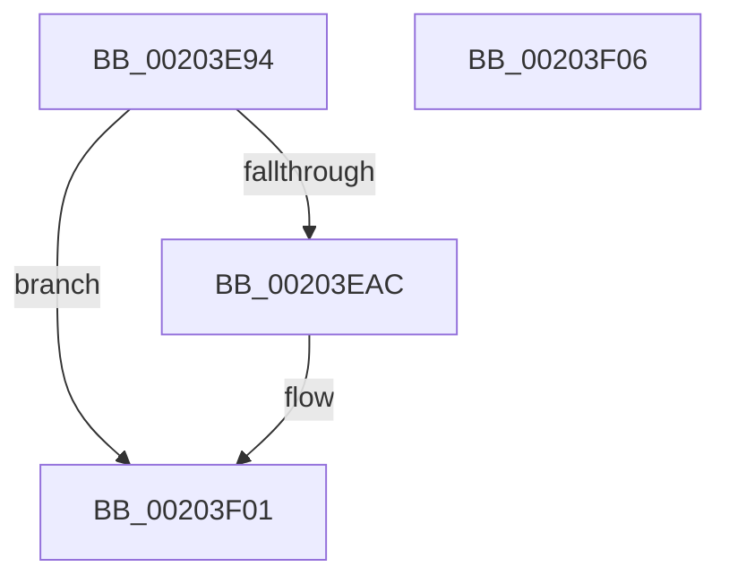

# MiStoreModifiedWriteDereference

- RVA: `0x00203E94`–`0x00203F07` (길이 `115` bytes)
- VA: `0x0000000140203E94`
- 실행 섹션: `.text`
- PDB 이름 있음: `예`; PDB Function 태그: `아니요`
- unwind 정보 RVA: `0x0005C788`
- 디코드: `29`개 명령, `115/115` bytes 표시
- 미해석 바이트: `0` (있으면 어셈블리에 `.byte`로 보존)

> 이 문서는 커널 이미지의 기계어와 PDB 기호를 분석해 생성했습니다. 4번과 5번은 함수 원형과 자료형을 바이너리 사용 방식에서 추정한 C 해석이며 원본 소스 복구 결과는 아닙니다.

## 1. Dependencies

- 직접 호출 지점: **1**; 고유 호출 대상: **1**
- 직접 호출자로 확인된 함수: **2**
- RIP 상대 이미지 참조: **1**

### Outgoing calls
- `0x00203EFC` → [KeInsertQueueApc](KeInsertQueueApc_function_00203F10.md) (function, `0x00203F10`)

### Direct callers
- [MiStoreModifiedWriteComplete](MiStoreModifiedWriteComplete_function_002045E8.md) at `0x00204620`
- [MiStoreWriteModifiedPages](../2B/MiStoreWriteModifiedPages_function_002B46C4.md) at `0x002B5246`

### Static image references
- `0x00203ECC` → RVA `0x00406990` (`MiStoreWriteModifiedCompleteApc`; read)

## 2. Other-region calls and transfers

- 다른 실행 섹션으로 향하는 call: **0**
- 별도 외부 분기/꼬리 이동을 확인하지 못했습니다.

## 3. Assembly (complete function range)

```asm
00203E94  48 83 EC 28                     sub rsp, 0x28
00203E98  4C 8B D1                        mov r10, rcx
00203E9B  83 C8 FF                        or eax, 0xffffffff
00203E9E  48 8B 49 48                     mov rcx, qword ptr [rcx + 0x48]
00203EA2  F0 0F C1 41 58                  lock xadd dword ptr [rcx + 0x58], eax
00203EA7  83 F8 01                        cmp eax, 1
00203EAA  75 55                           jne 0x140203f01
00203EAC  41 8B 82 90 00 00 00            mov eax, dword ptr [r10 + 0x90]
00203EB3  45 33 C0                        xor r8d, r8d
00203EB6  49 89 42 20                     mov qword ptr [r10 + 0x20], rax
00203EBA  45 33 C9                        xor r9d, r9d
00203EBD  49 8B 42 38                     mov rax, qword ptr [r10 + 0x38]
00203EC1  45 89 42 18                     mov dword ptr [r10 + 0x18], r8d
00203EC5  48 8B 90 E0 03 00 00            mov rdx, qword ptr [rax + 0x3e0]
00203ECC  48 8D 05 BD 2A 20 00            lea rax, [rip + 0x202abd]
00203ED3  48 89 51 08                     mov qword ptr [rcx + 8], rdx
00203ED7  49 8B D2                        mov rdx, r10
00203EDA  48 89 41 20                     mov qword ptr [rcx + 0x20], rax
00203EDE  66 C7 01 12 00                  mov word ptr [rcx], 0x12
00203EE3  C6 41 02 58                     mov byte ptr [rcx + 2], 0x58
00203EE7  66 44 89 41 50                  mov word ptr [rcx + 0x50], r8w
00203EEC  4C 89 41 28                     mov qword ptr [rcx + 0x28], r8
00203EF0  4C 89 41 30                     mov qword ptr [rcx + 0x30], r8
00203EF4  4C 89 41 38                     mov qword ptr [rcx + 0x38], r8
00203EF8  44 88 41 52                     mov byte ptr [rcx + 0x52], r8b
00203EFC  E8 0F 00 00 00                  call 0x140203f10
00203F01  48 83 C4 28                     add rsp, 0x28
00203F05  C3                              ret
00203F06  CC                              int3
```

## 4. C-style interpretation (structured pseudocode)

```c
__int64 __fastcall MiStoreModifiedWriteDereference(__int64 a1, __int64 a2, int a3, int a4)
{
    __int64 result;
    __int64 v_rsp;

    v_rsp = (v_rsp) - (40);
    result = (unsigned int)((result) | (0xFFFFFFFFULL));
    if (((unsigned int)(result)) == 1) {
        result = *(unsigned int *)(a1 + 144);
        a3 = 0;
        *(unsigned __int64 *)(a1 + 32) = result;
        a4 = 0;
        result = *(unsigned __int64 *)(a1 + 56);
        *(unsigned int *)(a1 + 24) = 0;
        a2 = *(unsigned __int64 *)(result + 992);
        result = v_rip + 2108093;
        *(unsigned __int64 *)(*(unsigned __int64 *)(a1 + 72) + 8) = a2;
        a2 = a1;
        *(unsigned __int64 *)(*(unsigned __int64 *)(a1 + 72) + 32) = result;
        *(unsigned __int16 *)(*(unsigned __int64 *)(a1 + 72)) = 18;
        *(unsigned __int8 *)(*(unsigned __int64 *)(a1 + 72) + 2) = 88;
        *(unsigned __int16 *)(*(unsigned __int64 *)(a1 + 72) + 80) = 0;
        *(unsigned __int64 *)(*(unsigned __int64 *)(a1 + 72) + 40) = 0;
        *(unsigned __int64 *)(*(unsigned __int64 *)(a1 + 72) + 48) = 0;
        *(unsigned __int64 *)(*(unsigned __int64 *)(a1 + 72) + 56) = 0;
        *(unsigned __int8 *)(*(unsigned __int64 *)(a1 + 72) + 82) = 0;
        result = KeInsertQueueApc(*(unsigned __int64 *)(a1 + 72), a2, a3, a4);
    }
    v_rsp = (v_rsp) + (40);
    return result;
}
```

## 5. (Beta) C Style

```c
int64_t MiStoreModifiedWriteDereference(void *Arg1, int64_t Arg2, int32_t Arg3, int32_t Arg4)
{
    uint8_t *arg1 = (uint8_t *)Arg1;

    int64_t result;
    int64_t local_rsp;

    local_rsp = (local_rsp) - (40);
    result = (uint32_t)((result) | (0xFFFFFFFFULL));
    if (((uint32_t)(result)) == 1) {
        result = *(uint32_t *)(arg1 + 0x90);
        Arg3 = 0;
        *(uint64_t *)(arg1 + 0x20) = result;
        Arg4 = 0;
        result = *(uint64_t *)(arg1 + 0x38);
        *(uint32_t *)(arg1 + 0x18) = 0;
        Arg2 = *(uint64_t *)(result + 0x3E0);
        result = v_rip + 2108093;
        *(uint64_t *)(*(uint64_t *)(arg1 + 0x48) + 0x8) = Arg2;
        Arg2 = Arg1;
        *(uint64_t *)(*(uint64_t *)(arg1 + 0x48) + 0x20) = result;
        *(uint16_t *)(*(uint64_t *)(arg1 + 0x48)) = 18;
        *(uint8_t *)(*(uint64_t *)(arg1 + 0x48) + 0x2) = 88;
        *(uint16_t *)(*(uint64_t *)(arg1 + 0x48) + 0x50) = 0;
        *(uint64_t *)(*(uint64_t *)(arg1 + 0x48) + 0x28) = 0;
        *(uint64_t *)(*(uint64_t *)(arg1 + 0x48) + 0x30) = 0;
        *(uint64_t *)(*(uint64_t *)(arg1 + 0x48) + 0x38) = 0;
        *(uint8_t *)(*(uint64_t *)(arg1 + 0x48) + 0x52) = 0;
        result = KeInsertQueueApc(*(uint64_t *)(arg1 + 0x48), Arg2, Arg3, Arg4);
    }
    local_rsp = (local_rsp) + (40);
    return result;
}
```

### 관측된 메모리 오프셋

구조체 형식이 확인되지 않은 접근은 인자 기준의 오프셋으로만 기록했습니다.

| 기준 인자 | 오프셋 표현 | 폭 (bit) | 접근 |
|---|---:|---:|---|
| `Arg1` | `+ 0x18` | `32` | `W` |
| `Arg1` | `+ 0x20` | `64` | `W` |
| `Arg1` | `+ 0x38` | `64` | `R` |
| `Arg1` | `+ 0x48` | `64` | `R` |
| `Arg1` | `+ 0x90` | `32` | `R` |

## 6. Execution-region graph

[열기: 2D/3D 그래프와 함수 탐색 컨트롤 패널](../../../control-panel.html?section=text&rva=0x00203E94&view=graph)

- 2D 그래프는 위에서 아래로 흐르고, 3D 그래프는 빈 공간을 드래그해 회전합니다. Shift+드래그는 이동, 휠은 확대·축소, 함수 노드 선택은 대상 보고서 이동입니다.

### Static fallback


