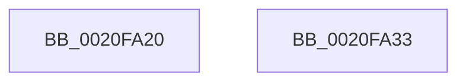

# ObfReferenceObject

- RVA: `0x0020FA20`–`0x0020FA34` (길이 `20` bytes)
- VA: `0x000000014020FA20`
- 실행 섹션: `.text`
- PDB 이름 있음: `예`; PDB Function 태그: `아니요`
- unwind 정보 RVA: `0x0005C788`
- 디코드: `6`개 명령, `20/20` bytes 표시
- 미해석 바이트: `0` (있으면 어셈블리에 `.byte`로 보존)

> 이 문서는 커널 이미지의 기계어와 PDB 기호를 분석해 생성했습니다. 4번과 5번은 함수 원형과 자료형을 바이너리 사용 방식에서 추정한 C 해석이며 원본 소스 복구 결과는 아닙니다.

## 1. Dependencies

- 직접 호출 지점: **1**; 고유 호출 대상: **1**
- 직접 호출자로 확인된 함수: **155**
- RIP 상대 이미지 참조: **0**

### Outgoing calls
- `0x0020FA29` → [ObfReferenceObjectWithTag](../21/ObfReferenceObjectWithTag_function_00210710.md) (function, `0x00210710`)

### Direct callers
- [NtSetInformationFile](../29/NtSetInformationFile_function_0029C5E0.md) at `0x0029C85C`
- [IopValidateAndGetWriteParameters](../40/IopValidateAndGetWriteParameters_function_00400C30.md) at `0x00400F2C`
- [HalpDynamicDeviceInterfaceNotification](../../page/70/HalpDynamicDeviceInterfaceNotification_function_00708410.md) at `0x007084EF`
- [DbgkQueueUserExceptionReport](../../page/71/DbgkQueueUserExceptionReport_function_00710B04.md) at `0x00710BB5`
- [EmpClientRuleRegisterNotification](../../page/71/EmpClientRuleRegisterNotification_function_00712DE4.md) at `0x00712FEF`
- [FsRtlpOplockTryPrepForAckTimeout](../../page/71/FsRtlpOplockTryPrepForAckTimeout_function_007156C0.md) at `0x00715837`
- [IopSetEaOrQuotaInformationFile](../../page/71/IopSetEaOrQuotaInformationFile_function_0071BD70.md) at `0x0071BEA1`
- [IopSetRemoteLink](../../page/71/IopSetRemoteLink_function_0071C690.md) at `0x0071C7A1`
- [IoEnumerateRegisteredFiltersList](../../page/71/IoEnumerateRegisteredFiltersList_function_0071D450.md) at `0x0071D4F1`
- [IoRegisterDriverReinitialization](../../page/71/IoRegisterDriverReinitialization_function_0071D640.md) at `0x0071D658`
- [IoRegisterFsRegistrationChangeMountAware](../../page/71/IoRegisterFsRegistrationChangeMountAware_function_0071D890.md) at `0x0071DAA0`
- [IoRegisterLastChanceShutdownNotification](../../page/71/IoRegisterLastChanceShutdownNotification_function_0071DAD0.md) at `0x0071DB02`
- [IoRegisterShutdownNotification](../../page/71/IoRegisterShutdownNotification_function_0071DB50.md) at `0x0071DB86`
- [IoSetInformation](../../page/71/IoSetInformation_function_0071DBF0.md) at `0x0071DC35`
- [IoSetInformation](../../page/71/IoSetInformation_function_0071DBF0.md) at `0x0071DC89`
- [IoRegisterContainerNotification](../../page/71/IoRegisterContainerNotification_function_0071E700.md) at `0x0071E92B`
- [NtQueryQuotaInformationFile](../../page/72/NtQueryQuotaInformationFile_function_00720FE0.md) at `0x007213B1`
- [NtSetVolumeInformationFile](../../page/72/NtSetVolumeInformationFile_function_00721750.md) at `0x00721974`
- [IoReportDetectedDevice](../../page/72/IoReportDetectedDevice_function_00725CD0.md) at `0x00726489`
- [PiPagePathSetState](../../page/72/PiPagePathSetState_function_0072BDE0.md) at `0x0072BE14`
- [PiProcessResourceRequirementsChanged](../../page/72/PiProcessResourceRequirementsChanged_function_0072D504.md) at `0x0072D5DC`
- [PiInitializeDevice](../../page/73/PiInitializeDevice_function_0073EC5C.md) at `0x0073EFDA`
- [PiEventAllocatePendingEjectRelations](../../page/74/PiEventAllocatePendingEjectRelations_function_00744220.md) at `0x0074426D`
- [KsepApplyShimsToDriver](../../page/74/KsepApplyShimsToDriver_function_00749C84.md) at `0x00749D5D`
- [ObpCreateSymbolicLinkName](../../page/74/ObpCreateSymbolicLinkName_function_0074EB80.md) at `0x0074EC48`
- [ObpCreateSymbolicLinkName](../../page/74/ObpCreateSymbolicLinkName_function_0074EB80.md) at `0x0074ED55`
- [ObpCreateSymbolicLinkName](../../page/74/ObpCreateSymbolicLinkName_function_0074EB80.md) at `0x0074EE75`
- [PfGenerateTrace](../../page/75/PfGenerateTrace_function_0075101C.md) at `0x00751093`
- [TtmiCreateTerminal](../../page/77/TtmiCreateTerminal_function_0077C748.md) at `0x0077C879`
- [TtmpResetEvaluationTimer](../../page/77/TtmpResetEvaluationTimer_function_0077D4E4.md) at `0x0077D4FE`
- [PspCompleteServerSiloShutdown](../../page/77/PspCompleteServerSiloShutdown_function_0077F808.md) at `0x0077F81D`
- [PsCheckProcessFileSigningLevel](../../page/78/PsCheckProcessFileSigningLevel_function_00783800.md) at `0x007838C0`
- [PsShutdownSystem](../../page/78/PsShutdownSystem_function_00785E94.md) at `0x00785FA9`
- [PspStorageReplaceObject](../../page/78/PspStorageReplaceObject_function_00789EA0.md) at `0x00789EE1`
- [SeExchangePrimaryToken](../../page/7A/SeExchangePrimaryToken_function_007A07BC.md) at `0x007A09DC`
- [VmPrefetchVirtualAddresses](../../page/7A/VmPrefetchVirtualAddresses_function_007ACE98.md) at `0x007ACF42`
- [EtwpCoverageSamplerStart](../../page/7C/EtwpCoverageSamplerStart_function_007C2248.md) at `0x007C23FC`
- [EtwpSetCoverageSamplerInformation](../../page/7C/EtwpSetCoverageSamplerInformation_function_007C288C.md) at `0x007C2F3C`
- [ExpRegisterFirmwareTableInformationHandler](../../page/7C/ExpRegisterFirmwareTableInformationHandler_function_007C504C.md) at `0x007C516A`
- [SLUpdateLicenseDataInternal](../../page/7C/SLUpdateLicenseDataInternal_function_007C9C04.md) at `0x007CA530`
- [NtSetDefaultHardErrorPort](../../page/7D/NtSetDefaultHardErrorPort_function_007D0340.md) at `0x007D0406`
- [ExpAssignPasid](../../page/7D/ExpAssignPasid_function_007D0AB8.md) at `0x007D0AC7`
- [CmpRecordUnloadEventForHive](../../page/7E/CmpRecordUnloadEventForHive_function_007EA6CC.md) at `0x007EA754`
- [CmpAddEnlistmentToRollbackPacket](../../page/7E/CmpAddEnlistmentToRollbackPacket_function_007EFDE8.md) at `0x007EFDFB`
- [CmpAddUoWToRollbackPacket](../../page/7E/CmpAddUoWToRollbackPacket_function_007EFE8C.md) at `0x007EFEC0`
- [CmpSnapshotTxOwnerArray](../../page/84/CmpSnapshotTxOwnerArray_function_00846808.md) at `0x008468A6`
- [CmpSnapshotTxOwnerArray](../../page/84/CmpSnapshotTxOwnerArray_function_00846808.md) at `0x008468EC`
- [ObpDecrementHandleCount](../../page/86/ObpDecrementHandleCount_function_008632E0.md) at `0x0086393C`
- [IopCloseFile](../../page/86/IopCloseFile_function_008640C0.md) at `0x008642D5`
- [ObCloseHandleTableEntry](../../page/86/ObCloseHandleTableEntry_function_00869E20.md) at `0x0086A8A2`
- [CmpTransReferenceTransaction](../../page/87/CmpTransReferenceTransaction_function_00873434.md) at `0x0087344D`
- [CmpTransReferenceTransaction](../../page/87/CmpTransReferenceTransaction_function_00873434.md) at `0x0087346E`
- [IopGetSetSecurityObject](../../page/87/IopGetSetSecurityObject_function_00873A80.md) at `0x00873B1D`
- [IopGetSetSecurityObject](../../page/87/IopGetSetSecurityObject_function_00873A80.md) at `0x00873D05`
- [AlpcpCreateView](../../page/88/AlpcpCreateView_function_0088A9B8.md) at `0x0088AC18`
- [sub_0088D871](../../page/88/Unknown_function_0088D871.md) at `0x0088D95D`
- [AlpcpDispatchNewMessage](../../page/88/AlpcpDispatchNewMessage_function_0088DD20.md) at `0x0088DF6C`
- [AlpcpDispatchReplyToPort](../../page/88/AlpcpDispatchReplyToPort_function_0088F880.md) at `0x0088FAA3`
- [AlpcpCreateSecurityContext](../../page/89/AlpcpCreateSecurityContext_function_00890D94.md) at `0x00890FF3`
- [AlpcpCreateReserve](../../page/89/AlpcpCreateReserve_function_00892318.md) at `0x008924FC`
- [AlpcpCreateSection](../../page/89/AlpcpCreateSection_function_0089307C.md) at `0x0089322C`
- [sub_0089A511](../../page/89/Unknown_function_0089A511.md) at `0x0089A703`
- [sub_0089A903](../../page/89/Unknown_function_0089A903.md) at `0x0089AAEA`
- [ObpLookupObjectName](../../page/89/ObpLookupObjectName_function_0089BE90.md) at `0x0089C663`
- [IopParseDevice](../../page/89/IopParseDevice_function_0089E510.md) at `0x0089ED92`
- [IopParseDevice](../../page/89/IopParseDevice_function_0089E510.md) at `0x008A0886`
- [DbgkForwardException](../../page/8A/DbgkForwardException_function_008A2D60.md) at `0x008A2FF7`
- [IopQueryNameInternal](../../page/8A/IopQueryNameInternal_function_008A6770.md) at `0x008A6916`
- [NtQueryObject](../../page/8A/NtQueryObject_function_008A6DB0.md) at `0x008A7278`
- [NtQueryObject](../../page/8A/NtQueryObject_function_008A6DB0.md) at `0x008A7373`
- [ObQueryNameStringMode](../../page/8A/ObQueryNameStringMode_function_008A7ED0.md) at `0x008A80E6`
- [ObQueryNameStringMode](../../page/8A/ObQueryNameStringMode_function_008A7ED0.md) at `0x008A825A`
- [ObQueryNameStringMode](../../page/8A/ObQueryNameStringMode_function_008A7ED0.md) at `0x008A84DA`
- [ObQueryNameStringMode](../../page/8A/ObQueryNameStringMode_function_008A7ED0.md) at `0x008A863F`
- [IopQueryXxxInformation](../../page/8A/IopQueryXxxInformation_function_008A89D0.md) at `0x008A8A02`
- [sub_008A8B60](../../page/8A/Unknown_function_008A8B60.md) at `0x008A8BBB`
- [NtQueryEaFile](../../page/8A/NtQueryEaFile_function_008AC1B0.md) at `0x008AC4F8`
- [NtQueryVolumeInformationFile](../../page/8A/NtQueryVolumeInformationFile_function_008AC8C0.md) at `0x008ACAD2`
- [IopFlushBuffersFile](../../page/8A/IopFlushBuffersFile_function_008ACFA4.md) at `0x008AD0F4`
- [IopGetFileInformation](../../page/8A/IopGetFileInformation_function_008AD4D0.md) at `0x008AD508`
- [NtQueryInformationFile](../../page/8A/NtQueryInformationFile_function_008AD630.md) at `0x008AD808`
- [NtQueryInformationFile](../../page/8A/NtQueryInformationFile_function_008AD630.md) at `0x008ADA7E`
- [IopWaitAndAcquireFileObjectLock](../../page/8A/IopWaitAndAcquireFileObjectLock_function_008AE6D8.md) at `0x008AE7AC`
- [IopReadFile](../../page/8A/IopReadFile_function_008AEFF0.md) at `0x008AF391`
- [sub_008B4B26](../../page/8B/Unknown_function_008B4B26.md) at `0x008B4BD2`
- [sub_008B4D32](../../page/8B/Unknown_function_008B4D32.md) at `0x008B4E05`
- [NtOpenThreadTokenEx](../../page/8B/NtOpenThreadTokenEx_function_008B7840.md) at `0x008B7C1F`
- [NtOpenThreadTokenEx](../../page/8B/NtOpenThreadTokenEx_function_008B7840.md) at `0x008B7DA3`
- [NtOpenThreadTokenEx](../../page/8B/NtOpenThreadTokenEx_function_008B7840.md) at `0x008B8035`
- [EtwpQueueNotification](../../page/8C/EtwpQueueNotification_function_008C870C.md) at `0x008C88BC`
- [PsImpersonateClient](../../page/8C/PsImpersonateClient_function_008CBE10.md) at `0x008CBEFE`
- [EtwpCovSampProcessAddModule](../../page/8D/EtwpCovSampProcessAddModule_function_008D8F58.md) at `0x008D8FE4`
- [PiSwCompleteCreate](../../page/8D/PiSwCompleteCreate_function_008DAB90.md) at `0x008DAD4F`
- [IopXxxControlFile](../../page/8E/IopXxxControlFile_function_008E9AD0.md) at `0x008EA751`
- [BuildQueryDirectoryIrp](../../page/8E/BuildQueryDirectoryIrp_function_008EC770.md) at `0x008ECBA3`
- [PsCaptureExceptionPort](../../page/90/PsCaptureExceptionPort_function_00904CB0.md) at `0x00904CEC`
- [NtCreateJobObject](../../page/91/NtCreateJobObject_function_009177E0.md) at `0x00917AA5`
- [AlpcpSendLegacySynchronousRequest](../../page/92/AlpcpSendLegacySynchronousRequest_function_0092376C.md) at `0x00923DAF`
- [AlpcpSetOwnerPortMessage](../../page/92/AlpcpSetOwnerPortMessage_function_00923E70.md) at `0x00923E83`
- [AlpcpCreateClientPort](../../page/92/AlpcpCreateClientPort_function_009270AC.md) at `0x00927465`
- [sub_0093345B](../../page/93/Unknown_function_0093345B.md) at `0x00933854`
- [DbgkCopyProcessDebugPort](../../page/94/DbgkCopyProcessDebugPort_function_00947BE8.md) at `0x00947C56`
- [DbgkCopyProcessDebugPort](../../page/94/DbgkCopyProcessDebugPort_function_00947BE8.md) at `0x00947CC3`
- [NtCopyFileChunk](../../page/94/NtCopyFileChunk_function_0094B600.md) at `0x0094BC1B`
- [PiSwPdoPnPDispatch](../../page/94/PiSwPdoPnPDispatch_function_0094DDF0.md) at `0x0094DF0B`
- [PfSnAsyncContextInitialize](../../page/96/PfSnAsyncContextInitialize_function_00961168.md) at `0x009611B8`
- [ExpGetGlobalLocaleSection](../../page/98/ExpGetGlobalLocaleSection_function_00980DD4.md) at `0x00980E23`
- [PipCallDriverAddDeviceQueryRoutine](../../page/99/PipCallDriverAddDeviceQueryRoutine_function_00996604.md) at `0x009969CB`
- [IoCreateDevice](../../page/9A/IoCreateDevice_function_009A4B00.md) at `0x009A4E48`
- [NtCreateWorkerFactory](../../page/9A/NtCreateWorkerFactory_function_009A7E10.md) at `0x009A80DE`
- [NtQueryInformationProcess](../../page/9A/NtQueryInformationProcess_function_009AA250.md) at `0x009ABBA7`
- [NtQueryInformationProcess](../../page/9A/NtQueryInformationProcess_function_009AA250.md) at `0x009AC2F2`
- [NtAlpcOpenSenderThread](../../page/9C/NtAlpcOpenSenderThread_function_009C5920.md) at `0x009C5AA1`
- [NtOpenPrivateNamespace](../../page/9C/NtOpenPrivateNamespace_function_009C94E0.md) at `0x009C9694`
- [NtCreatePrivateNamespace](../../page/9C/NtCreatePrivateNamespace_function_009CA6D0.md) at `0x009CA837`
- [sub_009CB10D](../../page/9C/Unknown_function_009CB10D.md) at `0x009CB10D`
- [NtLockFile](../../page/9D/NtLockFile_function_009D86D0.md) at `0x009D8AF7`
- [NtNotifyChangeMultipleKeys](../../page/9D/NtNotifyChangeMultipleKeys_function_009DC6B0.md) at `0x009DCD41`
- [WmipTranslatePDOInstanceNames](../../page/9E/WmipTranslatePDOInstanceNames_function_009E2F0C.md) at `0x009E3098`
- [NtUnlockFile](../../page/9E/NtUnlockFile_function_009E5DA0.md) at `0x009E6045`
- [sub_009E6FF2](../../page/9E/Unknown_function_009E6FF2.md) at `0x009E7022`
- [CmGetRootKeyObjectForSilo](../../page/9E/CmGetRootKeyObjectForSilo_function_009E7CCC.md) at `0x009E7D07`
- [CmGetRootKeyObjectForSilo](../../page/9E/CmGetRootKeyObjectForSilo_function_009E7CCC.md) at `0x009E7D19`
- [PspStorageInsertObject](../../page/9E/PspStorageInsertObject_function_009E8420.md) at `0x009E8506`
- [sub_009EB6B7](../../page/9E/Unknown_function_009EB6B7.md) at `0x009EB6EA`
- [IoCreateSystemThread](../../page/9E/IoCreateSystemThread_function_009ECD10.md) at `0x009ECD85`
- [SeAssignPrimaryToken](../../page/9F/SeAssignPrimaryToken_function_009F117C.md) at `0x009F121F`
- [AlpcpReplyLegacySynchronousRequest](../../page/9F/AlpcpReplyLegacySynchronousRequest_function_009F5CF0.md) at `0x009F6159`
- [PspStorageGetObject](../../page/9F/PspStorageGetObject_function_009FC6F4.md) at `0x009FC789`
- [DbgkpSetProcessDebugObject](../../page/A1/DbgkpSetProcessDebugObject_function_00A10468.md) at `0x00A10642`
- [PspReferenceTokenForNewProcess](../../page/A1/PspReferenceTokenForNewProcess_function_00A12D58.md) at `0x00A12DD0`
- [PspAllocateProcess](../../page/A1/PspAllocateProcess_function_00A13B3C.md) at `0x00A143E5`
- [PspAllocateProcess](../../page/A1/PspAllocateProcess_function_00A13B3C.md) at `0x00A14440`
- [NtAlpcSetInformation](../../page/A1/NtAlpcSetInformation_function_00A19DC0.md) at `0x00A1A1AA`
- [NtNotifyChangeDirectoryFileEx](../../page/A1/NtNotifyChangeDirectoryFileEx_function_00A1DEA0.md) at `0x00A1E22E`
- [PerfLogImageUnload](../../page/A2/PerfLogImageUnload_function_00A2216C.md) at `0x00A2226B`
- [PerfLogImageUnload](../../page/A2/PerfLogImageUnload_function_00A2216C.md) at `0x00A22273`
- [CmFcpCopySectionState](../../page/A3/CmFcpCopySectionState_function_00A30484.md) at `0x00A304A1`
- [IopMountVolume](../../page/A3/IopMountVolume_function_00A329D0.md) at `0x00A32B3D`
- [IopMountVolume](../../page/A3/IopMountVolume_function_00A329D0.md) at `0x00A32C51`
- [AlpcpAcceptConnectPort](../../page/A3/AlpcpAcceptConnectPort_function_00A34290.md) at `0x00A34B3D`
- [IopGetSetObjectId](../../page/A3/IopGetSetObjectId_function_00A37190.md) at `0x00A37258`
- [IopGetVolumeId](../../page/A3/IopGetVolumeId_function_00A372CC.md) at `0x00A373B2`
- [PsReferencePartitionSystemProcess](../../page/A6/PsReferencePartitionSystemProcess_function_00A68E00.md) at `0x00A68E78`
- [SepRmCommandServerThread](../../page/A6/SepRmCommandServerThread_function_00A6A8D0.md) at `0x00A6A943`
- [IopSetDeviceSecurityDescriptors](../../page/A7/IopSetDeviceSecurityDescriptors_function_00A718FC.md) at `0x00A7192A`
- [IopSetDeviceSecurityDescriptors](../../page/A7/IopSetDeviceSecurityDescriptors_function_00A718FC.md) at `0x00A7195E`
- [IopPnPDispatch](../../page/A7/IopPnPDispatch_function_00A74B90.md) at `0x00A74E19`
- [NtSetEaFile](../../page/A7/NtSetEaFile_function_00A788A0.md) at `0x00A789D4`
- [DbgkOpenProcessDebugPort](../../page/A8/DbgkOpenProcessDebugPort_function_00A82414.md) at `0x00A82477`
- [SeCreateAccessStateFromSubjectContext](../../page/A8/SeCreateAccessStateFromSubjectContext_function_00A8B12C.md) at `0x00A8B158`
- [SeCreateAccessStateFromSubjectContext](../../page/A8/SeCreateAccessStateFromSubjectContext_function_00A8B12C.md) at `0x00A8B196`
- [HalpQueryDeviceRelations](../../page/A9/HalpQueryDeviceRelations_function_00A91420.md) at `0x00A914AC`
- [PspPostFreezeOperationWorker](../../page/A9/PspPostFreezeOperationWorker_function_00A94CB0.md) at `0x00A94F44`
- [HalpGetDynamicDevicePointer](../../page/A9/HalpGetDynamicDevicePointer_function_00A983AC.md) at `0x00A983F1`
- [PiSwAddPdoAssociation](../../page/A9/PiSwAddPdoAssociation_function_00A9E490.md) at `0x00A9E4D6`
- [PiSwAddPdoAssociation](../../page/A9/PiSwAddPdoAssociation_function_00A9E490.md) at `0x00A9E4DE`
- [AlpcpMapLegacyPortRemoteView](../../page/A9/AlpcpMapLegacyPortRemoteView_function_00A9FEE4.md) at `0x00A9FFCB`
- [PspPostFreezeOperationWorkEnqueue](../../page/AA/PspPostFreezeOperationWorkEnqueue_function_00AA6DFC.md) at `0x00AA6EA3`
- [PnpAddVetoInformation](../../page/AA/PnpAddVetoInformation_function_00AA8250.md) at `0x00AA82C1`
- [PiSwGetChildPdo](../../page/AC/PiSwGetChildPdo_function_00AC3544.md) at `0x00AC37FD`
- [IoRegisterBootDriverReinitialization](../../page/AC/IoRegisterBootDriverReinitialization_function_00AC3BE0.md) at `0x00AC3C01`
- [SmKmFileInfoDuplicate](../../page/AC/SmKmFileInfoDuplicate_function_00AC98FC.md) at `0x00AC99D9`
- [EmpProviderRegister](../../page/AC/EmpProviderRegister_function_00ACC5D0.md) at `0x00ACC96D`
- [PiRestartDevice](../../page/AC/PiRestartDevice_function_00ACFA1C.md) at `0x00ACFAB3`
- [IopFreeBandwidthContract](../../page/AD/IopFreeBandwidthContract_function_00ADC7B4.md) at `0x00ADC8B5`
- [sub_00B174A6](../../page/B1/Unknown_function_00B174A6.md) at `0x00B17531`
- [sub_00B174A6](../../page/B1/Unknown_function_00B174A6.md) at `0x00B17614`
- [sub_00B2A59A](../../page/B2/Unknown_function_00B2A59A.md) at `0x00B2A687`
- [sub_00B2A59A](../../page/B2/Unknown_function_00B2A59A.md) at `0x00B2A6AD`
- [sub_00B3032C](../../page/B3/Unknown_function_00B3032C.md) at `0x00B3034E`
- [sub_00B420B0](../../page/B4/Unknown_function_00B420B0.md) at `0x00B420EC`
- [sub_00B420B0](../../page/B4/Unknown_function_00B420B0.md) at `0x00B421A8`
- [sub_00B46CEE](../../page/B4/Unknown_function_00B46CEE.md) at `0x00B46D28`
- [IopShutdownBaseFileSystems](../../pagelk/B6/IopShutdownBaseFileSystems_function_00B63E10.md) at `0x00B63E7A`
- [IoBuildPoDeviceNotifyList](../../pagelk/B7/IoBuildPoDeviceNotifyList_function_00B78B0C.md) at `0x00B78C2C`
- [IovpUnloadDriver](../../pagevrfy/B9/IovpUnloadDriver_function_00B92AE8.md) at `0x00B92B15`
- [ViHookDmaAdapter](../../pagevrfy/B9/ViHookDmaAdapter_function_00B993D8.md) at `0x00B99443`
- [ViPendingDelayCompletion](../../pagevrfy/BA/ViPendingDelayCompletion_function_00BA1E78.md) at `0x00BA1F16`
- [VfIrpLogRecordEvent](../../pagevrfy/BA/VfIrpLogRecordEvent_function_00BAB674.md) at `0x00BAB77A`
- [sub_00C19340](../../init/C1/Unknown_function_00C19340.md) at `0x00C19373`

### Static image references
- 디코드된 RIP-relative 메모리 참조가 없습니다.

## 2. Other-region calls and transfers

- 다른 실행 섹션으로 향하는 call: **0**
- 별도 외부 분기/꼬리 이동을 확인하지 못했습니다.

## 3. Assembly (complete function range)

```asm
0020FA20  48 83 EC 28                     sub rsp, 0x28
0020FA24  BA 44 66 6C 74                  mov edx, 0x746c6644
0020FA29  E8 E2 0C 00 00                  call 0x140210710
0020FA2E  48 83 C4 28                     add rsp, 0x28
0020FA32  C3                              ret
0020FA33  CC                              int3
```

## 4. C-style interpretation (structured pseudocode)

```c
__int64 __fastcall ObfReferenceObject(void)
{
    __int64 result;
    __int64 v_rsp;

    v_rsp = (v_rsp) - (40);
    result = ObfReferenceObjectWithTag(a1, (unsigned int)(0x746C6644ULL), a3, a4);
    v_rsp = (v_rsp) + (40);
    return result;
}
```

## 5. (Beta) C Style

```c
void ObfReferenceObject(void)
{
    int64_t result;
    int64_t local_rsp;

    local_rsp = (local_rsp) - (40);
    result = ObfReferenceObjectWithTag(a1, (uint32_t)(0x746C6644ULL), a3, a4);
    local_rsp = (local_rsp) + (40);
    return result;
}
```

## 6. Execution-region graph

[열기: 2D/3D 그래프와 함수 탐색 컨트롤 패널](../../../control-panel.html?section=text&rva=0x0020FA20&view=graph)

- 2D 그래프는 위에서 아래로 흐르고, 3D 그래프는 빈 공간을 드래그해 회전합니다. Shift+드래그는 이동, 휠은 확대·축소, 함수 노드 선택은 대상 보고서 이동입니다.

### Static fallback


