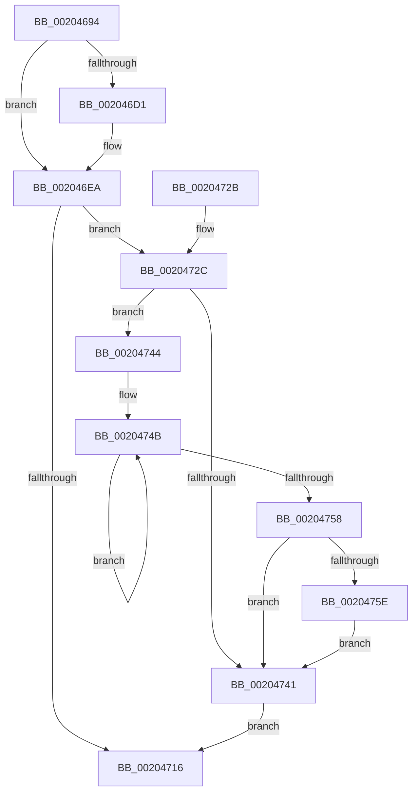

# PpmIdleSnapConcurrency

- RVA: `0x00204694`–`0x00204765` (길이 `209` bytes)
- VA: `0x0000000140204694`
- 실행 섹션: `.text`
- PDB 이름 있음: `예`; PDB Function 태그: `아니요`
- unwind 정보 RVA: `0x0005CBA8`
- 디코드: `57`개 명령, `209/209` bytes 표시
- 미해석 바이트: `0` (있으면 어셈블리에 `.byte`로 보존)

> 이 문서는 커널 이미지의 기계어와 PDB 기호를 분석해 생성했습니다. 4번과 5번은 함수 원형과 자료형을 바이너리 사용 방식에서 추정한 C 해석이며 원본 소스 복구 결과는 아닙니다.

## 1. Dependencies

- 직접 호출 지점: **6**; 고유 호출 대상: **6**
- 직접 호출자로 확인된 함수: **1**
- RIP 상대 이미지 참조: **0**

### Outgoing calls
- `0x002046B0` → [KeQueryPerformanceCounter](../37/KeQueryPerformanceCounter_function_0037E7E0.md) (function, `0x0037E7E0`)
- `0x002046B8` → [KeDisableInterrupts](../21/KeDisableInterrupts_function_00217BE0.md) (function, `0x00217BE0`)
- `0x002046C3` → [KeAcquireSpinLockAtDpcLevel](KeAcquireSpinLockAtDpcLevel_function_00208430.md) (function, `0x00208430`)
- `0x00204704` → [memcpy](../6C/memcpy_function_006C6840.md) (function, `0x006C6840`)
- `0x0020470C` → [KxReleaseSpinLock](KxReleaseSpinLock_function_00206670.md) (function, `0x00206670`)
- `0x0020475E` → [KiRemoveSystemWorkPriorityKick](../26/KiRemoveSystemWorkPriorityKick_function_002631D0.md) (function, `0x002631D0`)

### Direct callers
- [PpmParkSnapNodeStatistics](../41/PpmParkSnapNodeStatistics_function_0041419C.md) at `0x004142F5`

### Static image references
- 디코드된 RIP-relative 메모리 참조가 없습니다.

## 2. Other-region calls and transfers

- 다른 실행 섹션으로 향하는 call: **0**
- 별도 외부 분기/꼬리 이동을 확인하지 못했습니다.

## 3. Assembly (complete function range)

```asm
00204694  48 89 5C 24 08                  mov qword ptr [rsp + 8], rbx
00204699  48 89 6C 24 10                  mov qword ptr [rsp + 0x10], rbp
0020469E  48 89 74 24 18                  mov qword ptr [rsp + 0x18], rsi
002046A3  57                              push rdi
002046A4  48 83 EC 20                     sub rsp, 0x20
002046A8  48 8B D9                        mov rbx, rcx
002046AB  48 8B FA                        mov rdi, rdx
002046AE  33 C9                           xor ecx, ecx
002046B0  E8 2B A1 17 00                  call 0x14037e7e0
002046B5  48 8B F0                        mov rsi, rax
002046B8  E8 23 35 01 00                  call 0x140217be0
002046BD  48 8B CB                        mov rcx, rbx
002046C0  40 8A E8                        mov bpl, al
002046C3  E8 68 3D 00 00                  call 0x140208430
002046C8  48 8B 4B 10                     mov rcx, qword ptr [rbx + 0x10]
002046CC  48 3B F1                        cmp rsi, rcx
002046CF  76 19                           jbe 0x1402046ea
002046D1  8B 43 0C                        mov eax, dword ptr [rbx + 0xc]
002046D4  48 8B D6                        mov rdx, rsi
002046D7  48 2B D1                        sub rdx, rcx
002046DA  48 89 73 10                     mov qword ptr [rbx + 0x10], rsi
002046DE  48 01 53 18                     add qword ptr [rbx + 0x18], rdx
002046E2  48 01 94 C3 48 01 00 00         add qword ptr [rbx + rax*8 + 0x148], rdx
002046EA  44 8B 47 30                     mov r8d, dword ptr [rdi + 0x30]
002046EE  48 8D 93 48 01 00 00            lea rdx, [rbx + 0x148]
002046F5  48 8B 43 18                     mov rax, qword ptr [rbx + 0x18]
002046F9  48 8B 0F                        mov rcx, qword ptr [rdi]
002046FC  49 C1 E0 03                     shl r8, 3
00204700  48 89 47 18                     mov qword ptr [rdi + 0x18], rax
00204704  E8 37 21 4C 00                  call 0x1406c6840
00204709  48 8B CB                        mov rcx, rbx
0020470C  E8 5F 1F 00 00                  call 0x140206670
00204711  40 84 ED                        test bpl, bpl
00204714  75 16                           jne 0x14020472c
00204716  48 8B 5C 24 30                  mov rbx, qword ptr [rsp + 0x30]
0020471B  48 8B 6C 24 38                  mov rbp, qword ptr [rsp + 0x38]
00204720  48 8B 74 24 40                  mov rsi, qword ptr [rsp + 0x40]
00204725  48 83 C4 20                     add rsp, 0x20
00204729  5F                              pop rdi
0020472A  C3                              ret
0020472B  CC                              int3
0020472C  65 48 8B 0C 25 20 00 00 00      mov rcx, qword ptr gs:[0x20]
00204735  4C 8B 81 B8 8E 00 00            mov r8, qword ptr [rcx + 0x8eb8]
0020473C  4D 85 C0                        test r8, r8
0020473F  75 03                           jne 0x140204744
00204741  FB                              sti
00204742  EB D2                           jmp 0x140204716
00204744  41 0F 0D 08                     prefetchw byte ptr [r8]
00204748  41 8B 00                        mov eax, dword ptr [r8]
0020474B  8B D0                           mov edx, eax
0020474D  0F BA F2 15                     btr edx, 0x15
00204751  F0 41 0F B1 10                  lock cmpxchg dword ptr [r8], edx
00204756  75 F3                           jne 0x14020474b
00204758  0F BA E0 15                     bt eax, 0x15
0020475C  73 E3                           jae 0x140204741
0020475E  E8 6D EA 05 00                  call 0x1402631d0
00204763  EB DC                           jmp 0x140204741
```

## 4. C-style interpretation (structured pseudocode)

```c
__int64 __fastcall PpmIdleSnapConcurrency(__int64 a1, __int64 a2)
{
    __int64 result;
    __int64 v_rsp;
    unsigned __int64 v_stack_p10;
    unsigned __int64 v_stack_p18;
    unsigned __int64 v_stack_p8;

    v_stack_p8 = v_rbx;
    v_stack_p10 = v_rbp;
    v_stack_p18 = v_rsi;
    v_rsp = (v_rsp) - (32);
    a1 = 0;
    result = KeQueryPerformanceCounter(a1, a2, a3, a4);
    result = KeDisableInterrupts(a1, a2, a3, a4);
    result = KeAcquireSpinLockAtDpcLevel(0, a2, a3, a4);
    if (result >= = (*(unsigned __int64 *)(a1 + 16))) {
        result = *(unsigned int *)(a1 + 12);
        a2 = result;
        a2 = (a2) - (*(unsigned __int64 *)(a1 + 16));
        *(unsigned __int64 *)(a1 + 16) = result;
    }
    a3 = ((unsigned int)(*(unsigned int *)(a2 + 48))) << (3);
    *(unsigned __int64 *)(a2 + 24) = *(unsigned __int64 *)(a1 + 24);
    result = memcpy(*(unsigned __int64 *)(a2), a1 + 328, a3, a4);
    result = KxReleaseSpinLock(0, a1 + 328, a3, a4);
    if ((unsigned __int8)((unsigned __int8)(result)) != 0) goto loc_0020472C;
loc_00204716:
    v_rsp = (v_rsp) + (32);
    return result;
loc_0020472C:
    if (*(unsigned __int64 *)(*(unsigned __int64 *)(gs_base + (0 + 32)) + 36536) != 0) goto loc_00204744;
loc_00204741:
    goto loc_00204716;
loc_00204744:
loc_0020474B:
    if (*(unsigned __int64 *)(*(unsigned __int64 *)(gs_base + (0 + 32)) + 36536) != 0) goto loc_0020474B;
    if (condition_is_above_or_equal) goto loc_00204741;
    result = KiRemoveSystemWorkPriorityKick(*(unsigned __int64 *)(gs_base + (0 + 32)), (unsigned int)((unsigned int)((unsigned int)(*(unsigned int *)(*(unsigned __int64 *)(*(unsigned __int64 *)(gs_base + (0 + 32)) + 36536))))), *(unsigned __int64 *)(*(unsigned __int64 *)(gs_base + (0 + 32)) + 36536), a4);
    goto loc_00204741;
}
```

## 5. (Beta) C Style

```c
int64_t PpmIdleSnapConcurrency(void *Arg1, void *Arg2)
{
    uint8_t *arg1 = (uint8_t *)Arg1;
    uint8_t *arg2 = (uint8_t *)Arg2;

    int64_t result;
    int64_t local_rsp;
    uint64_t v_stack_p10;
    uint64_t v_stack_p18;
    uint64_t v_stack_p8;

    v_stack_p8 = local_rbx;
    v_stack_p10 = local_rbp;
    v_stack_p18 = local_rsi;
    local_rsp = (local_rsp) - (32);
    Arg1 = 0;
    result = KeQueryPerformanceCounter(Arg1, Arg2, a3, a4);
    result = KeDisableInterrupts(Arg1, Arg2, a3, a4);
    result = KeAcquireSpinLockAtDpcLevel(0, Arg2, a3, a4);
    if (result >= = (*(uint64_t *)(arg1 + 0x10))) {
        result = *(uint32_t *)(arg1 + 0xC);
        Arg2 = result;
        Arg2 = (Arg2) - (*(uint64_t *)(arg1 + 0x10));
        *(uint64_t *)(arg1 + 0x10) = result;
    }
    a3 = ((uint32_t)(*(uint32_t *)(arg2 + 0x30))) << (3);
    *(uint64_t *)(arg2 + 0x18) = *(uint64_t *)(arg1 + 0x18);
    result = memcpy(*(uint64_t *)(arg2), Arg1 + 328, a3, a4);
    result = KxReleaseSpinLock(0, Arg1 + 328, a3, a4);
    if ((uint8_t)((uint8_t)(result)) != 0) goto loc_0020472C;
loc_00204716:
    local_rsp = (local_rsp) + (32);
    return result;
loc_0020472C:
    if (*(uint64_t *)(*(uint64_t *)(gs_base + (0 + 0x20)) + 0x8EB8) != 0) goto loc_00204744;
loc_00204741:
    goto loc_00204716;
loc_00204744:
loc_0020474B:
    if (*(uint64_t *)(*(uint64_t *)(gs_base + (0 + 0x20)) + 0x8EB8) != 0) goto loc_0020474B;
    if (condition_is_above_or_equal) goto loc_00204741;
    result = KiRemoveSystemWorkPriorityKick(*(uint64_t *)(gs_base + (0 + 0x20)), (uint32_t)((uint32_t)((uint32_t)(*(uint32_t *)(*(uint64_t *)(*(uint64_t *)(gs_base + (0 + 0x20)) + 0x8EB8))))), *(uint64_t *)(*(uint64_t *)(gs_base + (0 + 0x20)) + 0x8EB8), a4);
    goto loc_00204741;
}
```

### 관측된 메모리 오프셋

구조체 형식이 확인되지 않은 접근은 인자 기준의 오프셋으로만 기록했습니다.

| 기준 인자 | 오프셋 표현 | 폭 (bit) | 접근 |
|---|---:|---:|---|
| `Arg1` | `+ 0xC` | `32` | `R` |
| `Arg1` | `+ 0x10` | `64` | `R` |
| `Arg1` | `+ 0x10` | `64` | `W` |
| `Arg1` | `+ 0x18` | `64` | `R` |
| `Arg1` | `+ 0x18` | `64` | `R/W` |
| `Arg1` | `+ 0x148` | `64` | `R` |
| `Arg1` | `+ 0x148 + rax*8` | `64` | `R/W` |
| `Arg2` | `+ 0x0` | `64` | `R` |
| `Arg2` | `+ 0x18` | `64` | `W` |
| `Arg2` | `+ 0x30` | `32` | `R` |

## 6. Execution-region graph

[열기: 2D/3D 그래프와 함수 탐색 컨트롤 패널](../../../control-panel.html?section=text&rva=0x00204694&view=graph)

- 2D 그래프는 위에서 아래로 흐르고, 3D 그래프는 빈 공간을 드래그해 회전합니다. Shift+드래그는 이동, 휠은 확대·축소, 함수 노드 선택은 대상 보고서 이동입니다.

### Static fallback


