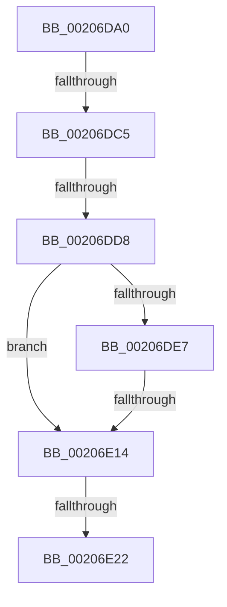

# PsGetThreadProperty

- RVA: `0x00206DA0`–`0x00206E35` (길이 `149` bytes)
- VA: `0x0000000140206DA0`
- 실행 섹션: `.text`
- PDB 이름 있음: `예`; PDB Function 태그: `아니요`
- unwind 정보 RVA: `0x0005D02C`
- 디코드: `34`개 명령, `149/149` bytes 표시
- 미해석 바이트: `0` (있으면 어셈블리에 `.byte`로 보존)

> 이 문서는 커널 이미지의 기계어와 PDB 기호를 분석해 생성했습니다. 4번과 5번은 함수 원형과 자료형을 바이너리 사용 방식에서 추정한 C 해석이며 원본 소스 복구 결과는 아닙니다.

## 1. Dependencies

- 직접 호출 지점: **0**; 고유 호출 대상: **0**
- 직접 호출자로 확인된 함수: **0**
- RIP 상대 이미지 참조: **3**

### Outgoing calls
- 직접 디코드된 call 명령이 없습니다.

### Direct callers
- 이 함수 시작 RVA로 연결되는 직접 call은 확인되지 않았습니다. 간접 호출은 완전히 역산할 수 없습니다.

### Static image references
- `0x00206DDC` → RVA `0x00FC7800` (`ALMOSTRO`; read)
- `0x00206DF9` → RVA `0x00FC6E4C` (`ALMOSTRO`; read)
- `0x00206E03` → RVA `0x00FC6AC8` (`ALMOSTRO`; read)

## 2. Other-region calls and transfers

- 다른 실행 섹션으로 향하는 call: **0**
- call이 아닌 외부 분기/꼬리 이동: **5**
  - `0x00206DBF` → [sub_0020706C](Unknown_function_0020706C.md) (`tail-transfer`)
  - `0x00206DD2` → [sub_0020706C](Unknown_function_0020706C.md) (`tail-transfer`)
  - `0x00206E0E` → [sub_0020706C](Unknown_function_0020706C.md) (`tail-transfer`)
  - `0x00206E20` → [sub_00206E35](Unknown_function_00206E35.md) (`tail-transfer`)
  - `0x00206E2F` → [sub_0020706C](Unknown_function_0020706C.md) (`tail-transfer`)

## 3. Assembly (complete function range)

```asm
00206DA0  40 57                           push rdi
00206DA2  41 54                           push r12
00206DA4  41 55                           push r13
00206DA6  41 57                           push r15
00206DA8  48 83 EC 28                     sub rsp, 0x28
00206DAC  45 33 FF                        xor r15d, r15d
00206DAF  45 8B E0                        mov r12d, r8d
00206DB2  4C 8B EA                        mov r13, rdx
00206DB5  48 8B F9                        mov rdi, rcx
00206DB8  41 F7 C0 FE FF FF FF            test r8d, 0xfffffffe
00206DBF  0F 85 A7 02 00 00               jne 0x14020706c
00206DC5  65 48 8B 04 25 20 00 00 00      mov rax, qword ptr gs:[0x20]
00206DCE  48 3B 48 18                     cmp rcx, qword ptr [rax + 0x18]
00206DD2  0F 84 94 02 00 00               je 0x14020706c
00206DD8  44 0F 20 C0                     mov rax, cr8
00206DDC  4C 8D 05 1D 0A DC 00            lea r8, [rip + 0xdc0a1d]
00206DE3  3C 02                           cmp al, 2
00206DE5  73 2D                           jae 0x140206e14
00206DE7  48 8D 41 D0                     lea rax, [rcx - 0x30]
00206DEB  48 C1 E8 08                     shr rax, 8
00206DEF  0F B6 D0                        movzx edx, al
00206DF2  0F B6 41 E8                     movzx eax, byte ptr [rcx - 0x18]
00206DF6  48 33 D0                        xor rdx, rax
00206DF9  0F B6 05 4C 00 DC 00            movzx eax, byte ptr [rip + 0xdc004c]
00206E00  48 33 D0                        xor rdx, rax
00206E03  48 8B 05 BE FC DB 00            mov rax, qword ptr [rip + 0xdbfcbe]
00206E0A  49 39 04 D0                     cmp qword ptr [r8 + rdx*8], rax
00206E0E  0F 85 58 02 00 00               jne 0x14020706c
00206E14  65 48 8B 04 25 88 01 00 00      mov rax, qword ptr gs:[0x188]
00206E1D  48 3B F8                        cmp rdi, rax
00206E20  75 13                           jne 0x140206e35
00206E22  65 8B 04 25 3C 3A 00 00         mov eax, dword ptr gs:[0x3a3c]
00206E2A  A9 01 00 01 00                  test eax, 0x10001
00206E2F  0F 85 37 02 00 00               jne 0x14020706c
```

## 4. C-style interpretation (structured pseudocode)

```c
__int64 __fastcall PsGetThreadProperty(__int64 a1, __int64 a2, int a3)
{
    __int64 result;
    __int64 v_r15;
    __int64 v_rsp;

    v_rsp = (v_rsp) - (40);
    v_r15 = 0;
    if (((unsigned __int8)(v_cr8)) >= 2) goto loc_00206E14;
    result = (a1 - 48) >> (8);
    a2 = ((unsigned __int8)(result)) ^ (*(unsigned __int8 *)(a1 - 24));
    a2 = (a2) ^ (*(unsigned __int8 *)(v_rip + 14417996));
loc_00206E14:
}
```

## 5. (Beta) C Style

```c
int64_t PsGetThreadProperty(int64_t Arg1, int64_t Arg2, int32_t Arg3)
{
    int64_t result;
    int64_t local_r15;
    int64_t local_rsp;

    local_rsp = (local_rsp) - (40);
    local_r15 = 0;
    if (((uint8_t)(v_cr8)) >= 2) goto loc_00206E14;
    result = (Arg1 - 48) >> (8);
    Arg2 = ((uint8_t)(result)) ^ (*(uint8_t *)(Arg1 - 0x18));
    Arg2 = (Arg2) ^ (*(uint8_t *)(v_rip + 0xDC004C));
loc_00206E14:
}
```

## 6. Execution-region graph

[열기: 2D/3D 그래프와 함수 탐색 컨트롤 패널](../../../control-panel.html?section=text&rva=0x00206DA0&view=graph)

- 2D 그래프는 위에서 아래로 흐르고, 3D 그래프는 빈 공간을 드래그해 회전합니다. Shift+드래그는 이동, 휠은 확대·축소, 함수 노드 선택은 대상 보고서 이동입니다.

### Static fallback


