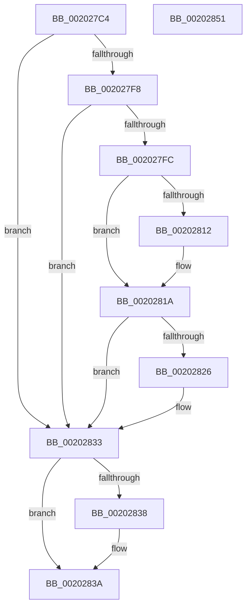

# PsMultiResumeThread

- RVA: `0x002027C4`–`0x00202852` (길이 `142` bytes)
- VA: `0x00000001402027C4`
- 실행 섹션: `.text`
- PDB 이름 있음: `예`; PDB Function 태그: `아니요`
- unwind 정보 RVA: `0x0005C954`
- 디코드: `38`개 명령, `142/142` bytes 표시
- 미해석 바이트: `0` (있으면 어셈블리에 `.byte`로 보존)

> 이 문서는 커널 이미지의 기계어와 PDB 기호를 분석해 생성했습니다. 4번과 5번은 함수 원형과 자료형을 바이너리 사용 방식에서 추정한 C 해석이며 원본 소스 복구 결과는 아닙니다.

## 1. Dependencies

- 직접 호출 지점: **2**; 고유 호출 대상: **2**
- 직접 호출자로 확인된 함수: **9**
- RIP 상대 이미지 참조: **0**

### Outgoing calls
- `0x002027E4` → [KeResumeThread](KeResumeThread_function_00202858.md) (function, `0x00202858`)
- `0x0020282E` → [EtwTiLogSuspendResumeThread](../../page/A3/EtwTiLogSuspendResumeThread_function_00A34DE0.md) (function, `0x00A34DE0`)

### Direct callers
- [DbgkUserReportWorkRoutine](../../page/71/DbgkUserReportWorkRoutine_function_00710D10.md) at `0x00710F9C`
- [PspWow64SetContextThread](../../page/8C/PspWow64SetContextThread_function_008CCC88.md) at `0x008CD1E1`
- [DbgkpWakeTarget](../../page/A1/DbgkpWakeTarget_function_00A106AC.md) at `0x00A106CD`
- [DbgkpPostFakeThreadMessages](../../page/A1/DbgkpPostFakeThreadMessages_function_00A108CC.md) at `0x00A10BBC`
- [PspWow64GetContextThread](../../page/A1/PspWow64GetContextThread_function_00A11E90.md) at `0x00A1237E`
- [NtResumeThread](../../page/A2/NtResumeThread_function_00A20D90.md) at `0x00A20E26`
- [PsResumeThread](../../page/A4/PsResumeThread_function_00A4A920.md) at `0x00A4A92A`
- [PspDeleteThreadStateChange](../../page/A9/PspDeleteThreadStateChange_function_00A9B010.md) at `0x00A9B03B`
- [NtChangeThreadState](../../page/AE/NtChangeThreadState_function_00AEA210.md) at `0x00AEA486`
- [NtChangeThreadState](../../page/AE/NtChangeThreadState_function_00AEA210.md) at `0x00AEA5B2`

### Static image references
- 디코드된 RIP-relative 메모리 참조가 없습니다.

## 2. Other-region calls and transfers

- 다른 실행 섹션으로 향하는 call: **1**
  - `0x0020282E` → [EtwTiLogSuspendResumeThread](../../page/A3/EtwTiLogSuspendResumeThread_function_00A34DE0.md) (`.text` → `PAGE`)
- 별도 외부 분기/꼬리 이동을 확인하지 못했습니다.

## 3. Assembly (complete function range)

```asm
002027C4  48 89 5C 24 08                  mov qword ptr [rsp + 8], rbx
002027C9  48 89 6C 24 10                  mov qword ptr [rsp + 0x10], rbp
002027CE  48 89 74 24 18                  mov qword ptr [rsp + 0x18], rsi
002027D3  57                              push rdi
002027D4  48 83 EC 20                     sub rsp, 0x20
002027D8  48 8B FA                        mov rdi, rdx
002027DB  41 8B E8                        mov ebp, r8d
002027DE  41 8B D0                        mov edx, r8d
002027E1  48 8B F1                        mov rsi, rcx
002027E4  E8 6F 00 00 00                  call 0x140202858
002027E9  65 48 8B 14 25 88 01 00 00      mov rdx, qword ptr gs:[0x188]
002027F2  8B D8                           mov ebx, eax
002027F4  85 C0                           test eax, eax
002027F6  74 3B                           je 0x140202833
002027F8  3B C5                           cmp eax, ebp
002027FA  77 37                           ja 0x140202833
002027FC  48 8B 86 20 02 00 00            mov rax, qword ptr [rsi + 0x220]
00202803  41 B8 00 80 00 00               mov r8d, 0x8000
00202809  44 85 80 FC 05 00 00            test dword ptr [rax + 0x5fc], r8d
00202810  75 08                           jne 0x14020281a
00202812  F0 44 09 80 FC 05 00 00         lock or dword ptr [rax + 0x5fc], r8d
0020281A  F7 80 FC 05 00 00 00 00 10 00   test dword ptr [rax + 0x5fc], 0x100000
00202824  74 0D                           je 0x140202833
00202826  45 33 C9                        xor r9d, r9d
00202829  4C 8B C6                        mov r8, rsi
0020282C  33 C9                           xor ecx, ecx
0020282E  E8 AD 25 83 00                  call 0x140a34de0
00202833  48 85 FF                        test rdi, rdi
00202836  74 02                           je 0x14020283a
00202838  89 1F                           mov dword ptr [rdi], ebx
0020283A  48 8B 5C 24 30                  mov rbx, qword ptr [rsp + 0x30]
0020283F  33 C0                           xor eax, eax
00202841  48 8B 6C 24 38                  mov rbp, qword ptr [rsp + 0x38]
00202846  48 8B 74 24 40                  mov rsi, qword ptr [rsp + 0x40]
0020284B  48 83 C4 20                     add rsp, 0x20
0020284F  5F                              pop rdi
00202850  C3                              ret
00202851  CC                              int3
```

## 4. C-style interpretation (structured pseudocode)

```c
__int64 __fastcall PsMultiResumeThread(__int64 a1, __int64 a2, int a3, int a4)
{
    __int64 result;
    __int64 v_rsp;
    unsigned __int64 v_stack_p10;
    unsigned __int64 v_stack_p18;
    unsigned __int64 v_stack_p8;

    v_stack_p8 = v_rbx;
    v_stack_p10 = v_rbp;
    v_stack_p18 = v_rsi;
    v_rsp = (v_rsp) - (32);
    result = KeResumeThread(a1, (unsigned int)(a3), a3, a4);
    if ((unsigned int)(result) == 0) goto loc_00202833;
    if (((unsigned int)(result)) > ((unsigned int)((unsigned int)(a3)))) goto loc_00202833;
    if (((*(unsigned int *)(*(unsigned __int64 *)(a1 + 544) + 1532)) & ((unsigned int)((unsigned int)(0x8000ULL)))) == 0) {
    }
    result = *(unsigned __int64 *)(a1 + 544);
    if (((*(unsigned int *)(*(unsigned __int64 *)(a1 + 544) + 1532)) & (0x100000ULL)) != 0) {
        a4 = 0;
        a3 = a1;
        a1 = 0;
        result = EtwTiLogSuspendResumeThread(a1, *(unsigned __int64 *)(gs_base + (0 + 392)), a3, a4);
    }
    if (a2 != 0) {
        *(unsigned int *)(a2) = (unsigned int)((unsigned int)((unsigned int)(result)));
    }
    result = 0;
    v_rsp = (v_rsp) + (32);
    return result;
}
```

## 5. (Beta) C Style

```c
int64_t PsMultiResumeThread(void *Arg1, int64_t Arg2, int32_t Arg3, int32_t Arg4)
{
    uint8_t *arg1 = (uint8_t *)Arg1;

    int64_t result;
    int64_t local_rsp;
    uint64_t v_stack_p10;
    uint64_t v_stack_p18;
    uint64_t v_stack_p8;

    v_stack_p8 = local_rbx;
    v_stack_p10 = local_rbp;
    v_stack_p18 = local_rsi;
    local_rsp = (local_rsp) - (32);
    result = KeResumeThread(Arg1, (uint32_t)(Arg3), Arg3, Arg4);
    if ((uint32_t)(result) == 0) goto loc_00202833;
    if (((uint32_t)(result)) > ((uint32_t)((uint32_t)(Arg3)))) goto loc_00202833;
    if (((*(uint32_t *)(*(uint64_t *)(arg1 + 0x220) + 0x5FC)) & ((uint32_t)((uint32_t)(0x8000ULL)))) == 0) {
    }
    result = *(uint64_t *)(arg1 + 0x220);
    if (((*(uint32_t *)(*(uint64_t *)(arg1 + 0x220) + 0x5FC)) & (0x100000ULL)) != 0) {
        Arg4 = 0;
        Arg3 = Arg1;
        Arg1 = 0;
        result = EtwTiLogSuspendResumeThread(Arg1, *(uint64_t *)(gs_base + (0 + 0x188)), Arg3, Arg4);
    }
    if (Arg2 != 0) {
        *(uint32_t *)(Arg2) = (uint32_t)((uint32_t)((uint32_t)(result)));
    }
    result = 0;
    local_rsp = (local_rsp) + (32);
    return result;
}
```

### 관측된 메모리 오프셋

구조체 형식이 확인되지 않은 접근은 인자 기준의 오프셋으로만 기록했습니다.

| 기준 인자 | 오프셋 표현 | 폭 (bit) | 접근 |
|---|---:|---:|---|
| `Arg1` | `+ 0x220` | `64` | `R` |

## 6. Execution-region graph

[열기: 2D/3D 그래프와 함수 탐색 컨트롤 패널](../../../control-panel.html?section=text&rva=0x002027C4&view=graph)

- 2D 그래프는 위에서 아래로 흐르고, 3D 그래프는 빈 공간을 드래그해 회전합니다. Shift+드래그는 이동, 휠은 확대·축소, 함수 노드 선택은 대상 보고서 이동입니다.

### Static fallback


