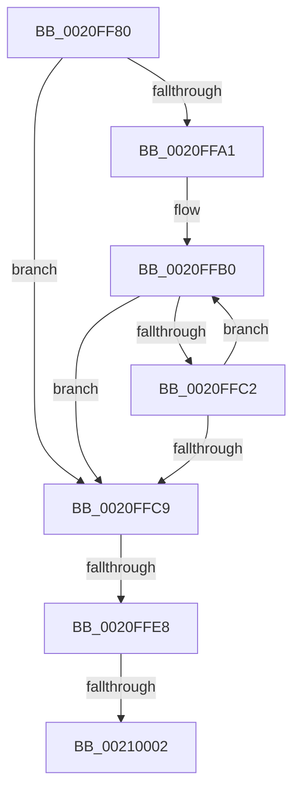

# PsReferencePrimaryTokenWithTag

- RVA: `0x0020FF80`–`0x00210015` (길이 `149` bytes)
- VA: `0x000000014020FF80`
- 실행 섹션: `.text`
- PDB 이름 있음: `예`; PDB Function 태그: `아니요`
- unwind 정보 RVA: `0x0005DC28`
- 디코드: `35`개 명령, `149/149` bytes 표시
- 미해석 바이트: `0` (있으면 어셈블리에 `.byte`로 보존)

> 이 문서는 커널 이미지의 기계어와 PDB 기호를 분석해 생성했습니다. 4번과 5번은 함수 원형과 자료형을 바이너리 사용 방식에서 추정한 C 해석이며 원본 소스 복구 결과는 아닙니다.

## 1. Dependencies

- 직접 호출 지점: **1**; 고유 호출 대상: **1**
- 직접 호출자로 확인된 함수: **74**
- RIP 상대 이미지 참조: **0**

### Outgoing calls
- `0x0020FFF4` → [ObpTraceObjectReferenceIfActive](../21/ObpTraceObjectReferenceIfActive_function_00210780.md) (function, `0x00210780`)

### Direct callers
- [SepReferenceTokenByHandle](../3E/SepReferenceTokenByHandle_function_003EDAD0.md) at `0x003EDD69`
- [RtlpQueryLowBoxId](../43/RtlpQueryLowBoxId_function_00438A50.md) at `0x00438B54`
- [FsRtlpOplockGetThreadIntegrityLevel](../../page/6F/FsRtlpOplockGetThreadIntegrityLevel_function_006FD814.md) at `0x006FD898`
- [PsCreateMinimalProcess](../../page/78/PsCreateMinimalProcess_function_00786D14.md) at `0x00786DFC`
- [SepGetMandatoryAccessControlList](../../page/79/SepGetMandatoryAccessControlList_function_0079D5EC.md) at `0x0079D662`
- [SepGetMandatoryAccessControlList](../../page/79/SepGetMandatoryAccessControlList_function_0079D5EC.md) at `0x0079D69F`
- [SeAuditProcessExit](../../page/79/SeAuditProcessExit_function_0079EA08.md) at `0x0079EA71`
- [CmpCreateRegistryProcessToken](../../page/7E/CmpCreateRegistryProcessToken_function_007E7F6C.md) at `0x007E7FA0`
- [MiInitializeVsmEnclave](../../page/80/MiInitializeVsmEnclave_function_00808AE0.md) at `0x00808B6A`
- [sub_0086B826](../../page/86/Unknown_function_0086B826.md) at `0x0086B86A`
- [sub_00871E5A](../../page/87/Unknown_function_00871E5A.md) at `0x00871EA0`
- [AlpcpCreateSecurityContext](../../page/89/AlpcpCreateSecurityContext_function_00890D94.md) at `0x00890EB4`
- [SeCreateClientSecurity](../../page/89/SeCreateClientSecurity_function_008911B0.md) at `0x00891218`
- [AlpcpExposeTokenAttribute](../../page/89/AlpcpExposeTokenAttribute_function_00891390.md) at `0x0089148A`
- [sub_00891777](../../page/89/Unknown_function_00891777.md) at `0x008917CD`
- [sub_00891A05](../../page/89/Unknown_function_00891A05.md) at `0x00891A4D`
- [sub_00891E2F](../../page/89/Unknown_function_00891E2F.md) at `0x00891EDF`
- [sub_0089A903](../../page/89/Unknown_function_0089A903.md) at `0x0089AA00`
- [ObCreateObjectEx](../../page/89/ObCreateObjectEx_function_0089B1E0.md) at `0x0089B436`
- [PspCombineSecurityDomains](../../page/8A/PspCombineSecurityDomains_function_008A18C0.md) at `0x008A19B6`
- [EtwpPsProvTraceProcess](../../page/8A/EtwpPsProvTraceProcess_function_008A3954.md) at `0x008A3B3C`
- [EtwpPsProvTraceProcess](../../page/8A/EtwpPsProvTraceProcess_function_008A3954.md) at `0x008A3D7D`
- [EtwTraceAppStateChange](../../page/8A/EtwTraceAppStateChange_function_008A452C.md) at `0x008A46C9`
- [EtwQueryProcessTelemetryInfo](../../page/8A/EtwQueryProcessTelemetryInfo_function_008A51A0.md) at `0x008A5250`
- [EtwpBuildProcessEvent](../../page/8A/EtwpBuildProcessEvent_function_008A552C.md) at `0x008A55EF`
- [MiCreateSectionCommon](../../page/8A/MiCreateSectionCommon_function_008A9AA4.md) at `0x008A9C1D`
- [sub_008B4839](../../page/8B/Unknown_function_008B4839.md) at `0x008B4872`
- [NtOpenProcessTokenEx](../../page/8B/NtOpenProcessTokenEx_function_008B72D0.md) at `0x008B7394`
- [sub_008B750F](../../page/8B/Unknown_function_008B750F.md) at `0x008B754F`
- [NtOpenThreadTokenEx](../../page/8B/NtOpenThreadTokenEx_function_008B7840.md) at `0x008B7AA2`
- [ObInsertObjectEx](../../page/8B/ObInsertObjectEx_function_008B97A0.md) at `0x008B99BB`
- [sub_008C4CA0](../../page/8C/Unknown_function_008C4CA0.md) at `0x008C4CD9`
- [sub_008C6ACF](../../page/8C/Unknown_function_008C6ACF.md) at `0x008C6B20`
- [PsImpersonateClient](../../page/8C/PsImpersonateClient_function_008CBE10.md) at `0x008CBE71`
- [EtwTiLogImpersonateClient](../../page/8C/EtwTiLogImpersonateClient_function_008CC9D0.md) at `0x008CCA8C`
- [PspDisablePrimaryTokenExchange](../../page/8D/PspDisablePrimaryTokenExchange_function_008D5C10.md) at `0x008D5C5E`
- [PspExitLastThread](../../page/90/PspExitLastThread_function_00904184.md) at `0x00904205`
- [PspAllocateAndQueryNotificationChannel](../../page/91/PspAllocateAndQueryNotificationChannel_function_00917EE4.md) at `0x009180E9`
- [ExpGetProcessInformation](../../page/91/ExpGetProcessInformation_function_0091A878.md) at `0x0091ADC2`
- [ExpGetProcessInformation](../../page/91/ExpGetProcessInformation_function_0091A878.md) at `0x0091B6CF`
- [PfpPrivSourceEnum](../../page/91/PfpPrivSourceEnum_function_0091BF00.md) at `0x0091C2A5`
- [SeAuditProcessCreation](../../page/94/SeAuditProcessCreation_function_00947624.md) at `0x009476F6`
- [sub_00947A93](../../page/94/Unknown_function_00947A93.md) at `0x00947AD6`
- [PfSnCheckModernApp](../../page/95/PfSnCheckModernApp_function_0095FFF8.md) at `0x00960044`
- [ObpSetCurrentProcessDeviceMap](../../page/96/ObpSetCurrentProcessDeviceMap_function_0096CF6C.md) at `0x0096CF96`
- [MmCreateSectionEx](../../page/98/MmCreateSectionEx_function_009839CC.md) at `0x00983A6B`
- [PopEtGetProcessSidAndPackageIdentity](../../page/98/PopEtGetProcessSidAndPackageIdentity_function_0098FD2C.md) at `0x0098FD58`
- [ExpWnfQueryCurrentUserSID](../../page/98/ExpWnfQueryCurrentUserSID_function_0098FFB0.md) at `0x0098FFE5`
- [sub_009A2B7F](../../page/9A/Unknown_function_009A2B7F.md) at `0x009A2B92`
- [PsReferencePrimaryToken](../../page/9A/PsReferencePrimaryToken_function_009A2CB0.md) at `0x009A2CB9`
- [sub_009A8DF3](../../page/9A/Unknown_function_009A8DF3.md) at `0x009A8E0B`
- [SepFilterToken](../../page/9C/SepFilterToken_function_009C6B80.md) at `0x009C721A`
- [AlpcpPortQueryConnectedSidInfo](../../page/9C/AlpcpPortQueryConnectedSidInfo_function_009CAC3C.md) at `0x009CAD57`
- [PsQueryProcessAttributes](../../page/9D/PsQueryProcessAttributes_function_009DB630.md) at `0x009DB653`
- [MiIsUserQueryVmCallerTrusted](../../page/9F/MiIsUserQueryVmCallerTrusted_function_009FE378.md) at `0x009FE3E2`
- [PspReferenceTokenForNewProcess](../../page/A1/PspReferenceTokenForNewProcess_function_00A12D58.md) at `0x00A12DBC`
- [PspAllocateProcess](../../page/A1/PspAllocateProcess_function_00A13B3C.md) at `0x00A161D0`
- [PspGetNoChildProcessRestrictedPolicy](../../page/A1/PspGetNoChildProcessRestrictedPolicy_function_00A172B8.md) at `0x00A172D8`
- [AlpcpCheckConnectionSecurity](../../page/A2/AlpcpCheckConnectionSecurity_function_00A227A0.md) at `0x00A227FB`
- [AlpcpCheckConnectionSecurity](../../page/A2/AlpcpCheckConnectionSecurity_function_00A227A0.md) at `0x00A2289A`
- [PsIsProcessAppContainer](../../page/A3/PsIsProcessAppContainer_function_00A38C44.md) at `0x00A38C5E`
- [NtImpersonateAnonymousToken](../../page/A3/NtImpersonateAnonymousToken_function_00A3A150.md) at `0x00A3A33A`
- [SeIsTokenAssignableToProcess](../../page/A3/SeIsTokenAssignableToProcess_function_00A3B2C0.md) at `0x00A3B318`
- [SepIsChildTokenByPointer](../../page/A3/SepIsChildTokenByPointer_function_00A3B478.md) at `0x00A3B4AD`
- [SepIsSiblingTokenByPointer](../../page/A3/SepIsSiblingTokenByPointer_function_00A3B514.md) at `0x00A3B545`
- [PspGetRedirectionTrustPolicy](../../page/A7/PspGetRedirectionTrustPolicy_function_00A769A8.md) at `0x00A769C4`
- [PspSetRedirectionTrustPolicy](../../page/A7/PspSetRedirectionTrustPolicy_function_00A7C2D4.md) at `0x00A7C2ED`
- [EtwpAcquireTokenAccessInformation](../../page/A8/EtwpAcquireTokenAccessInformation_function_00A83AC0.md) at `0x00A83B38`
- [PspInitializeProcessSecurity](../../page/AA/PspInitializeProcessSecurity_function_00AAD368.md) at `0x00AAD4AB`
- [PspSetNoChildProcessRestrictedPolicy](../../page/AB/PspSetNoChildProcessRestrictedPolicy_function_00AB1BE0.md) at `0x00AB1BF9`
- [EtwpGetPsmKeyExtendedHeaderItem](../../page/AC/EtwpGetPsmKeyExtendedHeaderItem_function_00AC3EE0.md) at `0x00AC3F1E`
- [NtSetInformationProcess](../../page/AE/NtSetInformationProcess_function_00AE5370.md) at `0x00AE795E`
- [NtLoadEnclaveData](../../page/AF/NtLoadEnclaveData_function_00AF8DF0.md) at `0x00AF9137`
- [sub_00B20A40](../../page/B2/Unknown_function_00B20A40.md) at `0x00B20A48`
- [sub_00B2E606](../../page/B2/Unknown_function_00B2E606.md) at `0x00B2E631`
- [sub_00B3ABCE](../../page/B3/Unknown_function_00B3ABCE.md) at `0x00B3ABD6`
- [sub_00B413EC](../../page/B4/Unknown_function_00B413EC.md) at `0x00B4143E`
- [sub_00B47918](../../page/B4/Unknown_function_00B47918.md) at `0x00B47921`

### Static image references
- 디코드된 RIP-relative 메모리 참조가 없습니다.

## 2. Other-region calls and transfers

- 다른 실행 섹션으로 향하는 call: **0**
- call이 아닌 외부 분기/꼬리 이동: **2**
  - `0x0020FFE2` → [sub_00210084 + 0x5C](../21/Unknown_function_00210084.md) (`tail-transfer`)
  - `0x0020FFFC` → [sub_00210084 + 0x132](../21/Unknown_function_00210084.md) (`tail-transfer`)

## 3. Assembly (complete function range)

```asm
0020FF80  40 53                           push rbx
0020FF82  55                              push rbp
0020FF83  57                              push rdi
0020FF84  48 83 EC 30                     sub rsp, 0x30
0020FF88  8B EA                           mov ebp, edx
0020FF8A  48 8B F9                        mov rdi, rcx
0020FF8D  0F 0D 89 48 02 00 00            prefetchw byte ptr [rcx + 0x248]
0020FF94  4C 8B 81 48 02 00 00            mov r8, qword ptr [rcx + 0x248]
0020FF9B  41 F6 C0 0F                     test r8b, 0xf
0020FF9F  74 28                           je 0x14020ffc9
0020FFA1  0F 1F 40 00                     nop dword ptr [rax]
0020FFA5  66 66 66 0F 1F 84 00 00 00 00 00  nop word ptr [rax + rax]
0020FFB0  49 8D 48 FF                     lea rcx, [r8 - 1]
0020FFB4  49 8B C0                        mov rax, r8
0020FFB7  F0 48 0F B1 8F 48 02 00 00      lock cmpxchg qword ptr [rdi + 0x248], rcx
0020FFC0  74 07                           je 0x14020ffc9
0020FFC2  4C 8B C0                        mov r8, rax
0020FFC5  A8 0F                           test al, 0xf
0020FFC7  75 E7                           jne 0x14020ffb0
0020FFC9  49 8B D8                        mov rbx, r8
0020FFCC  48 89 74 24 58                  mov qword ptr [rsp + 0x58], rsi
0020FFD1  48 83 E3 F0                     and rbx, 0xfffffffffffffff0
0020FFD5  4C 89 74 24 60                  mov qword ptr [rsp + 0x60], r14
0020FFDA  41 83 E0 0F                     and r8d, 0xf
0020FFDE  41 83 F8 01                     cmp r8d, 1
0020FFE2  0F 86 F8 00 00 00               jbe 0x1402100e0
0020FFE8  48 8D 4B D0                     lea rcx, [rbx - 0x30]
0020FFEC  44 8B C5                        mov r8d, ebp
0020FFEF  BA 01 00 00 00                  mov edx, 1
0020FFF4  E8 87 07 00 00                  call 0x140210780
0020FFF9  48 85 DB                        test rbx, rbx
0020FFFC  0F 85 B4 01 00 00               jne 0x1402101b6
00210002  65 4C 8B 34 25 88 01 00 00      mov r14, qword ptr gs:[0x188]
0021000B  48 8D B7 C8 01 00 00            lea rsi, [rdi + 0x1c8]
00210012  45 33 C0                        xor r8d, r8d
```

## 4. C-style interpretation (structured pseudocode)

```c
__int64 __fastcall PsReferencePrimaryTokenWithTag(__int64 a1, int a2)
{
    __int64 result;
    __int64 v_rbx;
    __int64 v_rsp;
    unsigned __int64 v_stack_p10;
    unsigned __int64 v_stack_p18;

    v_rsp = (v_rsp) - (48);
    if ((((unsigned __int8)(*(unsigned __int64 *)(a1 + 584))) & (15)) == 0) goto loc_0020FFC9;
loc_0020FFB0:
    if ((((unsigned __int8)(*(unsigned __int64 *)(a1 + 584))) & (15)) == 0) goto loc_0020FFC9;
    if ((((unsigned __int8)(*(unsigned __int64 *)(a1 + 584))) & (15)) != 0) goto loc_0020FFB0;
loc_0020FFC9:
    v_stack_p10 = v_rsi;
    v_rbx = (*(unsigned __int64 *)(a1 + 584)) & (-16);
    v_stack_p18 = v_r14;
    a3 = (unsigned int)((*(unsigned __int64 *)(a1 + 584)) & (15));
    result = ObpTraceObjectReferenceIfActive(v_rbx - 48, 1, (unsigned int)((unsigned int)((unsigned int)(a2))), a4);
    a3 = 0;
    return result;
}
```

## 5. (Beta) C Style

```c
int64_t PsReferencePrimaryTokenWithTag(void *Arg1, int32_t Arg2)
{
    uint8_t *arg1 = (uint8_t *)Arg1;

    int64_t result;
    int64_t local_rbx;
    int64_t local_rsp;
    uint64_t v_stack_p10;
    uint64_t v_stack_p18;

    local_rsp = (local_rsp) - (48);
    if ((((uint8_t)(*(uint64_t *)(arg1 + 0x248))) & (15)) == 0) goto loc_0020FFC9;
loc_0020FFB0:
    if ((((uint8_t)(*(uint64_t *)(arg1 + 0x248))) & (15)) == 0) goto loc_0020FFC9;
    if ((((uint8_t)(*(uint64_t *)(arg1 + 0x248))) & (15)) != 0) goto loc_0020FFB0;
loc_0020FFC9:
    v_stack_p10 = local_rsi;
    local_rbx = (*(uint64_t *)(arg1 + 0x248)) & (-16);
    v_stack_p18 = local_r14;
    a3 = (uint32_t)((*(uint64_t *)(arg1 + 0x248)) & (15));
    result = ObpTraceObjectReferenceIfActive(local_rbx - 48, 1, (uint32_t)((uint32_t)((uint32_t)(Arg2))), a4);
    a3 = 0;
    return result;
}
```

### 관측된 메모리 오프셋

구조체 형식이 확인되지 않은 접근은 인자 기준의 오프셋으로만 기록했습니다.

| 기준 인자 | 오프셋 표현 | 폭 (bit) | 접근 |
|---|---:|---:|---|
| `Arg1` | `+ 0x1C8` | `64` | `R` |
| `Arg1` | `+ 0x248` | `8` | `R` |
| `Arg1` | `+ 0x248` | `64` | `R` |

## 6. Execution-region graph

[열기: 2D/3D 그래프와 함수 탐색 컨트롤 패널](../../../control-panel.html?section=text&rva=0x0020FF80&view=graph)

- 2D 그래프는 위에서 아래로 흐르고, 3D 그래프는 빈 공간을 드래그해 회전합니다. Shift+드래그는 이동, 휠은 확대·축소, 함수 노드 선택은 대상 보고서 이동입니다.

### Static fallback


