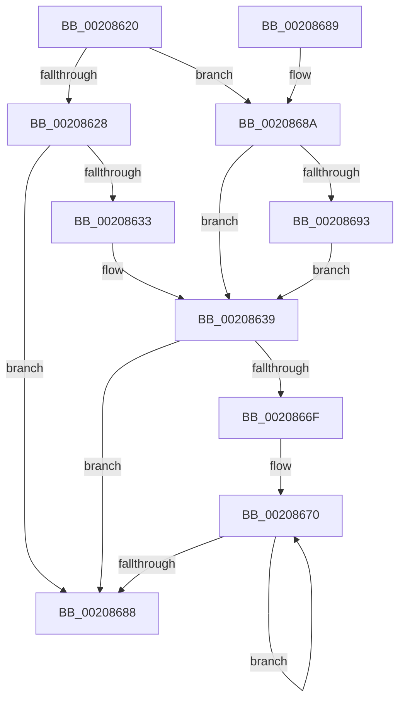

# RtlBackoff

- RVA: `0x00208620`–`0x00208698` (길이 `120` bytes)
- VA: `0x0000000140208620`
- 실행 섹션: `.text`
- PDB 이름 있음: `예`; PDB Function 태그: `아니요`
- unwind 정보 RVA: `0x000DB714`
- 디코드: `39`개 명령, `120/120` bytes 표시
- 미해석 바이트: `0` (있으면 어셈블리에 `.byte`로 보존)

> 이 문서는 커널 이미지의 기계어와 PDB 기호를 분석해 생성했습니다. 4번과 5번은 함수 원형과 자료형을 바이너리 사용 방식에서 추정한 C 해석이며 원본 소스 복구 결과는 아닙니다.

## 1. Dependencies

- 직접 호출 지점: **0**; 고유 호출 대상: **0**
- 직접 호출자로 확인된 함수: **8**
- RIP 상대 이미지 참조: **1**

### Outgoing calls
- 직접 디코드된 call 명령이 없습니다.

### Direct callers
- [sub_00207D3E](Unknown_function_00207D3E.md) at `0x002080EF`
- [ExfAcquirePushLockExclusiveEx](ExfAcquirePushLockExclusiveEx_function_0020FC90.md) at `0x0020FF2A`
- [ExfAcquirePushLockSharedEx](../21/ExfAcquirePushLockSharedEx_function_0021044C.md) at `0x00210505`
- [KiRetireDpcList](../21/KiRetireDpcList_function_0021A0B0.md) at `0x0021A808`
- [RtlAcquireSwapReference](../37/RtlAcquireSwapReference_function_00378684.md) at `0x003786C8`
- [RtlpFcAddDelayedUsageReportToBuffer](../37/RtlpFcAddDelayedUsageReportToBuffer_function_003786DC.md) at `0x00378826`
- [RtlReleaseSwapReference](../37/RtlReleaseSwapReference_function_0037885C.md) at `0x003788CF`
- [RtlpFcAddFeatureUsageDataToBuffer](../49/RtlpFcAddFeatureUsageDataToBuffer_function_0049C8CC.md) at `0x0049C95F`

### Static image references
- `0x00208628` → RVA `0x00FC6A80` (`ALMOSTRO`; read)

## 2. Other-region calls and transfers

- 다른 실행 섹션으로 향하는 call: **0**
- 별도 외부 분기/꼬리 이동을 확인하지 못했습니다.

## 3. Assembly (complete function range)

```asm
00208620  44 8B 01                        mov r8d, dword ptr [rcx]
00208623  45 85 C0                        test r8d, r8d
00208626  75 62                           jne 0x14020868a
00208628  8B 05 52 E4 DB 00               mov eax, dword ptr [rip + 0xdbe452]
0020862E  83 F8 01                        cmp eax, 1
00208631  74 55                           je 0x140208688
00208633  41 B8 40 00 00 00               mov r8d, 0x40
00208639  44 89 01                        mov dword ptr [rcx], r8d
0020863C  0F 31                           rdtsc
0020863E  48 C1 E2 20                     shl rdx, 0x20
00208642  41 8D 48 FF                     lea ecx, [r8 - 1]
00208646  48 0B C2                        or rax, rdx
00208649  33 D2                           xor edx, edx
0020864B  23 C1                           and eax, ecx
0020864D  48 B9 D6 02 00 00 80 F7 FF FF   movabs rcx, 0xfffff780000002d6
00208657  44 03 C0                        add r8d, eax
0020865A  0F B7 09                        movzx ecx, word ptr [rcx]
0020865D  43 8D 04 80                     lea eax, [r8 + r8*4]
00208661  03 C0                           add eax, eax
00208663  F7 F1                           div ecx
00208665  33 C9                           xor ecx, ecx
00208667  89 4C 24 08                     mov dword ptr [rsp + 8], ecx
0020866B  85 C0                           test eax, eax
0020866D  74 19                           je 0x140208688
0020866F  90                              nop
00208670  8B 54 24 08                     mov edx, dword ptr [rsp + 8]
00208674  8B 54 24 08                     mov edx, dword ptr [rsp + 8]
00208678  8B 54 24 08                     mov edx, dword ptr [rsp + 8]
0020867C  F3 90                           pause
0020867E  FF C1                           inc ecx
00208680  89 4C 24 08                     mov dword ptr [rsp + 8], ecx
00208684  3B C8                           cmp ecx, eax
00208686  72 E8                           jb 0x140208670
00208688  C3                              ret
00208689  CC                              int3
0020868A  41 81 F8 FF 1F 00 00            cmp r8d, 0x1fff
00208691  73 A6                           jae 0x140208639
00208693  45 03 C0                        add r8d, r8d
00208696  EB A1                           jmp 0x140208639
```

## 4. C-style interpretation (structured pseudocode)

```c
__int64 __fastcall RtlBackoff(__int64 a1, __int64 a2)
{
    __int64 result;
    unsigned int v_stack_p8;

    if ((unsigned int)((unsigned int)(*(unsigned int *)(a1))) != 0) goto loc_0020868A;
    if (((unsigned int)((unsigned int)(*(unsigned int *)(v_rip + 14410834)))) == 1) goto loc_00208688;
loc_00208639:
    *(unsigned int *)(a1) = 64;
    a2 = (a2) << (32);
    result = ((unsigned int)(*(unsigned int *)(v_rip + 14410834))) | (a2);
    a2 = 0;
    result = (unsigned int)((result) & ((unsigned int)(64 - 1)));
    a3 = (unsigned int)((64) + ((unsigned int)(result)));
    result = (unsigned int)((a3 + a3 * 4) + ((unsigned int)(a3 + a3 * 4)));
    a1 = 0;
    v_stack_p8 = 0;
    if ((unsigned int)(result) == 0) goto loc_00208688;
loc_00208670:
    a1 = (unsigned int)((a1) + 1);
    v_stack_p8 = (unsigned int)(a1);
    if (((unsigned int)(a1)) < ((unsigned int)(result))) goto loc_00208670;
loc_00208688:
    return result;
loc_0020868A:
    if (((unsigned int)(a3)) >= 0x1FFFULL) goto loc_00208639;
    a3 = (unsigned int)((a3) + ((unsigned int)(a3)));
    goto loc_00208639;
}
```

## 5. (Beta) C Style

```c
int64_t RtlBackoff(void *Arg1, int64_t Arg2)
{
    uint8_t *arg1 = (uint8_t *)Arg1;

    int64_t result;
    uint32_t v_stack_p8;

    if ((uint32_t)((uint32_t)(*(uint32_t *)(arg1))) != 0) goto loc_0020868A;
    if (((uint32_t)((uint32_t)(*(uint32_t *)(v_rip + 0xDBE452)))) == 1) goto loc_00208688;
loc_00208639:
    *(uint32_t *)(arg1) = 64;
    Arg2 = (Arg2) << (32);
    result = ((uint32_t)(*(uint32_t *)(v_rip + 0xDBE452))) | (Arg2);
    Arg2 = 0;
    result = (uint32_t)((result) & ((uint32_t)(64 - 1)));
    a3 = (uint32_t)((64) + ((uint32_t)(result)));
    result = (uint32_t)((a3 + a3 * 4) + ((uint32_t)(a3 + a3 * 4)));
    Arg1 = 0;
    v_stack_p8 = 0;
    if ((uint32_t)(result) == 0) goto loc_00208688;
loc_00208670:
    Arg1 = (uint32_t)((Arg1) + 1);
    v_stack_p8 = (uint32_t)(Arg1);
    if (((uint32_t)(Arg1)) < ((uint32_t)(result))) goto loc_00208670;
loc_00208688:
    return result;
loc_0020868A:
    if (((uint32_t)(a3)) >= 0x1FFFULL) goto loc_00208639;
    a3 = (uint32_t)((a3) + ((uint32_t)(a3)));
    goto loc_00208639;
}
```

### 관측된 메모리 오프셋

구조체 형식이 확인되지 않은 접근은 인자 기준의 오프셋으로만 기록했습니다.

| 기준 인자 | 오프셋 표현 | 폭 (bit) | 접근 |
|---|---:|---:|---|
| `Arg1` | `+ 0x0` | `32` | `R` |
| `Arg1` | `+ 0x0` | `32` | `W` |

## 6. Execution-region graph

[열기: 2D/3D 그래프와 함수 탐색 컨트롤 패널](../../../control-panel.html?section=text&rva=0x00208620&view=graph)

- 2D 그래프는 위에서 아래로 흐르고, 3D 그래프는 빈 공간을 드래그해 회전합니다. Shift+드래그는 이동, 휠은 확대·축소, 함수 노드 선택은 대상 보고서 이동입니다.

### Static fallback


