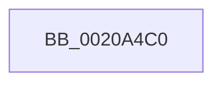

# RtlGetInterruptTimePrecise

- RVA: `0x0020A4C0`–`0x0020A4CF` (길이 `15` bytes)
- VA: `0x000000014020A4C0`
- 실행 섹션: `.text`
- PDB 이름 있음: `예`; PDB Function 태그: `아니요`
- unwind 정보 RVA: `0x0005D700`
- 디코드: `5`개 명령, `15/15` bytes 표시
- 미해석 바이트: `0` (있으면 어셈블리에 `.byte`로 보존)

> 이 문서는 커널 이미지의 기계어와 PDB 기호를 분석해 생성했습니다. 4번과 5번은 함수 원형과 자료형을 바이너리 사용 방식에서 추정한 C 해석이며 원본 소스 복구 결과는 아닙니다.

## 1. Dependencies

- 직접 호출 지점: **0**; 고유 호출 대상: **0**
- 직접 호출자로 확인된 함수: **63**
- RIP 상대 이미지 참조: **0**

### Outgoing calls
- 직접 디코드된 call 명령이 없습니다.

### Direct callers
- [HalpTimerClockInterrupt](HalpTimerClockInterrupt_function_002086A0.md) at `0x00208717`
- [sub_00208A9F](Unknown_function_00208A9F.md) at `0x00208B29`
- [KeQueryInterruptTimePrecise](KeQueryInterruptTimePrecise_function_00209530.md) at `0x00209534`
- [sub_00209822](Unknown_function_00209822.md) at `0x0020987B`
- [ExpUpdateTimerConfigurationWorker](../23/ExpUpdateTimerConfigurationWorker_function_00235410.md) at `0x00235522`
- [KiSetNextClockTickDueTime](../23/KiSetNextClockTickDueTime_function_002363F0.md) at `0x00236707`
- [KiSetClockTimerKTimerDeadlines](../23/KiSetClockTimerKTimerDeadlines_function_0023671C.md) at `0x002367F7`
- [PopFxIdleComponent](../2C/PopFxIdleComponent_function_002C01D8.md) at `0x002C026F`
- [PopFxIdleComponent](../2C/PopFxIdleComponent_function_002C01D8.md) at `0x002C031D`
- [HalpVpptAcknowledgeInterrupt](../2D/HalpVpptAcknowledgeInterrupt_function_002D2230.md) at `0x002D22EC`
- [HalpVpptUpdatePhysicalTimer](../2D/HalpVpptUpdatePhysicalTimer_function_002D23D8.md) at `0x002D23FD`
- [KeIntSteerSnapPerf](../2D/KeIntSteerSnapPerf_function_002D76C0.md) at `0x002D772C`
- [PpmUpdatePerformanceFeedback](../2D/PpmUpdatePerformanceFeedback_function_002DE580.md) at `0x002DE780`
- [PopIdleWakeNotifyDevicesActive](../30/PopIdleWakeNotifyDevicesActive_function_00303EC0.md) at `0x00303F3D`
- [PpmIdleCsVetoAccountingUpdateBlock](../30/PpmIdleCsVetoAccountingUpdateBlock_function_003040B0.md) at `0x003040DF`
- [PpmIdleCsVetoAccountingUpdateBlock](../30/PpmIdleCsVetoAccountingUpdateBlock_function_003040B0.md) at `0x0030410F`
- [PpmUpdateIdleVeto](../30/PpmUpdateIdleVeto_function_00304930.md) at `0x003049BF`
- [PpmUpdateIdleVeto](../30/PpmUpdateIdleVeto_function_00304930.md) at `0x00304A56`
- [KiTransitionSchedulingGroupGeneration](../30/KiTransitionSchedulingGroupGeneration_function_003094C8.md) at `0x003097E0`
- [KeUpdatePendingQosRequest](../39/KeUpdatePendingQosRequest_function_003924F4.md) at `0x00392575`
- [KeUpdatePendingQosRequest](../39/KeUpdatePendingQosRequest_function_003924F4.md) at `0x00392690`
- [KeClockInterruptNotify](../39/KeClockInterruptNotify_function_0039A970.md) at `0x0039AB1F`
- [KeClockInterruptNotify](../39/KeClockInterruptNotify_function_0039A970.md) at `0x0039ADA4`
- [KiUpdateTime](../39/KiUpdateTime_function_0039B530.md) at `0x0039BB52`
- [KiUpdateRunTime](../39/KiUpdateRunTime_function_0039BB70.md) at `0x0039BC3E`
- [KiUpdateRunTime](../39/KiUpdateRunTime_function_0039BB70.md) at `0x0039BE5C`
- [KiUpdateRunTime](../39/KiUpdateRunTime_function_0039BB70.md) at `0x0039C125`
- [PpmExecutePeriodicPerfCheck](../39/PpmExecutePeriodicPerfCheck_function_0039D0CC.md) at `0x0039D26D`
- [KiSetClockTimer](../39/KiSetClockTimer_function_0039DB2C.md) at `0x0039DC2F`
- [KiSetClockIntervalToMinimumRequested](../39/KiSetClockIntervalToMinimumRequested_function_0039DF1C.md) at `0x0039DF6A`
- [KiShouldRearmClockTimer](../39/KiShouldRearmClockTimer_function_0039E134.md) at `0x0039E21B`
- [KeSetTimer2](../3A/KeSetTimer2_function_003A08E0.md) at `0x003A0B2C`
- [KiCheckAndRearmForceIdle](../3A/KiCheckAndRearmForceIdle_function_003A1C58.md) at `0x003A1D31`
- [KiExpireTimer2](../3A/KiExpireTimer2_function_003A24E0.md) at `0x003A27A7`
- [PpmCheckStart](../3B/PpmCheckStart_function_003BEE14.md) at `0x003BEE28`
- [sub_003C6144](../3C/Unknown_function_003C6144.md) at `0x003C6149`
- [PopPushPowerStateTransitionRecordWithCallback](../43/PopPushPowerStateTransitionRecordWithCallback_function_00430A04.md) at `0x00430ADD`
- [PopCalculateCsSummary](../43/PopCalculateCsSummary_function_0043A1B0.md) at `0x0043A1F8`
- [KiSetClockTickRate](../43/KiSetClockTickRate_function_0043FEA0.md) at `0x0043FF2B`
- [KiSetClockTickRate](../43/KiSetClockTickRate_function_0043FEA0.md) at `0x00440067`
- [PpmResetPerfEngineForProcessor](../44/PpmResetPerfEngineForProcessor_function_0044F7D0.md) at `0x0044F890`
- [PopSetWatchdog](../46/PopSetWatchdog_function_00460CAC.md) at `0x00460CCE`
- [PopSetWatchdog](../46/PopSetWatchdog_function_00460CAC.md) at `0x00460D2A`
- [PopSetWatchdog](../46/PopSetWatchdog_function_00460CAC.md) at `0x00460D74`
- [PopSetWatchdog](../46/PopSetWatchdog_function_00460CAC.md) at `0x00460D92`
- [PopSetWatchdog](../46/PopSetWatchdog_function_00460CAC.md) at `0x00460E22`
- [PopSetWatchdog](../46/PopSetWatchdog_function_00460CAC.md) at `0x00460E91`
- [PopFxResidentTimeoutRoutine](../46/PopFxResidentTimeoutRoutine_function_00462650.md) at `0x004626D7`
- [KiCancelClockTimer](../47/KiCancelClockTimer_function_004743CC.md) at `0x00474449`
- [KiSetClockInterval](../47/KiSetClockInterval_function_00475064.md) at `0x00475126`
- [KeSetForceIdle](../48/KeSetForceIdle_function_0048D5A8.md) at `0x0048D65D`
- [PpmEventTracePreVetoAccounting](../49/PpmEventTracePreVetoAccounting_function_00490F88.md) at `0x0049103F`
- [HalpVpptArmTimer](../4A/HalpVpptArmTimer_function_004AFFE0.md) at `0x004B004A`
- [PopIdleWakeNotifyModernStandbyExit](../4B/PopIdleWakeNotifyModernStandbyExit_function_004B4034.md) at `0x004B4087`
- [PopSetModernStandbyTransitionReason](../4B/PopSetModernStandbyTransitionReason_function_004BFFCC.md) at `0x004BFFE5`
- [PpmIdleEvaluateConstraints](../4C/PpmIdleEvaluateConstraints_function_004CD400.md) at `0x004CD426`
- [PopRecordPowerWatchdogBlackboxInformation](../4D/PopRecordPowerWatchdogBlackboxInformation_function_004D3A18.md) at `0x004D3AF1`
- [KiResumeClockTimer](../4F/KiResumeClockTimer_function_004F6420.md) at `0x004F64AE`
- [HalpWatchdogCheckPreResetNMI](../54/HalpWatchdogCheckPreResetNMI_function_0054C7F4.md) at `0x0054C877`
- [HalpWatchdogDelayExpiration](../54/HalpWatchdogDelayExpiration_function_0054C8E0.md) at `0x0054C919`
- [HalpTimerAlwaysOnClockInterrupt](../56/HalpTimerAlwaysOnClockInterrupt_function_00560240.md) at `0x0056029D`
- [HalpTimerWatchdogPreResetInterrupt](../56/HalpTimerWatchdogPreResetInterrupt_function_005605C0.md) at `0x00560613`
- [KeGetNextClockTickDuration](../5B/KeGetNextClockTickDuration_function_005BA350.md) at `0x005BA3C2`
- [KePrepareClockTimerForIdle](../5B/KePrepareClockTimerForIdle_function_005BA49C.md) at `0x005BA4EA`
- [KePrepareClockTimerForPlatformIdle](../5B/KePrepareClockTimerForPlatformIdle_function_005BA820.md) at `0x005BA9E4`
- [KePrepareClockTimerForPlatformIdle](../5B/KePrepareClockTimerForPlatformIdle_function_005BA820.md) at `0x005BAAAD`
- [KeResumeClockTimerFromIdle](../5B/KeResumeClockTimerFromIdle_function_005BACC4.md) at `0x005BB1EE`
- [KiResetClockInterval](../5B/KiResetClockInterval_function_005BB8BC.md) at `0x005BB906`
- [PpmIdlePrevetoWatchdog](../5D/PpmIdlePrevetoWatchdog_function_005D0010.md) at `0x005D006F`
- [PopWatchdogDpc](../5D/PopWatchdogDpc_function_005DA160.md) at `0x005DA182`
- [PopWatchdogDpc](../5D/PopWatchdogDpc_function_005DA160.md) at `0x005DA1B5`
- [PopWatchdogWorker](../5D/PopWatchdogWorker_function_005DA200.md) at `0x005DA21D`
- [PopWatchdogWorker](../5D/PopWatchdogWorker_function_005DA200.md) at `0x005DA24D`
- [PopWatchdogWorker](../5D/PopWatchdogWorker_function_005DA200.md) at `0x005DA32D`
- [PopWatchdogWorker](../5D/PopWatchdogWorker_function_005DA200.md) at `0x005DA3A7`
- [sub_006D6552](../6D/Unknown_function_006D6552.md) at `0x006D6582`
- [sub_006DD630](../6D/Unknown_function_006DD630.md) at `0x006DD698`
- [sub_006E638A](../6E/Unknown_function_006E638A.md) at `0x006E63B4`
- [sub_006E650A](../6E/Unknown_function_006E650A.md) at `0x006E6537`
- [sub_006FB870](../6F/Unknown_function_006FB870.md) at `0x006FB896`
- [PopSleepstudyInitialize](../../init/C7/PopSleepstudyInitialize_function_00C76C60.md) at `0x00C76CDB`

### Static image references
- 디코드된 RIP-relative 메모리 참조가 없습니다.

## 2. Other-region calls and transfers

- 다른 실행 섹션으로 향하는 call: **0**
- 별도 외부 분기/꼬리 이동을 확인하지 못했습니다.

## 3. Assembly (complete function range)

```asm
0020A4C0  48 89 4C 24 08                  mov qword ptr [rsp + 8], rcx
0020A4C5  41 54                           push r12
0020A4C7  41 56                           push r14
0020A4C9  41 57                           push r15
0020A4CB  48 83 EC 60                     sub rsp, 0x60
```

## 4. C-style interpretation (structured pseudocode)

```c
void __fastcall RtlGetInterruptTimePrecise(__int64 a1)
{
    __int64 v_rsp;
    unsigned __int64 v_stack_p8;

    v_stack_p8 = a1;
    v_rsp = (v_rsp) - (96);
    return;
}
```

## 5. (Beta) C Style

```c
void RtlGetInterruptTimePrecise(int64_t Arg1)
{
    int64_t local_rsp;
    uint64_t v_stack_p8;

    v_stack_p8 = Arg1;
    local_rsp = (local_rsp) - (96);
    return;
}
```

## 6. Execution-region graph

[열기: 2D/3D 그래프와 함수 탐색 컨트롤 패널](../../../control-panel.html?section=text&rva=0x0020A4C0&view=graph)

- 2D 그래프는 위에서 아래로 흐르고, 3D 그래프는 빈 공간을 드래그해 회전합니다. Shift+드래그는 이동, 휠은 확대·축소, 함수 노드 선택은 대상 보고서 이동입니다.

### Static fallback


