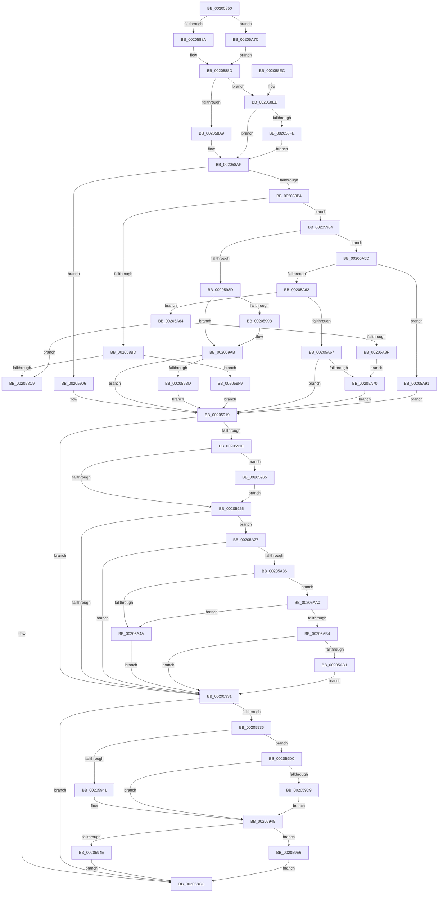

# SMKM_STORE_MGR&lt;SM_TRAITS&gt;::SmIoCtxWorkItemComplete

- RVA: `0x00205850`–`0x00205AEB` (길이 `667` bytes)
- VA: `0x0000000140205850`
- 실행 섹션: `.text`
- PDB 이름 있음: `예`; PDB Function 태그: `아니요`
- unwind 정보 RVA: `0x0005CD9C`
- 디코드: `179`개 명령, `667/667` bytes 표시
- 미해석 바이트: `0` (있으면 어셈블리에 `.byte`로 보존)

> 이 문서는 커널 이미지의 기계어와 PDB 기호를 분석해 생성했습니다. 4번과 5번은 함수 원형과 자료형을 바이너리 사용 방식에서 추정한 C 해석이며 원본 소스 복구 결과는 아닙니다.

## 1. Dependencies

- 직접 호출 지점: **11**; 고유 호출 대상: **10**
- 직접 호출자로 확인된 함수: **1**
- RIP 상대 이미지 참조: **0**

### Outgoing calls
- `0x00205914` → [SMKM_STORE_MGR<SM_TRAITS>::SmProcessAddCompletion](../47/SMKM_STORE_MGR_SM_TRAITS_SmProcessAddCompletion_function_00471510.md) (function, `0x00471510`)
- `0x0020595B` → [MiStoreModifiedWriteComplete](MiStoreModifiedWriteComplete_function_002045E8.md) (function, `0x002045E8`)
- `0x0020597D` → [MmMapLockedPagesSpecifyCache](../31/MmMapLockedPagesSpecifyCache_function_00318800.md) (function, `0x00318800`)
- `0x002059C6` → [SmAcquireReleaseResAvailForRead](../28/SmAcquireReleaseResAvailForRead_function_0028AD20.md) (function, `0x0028AD20`)
- `0x002059EF` → [KeSetEvent](../33/KeSetEvent_function_0033F310.md) (function, `0x0033F310`)
- `0x00205A07` → [SMKM_STORE_MGR<SM_TRAITS>::SmFeEvictComplete](../26/SMKM_STORE_MGR_SM_TRAITS_SmFeEvictComplete_function_00266854.md) (function, `0x00266854`)
- `0x00205A1A` → [MmStoreEvictComplete](../3E/MmStoreEvictComplete_function_003E1840.md) (function, `0x003E1840`)
- `0x00205A50` → [MmUnmapLockedPages](../24/MmUnmapLockedPages_function_00246E60.md) (function, `0x00246E60`)
- `0x00205AAB` → [SmpFpReleaseResource](../4F/SmpFpReleaseResource_function_004FAC90.md) (function, `0x004FAC90`)
- `0x00205ABF` → [MmUnmapReservedMapping](../3E/MmUnmapReservedMapping_function_003E7BE0.md) (function, `0x003E7BE0`)
- `0x00205AE1` → [KeSetEvent](../33/KeSetEvent_function_0033F310.md) (function, `0x0033F310`)

### Direct callers
- [sub_002055DD](Unknown_function_002055DD.md) at `0x0020565E`

### Static image references
- 디코드된 RIP-relative 메모리 참조가 없습니다.

## 2. Other-region calls and transfers

- 다른 실행 섹션으로 향하는 call: **0**
- 별도 외부 분기/꼬리 이동을 확인하지 못했습니다.

## 3. Assembly (complete function range)

```asm
00205850  48 89 5C 24 08                  mov qword ptr [rsp + 8], rbx
00205855  48 89 6C 24 10                  mov qword ptr [rsp + 0x10], rbp
0020585A  48 89 74 24 18                  mov qword ptr [rsp + 0x18], rsi
0020585F  57                              push rdi
00205860  41 54                           push r12
00205862  41 55                           push r13
00205864  41 56                           push r14
00205866  41 57                           push r15
00205868  48 83 EC 30                     sub rsp, 0x30
0020586C  48 8B 79 20                     mov rdi, qword ptr [rcx + 0x20]
00205870  45 33 E4                        xor r12d, r12d
00205873  4D 8B D0                        mov r10, r8
00205876  4C 8B EA                        mov r13, rdx
00205879  48 8B F1                        mov rsi, rcx
0020587C  45 8D 74 24 01                  lea r14d, [r12 + 1]
00205881  49 3B FE                        cmp rdi, r14
00205884  0F 86 F2 01 00 00               jbe 0x140205a7c
0020588A  48 8B 2F                        mov rbp, qword ptr [rdi]
0020588D  8B 01                           mov eax, dword ptr [rcx]
0020588F  8B C8                           mov ecx, eax
00205891  41 8B 90 90 1A 00 00            mov edx, dword ptr [r8 + 0x1a90]
00205898  83 E1 07                        and ecx, 7
0020589B  81 E2 FF 03 00 00               and edx, 0x3ff
002058A1  F7 C1 FD FF FF FF               test ecx, 0xfffffffd
002058A7  74 44                           je 0x1402058ed
002058A9  4D 8B FC                        mov r15, r12
002058AC  45 8B C4                        mov r8d, r12d
002058AF  83 E0 07                        and eax, 7
002058B2  74 52                           je 0x140205906
002058B4  41 2B C6                        sub eax, r14d
002058B7  0F 85 C7 00 00 00               jne 0x140205984
002058BD  8B 46 10                        mov eax, dword ptr [rsi + 0x10]
002058C0  41 84 C6                        test r14b, al
002058C3  0F 84 30 01 00 00               je 0x1402059f9
002058C9  45 8B F4                        mov r14d, r12d
002058CC  48 8B 5C 24 60                  mov rbx, qword ptr [rsp + 0x60]
002058D1  41 8B C6                        mov eax, r14d
002058D4  48 8B 6C 24 68                  mov rbp, qword ptr [rsp + 0x68]
002058D9  48 8B 74 24 70                  mov rsi, qword ptr [rsp + 0x70]
002058DE  48 83 C4 30                     add rsp, 0x30
002058E2  41 5F                           pop r15
002058E4  41 5E                           pop r14
002058E6  41 5D                           pop r13
002058E8  41 5C                           pop r12
002058EA  5F                              pop rdi
002058EB  C3                              ret
002058EC  CC                              int3
002058ED  4C 8B 7E 10                     mov r15, qword ptr [rsi + 0x10]
002058F1  45 8B 47 28                     mov r8d, dword ptr [r15 + 0x28]
002058F5  41 C1 E8 0C                     shr r8d, 0xc
002058F9  83 F9 02                        cmp ecx, 2
002058FC  75 B1                           jne 0x1402058af
002058FE  4C 89 67 08                     mov qword ptr [rdi + 8], r12
00205902  8B 06                           mov eax, dword ptr [rsi]
00205904  EB A9                           jmp 0x1402058af
00205906  44 89 4C 24 20                  mov dword ptr [rsp + 0x20], r9d
0020590B  48 8B D6                        mov rdx, rsi
0020590E  4D 8B CA                        mov r9, r10
00205911  49 8B CD                        mov rcx, r13
00205914  E8 F7 BB 26 00                  call 0x140471510
00205919  4D 85 FF                        test r15, r15
0020591C  74 13                           je 0x140205931
0020591E  41 F6 47 0A 05                  test byte ptr [r15 + 0xa], 5
00205923  74 40                           je 0x140205965
00205925  8B 06                           mov eax, dword ptr [rsi]
00205927  24 07                           and al, 7
00205929  3C 02                           cmp al, 2
0020592B  0F 84 F6 00 00 00               je 0x140205a27
00205931  48 85 ED                        test rbp, rbp
00205934  74 96                           je 0x1402058cc
00205936  8B 06                           mov eax, dword ptr [rsi]
00205938  83 E0 07                        and eax, 7
0020593B  0F 85 8F 00 00 00               jne 0x1402059d0
00205941  4C 89 67 08                     mov qword ptr [rdi + 8], r12
00205945  48 85 ED                        test rbp, rbp
00205948  0F 88 98 00 00 00               js 0x1402059e6
0020594E  48 B9 00 00 00 00 00 00 00 80   movabs rcx, 0x8000000000000000
00205958  48 0B CD                        or rcx, rbp
0020595B  E8 88 EC FF FF                  call 0x1402045e8
00205960  E9 67 FF FF FF                  jmp 0x1402058cc
00205965  C7 44 24 28 10 00 00 40         mov dword ptr [rsp + 0x28], 0x40000010
0020596D  45 33 C9                        xor r9d, r9d
00205970  45 8B C6                        mov r8d, r14d
00205973  44 89 64 24 20                  mov dword ptr [rsp + 0x20], r12d
00205978  33 D2                           xor edx, edx
0020597A  49 8B CF                        mov rcx, r15
0020597D  E8 7E 2E 11 00                  call 0x140318800
00205982  EB A1                           jmp 0x140205925
00205984  41 2B C6                        sub eax, r14d
00205987  0F 85 D0 00 00 00               jne 0x140205a5d
0020598D  8B 46 08                        mov eax, dword ptr [rsi + 8]
00205990  48 8B 4E 20                     mov rcx, qword ptr [rsi + 0x20]
00205994  0F B6 D0                        movzx edx, al
00205997  84 C0                           test al, al
00205999  74 10                           je 0x1402059ab
0020599B  66 89 51 08                     mov word ptr [rcx + 8], dx
0020599F  41 F6 85 D0 07 00 00 08         test byte ptr [r13 + 0x7d0], 8
002059A7  45 0F 45 CC                     cmovne r9d, r12d
002059AB  44 89 09                        mov dword ptr [rcx], r9d
002059AE  41 8B 85 D0 07 00 00            mov eax, dword ptr [r13 + 0x7d0]
002059B5  A8 10                           test al, 0x10
002059B7  0F 84 5C FF FF FF               je 0x140205919
002059BD  45 8B CE                        mov r9d, r14d
002059C0  48 8B D7                        mov rdx, rdi
002059C3  49 8B CD                        mov rcx, r13
002059C6  E8 55 53 08 00                  call 0x14028ad20
002059CB  E9 49 FF FF FF                  jmp 0x140205919
002059D0  83 F8 02                        cmp eax, 2
002059D3  0F 85 6C FF FF FF               jne 0x140205945
002059D9  48 81 67 08 FF FF 00 00         and qword ptr [rdi + 8], 0xffff
002059E1  E9 5F FF FF FF                  jmp 0x140205945
002059E6  45 33 C0                        xor r8d, r8d
002059E9  41 8B D6                        mov edx, r14d
002059EC  48 8B CD                        mov rcx, rbp
002059EF  E8 1C 99 13 00                  call 0x14033f310
002059F4  E9 D3 FE FF FF                  jmp 0x1402058cc
002059F9  44 8B 46 0C                     mov r8d, dword ptr [rsi + 0xc]
002059FD  44 8B CA                        mov r9d, edx
00205A00  48 8D 56 08                     lea rdx, [rsi + 8]
00205A04  49 8B CD                        mov rcx, r13
00205A07  E8 48 0E 06 00                  call 0x140266854
00205A0C  8B 56 08                        mov edx, dword ptr [rsi + 8]
00205A0F  44 8B 46 0C                     mov r8d, dword ptr [rsi + 0xc]
00205A13  49 8B 8D 30 08 00 00            mov rcx, qword ptr [r13 + 0x830]
00205A1A  E8 21 BE 1D 00                  call 0x1403e1840
00205A1F  44 89 27                        mov dword ptr [rdi], r12d
00205A22  E9 F2 FE FF FF                  jmp 0x140205919
00205A27  41 8B 85 D0 07 00 00            mov eax, dword ptr [r13 + 0x7d0]
00205A2E  A8 02                           test al, 2
00205A30  0F 84 FB FE FF FF               je 0x140205931
00205A36  4D 8B 67 18                     mov r12, qword ptr [r15 + 0x18]
00205A3A  49 8D 9D A8 06 00 00            lea rbx, [r13 + 0x6a8]
00205A41  48 8B 43 70                     mov rax, qword ptr [rbx + 0x70]
00205A45  48 3B C7                        cmp rax, rdi
00205A48  74 56                           je 0x140205aa0
00205A4A  49 8B D7                        mov rdx, r15
00205A4D  49 8B CC                        mov rcx, r12
00205A50  E8 0B 14 04 00                  call 0x140246e60
00205A55  45 33 E4                        xor r12d, r12d
00205A58  E9 D4 FE FF FF                  jmp 0x140205931
00205A5D  41 2B C6                        sub eax, r14d
00205A60  74 2F                           je 0x140205a91
00205A62  41 2B C6                        sub eax, r14d
00205A65  74 1D                           je 0x140205a84
00205A67  41 3B C6                        cmp eax, r14d
00205A6A  0F 85 A9 FE FF FF               jne 0x140205919
00205A70  44 89 0F                        mov dword ptr [rdi], r9d
00205A73  4C 89 67 08                     mov qword ptr [rdi + 8], r12
00205A77  E9 9D FE FF FF                  jmp 0x140205919
00205A7C  49 8B EC                        mov rbp, r12
00205A7F  E9 09 FE FF FF                  jmp 0x14020588d
00205A84  8B 46 08                        mov eax, dword ptr [rsi + 8]
00205A87  A8 07                           test al, 7
00205A89  0F 84 3A FE FF FF               je 0x1402058c9
00205A8F  EB DF                           jmp 0x140205a70
00205A91  44 89 0F                        mov dword ptr [rdi], r9d
00205A94  8B 46 0C                        mov eax, dword ptr [rsi + 0xc]
00205A97  48 89 47 08                     mov qword ptr [rdi + 8], rax
00205A9B  E9 79 FE FF FF                  jmp 0x140205919
00205AA0  4D 8B C4                        mov r8, r12
00205AA3  BA 05 00 00 00                  mov edx, 5
00205AA8  48 8B CB                        mov rcx, rbx
00205AAB  E8 E0 51 2F 00                  call 0x1404fac90
00205AB0  85 C0                           test eax, eax
00205AB2  74 96                           je 0x140205a4a
00205AB4  4D 8B C7                        mov r8, r15
00205AB7  BA 73 6D 52 6D                  mov edx, 0x6d526d73
00205ABC  49 8B CC                        mov rcx, r12
00205ABF  E8 1C 21 1E 00                  call 0x1403e7be0
00205AC4  45 33 E4                        xor r12d, r12d
00205AC7  44 38 63 5E                     cmp byte ptr [rbx + 0x5e], r12b
00205ACB  0F 85 60 FE FF FF               jne 0x140205931
00205AD1  41 8B C4                        mov eax, r12d
00205AD4  48 8D 4B 08                     lea rcx, [rbx + 8]
00205AD8  48 87 43 70                     xchg qword ptr [rbx + 0x70], rax
00205ADC  45 33 C0                        xor r8d, r8d
00205ADF  33 D2                           xor edx, edx
00205AE1  E8 2A 98 13 00                  call 0x14033f310
00205AE6  E9 46 FE FF FF                  jmp 0x140205931
```

## 4. C-style interpretation (structured pseudocode)

```c
__int64 __fastcall SMKM_STORE_MGR_SM_TRAITS___SmIoCtxWorkItemComplete(__int64 a1, __int64 a2, __int64 a3, int a4)
{
    __int64 result;
    __int64 v_r12;
    __int64 v_rsp;
    unsigned __int64 v_stack_p10;
    unsigned __int64 v_stack_p18;
    unsigned int v_stack_p20;
    unsigned int v_stack_p28;
    unsigned __int64 v_stack_p8;

    v_stack_p8 = v_rbx;
    v_stack_p10 = v_rbp;
    v_stack_p18 = v_rsi;
    v_rsp = (v_rsp) - (48);
    v_r12 = 0;
    if ((*(unsigned __int64 *)(a1 + 32)) <= (v_r12 + 1)) goto loc_00205A7C;
loc_0020588D:
    a1 = (unsigned int)(((unsigned int)((unsigned int)((unsigned int)(*(unsigned int *)(a1))))) & (7));
    a2 = (unsigned int)(((unsigned int)(*(unsigned int *)(a3 + 6800))) & (0x3FFULL));
    if ((((unsigned int)(a1)) & (0xFFFFFFFDULL)) == 0) goto loc_002058ED;
loc_002058AF:
    result = (unsigned int)(((unsigned int)(*(unsigned int *)(a1))) & (7));
    if (condition_is_equal) goto loc_00205906;
    result = (unsigned int)((result) - ((unsigned int)(v_r12 + 1)));
    if (condition_is_not_equal) goto loc_00205984;
    if ((((unsigned __int8)(v_r12 + 1)) & ((unsigned __int8)((unsigned int)(*(unsigned int *)(a1 + 16))))) == 0) goto loc_002059F9;
loc_002058C9:
loc_002058CC:
    v_rsp = (v_rsp) + (48);
    return 0;
loc_002058ED:
    a3 = (unsigned int)(((unsigned int)(*(unsigned int *)(*(unsigned __int64 *)(v_stack_p18 + 16) + 40))) >> (12));
    if (((unsigned int)(a1)) != 2) goto loc_002058AF;
    *(unsigned __int64 *)(*(unsigned __int64 *)(a1 + 32) + 8) = 0;
    goto loc_002058AF;
loc_00205906:
    v_stack_p20 = a4;
    result = SMKM_STORE_MGR_SM_TRAITS___SmProcessAddCompletion(a2, v_stack_p18, a3, a3);
loc_00205919:
    if (*(unsigned __int64 *)(v_stack_p18 + 16) == 0) goto loc_00205931;
    if (((*(unsigned __int8 *)(*(unsigned __int64 *)(v_stack_p18 + 16) + 10)) & (5)) == 0) goto loc_00205965;
loc_00205925:
    result = (unsigned __int8)(((unsigned int)(*(unsigned int *)(v_stack_p18))) & (7));
    if (((unsigned __int8)(result)) == 2) goto loc_00205A27;
loc_00205931:
    if (v_stack_p10 == 0) goto loc_002058CC;
    result = (unsigned int)(((unsigned int)(*(unsigned int *)(v_stack_p18))) & (7));
    if (condition_is_not_equal) goto loc_002059D0;
    *(unsigned __int64 *)(*(unsigned __int64 *)(a1 + 32) + 8) = 0;
loc_00205945:
    if (sign_flag) goto loc_002059E6;
    a1 = (a2) | (v_stack_p10);
    result = MiStoreModifiedWriteComplete(a1, v_stack_p18, a3, a3);
    goto loc_002058CC;
loc_00205965:
    v_stack_p28 = 0x40000010ULL;
    a4 = 0;
    v_stack_p20 = 0;
    a2 = 0;
    result = MmMapLockedPagesSpecifyCache(*(unsigned __int64 *)(v_stack_p18 + 16), a2, 0, a4);
    goto loc_00205925;
loc_00205984:
    result = (unsigned int)((result) - (0));
    if (condition_is_not_equal) goto loc_00205A5D;
    if ((unsigned __int8)((unsigned int)(*(unsigned int *)(v_stack_p18 + 8))) != 0) {
        *(unsigned __int16 *)(*(unsigned __int64 *)(v_stack_p18 + 32) + 8) = (unsigned __int16)((unsigned __int8)((unsigned int)(*(unsigned int *)(v_stack_p18 + 8))));
        if (((*(unsigned __int8 *)(a2 + 2000)) & (8)) != 0) { a4 = 0; }
    }
    *(unsigned int *)(*(unsigned __int64 *)(v_stack_p18 + 32)) = a4;
    if ((((unsigned __int8)((unsigned int)(*(unsigned int *)(a2 + 2000)))) & (16)) == 0) goto loc_00205919;
    result = SmAcquireReleaseResAvailForRead(0, *(unsigned __int64 *)(a1 + 32), 0, 0);
    goto loc_00205919;
loc_002059D0:
    if (((unsigned int)(result)) != 2) goto loc_00205945;
    goto loc_00205945;
loc_002059E6:
    a3 = 0;
    result = KeSetEvent(v_stack_p10, 0, a3, 0);
    goto loc_002058CC;
loc_002059F9:
    result = SMKM_STORE_MGR_SM_TRAITS___SmFeEvictComplete(0, v_stack_p18 + 8, (unsigned int)(*(unsigned int *)(v_stack_p18 + 12)), 0);
    result = MmStoreEvictComplete(*(unsigned __int64 *)(a2 + 2096), (unsigned int)(*(unsigned int *)(v_stack_p18 + 8)), (unsigned int)(*(unsigned int *)(v_stack_p18 + 12)), 0);
    *(unsigned int *)(*(unsigned __int64 *)(a1 + 32)) = 0;
    goto loc_00205919;
loc_00205A27:
    if ((((unsigned __int8)((unsigned int)(*(unsigned int *)(a2 + 2000)))) & (2)) == 0) goto loc_00205931;
    if ((*(unsigned __int64 *)(a2 + 1704 + 112)) == (*(unsigned __int64 *)(a1 + 32))) goto loc_00205AA0;
loc_00205A4A:
    result = MmUnmapLockedPages(*(unsigned __int64 *)(*(unsigned __int64 *)(v_stack_p18 + 16) + 24), *(unsigned __int64 *)(v_stack_p18 + 16), (unsigned int)(*(unsigned int *)(v_stack_p18 + 12)), 0);
    v_r12 = 0;
    goto loc_00205931;
loc_00205A5D:
    result = (unsigned int)((result) - (0));
    if (condition_is_equal) goto loc_00205A91;
    result = (unsigned int)((result) - (0));
    if (condition_is_equal) goto loc_00205A84;
    if (((unsigned int)(result)) != 0) goto loc_00205919;
loc_00205A70:
    *(unsigned int *)(*(unsigned __int64 *)(a1 + 32)) = 0;
    *(unsigned __int64 *)(*(unsigned __int64 *)(a1 + 32) + 8) = 0;
    goto loc_00205919;
loc_00205A7C:
    goto loc_0020588D;
loc_00205A84:
    if ((((unsigned __int8)((unsigned int)(*(unsigned int *)(v_stack_p18 + 8)))) & (7)) == 0) goto loc_002058C9;
    goto loc_00205A70;
loc_00205A91:
    *(unsigned int *)(*(unsigned __int64 *)(a1 + 32)) = 0;
    *(unsigned __int64 *)(*(unsigned __int64 *)(a1 + 32) + 8) = (unsigned int)(*(unsigned int *)(v_stack_p18 + 12));
    goto loc_00205919;
loc_00205AA0:
    result = SmpFpReleaseResource(a2 + 1704, 5, 0, 0);
    if ((unsigned int)(result) == 0) goto loc_00205A4A;
    result = MmUnmapReservedMapping(0, (unsigned int)(0x6D526D73ULL), *(unsigned __int64 *)(v_stack_p18 + 16), 0);
    v_r12 = 0;
    if ((*(unsigned __int8 *)(a2 + 1704 + 94)) != 0) goto loc_00205931;
    a3 = 0;
    a2 = 0;
    result = KeSetEvent(a2 + 1704 + 8, a2, a3, 0);
    goto loc_00205931;
}
```

## 5. (Beta) C Style

```c
int64_t SMKM_STORE_MGR_SM_TRAITS___SmIoCtxWorkItemComplete(void *Arg1, void *Arg2, void *Arg3, int32_t Arg4)
{
    uint8_t *arg1 = (uint8_t *)Arg1;
    uint8_t *arg2 = (uint8_t *)Arg2;
    uint8_t *arg3 = (uint8_t *)Arg3;

    int64_t result;
    int64_t local_r12;
    int64_t local_rsp;
    uint64_t v_stack_p10;
    uint64_t v_stack_p18;
    uint32_t v_stack_p20;
    uint32_t v_stack_p28;
    uint64_t v_stack_p8;

    v_stack_p8 = local_rbx;
    v_stack_p10 = local_rbp;
    v_stack_p18 = local_rsi;
    local_rsp = (local_rsp) - (48);
    local_r12 = 0;
    if ((*(uint64_t *)(arg1 + 0x20)) <= (local_r12 + 1)) goto loc_00205A7C;
loc_0020588D:
    Arg1 = (uint32_t)(((uint32_t)((uint32_t)((uint32_t)(*(uint32_t *)(arg1))))) & (7));
    Arg2 = (uint32_t)(((uint32_t)(*(uint32_t *)(arg3 + 0x1A90))) & (0x3FFULL));
    if ((((uint32_t)(Arg1)) & (0xFFFFFFFDULL)) == 0) goto loc_002058ED;
loc_002058AF:
    result = (uint32_t)(((uint32_t)(*(uint32_t *)(arg1))) & (7));
    if (condition_is_equal) goto loc_00205906;
    result = (uint32_t)((result) - ((uint32_t)(local_r12 + 1)));
    if (condition_is_not_equal) goto loc_00205984;
    if ((((uint8_t)(local_r12 + 1)) & ((uint8_t)((uint32_t)(*(uint32_t *)(arg1 + 0x10))))) == 0) goto loc_002059F9;
loc_002058C9:
loc_002058CC:
    local_rsp = (local_rsp) + (48);
    return 0;
loc_002058ED:
    Arg3 = (uint32_t)(((uint32_t)(*(uint32_t *)(*(uint64_t *)(v_stack_p18 + 0x10) + 0x28))) >> (12));
    if (((uint32_t)(Arg1)) != 2) goto loc_002058AF;
    *(uint64_t *)(*(uint64_t *)(arg1 + 0x20) + 0x8) = 0;
    goto loc_002058AF;
loc_00205906:
    v_stack_p20 = Arg4;
    result = SMKM_STORE_MGR_SM_TRAITS___SmProcessAddCompletion(Arg2, v_stack_p18, Arg3, Arg3);
loc_00205919:
    if (*(uint64_t *)(v_stack_p18 + 0x10) == 0) goto loc_00205931;
    if (((*(uint8_t *)(*(uint64_t *)(v_stack_p18 + 0x10) + 0xA)) & (5)) == 0) goto loc_00205965;
loc_00205925:
    result = (uint8_t)(((uint32_t)(*(uint32_t *)(v_stack_p18))) & (7));
    if (((uint8_t)(result)) == 2) goto loc_00205A27;
loc_00205931:
    if (v_stack_p10 == 0) goto loc_002058CC;
    result = (uint32_t)(((uint32_t)(*(uint32_t *)(v_stack_p18))) & (7));
    if (condition_is_not_equal) goto loc_002059D0;
    *(uint64_t *)(*(uint64_t *)(arg1 + 0x20) + 0x8) = 0;
loc_00205945:
    if (sign_flag) goto loc_002059E6;
    Arg1 = (Arg2) | (v_stack_p10);
    result = MiStoreModifiedWriteComplete(Arg1, v_stack_p18, Arg3, Arg3);
    goto loc_002058CC;
loc_00205965:
    v_stack_p28 = 0x40000010ULL;
    Arg4 = 0;
    v_stack_p20 = 0;
    Arg2 = 0;
    result = MmMapLockedPagesSpecifyCache(*(uint64_t *)(v_stack_p18 + 0x10), Arg2, 0, Arg4);
    goto loc_00205925;
loc_00205984:
    result = (uint32_t)((result) - (0));
    if (condition_is_not_equal) goto loc_00205A5D;
    if ((uint8_t)((uint32_t)(*(uint32_t *)(v_stack_p18 + 0x8))) != 0) {
        *(uint16_t *)(*(uint64_t *)(v_stack_p18 + 0x20) + 0x8) = (uint16_t)((uint8_t)((uint32_t)(*(uint32_t *)(v_stack_p18 + 0x8))));
        if (((*(uint8_t *)(arg2 + 0x7D0)) & (8)) != 0) { Arg4 = 0; }
    }
    *(uint32_t *)(*(uint64_t *)(v_stack_p18 + 0x20)) = Arg4;
    if ((((uint8_t)((uint32_t)(*(uint32_t *)(arg2 + 0x7D0)))) & (16)) == 0) goto loc_00205919;
    result = SmAcquireReleaseResAvailForRead(0, *(uint64_t *)(arg1 + 0x20), 0, 0);
    goto loc_00205919;
loc_002059D0:
    if (((uint32_t)(result)) != 2) goto loc_00205945;
    goto loc_00205945;
loc_002059E6:
    Arg3 = 0;
    result = KeSetEvent(v_stack_p10, 0, Arg3, 0);
    goto loc_002058CC;
loc_002059F9:
    result = SMKM_STORE_MGR_SM_TRAITS___SmFeEvictComplete(0, v_stack_p18 + 8, (uint32_t)(*(uint32_t *)(v_stack_p18 + 0xC)), 0);
    result = MmStoreEvictComplete(*(uint64_t *)(arg2 + 0x830), (uint32_t)(*(uint32_t *)(v_stack_p18 + 0x8)), (uint32_t)(*(uint32_t *)(v_stack_p18 + 0xC)), 0);
    *(uint32_t *)(*(uint64_t *)(arg1 + 0x20)) = 0;
    goto loc_00205919;
loc_00205A27:
    if ((((uint8_t)((uint32_t)(*(uint32_t *)(arg2 + 0x7D0)))) & (2)) == 0) goto loc_00205931;
    if ((*(uint64_t *)(arg2 + 0x6A8 + 0x70)) == (*(uint64_t *)(arg1 + 0x20))) goto loc_00205AA0;
loc_00205A4A:
    result = MmUnmapLockedPages(*(uint64_t *)(*(uint64_t *)(v_stack_p18 + 0x10) + 0x18), *(uint64_t *)(v_stack_p18 + 0x10), (uint32_t)(*(uint32_t *)(v_stack_p18 + 0xC)), 0);
    local_r12 = 0;
    goto loc_00205931;
loc_00205A5D:
    result = (uint32_t)((result) - (0));
    if (condition_is_equal) goto loc_00205A91;
    result = (uint32_t)((result) - (0));
    if (condition_is_equal) goto loc_00205A84;
    if (((uint32_t)(result)) != 0) goto loc_00205919;
loc_00205A70:
    *(uint32_t *)(*(uint64_t *)(arg1 + 0x20)) = 0;
    *(uint64_t *)(*(uint64_t *)(arg1 + 0x20) + 0x8) = 0;
    goto loc_00205919;
loc_00205A7C:
    goto loc_0020588D;
loc_00205A84:
    if ((((uint8_t)((uint32_t)(*(uint32_t *)(v_stack_p18 + 0x8)))) & (7)) == 0) goto loc_002058C9;
    goto loc_00205A70;
loc_00205A91:
    *(uint32_t *)(*(uint64_t *)(arg1 + 0x20)) = 0;
    *(uint64_t *)(*(uint64_t *)(arg1 + 0x20) + 0x8) = (uint32_t)(*(uint32_t *)(v_stack_p18 + 0xC));
    goto loc_00205919;
loc_00205AA0:
    result = SmpFpReleaseResource(Arg2 + 1704, 5, 0, 0);
    if ((uint32_t)(result) == 0) goto loc_00205A4A;
    result = MmUnmapReservedMapping(0, (uint32_t)(0x6D526D73ULL), *(uint64_t *)(v_stack_p18 + 0x10), 0);
    local_r12 = 0;
    if ((*(uint8_t *)(arg2 + 0x6A8 + 0x5E)) != 0) goto loc_00205931;
    Arg3 = 0;
    Arg2 = 0;
    result = KeSetEvent(Arg2 + 1704 + 8, Arg2, Arg3, 0);
    goto loc_00205931;
}
```

### 관측된 메모리 오프셋

구조체 형식이 확인되지 않은 접근은 인자 기준의 오프셋으로만 기록했습니다.

| 기준 인자 | 오프셋 표현 | 폭 (bit) | 접근 |
|---|---:|---:|---|
| `Arg1` | `+ 0x0` | `32` | `R` |
| `Arg1` | `+ 0x8` | `32` | `R` |
| `Arg1` | `+ 0x8` | `64` | `R` |
| `Arg1` | `+ 0xC` | `32` | `R` |
| `Arg1` | `+ 0x10` | `32` | `R` |
| `Arg1` | `+ 0x10` | `64` | `R` |
| `Arg1` | `+ 0x20` | `64` | `R` |
| `Arg2` | `+ 0x8` | `64` | `R` |
| `Arg2` | `+ 0x5E` | `8` | `R` |
| `Arg2` | `+ 0x70` | `64` | `R` |
| `Arg2` | `+ 0x70` | `64` | `R/W` |
| `Arg2` | `+ 0x6A8` | `64` | `R` |
| `Arg2` | `+ 0x7D0` | `8` | `R` |
| `Arg2` | `+ 0x7D0` | `32` | `R` |
| `Arg2` | `+ 0x830` | `64` | `R` |
| `Arg3` | `+ 0x1A90` | `32` | `R` |

## 6. Execution-region graph

[열기: 2D/3D 그래프와 함수 탐색 컨트롤 패널](../../../control-panel.html?section=text&rva=0x00205850&view=graph)

- 2D 그래프는 위에서 아래로 흐르고, 3D 그래프는 빈 공간을 드래그해 회전합니다. Shift+드래그는 이동, 휠은 확대·축소, 함수 노드 선택은 대상 보고서 이동입니다.

### Static fallback


