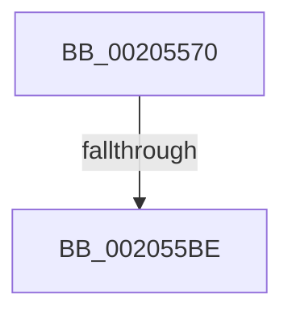

# SMKM_STORE_MGR&lt;SM_TRAITS&gt;::SmWorkItemFree

- RVA: `0x00205570`–`0x002055DD` (길이 `109` bytes)
- VA: `0x0000000140205570`
- 실행 섹션: `.text`
- PDB 이름 있음: `예`; PDB Function 태그: `예`
- unwind 정보 RVA: `0x0005CD54`
- 디코드: `30`개 명령, `109/109` bytes 표시
- 미해석 바이트: `0` (있으면 어셈블리에 `.byte`로 보존)

> 이 문서는 커널 이미지의 기계어와 PDB 기호를 분석해 생성했습니다. 4번과 5번은 함수 원형과 자료형을 바이너리 사용 방식에서 추정한 C 해석이며 원본 소스 복구 결과는 아닙니다.

## 1. Dependencies

- 직접 호출 지점: **0**; 고유 호출 대상: **0**
- 직접 호출자로 확인된 함수: **3**
- RIP 상대 이미지 참조: **0**

### Outgoing calls
- 직접 디코드된 call 명령이 없습니다.

### Direct callers
- [SMKM_STORE&lt;SM_TRAITS&gt;::SmStDirectReadComplete](SMKM_STORE_SM_TRAITS_SmStDirectReadComplete_function_00204968.md) at `0x00204988`
- [sub_00206865](Unknown_function_00206865.md) at `0x00206A45`
- [sub_006D8FB2](../6D/Unknown_function_006D8FB2.md) at `0x006D8FD2`

### Static image references
- 디코드된 RIP-relative 메모리 참조가 없습니다.

## 2. Other-region calls and transfers

- 다른 실행 섹션으로 향하는 call: **0**
- call이 아닌 외부 분기/꼬리 이동: **1**
  - `0x002055BC` → [sub_002055DD](Unknown_function_002055DD.md) (`tail-transfer`)

## 3. Assembly (complete function range)

```asm
00205570  48 89 5C 24 20                  mov qword ptr [rsp + 0x20], rbx
00205575  55                              push rbp
00205576  56                              push rsi
00205577  41 54                           push r12
00205579  41 56                           push r14
0020557B  41 57                           push r15
0020557D  48 83 EC 50                     sub rsp, 0x50
00205581  33 C0                           xor eax, eax
00205583  0F 57 C0                        xorps xmm0, xmm0
00205586  4C 8B F9                        mov r15, rcx
00205589  48 89 44 24 40                  mov qword ptr [rsp + 0x40], rax
0020558E  41 8B 08                        mov ecx, dword ptr [r8]
00205591  48 8B EA                        mov rbp, rdx
00205594  49 8B 50 20                     mov rdx, qword ptr [r8 + 0x20]
00205598  8B F1                           mov esi, ecx
0020559A  83 E6 07                        and esi, 7
0020559D  48 89 94 24 90 00 00 00         mov qword ptr [rsp + 0x90], rdx
002055A5  44 8D 60 01                     lea r12d, [rax + 1]
002055A9  4D 8B F1                        mov r14, r9
002055AC  49 8B D8                        mov rbx, r8
002055AF  0F 11 44 24 20                  movups xmmword ptr [rsp + 0x20], xmm0
002055B4  0F 11 44 24 30                  movups xmmword ptr [rsp + 0x30], xmm0
002055B9  4D 85 C9                        test r9, r9
002055BC  74 1F                           je 0x1402055dd
002055BE  41 0F 10 00                     movups xmm0, xmmword ptr [r8]
002055C2  41 0F 10 48 10                  movups xmm1, xmmword ptr [r8 + 0x10]
002055C7  0F 11 44 24 20                  movups xmmword ptr [rsp + 0x20], xmm0
002055CC  F2 41 0F 10 40 20               movsd xmm0, qword ptr [r8 + 0x20]
002055D2  F2 0F 11 44 24 40               movsd qword ptr [rsp + 0x40], xmm0
002055D8  0F 11 4C 24 30                  movups xmmword ptr [rsp + 0x30], xmm1
```

## 4. C-style interpretation (structured pseudocode)

```c
__int64 __fastcall SMKM_STORE_MGR_SM_TRAITS___SmWorkItemFree(__int64 a1, __int64 a2, __int64 a3, __int64 a4)
{
    __int64 result;
    __int64 v_rsi;
    __int64 v_rsp;
    unsigned __int64 v_stack_m38;
    unsigned __int64 v_stack_m48;
    unsigned __int64 v_stack_m58;
    unsigned __int64 v_stack_p18;
    unsigned __int64 v_stack_p20;

    v_stack_p20 = v_rbx;
    v_rsp = (v_rsp) - (80);
    result = 0;
    v_stack_m38 = 0;
    v_rsi = (unsigned int)(((unsigned int)((unsigned int)((unsigned int)(*(unsigned int *)(a3))))) & (7));
    v_stack_p18 = *(unsigned __int64 *)(a3 + 32);
    v_stack_m58 = v_xmm0;
    v_stack_m48 = v_xmm0;
    v_stack_m58 = v_xmm0;
    v_stack_m38 = v_xmm0;
    v_stack_m48 = v_xmm1;
    return result;
}
```

## 5. (Beta) C Style

```c
int64_t SMKM_STORE_MGR_SM_TRAITS___SmWorkItemFree(int64_t Arg1, int64_t Arg2, void *Arg3, int64_t Arg4)
{
    uint8_t *arg3 = (uint8_t *)Arg3;

    int64_t result;
    int64_t local_rsi;
    int64_t local_rsp;
    uint64_t v_stack_m38;
    uint64_t v_stack_m48;
    uint64_t v_stack_m58;
    uint64_t v_stack_p18;
    uint64_t v_stack_p20;

    v_stack_p20 = local_rbx;
    local_rsp = (local_rsp) - (80);
    result = 0;
    v_stack_m38 = 0;
    local_rsi = (uint32_t)(((uint32_t)((uint32_t)((uint32_t)(*(uint32_t *)(arg3))))) & (7));
    v_stack_p18 = *(uint64_t *)(arg3 + 0x20);
    v_stack_m58 = v_xmm0;
    v_stack_m48 = v_xmm0;
    v_stack_m58 = v_xmm0;
    v_stack_m38 = v_xmm0;
    v_stack_m48 = v_xmm1;
    return result;
}
```

### 관측된 메모리 오프셋

구조체 형식이 확인되지 않은 접근은 인자 기준의 오프셋으로만 기록했습니다.

| 기준 인자 | 오프셋 표현 | 폭 (bit) | 접근 |
|---|---:|---:|---|
| `Arg3` | `+ 0x0` | `32` | `R` |
| `Arg3` | `+ 0x0` | `128` | `R` |
| `Arg3` | `+ 0x10` | `128` | `R` |
| `Arg3` | `+ 0x20` | `64` | `R` |

## 6. Execution-region graph

[열기: 2D/3D 그래프와 함수 탐색 컨트롤 패널](../../../control-panel.html?section=text&rva=0x00205570&view=graph)

- 2D 그래프는 위에서 아래로 흐르고, 3D 그래프는 빈 공간을 드래그해 회전합니다. Shift+드래그는 이동, 휠은 확대·축소, 함수 노드 선택은 대상 보고서 이동입니다.

### Static fallback


