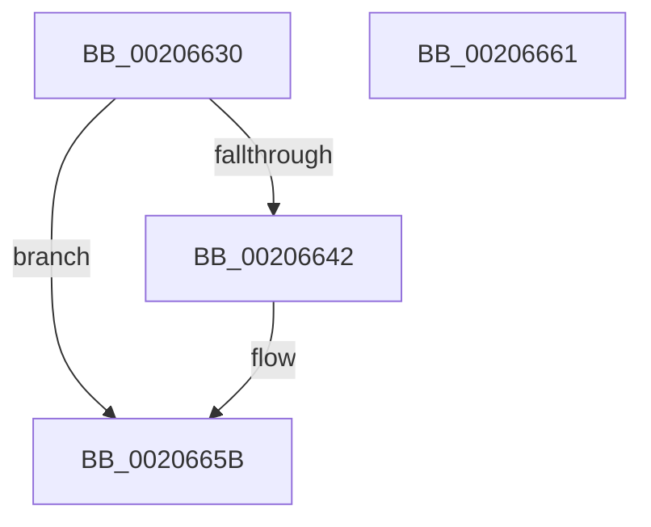

# SMKM_STORE&lt;SM_TRAITS&gt;::SmStAcquireStoreLockExclusive

- RVA: `0x00206630`–`0x00206662` (길이 `50` bytes)
- VA: `0x0000000140206630`
- 실행 섹션: `.text`
- PDB 이름 있음: `예`; PDB Function 태그: `아니요`
- unwind 정보 RVA: `0x0005CF00`
- 디코드: `13`개 명령, `50/50` bytes 표시
- 미해석 바이트: `0` (있으면 어셈블리에 `.byte`로 보존)

> 이 문서는 커널 이미지의 기계어와 PDB 기호를 분석해 생성했습니다. 4번과 5번은 함수 원형과 자료형을 바이너리 사용 방식에서 추정한 C 해석이며 원본 소스 복구 결과는 아닙니다.

## 1. Dependencies

- 직접 호출 지점: **1**; 고유 호출 대상: **1**
- 직접 호출자로 확인된 함수: **4**
- RIP 상대 이미지 참조: **0**

### Outgoing calls
- `0x00206649` → [StLockAcquireExclusive](../26/StLockAcquireExclusive_function_00266FF0.md) (function, `0x00266FF0`)

### Direct callers
- [ST_STORE&lt;SM_TRAITS&gt;::StDmpSinglePageAdd](ST_STORE_SM_TRAITS_StDmpSinglePageAdd_function_0020502C.md) at `0x00205266`
- [ST_STORE&lt;SM_TRAITS&gt;::StDmpSinglePageAdd](ST_STORE_SM_TRAITS_StDmpSinglePageAdd_function_0020502C.md) at `0x00205277`
- [sub_00206865](Unknown_function_00206865.md) at `0x002069A4`
- [sub_00206865](Unknown_function_00206865.md) at `0x00206C8E`
- [SMKM_STORE&lt;SM_TRAITS&gt;::SmStCleanup](../3B/SMKM_STORE_SM_TRAITS_SmStCleanup_function_003B00E0.md) at `0x003B01F3`
- [SMKM_STORE&lt;SM_TRAITS&gt;::SmStHelperSendCommand](../3B/SMKM_STORE_SM_TRAITS_SmStHelperSendCommand_function_003B0530.md) at `0x003B0629`

### Static image references
- 디코드된 RIP-relative 메모리 참조가 없습니다.

## 2. Other-region calls and transfers

- 다른 실행 섹션으로 향하는 call: **0**
- 별도 외부 분기/꼬리 이동을 확인하지 못했습니다.

## 3. Assembly (complete function range)

```asm
00206630  40 53                           push rbx
00206632  48 83 EC 20                     sub rsp, 0x20
00206636  F6 81 95 1A 00 00 04            test byte ptr [rcx + 0x1a95], 4
0020663D  48 8B D9                        mov rbx, rcx
00206640  74 19                           je 0x14020665b
00206642  48 81 C1 98 1A 00 00            add rcx, 0x1a98
00206649  E8 A2 09 06 00                  call 0x140266ff0
0020664E  48 FF 83 A8 1A 00 00            inc qword ptr [rbx + 0x1aa8]
00206655  89 83 A0 1A 00 00               mov dword ptr [rbx + 0x1aa0], eax
0020665B  48 83 C4 20                     add rsp, 0x20
0020665F  5B                              pop rbx
00206660  C3                              ret
00206661  CC                              int3
```

## 4. C-style interpretation (structured pseudocode)

```c
__int64 __fastcall SMKM_STORE_SM_TRAITS___SmStAcquireStoreLockExclusive(__int64 a1)
{
    __int64 result;
    __int64 v_rsp;

    v_rsp = (v_rsp) - (32);
    if (((*(unsigned __int8 *)(a1 + 6805)) & (4)) != 0) {
        a1 = (a1) + (0x1A98ULL);
        result = StLockAcquireExclusive(a1, a2, a3, a4);
        *(unsigned int *)(a1 + 6816) = (unsigned int)(result);
    }
    v_rsp = (v_rsp) + (32);
    return result;
}
```

## 5. (Beta) C Style

```c
int64_t SMKM_STORE_SM_TRAITS___SmStAcquireStoreLockExclusive(void *Arg1)
{
    uint8_t *arg1 = (uint8_t *)Arg1;

    int64_t result;
    int64_t local_rsp;

    local_rsp = (local_rsp) - (32);
    if (((*(uint8_t *)(arg1 + 0x1A95)) & (4)) != 0) {
        Arg1 = (Arg1) + (0x1A98ULL);
        result = StLockAcquireExclusive(Arg1, a2, a3, a4);
        *(uint32_t *)(arg1 + 0x1AA0) = (uint32_t)(result);
    }
    local_rsp = (local_rsp) + (32);
    return result;
}
```

### 관측된 메모리 오프셋

구조체 형식이 확인되지 않은 접근은 인자 기준의 오프셋으로만 기록했습니다.

| 기준 인자 | 오프셋 표현 | 폭 (bit) | 접근 |
|---|---:|---:|---|
| `Arg1` | `+ 0x1A95` | `8` | `R` |
| `Arg1` | `+ 0x1AA0` | `32` | `W` |
| `Arg1` | `+ 0x1AA8` | `64` | `R/W` |

## 6. Execution-region graph

[열기: 2D/3D 그래프와 함수 탐색 컨트롤 패널](../../../control-panel.html?section=text&rva=0x00206630&view=graph)

- 2D 그래프는 위에서 아래로 흐르고, 3D 그래프는 빈 공간을 드래그해 회전합니다. Shift+드래그는 이동, 휠은 확대·축소, 함수 노드 선택은 대상 보고서 이동입니다.

### Static fallback


