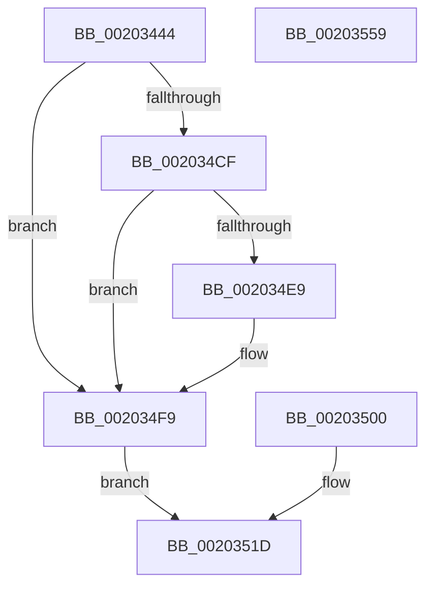

# SMKM_STORE&lt;SM_TRAITS&gt;::SmStDirectReadIssue

- RVA: `0x00203444`–`0x0020355A` (길이 `278` bytes)
- VA: `0x0000000140203444`
- 실행 섹션: `.text`
- PDB 이름 있음: `예`; PDB Function 태그: `아니요`
- unwind 정보 RVA: `0x0005CA38`
- 디코드: `73`개 명령, `278/278` bytes 표시
- 미해석 바이트: `0` (있으면 어셈블리에 `.byte`로 보존)

> 이 문서는 커널 이미지의 기계어와 PDB 기호를 분석해 생성했습니다. 4번과 5번은 함수 원형과 자료형을 바이너리 사용 방식에서 추정한 C 해석이며 원본 소스 복구 결과는 아닙니다.

## 1. Dependencies

- 직접 호출 지점: **5**; 고유 호출 대상: **4**
- 직접 호출자로 확인된 함수: **2**
- RIP 상대 이미지 참조: **0**

### Outgoing calls
- `0x00203499` → [SmUpdateReadStats](../47/SmUpdateReadStats_function_0047E300.md) (function, `0x0047E300`)
- `0x002034BA` → [ST_STORE<SM_TRAITS>::StDmPageRetrieve](../41/ST_STORE_SM_TRAITS_StDmPageRetrieve_function_0041FE20.md) (function, `0x0041FE20`)
- `0x002034D5` → [KiQueryUnbiasedInterruptTime](../42/KiQueryUnbiasedInterruptTime_function_0042D180.md) (function, `0x0042D180`)
- `0x002034F4` → [ST_STORE<SM_TRAITS>::StDmLazyWorkItemQueue](../3C/ST_STORE_SM_TRAITS_StDmLazyWorkItemQueue_function_003C2080.md) (function, `0x003C2080`)
- `0x0020353E` → [SmUpdateReadStats](../47/SmUpdateReadStats_function_0047E300.md) (function, `0x0047E300`)

### Direct callers
- [SMKM_STORE&lt;SM_TRAITS&gt;::SmStReadThread](SMKM_STORE_SM_TRAITS_SmStReadThread_function_00203230.md) at `0x0020339F`
- [SMKM_STORE&lt;SM_TRAITS&gt;::SmStDirectReadCallout](../2F/SMKM_STORE_SM_TRAITS_SmStDirectReadCallout_function_002FA3E0.md) at `0x002FA406`

### Static image references
- 디코드된 RIP-relative 메모리 참조가 없습니다.

## 2. Other-region calls and transfers

- 다른 실행 섹션으로 향하는 call: **0**
- 별도 외부 분기/꼬리 이동을 확인하지 못했습니다.

## 3. Assembly (complete function range)

```asm
00203444  48 89 4C 24 08                  mov qword ptr [rsp + 8], rcx
00203449  53                              push rbx
0020344A  56                              push rsi
0020344B  57                              push rdi
0020344C  41 54                           push r12
0020344E  41 55                           push r13
00203450  41 56                           push r14
00203452  41 57                           push r15
00203454  48 83 EC 40                     sub rsp, 0x40
00203458  4D 8B D8                        mov r11, r8
0020345B  4C 8B D2                        mov r10, rdx
0020345E  48 8B D9                        mov rbx, rcx
00203461  83 64 24 20 00                  and dword ptr [rsp + 0x20], 0
00203466  65 48 8B 04 25 88 01 00 00      mov rax, qword ptr gs:[0x188]
0020346F  44 8A 89 A4 1D 00 00            mov r9b, byte ptr [rcx + 0x1da4]
00203476  4C 8D B0 27 07 00 00            lea r14, [rax + 0x727]
0020347D  4C 89 74 24 28                  mov qword ptr [rsp + 0x28], r14
00203482  45 8A 3E                        mov r15b, byte ptr [r14]
00203485  44 88 BC 24 88 00 00 00         mov byte ptr [rsp + 0x88], r15b
0020348D  45 88 0E                        mov byte ptr [r14], r9b
00203490  8B 42 08                        mov eax, dword ptr [rdx + 8]
00203493  0F B6 D0                        movzx edx, al
00203496  45 33 C0                        xor r8d, r8d
00203499  E8 62 AE 27 00                  call 0x14047e300
0020349E  48 8D B3 08 1D 00 00            lea rsi, [rbx + 0x1d08]
002034A5  48 89 B4 24 98 00 00 00         mov qword ptr [rsp + 0x98], rsi
002034AD  F0 FF 06                        lock inc dword ptr [rsi]
002034B0  4D 8B C2                        mov r8, r10
002034B3  49 8B D3                        mov rdx, r11
002034B6  48 8D 4B 50                     lea rcx, [rbx + 0x50]
002034BA  E8 61 C9 21 00                  call 0x14041fe20
002034BF  44 8B E8                        mov r13d, eax
002034C2  48 8D BB 28 1A 00 00            lea rdi, [rbx + 0x1a28]
002034C9  F6 47 0C 01                     test byte ptr [rdi + 0xc], 1
002034CD  75 2A                           jne 0x1402034f9
002034CF  4C 8B 5F 10                     mov r11, qword ptr [rdi + 0x10]
002034D3  B1 01                           mov cl, 1
002034D5  E8 A6 9C 22 00                  call 0x14042d180
002034DA  4C 8B C0                        mov r8, rax
002034DD  4D 2B C3                        sub r8, r11
002034E0  49 81 F8 A0 86 01 00            cmp r8, 0x186a0
002034E7  72 10                           jb 0x1402034f9
002034E9  48 89 47 10                     mov qword ptr [rdi + 0x10], rax
002034ED  48 8B D7                        mov rdx, rdi
002034F0  48 8D 4B 50                     lea rcx, [rbx + 0x50]
002034F4  E8 87 EB 1B 00                  call 0x1403c2080
002034F9  44 89 6C 24 20                  mov dword ptr [rsp + 0x20], r13d
002034FE  EB 1D                           jmp 0x14020351d
00203500  48 8B 9C 24 80 00 00 00         mov rbx, qword ptr [rsp + 0x80]
00203508  44 8A BC 24 88 00 00 00         mov r15b, byte ptr [rsp + 0x88]
00203510  48 8B B4 24 98 00 00 00         mov rsi, qword ptr [rsp + 0x98]
00203518  4C 8B 74 24 28                  mov r14, qword ptr [rsp + 0x28]
0020351D  F0 FF 0E                        lock dec dword ptr [rsi]
00203520  44 8B 54 24 20                  mov r10d, dword ptr [rsp + 0x20]
00203525  B8 9A 00 00 C0                  mov eax, 0xc000009a
0020352A  41 81 FA 0E 00 00 80            cmp r10d, 0x8000000e
00203531  44 0F 44 D0                     cmove r10d, eax
00203535  33 D2                           xor edx, edx
00203537  44 8D 42 01                     lea r8d, [rdx + 1]
0020353B  48 8B CB                        mov rcx, rbx
0020353E  E8 BD AD 27 00                  call 0x14047e300
00203543  45 88 3E                        mov byte ptr [r14], r15b
00203546  41 8B C2                        mov eax, r10d
00203549  48 83 C4 40                     add rsp, 0x40
0020354D  41 5F                           pop r15
0020354F  41 5E                           pop r14
00203551  41 5D                           pop r13
00203553  41 5C                           pop r12
00203555  5F                              pop rdi
00203556  5E                              pop rsi
00203557  5B                              pop rbx
00203558  C3                              ret
00203559  CC                              int3
```

## 4. C-style interpretation (structured pseudocode)

```c
__int64 __fastcall SMKM_STORE_SM_TRAITS___SmStDirectReadIssue(__int64 a1, __int64 a2, __int64 a3)
{
    __int64 result;
    __int64 v_r10;
    __int64 v_rsp;
    unsigned __int64 v_stack_m50;
    unsigned int v_stack_m58;
    unsigned __int8 v_stack_p10;
    unsigned __int64 v_stack_p20;
    unsigned __int64 v_stack_p8;

    v_stack_p8 = a1;
    v_rsp = (v_rsp) - (64);
    v_stack_m50 = *(unsigned __int64 *)(gs_base + (0 + 392)) + 1831;
    v_stack_p10 = (unsigned __int8)(*(unsigned __int8 *)(*(unsigned __int64 *)(gs_base + (0 + 392)) + 1831));
    *(unsigned __int8 *)(*(unsigned __int64 *)(gs_base + (0 + 392)) + 1831) = (unsigned __int8)(*(unsigned __int8 *)(a1 + 7588));
    a3 = 0;
    result = SmUpdateReadStats(a1, (unsigned __int8)((unsigned int)(*(unsigned int *)(a2 + 8))), a3, *(unsigned __int8 *)(a1 + 7588));
    v_stack_p20 = a1 + 7432;
    result = ST_STORE_SM_TRAITS___StDmPageRetrieve(a1 + 80, 0, a2, *(unsigned __int8 *)(a1 + 7588));
    if (((*(unsigned __int8 *)(a1 + 6696 + 12)) & (1)) != 0) goto loc_002034F9;
    result = KiQueryUnbiasedInterruptTime(1, 0, a2, *(unsigned __int8 *)(a1 + 7588));
    a3 = (result) - (*(unsigned __int64 *)(a1 + 6696 + 16));
    if (a3 >= 0x186A0ULL) {
        *(unsigned __int64 *)(a1 + 6696 + 16) = result;
        a2 = a1 + 6696;
        a1 = a1 + 80;
        result = ST_STORE_SM_TRAITS___StDmLazyWorkItemQueue(a1, a2, a3, *(unsigned __int8 *)(a1 + 7588));
    }
    v_stack_m58 = (unsigned int)((unsigned int)((unsigned int)(result)));
    goto loc_0020351D;
loc_0020351D:
    v_r10 = (unsigned int)(v_stack_m58);
    if (((unsigned int)((unsigned int)(v_stack_m58))) == 0x8000000EULL) { v_r10 = (unsigned int)((unsigned int)(0xC000009AULL)); }
    a2 = 0;
    result = SmUpdateReadStats(a1, a2, a2 + 1, *(unsigned __int8 *)(a1 + 7588));
    *(unsigned __int8 *)(*(unsigned __int64 *)(gs_base + (0 + 392)) + 1831) = (unsigned __int8)(*(unsigned __int8 *)(*(unsigned __int64 *)(gs_base + (0 + 392)) + 1831));
    v_rsp = (v_rsp) + (64);
    return (unsigned int)((unsigned int)(v_r10));
}
```

## 5. (Beta) C Style

```c
int64_t SMKM_STORE_SM_TRAITS___SmStDirectReadIssue(void *Arg1, void *Arg2, int64_t Arg3)
{
    uint8_t *arg1 = (uint8_t *)Arg1;
    uint8_t *arg2 = (uint8_t *)Arg2;

    int64_t result;
    int64_t local_r10;
    int64_t local_rsp;
    uint64_t v_stack_m50;
    uint32_t v_stack_m58;
    uint8_t v_stack_p10;
    uint64_t v_stack_p20;
    uint64_t v_stack_p8;

    v_stack_p8 = Arg1;
    local_rsp = (local_rsp) - (64);
    v_stack_m50 = *(uint64_t *)(gs_base + (0 + 0x188)) + 1831;
    v_stack_p10 = (uint8_t)(*(uint8_t *)(*(uint64_t *)(gs_base + (0 + 0x188)) + 0x727));
    *(uint8_t *)(*(uint64_t *)(gs_base + (0 + 0x188)) + 0x727) = (uint8_t)(*(uint8_t *)(arg1 + 0x1DA4));
    Arg3 = 0;
    result = SmUpdateReadStats(Arg1, (uint8_t)((uint32_t)(*(uint32_t *)(arg2 + 0x8))), Arg3, *(uint8_t *)(arg1 + 0x1DA4));
    v_stack_p20 = Arg1 + 7432;
    result = ST_STORE_SM_TRAITS___StDmPageRetrieve(Arg1 + 80, 0, Arg2, *(uint8_t *)(arg1 + 0x1DA4));
    if (((*(uint8_t *)(arg1 + 0x1A28 + 0xC)) & (1)) != 0) goto loc_002034F9;
    result = KiQueryUnbiasedInterruptTime(1, 0, Arg2, *(uint8_t *)(arg1 + 0x1DA4));
    Arg3 = (result) - (*(uint64_t *)(arg1 + 0x1A28 + 0x10));
    if (Arg3 >= 0x186A0ULL) {
        *(uint64_t *)(arg1 + 0x1A28 + 0x10) = result;
        Arg2 = Arg1 + 6696;
        Arg1 = Arg1 + 80;
        result = ST_STORE_SM_TRAITS___StDmLazyWorkItemQueue(Arg1, Arg2, Arg3, *(uint8_t *)(arg1 + 0x1DA4));
    }
    v_stack_m58 = (uint32_t)((uint32_t)((uint32_t)(result)));
    goto loc_0020351D;
loc_0020351D:
    local_r10 = (uint32_t)(v_stack_m58);
    if (((uint32_t)((uint32_t)(v_stack_m58))) == 0x8000000EULL) { local_r10 = (uint32_t)((uint32_t)(0xC000009AULL)); }
    Arg2 = 0;
    result = SmUpdateReadStats(Arg1, Arg2, Arg2 + 1, *(uint8_t *)(arg1 + 0x1DA4));
    *(uint8_t *)(*(uint64_t *)(gs_base + (0 + 0x188)) + 0x727) = (uint8_t)(*(uint8_t *)(*(uint64_t *)(gs_base + (0 + 0x188)) + 0x727));
    local_rsp = (local_rsp) + (64);
    return (uint32_t)((uint32_t)(local_r10));
}
```

### 관측된 메모리 오프셋

구조체 형식이 확인되지 않은 접근은 인자 기준의 오프셋으로만 기록했습니다.

| 기준 인자 | 오프셋 표현 | 폭 (bit) | 접근 |
|---|---:|---:|---|
| `Arg1` | `+ 0x0` | `32` | `R/W` |
| `Arg1` | `+ 0xC` | `8` | `R` |
| `Arg1` | `+ 0x10` | `64` | `R` |
| `Arg1` | `+ 0x10` | `64` | `W` |
| `Arg1` | `+ 0x50` | `64` | `R` |
| `Arg1` | `+ 0x1A28` | `64` | `R` |
| `Arg1` | `+ 0x1D08` | `64` | `R` |
| `Arg1` | `+ 0x1DA4` | `8` | `R` |
| `Arg2` | `+ 0x8` | `32` | `R` |

## 6. Execution-region graph

[열기: 2D/3D 그래프와 함수 탐색 컨트롤 패널](../../../control-panel.html?section=text&rva=0x00203444&view=graph)

- 2D 그래프는 위에서 아래로 흐르고, 3D 그래프는 빈 공간을 드래그해 회전합니다. Shift+드래그는 이동, 휠은 확대·축소, 함수 노드 선택은 대상 보고서 이동입니다.

### Static fallback


