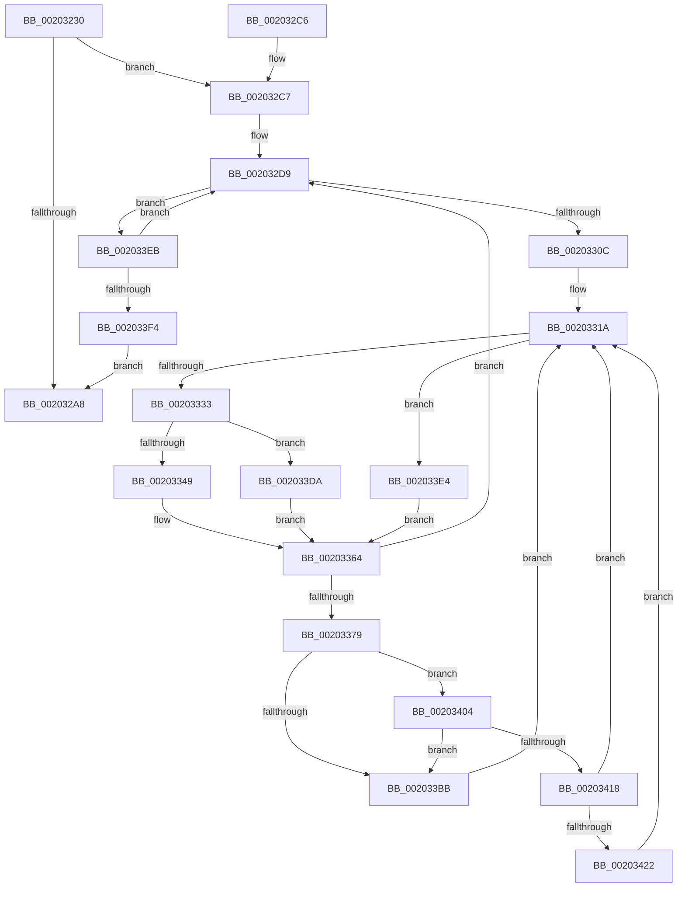

# SMKM_STORE&lt;SM_TRAITS&gt;::SmStReadThread

- RVA: `0x00203230`–`0x0020343B` (길이 `523` bytes)
- VA: `0x0000000140203230`
- 실행 섹션: `.text`
- PDB 이름 있음: `예`; PDB Function 태그: `아니요`
- unwind 정보 RVA: `0x0005CA18`
- 디코드: `136`개 명령, `523/523` bytes 표시
- 미해석 바이트: `0` (있으면 어셈블리에 `.byte`로 보존)

> 이 문서는 커널 이미지의 기계어와 PDB 기호를 분석해 생성했습니다. 4번과 5번은 함수 원형과 자료형을 바이너리 사용 방식에서 추정한 C 해석이며 원본 소스 복구 결과는 아닙니다.

## 1. Dependencies

- 직접 호출 지점: **14**; 고유 호출 대상: **13**
- 직접 호출자로 확인된 함수: **0**
- RIP 상대 이미지 참조: **0**

### Outgoing calls
- `0x00203275` → [KeSetActualBasePriorityThread](../3C/KeSetActualBasePriorityThread_function_003C4370.md) (function, `0x003C4370`)
- `0x0020327D` → [ST_STORE<SM_TRAITS>::StAcquireReadContext](../3A/ST_STORE_SM_TRAITS_StAcquireReadContext_function_003AA980.md) (function, `0x003AA980`)
- `0x0020329E` → [KeSetEvent](../33/KeSetEvent_function_0033F310.md) (function, `0x0033F310`)
- `0x002032FF` → [KeWaitForMultipleObjects](KeWaitForMultipleObjects_function_0020D110.md) (function, `0x0020D110`)
- `0x00203311` → [KeResetEvent](../24/KeResetEvent_function_00248350.md) (function, `0x00248350`)
- `0x0020331E` → [KeAcquireSpinLockRaiseToDpc](KeAcquireSpinLockRaiseToDpc_function_00208470.md) (function, `0x00208470`)
- `0x0020336B` → [KeReleaseSpinLock](../39/KeReleaseSpinLock_function_00392BA0.md) (function, `0x00392BA0`)
- `0x0020338E` → [SmFpAllocate](../31/SmFpAllocate_function_00317D10.md) (function, `0x00317D10`)
- `0x0020339F` → [SMKM_STORE<SM_TRAITS>::SmStDirectReadIssue](SMKM_STORE_SM_TRAITS_SmStDirectReadIssue_function_00203444.md) (function, `0x00203444`)
- `0x002033AD` → [SMKM_STORE<SM_TRAITS>::SmStDirectReadComplete](SMKM_STORE_SM_TRAITS_SmStDirectReadComplete_function_00204968.md) (function, `0x00204968`)
- `0x002033D0` → [SmAcquireReleaseCharges](../28/SmAcquireReleaseCharges_function_00285C40.md) (function, `0x00285C40`)
- `0x002033FA` → [ST_STORE<SM_TRAITS>::StReleaseReadContext](../3A/ST_STORE_SM_TRAITS_StReleaseReadContext_function_003ABF84.md) (function, `0x003ABF84`)
- `0x0020340F` → [SmpFpReleaseResource](../4F/SmpFpReleaseResource_function_004FAC90.md) (function, `0x004FAC90`)
- `0x00203431` → [KeSetEvent](../33/KeSetEvent_function_0033F310.md) (function, `0x0033F310`)

### Direct callers
- 이 함수 시작 RVA로 연결되는 직접 call은 확인되지 않았습니다. 간접 호출은 완전히 역산할 수 없습니다.

### Static image references
- 디코드된 RIP-relative 메모리 참조가 없습니다.

## 2. Other-region calls and transfers

- 다른 실행 섹션으로 향하는 call: **0**
- 별도 외부 분기/꼬리 이동을 확인하지 못했습니다.

## 3. Assembly (complete function range)

```asm
00203230  48 89 5C 24 08                  mov qword ptr [rsp + 8], rbx
00203235  48 89 6C 24 10                  mov qword ptr [rsp + 0x10], rbp
0020323A  48 89 74 24 18                  mov qword ptr [rsp + 0x18], rsi
0020323F  57                              push rdi
00203240  41 54                           push r12
00203242  41 55                           push r13
00203244  41 56                           push r14
00203246  41 57                           push r15
00203248  48 83 EC 50                     sub rsp, 0x50
0020324C  4C 8B 31                        mov r14, qword ptr [rcx]
0020324F  48 8B D9                        mov rbx, rcx
00203252  65 48 8B 0C 25 88 01 00 00      mov rcx, qword ptr gs:[0x188]
0020325B  BA 0C 00 00 00                  mov edx, 0xc
00203260  49 8B BE 90 1D 00 00            mov rdi, qword ptr [r14 + 0x1d90]
00203267  49 8D AE 98 1C 00 00            lea rbp, [r14 + 0x1c98]
0020326E  48 81 C7 B8 0B 00 00            add rdi, 0xbb8
00203275  E8 F6 10 1C 00                  call 0x1403c4370
0020327A  49 8B CE                        mov rcx, r14
0020327D  E8 FE 76 1A 00                  call 0x1403aa980
00203282  4C 8B F8                        mov r15, rax
00203285  48 F7 D8                        neg rax
00203288  1B C9                           sbb ecx, ecx
0020328A  45 33 C0                        xor r8d, r8d
0020328D  F7 D1                           not ecx
0020328F  33 D2                           xor edx, edx
00203291  81 E1 9A 00 00 C0               and ecx, 0xc000009a
00203297  89 4B 20                        mov dword ptr [rbx + 0x20], ecx
0020329A  48 8D 4B 08                     lea rcx, [rbx + 8]
0020329E  E8 6D C0 13 00                  call 0x14033f310
002032A3  4D 85 FF                        test r15, r15
002032A6  75 1F                           jne 0x1402032c7
002032A8  4C 8D 5C 24 50                  lea r11, [rsp + 0x50]
002032AD  49 8B 5B 30                     mov rbx, qword ptr [r11 + 0x30]
002032B1  49 8B 6B 38                     mov rbp, qword ptr [r11 + 0x38]
002032B5  49 8B 73 40                     mov rsi, qword ptr [r11 + 0x40]
002032B9  49 8B E3                        mov rsp, r11
002032BC  41 5F                           pop r15
002032BE  41 5E                           pop r14
002032C0  41 5D                           pop r13
002032C2  41 5C                           pop r12
002032C4  5F                              pop rdi
002032C5  C3                              ret
002032C6  CC                              int3
002032C7  48 8D 45 20                     lea rax, [rbp + 0x20]
002032CB  48 89 44 24 40                  mov qword ptr [rsp + 0x40], rax
002032D0  48 8D 45 08                     lea rax, [rbp + 8]
002032D4  48 89 44 24 48                  mov qword ptr [rsp + 0x48], rax
002032D9  48 83 64 24 38 00               and qword ptr [rsp + 0x38], 0
002032DF  48 8D 54 24 40                  lea rdx, [rsp + 0x40]
002032E4  48 83 64 24 30 00               and qword ptr [rsp + 0x30], 0
002032EA  45 33 C9                        xor r9d, r9d
002032ED  C6 44 24 28 00                  mov byte ptr [rsp + 0x28], 0
002032F2  C6 44 24 20 00                  mov byte ptr [rsp + 0x20], 0
002032F7  45 8D 41 01                     lea r8d, [r9 + 1]
002032FB  41 8D 49 02                     lea ecx, [r9 + 2]
002032FF  E8 0C 9E 00 00                  call 0x14020d110
00203304  85 C0                           test eax, eax
00203306  0F 85 DF 00 00 00               jne 0x1402033eb
0020330C  48 8B 4C 24 40                  mov rcx, qword ptr [rsp + 0x40]
00203311  E8 3A 50 04 00                  call 0x140248350
00203316  48 8D 5D 38                     lea rbx, [rbp + 0x38]
0020331A  48 8D 4D 48                     lea rcx, [rbp + 0x48]
0020331E  E8 4D 51 00 00                  call 0x140208470
00203323  48 8B 53 08                     mov rdx, qword ptr [rbx + 8]
00203327  44 8A C0                        mov r8b, al
0020332A  48 3B D3                        cmp rdx, rbx
0020332D  0F 84 B1 00 00 00               je 0x1402033e4
00203333  48 8B 33                        mov rsi, qword ptr [rbx]
00203336  48 8B 06                        mov rax, qword ptr [rsi]
00203339  48 83 E0 F8                     and rax, 0xfffffffffffffff8
0020333D  48 89 03                        mov qword ptr [rbx], rax
00203340  48 3B F2                        cmp rsi, rdx
00203343  0F 84 91 00 00 00               je 0x1402033da
00203349  48 8B 0A                        mov rcx, qword ptr [rdx]
0020334C  48 8B C1                        mov rax, rcx
0020334F  83 E1 07                        and ecx, 7
00203352  48 C1 E8 03                     shr rax, 3
00203356  48 8D 04 C5 F8 FF FF FF         lea rax, [rax*8 - 8]
0020335E  48 0B C1                        or rax, rcx
00203361  48 89 02                        mov qword ptr [rdx], rax
00203364  41 8A D0                        mov dl, r8b
00203367  48 8D 4D 48                     lea rcx, [rbp + 0x48]
0020336B  E8 30 F8 18 00                  call 0x140392ba0
00203370  48 85 F6                        test rsi, rsi
00203373  0F 84 60 FF FF FF               je 0x1402032d9
00203379  45 33 C9                        xor r9d, r9d
0020337C  C7 44 24 20 01 00 00 00         mov dword ptr [rsp + 0x20], 1
00203384  4C 8B C5                        mov r8, rbp
00203387  48 8B CF                        mov rcx, rdi
0020338A  41 8D 51 03                     lea edx, [r9 + 3]
0020338E  E8 7D 49 11 00                  call 0x140317d10
00203393  4D 8B C7                        mov r8, r15
00203396  48 8B D6                        mov rdx, rsi
00203399  49 8B CE                        mov rcx, r14
0020339C  4C 8B E8                        mov r13, rax
0020339F  E8 A0 00 00 00                  call 0x140203444
002033A4  44 8B C0                        mov r8d, eax
002033A7  48 8B D6                        mov rdx, rsi
002033AA  49 8B CE                        mov rcx, r14
002033AD  E8 B6 15 00 00                  call 0x140204968
002033B2  48 8B 4F 70                     mov rcx, qword ptr [rdi + 0x70]
002033B6  48 3B CD                        cmp rcx, rbp
002033B9  74 49                           je 0x140203404
002033BB  0F B7 57 66                     movzx edx, word ptr [rdi + 0x66]
002033BF  41 B9 01 00 00 00               mov r9d, 1
002033C5  48 8B 4F 20                     mov rcx, qword ptr [rdi + 0x20]
002033C9  45 8B C1                        mov r8d, r9d
002033CC  48 C1 E2 0C                     shl rdx, 0xc
002033D0  E8 6B 28 08 00                  call 0x140285c40
002033D5  E9 40 FF FF FF                  jmp 0x14020331a
002033DA  48 83 23 00                     and qword ptr [rbx], 0
002033DE  48 89 5B 08                     mov qword ptr [rbx + 8], rbx
002033E2  EB 80                           jmp 0x140203364
002033E4  33 F6                           xor esi, esi
002033E6  E9 79 FF FF FF                  jmp 0x140203364
002033EB  83 F8 01                        cmp eax, 1
002033EE  0F 85 E5 FE FF FF               jne 0x1402032d9
002033F4  49 8B D7                        mov rdx, r15
002033F7  49 8B CE                        mov rcx, r14
002033FA  E8 85 8B 1A 00                  call 0x1403abf84
002033FF  E9 A4 FE FF FF                  jmp 0x1402032a8
00203404  4D 8B C5                        mov r8, r13
00203407  BA 03 00 00 00                  mov edx, 3
0020340C  48 8B CF                        mov rcx, rdi
0020340F  E8 7C 78 2F 00                  call 0x1404fac90
00203414  85 C0                           test eax, eax
00203416  74 A3                           je 0x1402033bb
00203418  80 7F 5E 00                     cmp byte ptr [rdi + 0x5e], 0
0020341C  0F 85 F8 FE FF FF               jne 0x14020331a
00203422  33 C0                           xor eax, eax
00203424  48 8D 4F 08                     lea rcx, [rdi + 8]
00203428  48 87 47 70                     xchg qword ptr [rdi + 0x70], rax
0020342C  45 33 C0                        xor r8d, r8d
0020342F  33 D2                           xor edx, edx
00203431  E8 DA BE 13 00                  call 0x14033f310
00203436  E9 DF FE FF FF                  jmp 0x14020331a
```

## 4. C-style interpretation (structured pseudocode)

```c
__int64 __fastcall SMKM_STORE_SM_TRAITS___SmStReadThread(__int64 a1, __int64 a2, int a3, int a4)
{
    __int64 result;
    __int64 v_rdi;
    __int64 v_rsi;
    __int64 v_rsp;
    unsigned __int64 v_stack_m10;
    unsigned __int64 v_stack_m18;
    unsigned __int64 v_stack_m20;
    unsigned __int64 v_stack_m28;
    unsigned __int8 v_stack_m30;
    unsigned __int64 v_stack_m8;
    unsigned __int64 v_stack_p10;
    unsigned __int64 v_stack_p18;
    unsigned __int64 v_stack_p8;

    v_stack_p8 = v_rbx;
    v_stack_p10 = v_rbp;
    v_stack_p18 = v_rsi;
    v_rsp = (v_rsp) - (80);
    v_rdi = (*(unsigned __int64 *)(*(unsigned __int64 *)(a1) + 7568)) + (0xBB8ULL);
    result = KeSetActualBasePriorityThread(*(unsigned __int64 *)(gs_base + (0 + 392)), 12, a3, a4);
    result = ST_STORE_SM_TRAITS___StAcquireReadContext(*(unsigned __int64 *)(a1), 12, a3, a4);
    result = -(result);
    a3 = 0;
    a1 = (unsigned int)(~(*(unsigned __int64 *)(a1)));
    a2 = 0;
    a1 = (unsigned int)((a1) & (0xC000009AULL));
    *(unsigned int *)(a1 + 32) = (unsigned int)(a1);
    result = KeSetEvent(a1 + 8, a2, a3, a4);
    if (result != 0) goto loc_002032C7;
loc_002032A8:
    return result;
loc_002032C7:
    v_stack_m10 = *(unsigned __int64 *)(v_stack_m28 + 56) + 32;
    v_stack_m8 = *(unsigned __int64 *)(v_stack_m28 + 56) + 8;
loc_002032D9:
    a4 = 0;
    v_stack_m28 = 0;
    v_stack_m30 = 0;
    result = KeWaitForMultipleObjects(a4 + 2, v_stack_m10, a4 + 1, a4);
    if ((unsigned int)(result) != 0) goto loc_002033EB;
    result = KeResetEvent(v_stack_m10, v_stack_m10, a4 + 1, a4);
loc_0020331A:
    result = KeAcquireSpinLockRaiseToDpc(*(unsigned __int64 *)(v_stack_m28 + 56) + 72, v_stack_m10, a4 + 1, a4);
    if ((*(unsigned __int64 *)(*(unsigned __int64 *)(v_stack_m28 + 56) + 56 + 8)) == (*(unsigned __int64 *)(v_stack_m28 + 56) + 56)) goto loc_002033E4;
    result = (*(unsigned __int64 *)(*(unsigned __int64 *)(*(unsigned __int64 *)(v_stack_m28 + 56) + 56))) & (-8);
    *(unsigned __int64 *)(*(unsigned __int64 *)(v_stack_m28 + 56) + 56) = result;
    if ((*(unsigned __int64 *)(*(unsigned __int64 *)(v_stack_m28 + 56) + 56)) == (*(unsigned __int64 *)(*(unsigned __int64 *)(v_stack_m28 + 56) + 56 + 8))) goto loc_002033DA;
    a1 = (unsigned int)((*(unsigned __int64 *)(*(unsigned __int64 *)(*(unsigned __int64 *)(v_stack_m28 + 56) + 56 + 8))) & (7));
    result = (*(unsigned __int64 *)(*(unsigned __int64 *)(*(unsigned __int64 *)(v_stack_m28 + 56) + 56 + 8))) >> (3);
    result = (result * 8 - 8) | (a1);
    *(unsigned __int64 *)(*(unsigned __int64 *)(*(unsigned __int64 *)(v_stack_m28 + 56) + 56 + 8)) = result;
loc_00203364:
    result = KeReleaseSpinLock(*(unsigned __int64 *)(v_stack_m28 + 56) + 72, (unsigned __int8)((unsigned __int8)(result)), (unsigned __int8)(result), a4);
    if (*(unsigned __int64 *)(*(unsigned __int64 *)(v_stack_m28 + 56) + 56) == 0) goto loc_002032D9;
    a4 = 0;
    v_stack_m30 = 1;
    result = SmFpAllocate(v_rdi, a4 + 3, *(unsigned __int64 *)(v_stack_m28 + 56), a4);
    result = SMKM_STORE_SM_TRAITS___SmStDirectReadIssue(*(unsigned __int64 *)(a1), *(unsigned __int64 *)(*(unsigned __int64 *)(v_stack_m28 + 56) + 56), result, a4);
    result = SMKM_STORE_SM_TRAITS___SmStDirectReadComplete(*(unsigned __int64 *)(a1), *(unsigned __int64 *)(*(unsigned __int64 *)(v_stack_m28 + 56) + 56), (unsigned int)((unsigned int)(result)), a4);
    if ((*(unsigned __int64 *)(v_rdi + 112)) == (*(unsigned __int64 *)(v_stack_m28 + 56))) goto loc_00203404;
loc_002033BB:
    a2 = (*(unsigned __int16 *)(v_rdi + 102)) << (12);
    result = SmAcquireReleaseCharges(*(unsigned __int64 *)(v_rdi + 32), a2, 1, 1);
    goto loc_0020331A;
loc_002033DA:
    *(unsigned __int64 *)(*(unsigned __int64 *)(v_stack_m28 + 56) + 56 + 8) = *(unsigned __int64 *)(v_stack_m28 + 56) + 56;
    goto loc_00203364;
loc_002033E4:
    v_rsi = 0;
    goto loc_00203364;
loc_002033EB:
    if (((unsigned int)(result)) != 1) goto loc_002032D9;
    result = ST_STORE_SM_TRAITS___StReleaseReadContext(*(unsigned __int64 *)(a1), result, 1, 1);
    goto loc_002032A8;
loc_00203404:
    result = SmpFpReleaseResource(v_rdi, 3, result, 1);
    if ((unsigned int)(result) == 0) goto loc_002033BB;
    if ((*(unsigned __int8 *)(v_rdi + 94)) != 0) goto loc_0020331A;
    result = 0;
    a3 = 0;
    a2 = 0;
    result = KeSetEvent(v_rdi + 8, a2, a3, 1);
    goto loc_0020331A;
}
```

## 5. (Beta) C Style

```c
int64_t SMKM_STORE_SM_TRAITS___SmStReadThread(void *Arg1, int64_t Arg2, int32_t Arg3, int32_t Arg4)
{
    uint8_t *arg1 = (uint8_t *)Arg1;

    int64_t result;
    int64_t local_rdi;
    int64_t local_rsi;
    int64_t local_rsp;
    uint64_t v_stack_m10;
    uint64_t v_stack_m18;
    uint64_t v_stack_m20;
    uint64_t v_stack_m28;
    uint8_t v_stack_m30;
    uint64_t v_stack_m8;
    uint64_t v_stack_p10;
    uint64_t v_stack_p18;
    uint64_t v_stack_p8;

    v_stack_p8 = local_rbx;
    v_stack_p10 = local_rbp;
    v_stack_p18 = local_rsi;
    local_rsp = (local_rsp) - (80);
    local_rdi = (*(uint64_t *)(*(uint64_t *)(arg1) + 0x1D90)) + (0xBB8ULL);
    result = KeSetActualBasePriorityThread(*(uint64_t *)(gs_base + (0 + 0x188)), 12, Arg3, Arg4);
    result = ST_STORE_SM_TRAITS___StAcquireReadContext(*(uint64_t *)(arg1), 12, Arg3, Arg4);
    result = -(result);
    Arg3 = 0;
    Arg1 = (uint32_t)(~(*(uint64_t *)(arg1)));
    Arg2 = 0;
    Arg1 = (uint32_t)((Arg1) & (0xC000009AULL));
    *(uint32_t *)(arg1 + 0x20) = (uint32_t)(Arg1);
    result = KeSetEvent(Arg1 + 8, Arg2, Arg3, Arg4);
    if (result != 0) goto loc_002032C7;
loc_002032A8:
    return result;
loc_002032C7:
    v_stack_m10 = *(uint64_t *)(v_stack_m28 + 0x38) + 32;
    v_stack_m8 = *(uint64_t *)(v_stack_m28 + 0x38) + 8;
loc_002032D9:
    Arg4 = 0;
    v_stack_m28 = 0;
    v_stack_m30 = 0;
    result = KeWaitForMultipleObjects(Arg4 + 2, v_stack_m10, Arg4 + 1, Arg4);
    if ((uint32_t)(result) != 0) goto loc_002033EB;
    result = KeResetEvent(v_stack_m10, v_stack_m10, Arg4 + 1, Arg4);
loc_0020331A:
    result = KeAcquireSpinLockRaiseToDpc(*(uint64_t *)(v_stack_m28 + 0x38) + 72, v_stack_m10, Arg4 + 1, Arg4);
    if ((*(uint64_t *)(*(uint64_t *)(v_stack_m28 + 0x38) + 0x38 + 0x8)) == (*(uint64_t *)(v_stack_m28 + 0x38) + 56)) goto loc_002033E4;
    result = (*(uint64_t *)(*(uint64_t *)(*(uint64_t *)(v_stack_m28 + 0x38) + 0x38))) & (-8);
    *(uint64_t *)(*(uint64_t *)(v_stack_m28 + 0x38) + 0x38) = result;
    if ((*(uint64_t *)(*(uint64_t *)(v_stack_m28 + 0x38) + 0x38)) == (*(uint64_t *)(*(uint64_t *)(v_stack_m28 + 0x38) + 0x38 + 0x8))) goto loc_002033DA;
    Arg1 = (uint32_t)((*(uint64_t *)(*(uint64_t *)(*(uint64_t *)(v_stack_m28 + 0x38) + 0x38 + 0x8))) & (7));
    result = (*(uint64_t *)(*(uint64_t *)(*(uint64_t *)(v_stack_m28 + 0x38) + 0x38 + 0x8))) >> (3);
    result = (result * 8 - 8) | (Arg1);
    *(uint64_t *)(*(uint64_t *)(*(uint64_t *)(v_stack_m28 + 0x38) + 0x38 + 0x8)) = result;
loc_00203364:
    result = KeReleaseSpinLock(*(uint64_t *)(v_stack_m28 + 0x38) + 72, (uint8_t)((uint8_t)(result)), (uint8_t)(result), Arg4);
    if (*(uint64_t *)(*(uint64_t *)(v_stack_m28 + 0x38) + 0x38) == 0) goto loc_002032D9;
    Arg4 = 0;
    v_stack_m30 = 1;
    result = SmFpAllocate(local_rdi, Arg4 + 3, *(uint64_t *)(v_stack_m28 + 0x38), Arg4);
    result = SMKM_STORE_SM_TRAITS___SmStDirectReadIssue(*(uint64_t *)(arg1), *(uint64_t *)(*(uint64_t *)(v_stack_m28 + 0x38) + 0x38), result, Arg4);
    result = SMKM_STORE_SM_TRAITS___SmStDirectReadComplete(*(uint64_t *)(arg1), *(uint64_t *)(*(uint64_t *)(v_stack_m28 + 0x38) + 0x38), (uint32_t)((uint32_t)(result)), Arg4);
    if ((*(uint64_t *)(local_rdi + 0x70)) == (*(uint64_t *)(v_stack_m28 + 0x38))) goto loc_00203404;
loc_002033BB:
    Arg2 = (*(uint16_t *)(local_rdi + 0x66)) << (12);
    result = SmAcquireReleaseCharges(*(uint64_t *)(local_rdi + 0x20), Arg2, 1, 1);
    goto loc_0020331A;
loc_002033DA:
    *(uint64_t *)(*(uint64_t *)(v_stack_m28 + 0x38) + 0x38 + 0x8) = *(uint64_t *)(v_stack_m28 + 0x38) + 56;
    goto loc_00203364;
loc_002033E4:
    local_rsi = 0;
    goto loc_00203364;
loc_002033EB:
    if (((uint32_t)(result)) != 1) goto loc_002032D9;
    result = ST_STORE_SM_TRAITS___StReleaseReadContext(*(uint64_t *)(arg1), result, 1, 1);
    goto loc_002032A8;
loc_00203404:
    result = SmpFpReleaseResource(local_rdi, 3, result, 1);
    if ((uint32_t)(result) == 0) goto loc_002033BB;
    if ((*(uint8_t *)(local_rdi + 0x5E)) != 0) goto loc_0020331A;
    result = 0;
    Arg3 = 0;
    Arg2 = 0;
    result = KeSetEvent(local_rdi + 8, Arg2, Arg3, 1);
    goto loc_0020331A;
}
```

### 관측된 메모리 오프셋

구조체 형식이 확인되지 않은 접근은 인자 기준의 오프셋으로만 기록했습니다.

| 기준 인자 | 오프셋 표현 | 폭 (bit) | 접근 |
|---|---:|---:|---|
| `Arg1` | `+ 0x0` | `64` | `R` |
| `Arg1` | `+ 0x8` | `64` | `R` |
| `Arg1` | `+ 0x20` | `32` | `W` |

## 6. Execution-region graph

[열기: 2D/3D 그래프와 함수 탐색 컨트롤 패널](../../../control-panel.html?section=text&rva=0x00203230&view=graph)

- 2D 그래프는 위에서 아래로 흐르고, 3D 그래프는 빈 공간을 드래그해 회전합니다. Shift+드래그는 이동, 휠은 확대·축소, 함수 노드 선택은 대상 보고서 이동입니다.

### Static fallback


